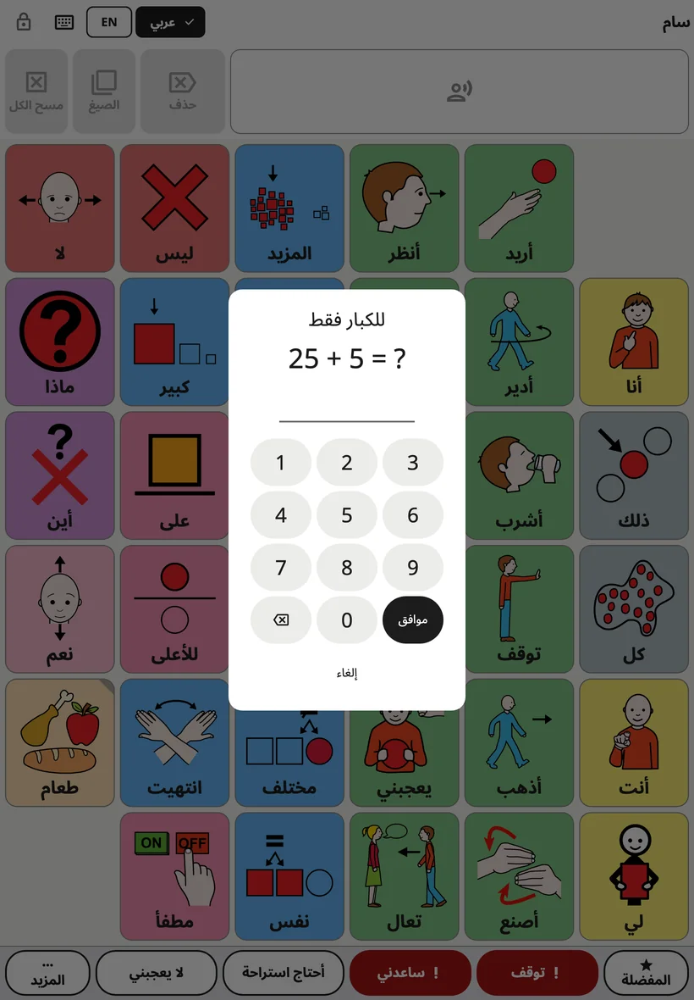
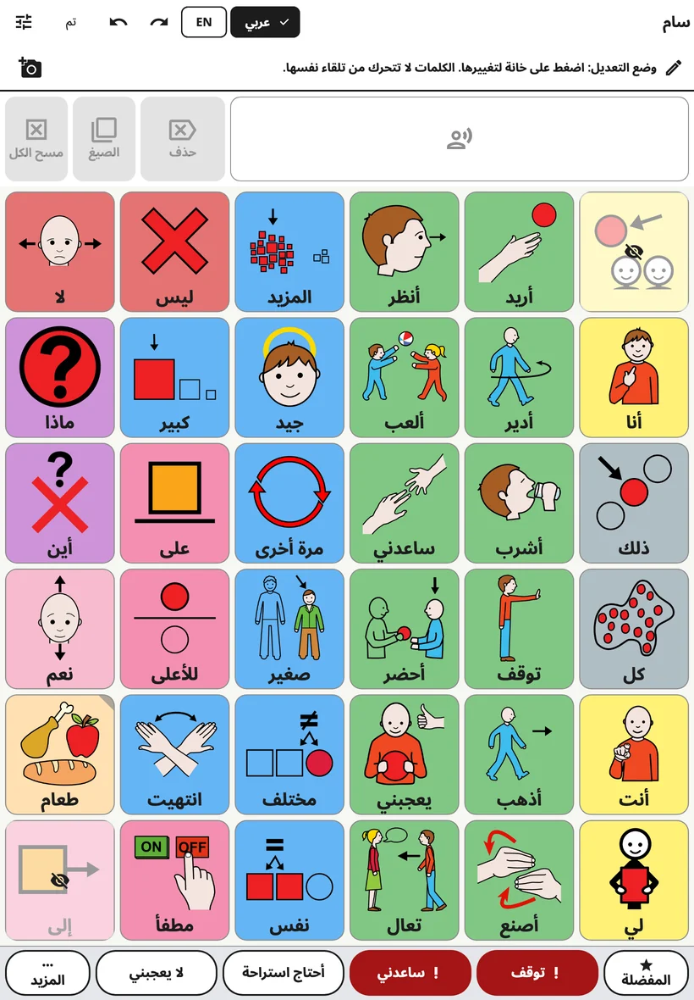
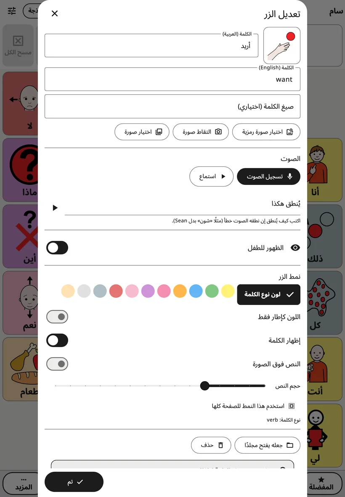
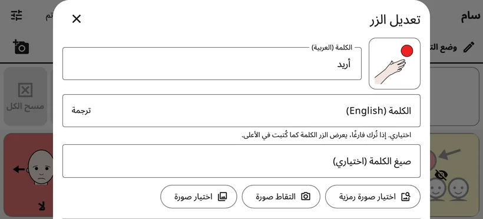
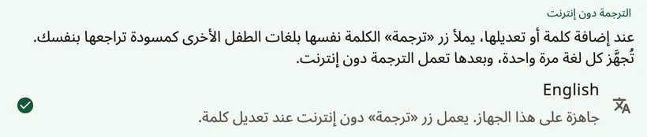

<!-- description: غيّر لوحة Amalino: افتح إعدادات الكبار، وعدّل كلمة الزر وصورته وصوته، وترجم، وأضف مجلدات، وانقل الأزرار، وتراجع عن التغييرات. -->
# تعديل الأزرار ونقلها

لكل أسرة كلماتها. ويمكنك أن تغيّر أي كلمة أو صورة أو صوت، وأن تضيف كلماتك ومجلداتك، وأن تنقل الأزرار التي أضفتها. ولا يستطيع الطفل أن يرى شيئًا من هذا أو يغيّره.

## فتح إعدادات الكبار

في أعلى اللوحة، **اضغط مطولًا على القفل 3 ثوانٍ**، ثم أجب عن عملية الجمع البسيطة (أو أدخل رقمك السري) بأزرار الأرقام التي تظهر. فتُفتح إعدادات الكبار. وهي تُقفل من تلقاء نفسها بعد 5 دقائق، أو فورًا حين تضغط **{app:lockNow}**.

يمكنك تغيير مدة الضغط والرقم السري والقفل التلقائي في **{app:lockAndKeep}**. راجع [الإعدادات](settings.md).

## تعديل اللوحة

اختر **{app:editBoard}**. يظهر في أعلى اللوحة سطر يقول: «{app:editingHint}»، ويصبح في الشريط العلوي الأزرار **{app:undo}** و**{app:redo}** و**{app:done}**.

- اضغط زرًا لتعديله.
- اضغط خانة فارغة واختر **{app:addWord}** أو **{app:addFolder}**.
- افتح المجلدات وعدّل أزرارها بالطريقة نفسها.
- اضغط **{app:done}** حين تنتهي.

تظهر الكلمات المخفية في أماكنها، مظللة بلون داكن وعليها عين مشطوبة، فترى اللوحة كلها دائمًا وأنت تعدّلها.

## محرّر الزر

- **الكلمة**: الكلمة المكتوبة على الزر، بلغة اللوحة الحالية.
- **لغات الطفل الأخرى**: تحت الكلمة، حقل لكل لغة أخرى من لغات الطفل، مثل **{app:wordLabel|language=الدنماركية}**. هذه الحقول اختيارية: والحقل الفارغ يعرض الكلمة كما كُتبت في الأعلى.
- **{app:translateWord}**: يظهر هذا الزر بجانب الحقل الفارغ حين يستطيع الجهاز ترجمة تلك اللغة دون إنترنت. فيملأ الكلمة مسودةً، وعليها ملاحظة «{app:translatedCheck}»، فراجعها قبل أن يستخدمها الطفل. وانظر «ترجمة الكلمات» أدناه.
- **{app:wordFormsManual}**: صيغ أخرى للكلمة، مفصولة بفواصل، مثل «فئران، فأر».
- **الصورة**: يبحث الزر **{app:chooseSymbol}** في الصور المضمّنة في التطبيق، أما الزر **{app:moreSymbolSets}** فيبحث على الإنترنت في مجموعات رموز مجانية غيرها، ولا تُرسَل إلا كلمات بحثك. أما **{app:takePhoto}** و**{app:choosePhoto}** فيستخدمان صورك أنت. والصور الفوتوغرافية أفضل للأشخاص والحيوانات الأليفة وأغراض الطفل نفسه.
- **{app:voice}**: يسجّل الزر **{app:recordVoice}** الكلمة بصوتك، ويشغّل الزر **{app:listen}** التسجيل، ويعيد الزر **{app:removeRecording}** صوت التطبيق.
- **{app:spokenAs}**: إن نطق الصوت كلمة خطأً، فاكتبها كما تُلفظ، مثلًا بالتشكيل: «عُمَر» بدلًا من «عمر».
- **{app:recInSentences}**: عادةً لا يُشغَّل تسجيلك إلا حين يضغط الطفل ذلك الزر وحده، أما داخل الجملة فينطق صوت التطبيق الكلمة. شغّل هذا الخيار للأصوات والأغاني والكلمات التي لا يحسن الصوت نطقها.
- **{app:visibility}**: إن كان مفعّلًا، يرى الطفل الكلمة ويستخدمها؛ وإن كان متوقفًا، يبدو مكانها للطفل فارغًا ولا يتحرك شيء. راجع [الكلمات والمجلدات](words-and-folders.md).
- **{app:buttonStyle}**: **{app:wordTypeColour}**، و**{app:borderOnly}**، و**{app:showLabel}**، و**{app:labelOnTop}**، و**{app:textSize}**. أما الخيار **{app:styleWholePage}** فيعمّم النمط على كل أزرار الصفحة.
- **{app:wordType}**: يحدد لون الزر (مثلًا الأفعال خضراء، وكلمات الوصف زرقاء).

لكلمة أو مجلد **جديد**، اضغط **{app:add}** في الأسفل لتضعه على اللوحة. ويبقى الزر **{app:add}** باهتًا إلى أن تكون للزر كلمة أو صورة. أما **✕** فيُلغي: لا يُضاف شيء، وتُحذف أي صورة أو تسجيل أنشأته له.

وحين تعدّل زرًا **موجودًا**، تُطبَّق تغييراتك فور إجرائها؛ اضغط **{app:done}** (أو **✕**) للإغلاق.

## ترجمة الكلمات

يعمل الزر **{app:translateWord}** على الجهاز، دون إنترنت، بعد إعداد اللغة. أعِدّ ذلك مرة واحدة لكل لغة: في إعدادات الكبار، افتح **{app:languages}** (ضمن **{app:sectionBoards}**)، ثم **{app:offlineTranslationHeader}**:

- **على Android**: اضغط اللغة ووافق على تنزيل نموذج الترجمة من Google، وحجمه نحو 30 ميغابايت لكل لغة. ولا تُرسَل أي كلمات من التطبيق.
- **على iPhone وiPad**: يلزم iOS 26 أو أحدث. وتأتي اللغات من Apple: افتح على الجهاز **الإعدادات ← التطبيقات ← الترجمة ← اللغات المنزّلة**، ونزّل اللغات، ثم عُد إلى Amalino.

تُظهر كل لغة هل هي جاهزة. وحيث لا يستطيع الجهاز ذلك، تظهر عبارة **{app:offlineTranslationUnsupported}**

## المجلدات

لإضافة مجلد، اضغط خانة فارغة في وضع التعديل واختر **{app:addFolder}**. تعرض شاشة **{app:pickFolderTitle}** مجلدات الطفل مع صورها، ومنها المجلدات الجاهزة (الطعام، والمشاعر، والأماكن…)، وفي أعلاها **{app:newFolder}**. اختر واحدًا، وتحقق من الاسم والصورة، ثم اضغط **{app:add}**.

وفي محرّر زر المجلد أيضًا:

- **{app:makeFolder}**: يحوّل زر الكلمة إلى زر مجلد. اختر مجلدًا، أو اضغط **{app:newFolder}**.
- **{app:changeFolder}**: يجعل زر المجلد يفتح مجلدًا آخر.
- **{app:openThisFolder}**: يغلق المحرّر ويفتح المجلد، لتعدّل ما بداخله.
- **{app:folderGoBack}**: إن كان مفعّلًا، يعود الطفل إلى حيث كان بعد أن يضغط كلمة في هذا المجلد، جاهزًا للكلمة التالية. أوقفه في المجلدات التي يختار فيها الطفل عدة كلمات متتالية. ويسري على المجلد أينما فُتح. ويبدأ مجلد **{app:favourites}** وهذا الخيار متوقف.

## نقل زر

تحتفظ الكلمات الأساسية على اللوحة الرئيسية بأماكنها، لتجدها يد الطفل دائمًا. أما الأزرار التي تفتح مجلدًا أو مشهدًا، فيمكن نقلها:

1. عدّل الزر واختر **{app:sceneMove}**
2. تعرض شاشة **{app:pickCellTitle}** اللوحة والخانات الفارغة مميَّزة. اضغط واحدة، ثم **{app:pickCellPutHere}**.
3. أو اضغط **{app:pickCellChooseAnother}** لتنقله إلى مجلد آخر، أو **{app:pickCellFavouritesInstead}**.

يحتفظ الزر بكلمته وصورته وصوته ونمطه. ولا يتحرك شيء آخر على أي من اللوحتين. وضغطة واحدة على **{app:undo}** تعيده إلى مكانه.

## حذف زر

عدّله واختر **{app:delete}**. وإن كان كلمة أساسية، يقترح Amalino **{app:hideInstead}**: فالإخفاء يحفظ مكانها لوقت لاحق، أما الحذف فيترك خانة فارغة. والإخفاء هو الخيار الأفضل في أغلب الأحيان.

## التراجع والسجل

- ينقلك الزران **{app:undo}** و**{app:redo}** في الشريط العلوي خطوة إلى الوراء أو إلى الأمام بين تغييراتك وأنت تعدّل.
- تعرض شاشة **{app:historyBackups}** في إعدادات الكبار كل تغيير. ويعيد الزر **{app:restoreHere}** اللوحات إلى ما كانت عليه في تلك اللحظة.

لا بأس بالأخطاء. فكل ما تغيّره يمكن التراجع عنه.

> **نصيحة:** حين تضيف كلمة، استخدمها أنت على الجهاز ثلاث مرات على الأقل في ذلك اليوم.

التالي: [الإعدادات شاشةً شاشة](settings.md).
