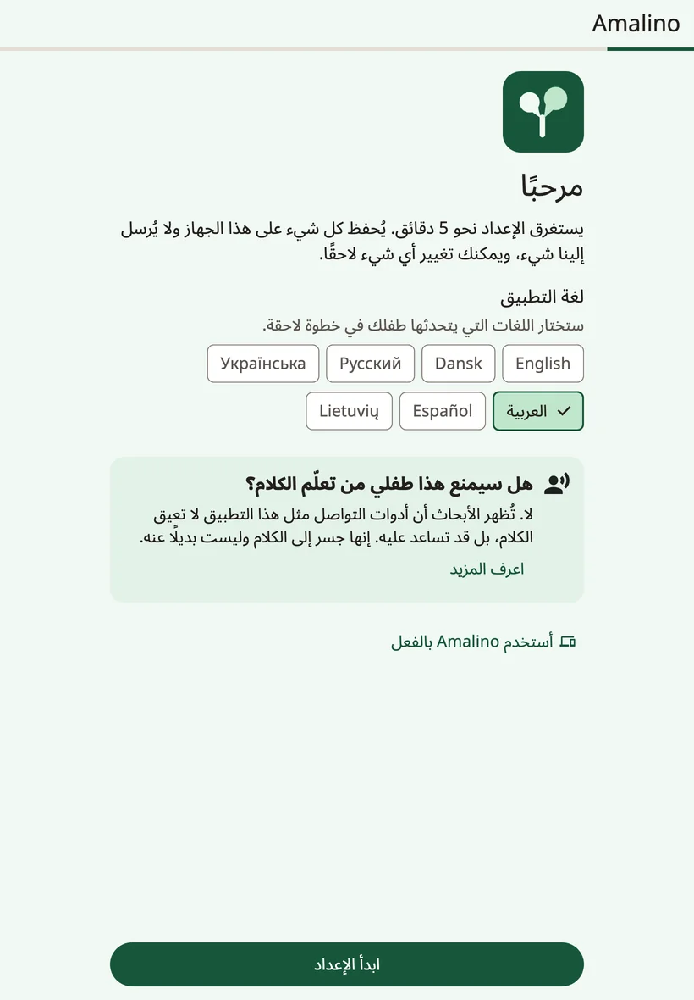
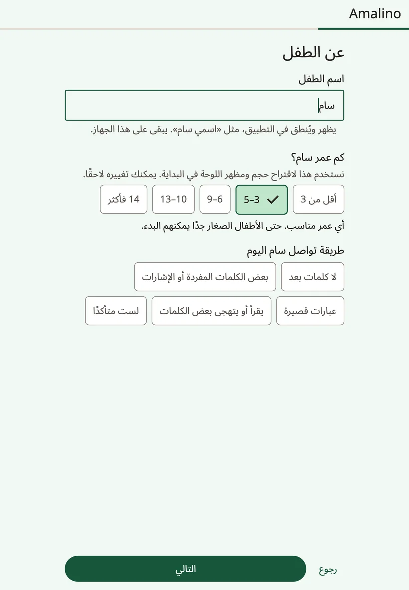
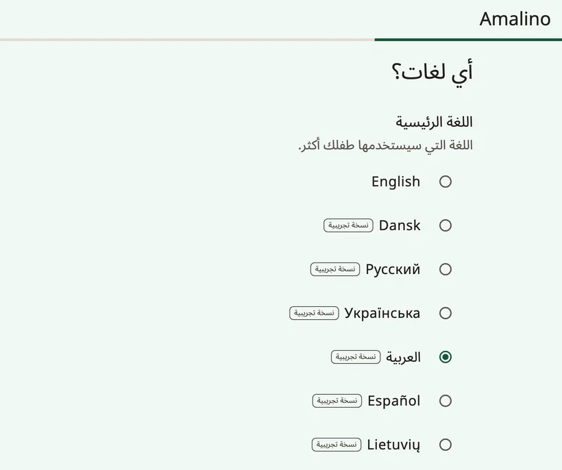
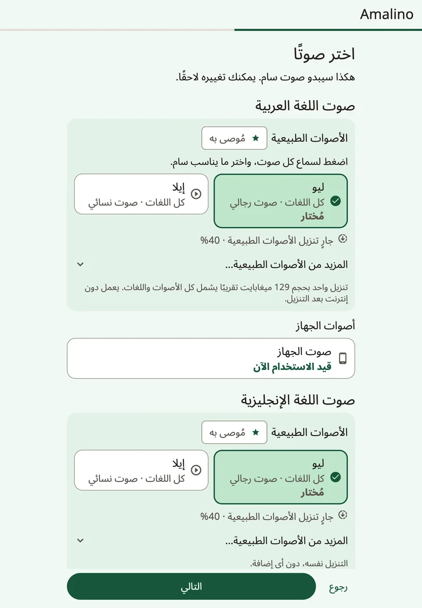
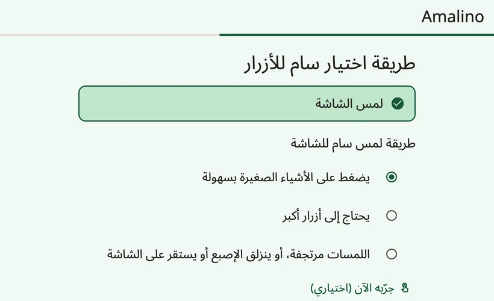
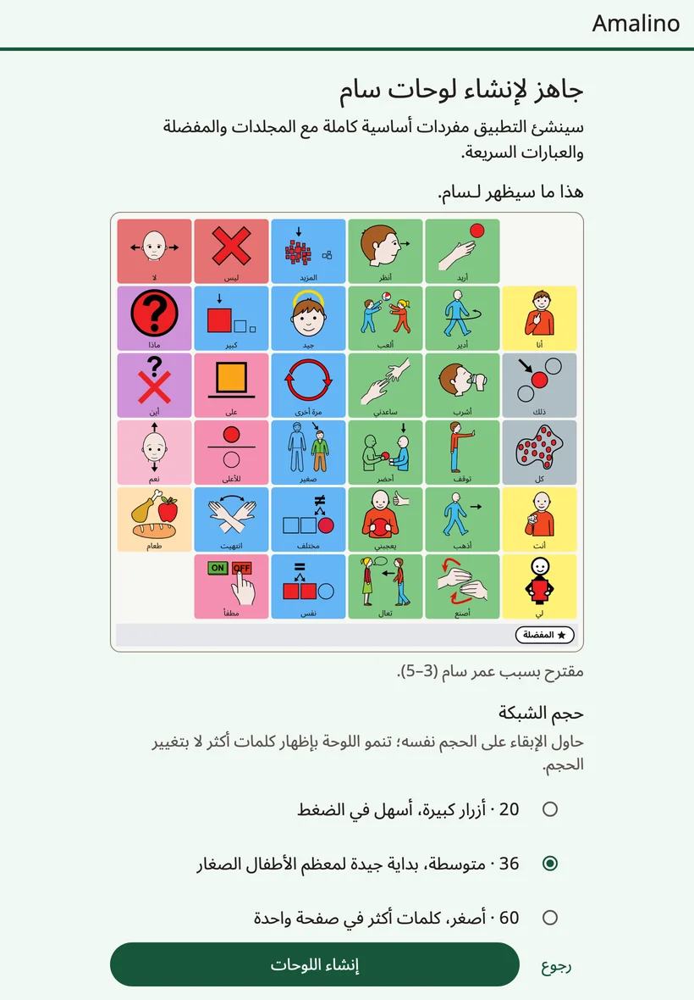

<!-- description: أعِدّ Amalino لأول مرة: معلومات الطفل، واللغات، والصوت، واللمس، والأشياء المفضلة، وقفل إعدادات الكبار. -->
# الخطوات الأولى

يعمل Amalino على iPhone وiPad، وعلى هواتف Android وأجهزته اللوحية. وهو مجاني، ويعمل دون إنترنت بعد إعداده.

يستغرق الإعداد نحو خمس دقائق. كل ما تُدخله يبقى على الجهاز، ويمكنك تغيير أي إجابة لاحقًا.

## قبل أن تبدأ

- اشحن الجهاز وارفع الصوت.
- إن أمكن، ليكن الطفل قريبًا منك في خطوة اللمس، فمن المفيد أن ترى كيف يضغط.
- استخدم Wi-Fi إن استطعت: فالأصوات الطبيعية تنزيل واحد بنحو 129 ميغابايت.

## خطوات الإعداد

### الترحيب

اختر **{app:appLanguage}**، أي لغة شاشات الكبار. أما لغات الطفل فتختارها في خطوة لاحقة.

إن كان الطفل يستخدم Amalino على جهاز آخر، فاضغط **{app:alreadyUse}**، ثم **{app:restoreBackup}**، لتنقل لوحاته من نسخة احتياطية صدّرتها بكلمة مرور. راجع [المشاركة والطباعة](sharing-and-printing.md).

### عن الطفل

- **{app:ageBandTitle.anon}** تقترح الفئة العمرية حجم اللوحة في البداية، ومستوى المفردات، والمظهر. كل الأعمار مناسبة، وحتى الأطفال الصغار جدًا يمكنهم البدء.
- **{app:commTitle.anon}** تساعد الإجابة على اختيار الكلمات الأولى.
- **{app:childName}** (اختياري). يظهر الاسم ويُنطق في التطبيق، مثل «اسمي…»، ويبقى على الجهاز.

### اللغات

اختر **{app:setPrimary}**، أي اللغة التي سيستخدمها الطفل أكثر من غيرها، وحدّد كل لغة أخرى يسمعها الطفل كل يوم. في Amalino سبع لغات: الإنجليزية والدنماركية والروسية والأوكرانية والعربية والإسبانية والليتوانية.

تضع كل اللغات الزر نفسه في المكان نفسه. فيستطيع الطفل أن يبدّل اللغة بلمسة واحدة، دون أن يتعلم اللوحة من جديد.

حاليًا، كل اللغات ما عدا الإنجليزية عليها علامة **{app:languagePreview}**: لم يراجع أحد من أهل اللغة كل كلماتها بعد. وتقول الملاحظة تحت القائمة: «{app:languagePreviewNote}»، ويمكنك أيضًا أن تصحح أي كلمة بنفسك.

في الروسية والأوكرانية والعربية والإسبانية والليتوانية، يسأل الإعداد أيضًا: **{app:wordFormsTitle.anon}** اختر **{app:forms.boy}** أو **{app:forms.girl}**، لتأتي الكلمات بالصيغة الصحيحة حين يتكلم الطفل عن نفسه (مثلًا «أنا متعب» أو «أنا متعبة»).

إن لم تكن لغتك في القائمة، فاضغط **{app:notListed}**. لا يزال بإمكانك إنشاء لوحات: سجّل كل كلمة بصوتك، وستشغّل اللوحة تسجيلاتك.

### الصوت

اختر الصوت الذي سيتكلم به الطفل في كل لغة. اضغط صوتًا لتسمعه.

- **{app:naturalVoicesHeading}** أقرب الأصوات إلى صوت الإنسان. عشرة أصوات تنطق اللغات السبع كلها، ويجمعها تنزيل واحد بنحو 129 ميغابايت، ثم تعمل دون إنترنت. والصوت المقترح مختار لك مسبقًا.
- **{app:systemVoice}** لا يحتاج إلى تنزيل، وهو جاهز فورًا. ويتكلم إلى أن يكتمل تنزيل الصوت الطبيعي.

على Wi-Fi يبدأ التنزيل من تلقاء نفسه. أما على بيانات الجوال، فيسألك Amalino أولًا، أو ينتظر حتى تتوفر شبكة Wi-Fi.

يمكنك تغيير الصوت في أي وقت. راجع [الأصوات](voices.md).

### كيف يختار الطفل

يستخدم الطفل Amalino حاليًا بلمس الشاشة. أما طرق الاختيار الأخرى فعليها عبارة «**{app:comingLater}**».

ثم أجب عن السؤال **{app:touchTitle.anon}**

- **{app:touch.easy}**
- **{app:touch.bigger}**
- **{app:touch.shaky}**

تضبط الإجابة إعدادات اللمس وحجم اللوحة. يتيح الزر **{app:tryItNow}** للطفل أن يضغط بضع مرات، ويعدّل الزر **{app:makeEasier}** الإعدادات إن أخطأت لمسات كثيرة هدفها. وتجد مزيدًا من إعدادات اللمس في **{app:sectionSettings}** ← **{app:touchAccess}**.

### 5 أشياء مفضلة

أضف حتى خمسة أشياء يحبها الطفل: الفقاعات، أو رسومًا متحركة، أو جدته. التقط صورة أو اختر واحدة، واكتب الاسم الذي يسمّيها به الطفل. توضع كلها في مجلد **{app:favourites}**، على بُعد لمسة واحدة من كل لوحة. والصور الفوتوغرافية أفضل للأشخاص ولألعاب الطفل نفسه.

### إعدادات الكبار

الإعدادات محمية، كي لا يغيّر الطفل اللوحة بالخطأ. لفتحها، **اضغط مطولًا على القفل أعلى اللوحة 3 ثوانٍ، ثم أجب عن عملية جمع بسيطة**. جرّب ذلك هنا مرة. وفي هذه الخطوة أيضًا خيار **{app:longerHold}**.

ويمكنك أن تختار الخيار **{app:lockPin}** بدلًا من عملية الجمع. فالأطفال الأكبر سنًا يستطيعون حلّها، والرقم السري أأمن معهم.

### الاسم في كل لغة

إن أضفت اسمًا، يمكنك أن تحدد كيف يُكتب في كل لغة، وأن تسمع كيف ينطقه الصوت. وإن بدا النطق خاطئًا، فاكتبه كما يُلفظ، مثلًا بالتشكيل: «عُمَر» بدلًا من «عمر».

### الملخص

تعرض الخطوة الأخيرة كل إجاباتك. اضغط **{app:change}** بجانب أي منها لتغييرها.

وهنا تختار أيضًا:

- **{app:gridSize}**: عدد الأزرار على اللوحة. ويعرض الزر **{app:moreSizes}** بقية الأحجام. حاول أن تبقى على حجم واحد: فاللوحة تكبر بإظهار مزيد من الكلمات، لا بتغيير حجمها.
- **{app:vocabLevel}**: نحو 400 أو 1300 أو 2500 كلمة. راجع [الكلمات والمجلدات](words-and-folders.md).

وللأطفال الأكبر سنًا، يمكنك تشغيل خيار **{app:teenPack}**: عبارات اجتماعية ونكات وكلمات عامية، ومظهر أنضج بلا رسوم كرتونية.

وللمبتدئين الصغار جدًا، قد يقترح الإعداد **{app:earlyOffer|label}**: أربع صور كبيرة تتكلم فورًا. وتبقى المفردات الكاملة تحتها، ويمكنك الانتقال إلى اللوحة الكاملة لاحقًا.

ثم اضغط **{app:createBoards}**.

## بعد الإعداد

تذكّرك صفحة **{app:allSet}** مرة أخرى بطريقة فتح إعدادات الكبار، وتقدّم لك نصيحة أولى تجربها اليوم. وفيها أيضًا قسم **{app:lockDeviceToApp}** (التعليمات نفسها الموجودة في **{app:guidedAccess}** ضمن إعدادات الكبار)، وخيار **{app:dailyTip}**.

اضغط **{app:startTalking}**، فتُفتح اللوحة جاهزة للطفل.

وهذه أمور يمكنك أن تفعلها لاحقًا، تحت **{app:finishSetup}** في إعدادات الكبار:

- اختيار العبارتين اللتين يحتاج إليهما الطفل أكثر من غيرهما،
- سماع كيف يُنطق اسم الطفل،
- تجربة إعدادات اللمس مع الطفل.

التالي: [لوحة الطفل](the-board.md).
