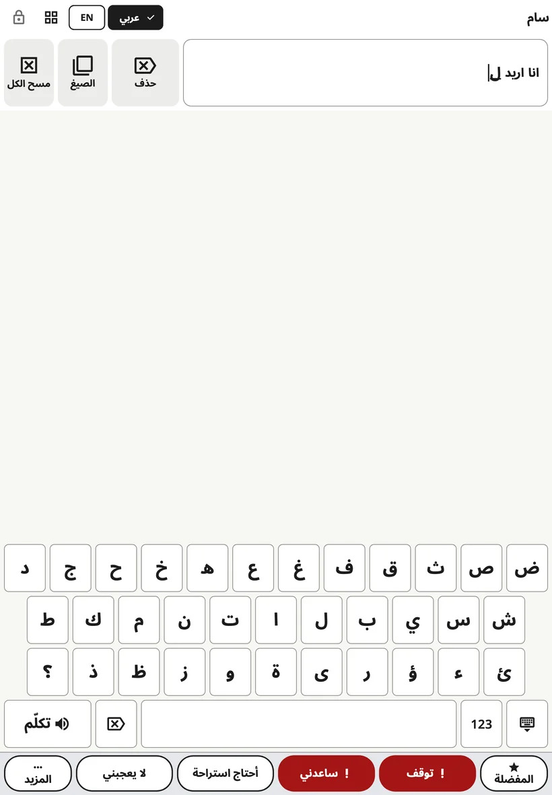

<!-- description: الكتابة في Amalino: فتح لوحة المفاتيح، واقتراحات الكلمات، وترتيب الحروف، والأرقام وعلامات الترقيم، وحجم المفاتيح على الهواتف. -->
# لوحة المفاتيح

يستطيع الأطفال الذين يعرفون بعض الحروف أن يكتبوا كلمات ليست على اللوحة. وتظهر لوحة المفاتيح في مكان اللوحة نفسه، فالتبديل بينهما لمسة واحدة.

## فتحها وإغلاقها

اضغط زر **لوحة المفاتيح** في الشريط العلوي. وللعودة إلى الصور، اضغط الزر نفسه مرة أخرى (وقد صار يعرض شبكة)، أو مفتاح **الإغلاق** في الزاوية السفلية من لوحة المفاتيح.

## الكتابة

- تظهر الكلمة التي تُكتب في **شريط الرسالة**، فيرى الطفل كيف تكبر.
- مفتاح **المسافة** يُنهي الكلمة.
- مفتاح **الحذف** يحذف حرفًا. اضغط عليه مطولًا ليستمر الحذف.
- مفتاح **{app:kbSpeak}** ينطق الرسالة كلها.
- مفتاح **123** يفتح الأرقام وعلامات الترقيم، ومنها العلامات الخاصة بكل لغة (¿ ¡ في الإسبانية، و» « في الدنماركية، و« » في الروسية والأوكرانية، و„ “ في الليتوانية، وعلامتا الاستفهام والفاصلة العربيتان ؟ ، في العربية). ومفتاح **ABC** يعيدك إلى الحروف.

ويعمل الزران **{app:barDelete}** و**{app:barClear}** بجانب شريط الرسالة كما يعملان على اللوحة.

وعلى الهاتف، حين يلمس الطفل حرفًا، يظهر الحرف مكبَّرًا فوق الإصبع، فيرى أي مفتاح يلمس قبل أن يرفع إصبعه. ولا يحدث هذا حين يكون الخياران **{app:activateOnRelease}** و**{app:holdTime}** مفعّلين، لأن المفتاح عندها يصبح داكنًا أثناء الضغط عليه.

## اقتراحات الكلمات

يقترح صف فوق المفاتيح كلمات أثناء كتابة الطفل. ولمسة على الكلمة تضيفها مع مسافة بعدها. وتأتي الاقتراحات من:

- الكلمات الموجودة على لوحات الطفل،
- ما كتبه الطفل من قبل، إن كان الخيار **{app:kbLearn.anon}** مفعّلًا،
- قائمة كلمات خاصة باللغة.

وتُنشأ الاقتراحات على الجهاز، ولا يُرسَل شيء إلى أي مكان.

بعض الأسر توقف الاقتراحات حين يتدرب الطفل على التهجئة: **{app:sectionSettings}** ← **{app:kbSettings}** ← **{app:kbSuggestions}**.

وإن كان الخيار **{app:aiPhrase}** مفعّلًا (في **{app:sectionSettings}** ← **{app:kbSettings}**)، فقد تؤدي كتابة الحروف الأولى من كلمات جملة مثل «أريد أن أذهب إلى الحديقة» إلى ظهور الجملة كاملة اقتراحًا إضافيًا. ويختارها الطفل أو يتجاهلها.

## ترتيب الحروف

**{app:sectionSettings}** ← **{app:kbSettings}** ← **{app:kbLayout}**:

- **{app:kbLayoutStandard}**: لوحة المفاتيح المعتادة للغة.
- **{app:kbLayoutAbc}**: الحروف بترتيبها الهجائي (أ ب ت…)، في الصفوف نفسها، فيبقى حجم لوحة المفاتيح كما هو.

## حجم المفاتيح على الهواتف

على الهاتف، اللغة التي فيها حروف كثيرة تعطي مفاتيح ضيقة. **{app:sectionSettings}** ← **{app:kbSettings}** ← **{app:kbKeySize}**:

- **{app:kbKeySizeAuto}** (الخيار الافتراضي) يتبع إعدادات اللمس: إن كان الطفل يحتاج إلى أزرار أكبر أو كانت لمساته مرتجفة، تنقسم صفوف الحروف الطويلة إلى صفين، مع الحفاظ على ترتيب الحروف، فيبلغ عرض كل مفتاح 40 نقطة على الأقل (نحو 6 ملم).
- **{app:kbKeySizeStandard}** يُبقي الصفوف المعتادة دائمًا.
- **{app:kbKeySizeLarger}** يقسم الصفوف الطويلة دائمًا.

وحين يُدار الهاتف أفقيًا، تكون المفاتيح عريضة أصلًا، فلا تنقسم الصفوف. أما الأجهزة اللوحية فتستخدم الصفوف المعتادة دائمًا.

## حين يُدار الهاتف أفقيًا

إن كانت اللوحة مضبوطة على الوضع الأفقي في الهاتف، تحتاج لوحة المفاتيح إلى الارتفاع كله. فينتقل «**توقف**» و«**ساعدني**» إلى آخر صف الاقتراحات، في المكان نفسه كل مرة. ويعود صف العبارات كاملًا حين تعود إلى اللوحة.

> **نصيحة:** اكتب أنت أيضًا أمام طفلك. اكتب كلمة ببطء وأنت تقولها، ثم اضغط **{app:kbSpeak}**.

التالي: [المشاهد](scenes.md).
