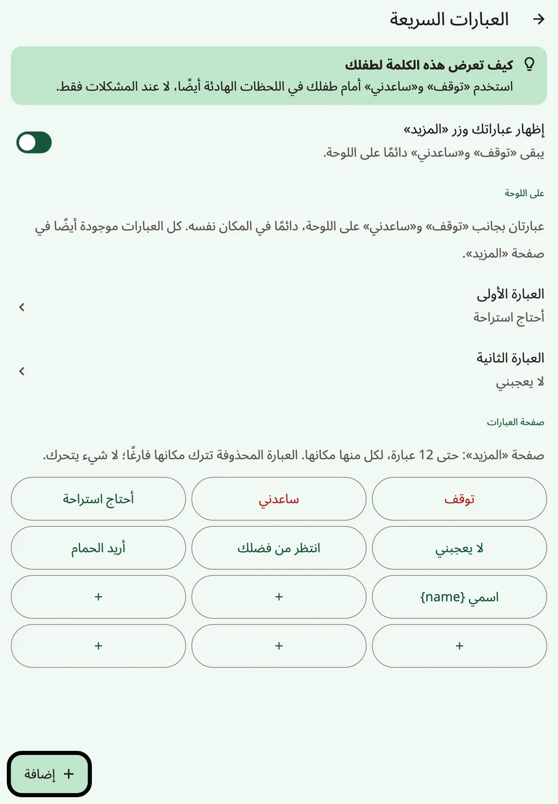
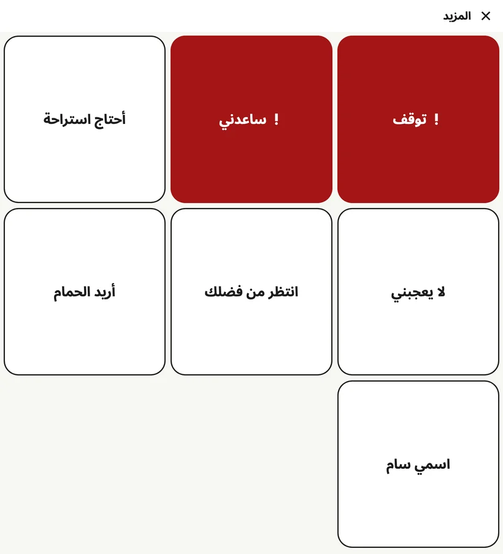

<!-- description: صف العبارات أسفل لوحة Amalino: «توقف» و«ساعدني»، وعبارتان للأسرة، ومجلد المفضلة، وصفحة «المزيد» التي تجمع العبارات. -->
# العبارات السريعة و«المزيد»

بعض الأشياء يجب أن تُقال بسرعة، دون بناء جملة. و**صف العبارات** أسفل اللوحة يُبقيها على بُعد لمسة واحدة، في كل صفحة.

## صف العبارات

بالترتيب، بدءًا من المفضلة:

1. **★ {app:favourites}**: يفتح مجلد المفضلة.
2. **! توقف**
3. **! ساعدني**
4. **عبارة الأسرة الأولى**
5. **عبارة الأسرة الثانية**
6. **{app:quickMore}**: يفتح الصفحة التي فيها كل العبارات.

يحتفظ كل زر بمكانه، في كل لغة وفي كل صفحة. والزران «**توقف**» و«**ساعدني**» موجودان دائمًا، ولونهما أحمر دائمًا: فهما العبارتان العاجلتان. وأزرار العبارات الأربعة كلها بالعرض نفسه، فلا تزيح العبارة الطويلة شيئًا من مكانه، بل تنتقل إلى سطر ثانٍ.

ولمسة على عبارة تنطقها فورًا، ولا تضيفها إلى شريط الرسالة.

## اختيار عبارتي الأسرة

افتح إعدادات الكبار واختر **{app:quickPhrases}**. وفي قسم **{app:qpOnBoard}**، اختر **{app:qpPick1}** و**{app:qpPick2}** للمكانين المجاورين لـ«توقف» و«ساعدني». واختر العبارتين اللتين يحتاج إليهما الطفل أكثر من غيرهما، مثل «أحتاج استراحة» و«لا يعجبني».

## صفحة «المزيد»

يفتح الزر **{app:quickMore}** صفحة فيها حتى 12 عبارة، لكل منها مكانها الثابت. ولمسة على عبارة تنطقها وتغلق الصفحة؛ أما الزر **{app:close}** فيعيدك دون أن ينطق شيئًا.

وفي شاشة **{app:quickPhrases}**، في قسم **{app:qpPage}**، يمكنك:

- أن تضيف عبارة بالزر **{app:add}** وتختار **{app:qpPlace}**،
- أن تعدّل عبارة بالزر **{app:edit}**، أو تشغّل لها خيار **{app:qpUrgent}** لتظهر باللون الأحمر،
- أن تحذف عبارة بالزر **{app:delete}**. فيبقى مكانها فارغًا، ولا تتحرك العبارات الأخرى.

وحين تمتلئ الصفحة، احذف عبارة، أو اضغط **{app:makePhraseBoard}** لتحويل العبارات إلى مجلد فيه متسع لعبارات أخرى.

أما العبارات التي فيها اسم الطفل، مثل «اسمي…»، فتظهر بعد أن تضيف الاسم.

## المفضلة

يضم مجلد **{app:favourites}** الأشياء التي يحبها الطفل أكثر من غيرها: الأشياء المفضلة الخمسة من الإعداد، وكل ما تضيفه لاحقًا. وهو على بُعد لمسة واحدة من كل صفحة، عبر الزر **★ {app:favourites}**.

وتحجز اللوحة الرئيسية أيضًا مكانًا فارغًا للمفضلة، تظهر عليه عبارة «{app:pickCellFavouritesNote}» حين تختار مكان زر جديد.

وعلى الهواتف الصغيرة، قد يظهر زر ★ بالنجمة وحدها دون الكلمة. ووظيفته هي نفسها.

## إخفاء عبارات الأسرة

إن كان الصف يشتّت انتباه الطفل، فأوقف الخيار **{app:showQuickPhrases}** في شاشة **{app:quickPhrases}**. فتختفي عبارتاك والزر **{app:quickMore}**، أما «**توقف**» و«**ساعدني**» فيبقيان دائمًا على اللوحة، في المكانين نفسيهما: فهما غالبًا أهم كلمات يملكها الطفل. ويبقى الزر **★ {app:favourites}** أيضًا.

> **نصيحة:** استخدم «توقف» و«ساعدني» أمام طفلك في اللحظات الهادئة أيضًا، لا عند المشكلات فقط.

التالي: [لوحة المفاتيح](keyboard.md).
