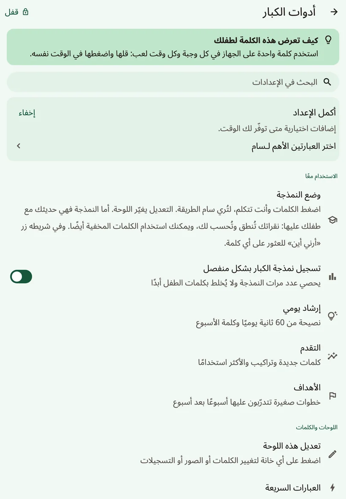
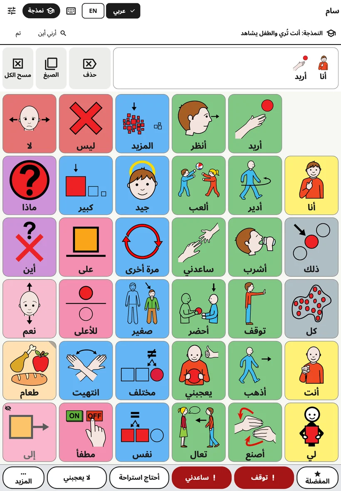
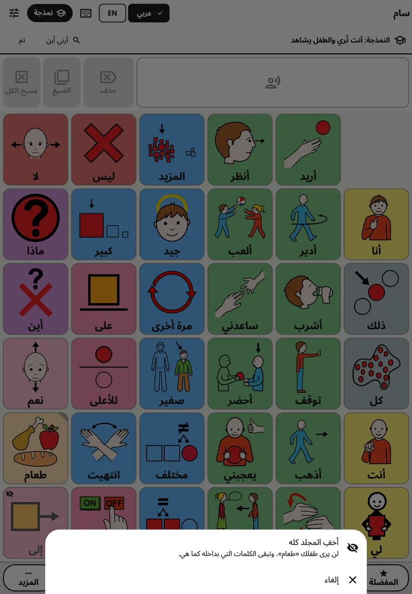
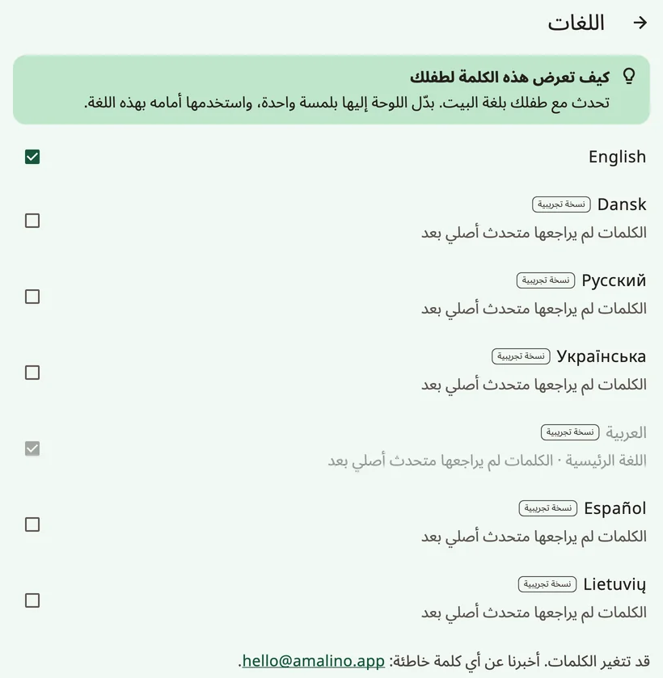
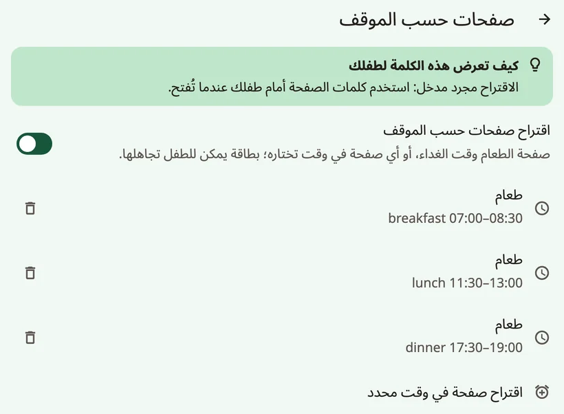

<!-- description: شرح كل شاشة في إعدادات الكبار في Amalino: النمذجة، والكلمات، والأصوات، واللمس، والعرض، وترتيب اللوحة، ولوحة المفاتيح، والاقتراحات، والقفل، والبيانات. -->
# الإعدادات شاشةً شاشة

لفتح إعدادات الكبار، اضغط مطولًا على القفل أعلى اللوحة 3 ثوانٍ، وأجب عن عملية الجمع بأزرار الأرقام. وهي موزعة على أربع مجموعات: **{app:sectionTogether}**، و**{app:sectionBoards}**، و**{app:sectionSettings}**، و**{app:sectionData}**. وتشرحها هذه الصفحة بالترتيب الذي تراها به. وحين يقول هذا الدليل «{app:sectionSettings} ← …»، فالمقصود مجموعة **{app:sectionSettings}** داخل إعدادات الكبار، لا تطبيق الإعدادات في جهازك.

في معظم الشاشات نصيحة قصيرة بعنوان **{app:tipTitle}**.

## البحث عن إعداد

لا تتذكر أين إعداد ما؟ اضغط **{app:searchSettings}** في الأعلى واكتب كلمة، مثل «صوت» أو «لون». وتُظهر كل نتيجة مكان الإعداد («{app:speechVoice} ← {app:speechRate}»). اضغطها، فيفتح Amalino تلك الشاشة ويميّز فيها الإعداد تمييزًا خفيفًا.

## {app:sectionTogether}

### {app:modellingMode}

الزر **{app:edit}** يغيّر اللوحة. أما الزر **{app:modelShort}** فهو للحديث مع طفلك باستخدام اللوحة: تضغط الكلمات وأنت تتكلم، لتُريه الطريقة. ولمساتك تُنطق وتُحسب لك، ولا تُحسب أبدًا من كلمات الطفل.

أسرع طريقة للدخول: وإعدادات الكبار مفتوحة، اضغط **{app:modelShort}** في الشريط العلوي للوحة (على الهاتف، أيقونة قبعة التخرج). ويؤدي البند **{app:modellingMode}** في القائمة الوظيفة نفسها. ويظهر في الأعلى سطر يقول «{app:modellingOn}». وفي ذلك السطر، يبحث الزر **{app:showMeWhere}** عن كلمة لك: اكتبها، فيُريك Amalino الطريق إليها، زرًا بعد زر.

- **الكلمات المخفية** تظهر باهتة، وعليها عين صغيرة مشطوبة، في الأماكن التي ستظهر فيها للطفل. اضغطها كأي كلمة، فيسمع طفلك هذه الكلمات ويراها قبل أن تظهر على لوحته بوقت طويل. أما الطفل فما زال يرى مكانًا فارغًا.
- **{app:showToChild}**: اضغط مطولًا على كلمة مخفية لحظة، واختر **{app:showToChild}** حين ترى أنه أصبح مستعدًا. ويعيدها **{app:undo}** كما كانت.
- **إخفاء كلمة أو مجلد كامل**: اضغط مطولًا على كلمة يراها طفلك واختر **{app:hideFromChild}**. واضغط مطولًا على زر مجلد لتُظهر المجلد كله أو تخفيه دفعة واحدة؛ أما اللمسة السريعة فما زالت تفتحه.

- **ينتهي من تلقاء نفسه** بعد دقيقتين من آخر لمسة، وكلما أُقفلت إعدادات الكبار، فلا يبقى طفلك أبدًا في وضع النمذجة. ولإنهائه بنفسك، اضغط **{app:done}** أو **{app:modelShort}** مرة أخرى.

راجع [نصائح للأسر](tips-for-families.md).

وبجانبه الخيار **{app:logModelTaps}**: يحسب عدد مرات النمذجة من الكبار، دون أن يخلطها أبدًا بكلمات الطفل.

### {app:coaching}

نصيحة واحدة في النمذجة كل يوم، تُقرأ في 60 ثانية، و**{app:wordOfWeek}**: حتى 3 كلمات يستخدمها الكبار أمام الطفل هذا الأسبوع، وتظهر مميَّزة في وضع النمذجة. ويرسل الخيار **{app:dailyReminder}** إشعارًا في الوقت الذي تختاره، ولا يطلب الإذن إلا حين تشغّله.

وهنا أيضًا **{app:mythBuster}**: أجوبة قصيرة عن مخاوف شائعة («{app:myth.speech.q}»)، ومعها الأبحاث.

### {app:progress} و{app:goals}

- **{app:progress}**: الكلمات الجديدة، وتراكيب الكلمات، والكلمات الأكثر استخدامًا. ويلخّص **{app:thisWeek}** الأسبوع في نص قصير تشاركه مع كل من يتحدث مع الطفل، ومعه كلمة واحدة لتستخدمها أمامه بعد ذلك.
- **{app:goals}**: خطوات صغيرة تعمل عليها أسبوعًا بعد أسبوع، مثل عدد أيام الاستخدام، أو الكلمات الجديدة، أو عدد الكلمات في الجملة.

استخدم الأرقام لتختار ما تعرضه على طفلك بعد ذلك، لا لتختبره.

## {app:sectionBoards}

- **{app:editBoard}**: راجع [تعديل الأزرار ونقلها](editing.md). وهناك أيضًا تُظهر الكلمات وتخفيها.
- **{app:quickPhrases}**: راجع [العبارات السريعة و«المزيد»](quick-phrases.md).
- **{app:languages}**: اللغة الرئيسية واللغات الأخرى. اللغات التي ما زالت كلماتها قيد المراجعة عليها علامة **{app:languagePreview}**، مع سطر يشرح كيف تُبلغ عن كلمة خاطئة. ويمكن ضبط **{app:englishSpelling}** (البريطانية أو الأمريكية) على كل جهاز على حدة. وتعرض شاشة **{app:translationReview}** الكلمات التي ما زالت تحتاج إلى مراجعة في كل لغة، لتتحقق منها أو تصححها. وفي قسم **{app:offlineTranslationHeader}** تُعِدّ الترجمة على الجهاز لكل لغة من لغات الطفل الأخرى؛ راجع [تعديل الأزرار ونقلها](editing.md).
- **{app:boardBuilder}**: اكتب موضوعًا، مثل «حفلة عيد ميلاد»، لتحصل على صفحة جاهزة له. وتعمل هذه الميزة على الجهاز، مع نحو 20 موضوعًا يوميًا (عيد الميلاد، والطبيب، والحديقة العامة، ووقت الاستحمام، ووقت النوم، وحديقة الحيوان، والشاطئ، وغيرها). وتراجع أنت الكلمات قبل الحفظ.
- **{app:symbolSets}**: صور ARASAAC المضمّنة، وصور Mulberry الأقدم التي ما زالت بعض اللوحات تستخدمها، وصورك أنت، وبحث اختياري في كل صور ARASAAC (نحو 13000 صورة) يُنزّل الصورة حين تختارها. ويضع الخيار «**{app:useNewPictures}**» الصور الأحدث مكان الصور الأصلية للكلمات المضمّنة التي ما زالت بصورتها الأصلية. أما صورك ورسومك الخاصة فتبقى كما هي. وصور ARASAAC مجانية للاستخدام غير التجاري.
- **{app:printBoards}**: راجع [المشاركة والطباعة](sharing-and-printing.md).

## {app:sectionSettings}

### اسم الطفل

الاسم، وكيف يُكتب في كل لغة. ويمكنك أيضًا أن تحدد كيف يُنطق. راجع [الأصوات](voices.md).

### {app:speechVoice}

الصوت لكل لغة، و**{app:useForAll|voice=…}**، و**{app:personalVoice}**، و**{app:speechRate}**، و**{app:voiceAge}**، و**{app:volume}**، و**{app:soundCheck}**. ولا يظهر خيار **{app:pitch}** إلا حين يتكلم أحد أصوات الجهاز. ويأتي **{app:savedSpeech}** في الآخر، تحت **{app:advanced}**. راجع [الأصوات](voices.md).

### {app:touchAccess}

كيف تستجيب اللوحة للّمس. غيّر شيئًا واحدًا في كل مرة، وراقب الطفل بضعة أيام.

يعرض قسم **{app:accessMethod}** خيار لمس الشاشة؛ أما طرق الاختيار الأخرى فمدرجة تحت عبارة **{app:comingLater}**. ويضع الخيار **{app:highlightSpeaking}** لونًا خفيفًا على الزر أثناء نطق كلمته.

وفي **{app:touchTuning}** بقية الإعدادات:

- **{app:holdTime}**: يجب أن يبقى الإصبع على الزر هذه المدة قبل أن ينطق. يفيد حين تلامس اليد الشاشة دون قصد، لكن اللمسة السريعة لن تعمل. ومع مدة الضغط، لا تُفتح صيغ الكلمات إلا من الزر **{app:barForms}**.
- **{app:repeatIgnore}**: تُتجاهل اللمسة الثانية على الزر نفسه إن جاءت بعد الأولى بقليل.
- **{app:activateOnRelease}**: يستطيع الطفل أن ينزلق بإصبعه إلى الزر الصحيح قبل أن تُحتسب اللمسة.
- **{app:targetEnlargement}**: يستجيب كل زر لمسافة قليلة خارج حدوده.
- **{app:tremorFilter}**: لليد المرتجفة، يكون الزر المحتسب **{app:tremor.firstLanding}** أو **{app:tremor.longestDwell}**.
- **{app:palmRejection}**: راحة اليد أو اليد المستريحة على الشاشة لا تضغط الأزرار.
- **{app:practice}**: لوحة تدريب تحسب اللمسات، واللمسات المتجاهَلة، واللمسات التي وقعت بين الأزرار.

### {app:displaySensory}

كيف تبدو اللوحة. وكل ما هنا آمن للتجربة: فلا شيء يتحرك من مكانه.

- **{app:theme}**: **{app:theme.standard}**، أو **{app:theme.calm}**، أو **{app:theme.dark}**، أو **{app:theme.highContrast}**، أو **{app:theme.teen}**.
- **{app:colourCoding}**: **{app:palette.fitzgerald}**، أو **{app:palette.calm}**، أو **{app:palette.colorBlindSafe}**، أو **{app:palette.none}**. ويمنح الخيار **{app:borderOnly}** مظهرًا أهدأ.
- **{app:showLabels}**، و**{app:labelOnTop}**، و**{app:textSize}**.
- **{app:reduceMotion}**: يتبع إعداد الجهاز، أو يكون مفعّلًا أو متوقفًا دائمًا.

### {app:boardLayout}

«{app:boardLayoutNote}»

- **{app:gridSize}**: راجع [الكلمات والمجلدات](words-and-folders.md). وعلى الجهاز اللوحي، تنبّهك ملاحظة حين لا تتسع بعض الكلمات الطويلة كاملة مع 84 زرًا في الوضع العمودي.
- **{app:boardOrientation}**: للهواتف فقط. تبقى اللوحة ولوحة المفاتيح والمشاهد عمودية (أو أفقية)، أما شاشات الكبار فتدور كالمعتاد. وإن كان الاتجاه الآخر يتسع لأزرار أقل، يستأذنك Amalino قبل التغيير.
- **{app:vocabLevel}**: راجع [الكلمات والمجلدات](words-and-folders.md).
- **{app:earlyMode}**: بسيط جدًا، أزرار كبيرة تتكلم فورًا، دون شريط رسالة. وتبقى المفردات الكاملة تحته.
- **{app:cellGap}**.

### {app:messageBar}

- **{app:showMessageBar}**.
- **{app:speakEachWord}** (مفعّل افتراضيًا). وحين يكون متوقفًا، يضيف ضغط الكلمة إياها إلى الرسالة فقط، ولا يُنطق شيء حتى يُضغط شريط الرسالة.
- **{app:clearAfterSpeak}**.
- **{app:grammarHelper}**: اضغط مطولًا على كلمة لتختار صيغة أخرى منها (كلاب، ذهبت، أكبر…). مفعّل في كل اللغات. راجع [لوحة الطفل](the-board.md).

### {app:kbSettings}

**{app:kbSuggestions}**، و**{app:kbLearn.anon}**، و**{app:aiPhrase}**، و**{app:kbLayout}**، و**{app:kbKeySize}**. راجع [لوحة المفاتيح](keyboard.md).

### {app:aiHelpers}

مساعدة تقترح الكلمات. لا تتكلم أبدًا نيابة عن طفلك، والطفل هو من يختار دائمًا. ولكل مساعد زر تشغيل خاص به، وكلها متوقفة إلى أن تشغّلها. وتعمل على الجهاز:

- **{app:aiNextWord}**: يضع إطارًا خفيفًا حول 2–3 أزرار. لا تتحرك الأزرار أبدًا، ويتعلّم على هذا الجهاز فقط.
- **{app:contextBoards}**: يقترح صفحة في وقت معيّن من اليوم، مثل صفحة الطعام وقت الغداء. ولا يعتمد إلا على وقت اليوم، ولا يستخدم موقعك ولا تقويمك أبدًا. وتعرض بطاقة على اللوحة الصفحة المقترحة؛ لمسة واحدة تفتحها، ويستطيع الطفل أن يتجاهلها. وفي شاشته، شغّل **{app:aiContext}**، ثم اضغط **{app:addMealRules}** أو **{app:addTimeRule}** لتختار صفحة ووقتًا.
- **{app:aiListen}**: حين تشغّل الميكروفون في الشريط العلوي، يستمع الجهاز إلى ما تقوله، ويميّز كلمات يمكن للطفل أن يجيب بها. ويجري التعرّف على الكلام على الجهاز؛ ولا يُحفظ الصوت ولا يُرسَل أبدًا. وتحتاج الميزة إلى تنزيل أداة التعرّف على الكلام مرة واحدة.

### {app:lockAndKeep}

- **{app:editLock}**: **{app:lockChallenge}** أو **{app:lockPin}** (من 4 إلى 8 أرقام)، وكلاهما يُكتب بأزرار أرقام على الشاشة. والرقم السري خاص بالجهاز: فالرقم نفسه يفتح إعدادات الكبار لكل طفل على هذا الجهاز. وإن لم يكن للجهاز قفل شاشة، يعرض Amalino أولًا **رمز استرداد** لتدوّنه وتحفظه بعيدًا عن الجهاز. وإن نسيت الرقم السري، فاضغط **{app:forgotPin}** واستخدم قفل الشاشة أو رمز الاسترداد لتعيين رقم جديد.
- **{app:holdSeconds}**: المدة التي يجب أن تضغط فيها على القفل.
- **{app:relockAfter}**: بعد كم من الوقت تُقفل إعدادات الكبار من تلقاء نفسها.
- **{app:guidedAccess}**: تعليمات خطوة بخطوة لميزة **الوصول الموجّه** على iPad وiPhone، ولميزة **تثبيت التطبيق** على Android (وعلى أجهزة سامسونج اللوحية أيضًا Samsung Kids). يستطيع الطفل أن يتكلم كالمعتاد، لكنه لا يستطيع مغادرة التطبيق.

## {app:sectionData}

- **{app:historyBackups}**: التراجع عن أي تغيير، وإنشاء نسخة احتياطية الآن، وتصدير نسخة احتياطية بكلمة مرور، أو استعادة نسخة. راجع [المشاركة والطباعة](sharing-and-printing.md).
- **{app:openBoardFormat}**: نقل اللوحات من تطبيقات التواصل المعزز والبديل الأخرى وإليها. راجع [المشاركة والطباعة](sharing-and-printing.md).
- **{app:profiles}**: لكل طفل لوحاته وكلماته. اضغط **{app:addChild}** لأخ أو أخت على الجهاز نفسه.
- **{app:about}**: الخصوصية، ورابط إلى **{app:privacyPolicy}**، وتراخيص الصور والأصوات، وسطر **{app:appVersion}**، و**{app:reportProblem}**: يفتح رسالة بريد إلكتروني إليّ فيها إصدار التطبيق وجهازك وبعض الإعدادات، دون أي شيء عن طفلك. وتقرأ كل ما فيها وتعدّله قبل أن ترسلها. ويعرض قسم **{app:diagnostics}**، في الآخر، تفاصيل تقنية، مثل سرعة تحوّل اللمسة إلى كلام. وقد أطلبها منك إن لم يعمل شيء كما ينبغي.

## ميزات قادمة

بعض الميزات تحتاج إلى خدمة على الإنترنت: **{app:syncTitle}** بين الأجهزة، و**{app:library}**، و**{app:lessonPages}**، و**{app:aiCloud}**. ولا توجد هذه الخدمة في هذا الإصدار من التطبيق، لذلك لا تظهر هذه الميزات في القائمة.

التالي: [الأصوات](voices.md).
