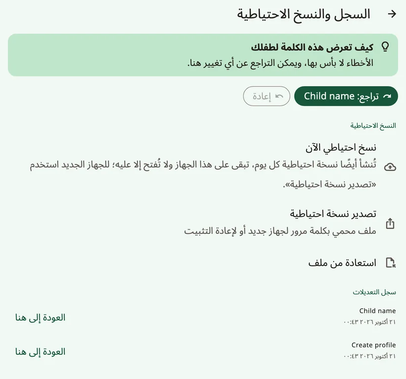
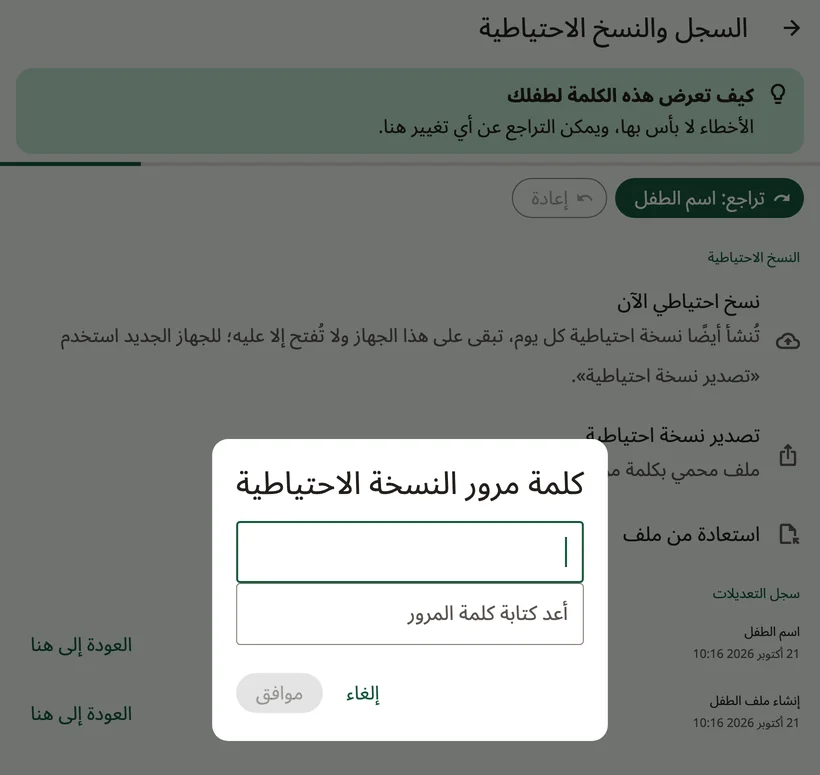
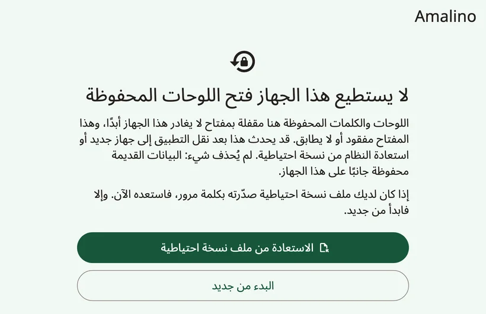
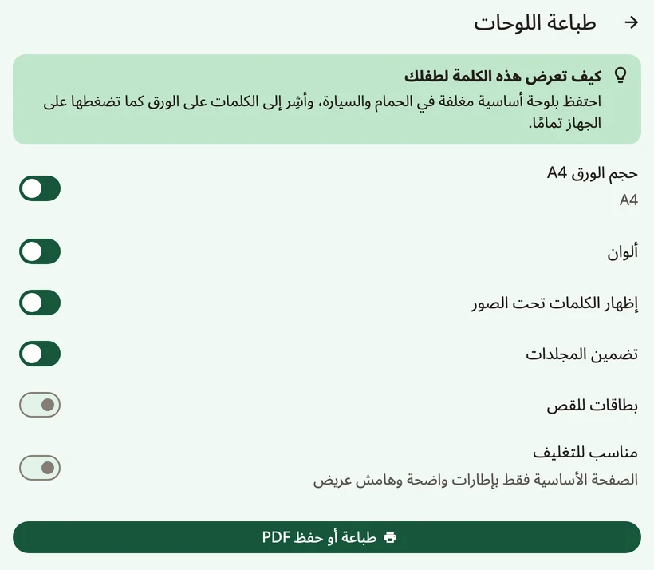

<!-- description: انسخ لوحات الطفل في Amalino احتياطيًا، وانقلها إلى جهاز جديد، وشاركها مع تطبيقات أخرى للتواصل المعزز والبديل، واطبع لوحات ورقية. -->
# المشاركة والطباعة

لوحات الطفل ثمينة: فيها شهور من الكلمات والصور والتسجيلات. وإليك كيف تحفظها، وتنقلها، وتطبعها على الورق.

## النسخ الاحتياطية

افتح إعدادات الكبار واختر **{app:historyBackups}**.

- تُنشأ نسخة احتياطية **تلقائيًا كل يوم**. وهي تبقى على الجهاز، ولا تُفتح إلا على الجهاز الذي أنشأها، فهي تحميك من الأخطاء، لا من ضياع الجهاز.
- الزر **{app:backupNow}** يُنشئ نسخة فورًا.
- الزر **{app:exportBackup}** يُنشئ ملفًا محميًا بكلمة مرور، لجهاز جديد أو لإعادة تثبيت التطبيق. اختر كلمة مرور ستتذكرها، واحفظ الملف في مكان غير الجهاز: حاسوب، أو تخزين سحابي، أو رسالة بريد ترسلها إلى نفسك.

إن لم تكن هناك نسخة خارج الجهاز، أو كانت آخر نسخة أقدم من شهر، تعرض إعدادات الكبار تذكيرًا لطيفًا فيه الزر **{app:backupReminderMake}** (ولا يظهر أبدًا في أول أسبوعين من ملف طفل جديد). والزر **{app:notNow}** يخفيه أسبوعين.

### النسخ الاحتياطي الخاص بالجهاز

- **على iPhone وiPad**: إذا كنت تنسخ الجهاز احتياطيًا إلى iCloud أو إلى حاسوب، فبيانات Amalino جزء من تلك النسخة.
- **على Android**: لا تُنسخ بيانات Amalino إلى نسختك الاحتياطية في Google، ولا إلى جهاز آخر. وللانتقال إلى جهاز جديد، استخدم **{app:exportBackup}**.

## الانتقال إلى جهاز جديد

1. على الجهاز القديم: افتح إعدادات الكبار، ثم **{app:historyBackups}** (ضمن **{app:sectionData}**) ← **{app:exportBackup}**، واختر كلمة مرور.
2. أرسل الملف إلى الجهاز الجديد عبر AirDrop أو Quick Share أو البريد الإلكتروني أو التخزين السحابي أو كابل USB.
3. على الجهاز الجديد، ثبّت Amalino. وفي أول شاشة من الإعداد، اضغط **{app:alreadyUse}**، ثم **{app:restoreBackup}**، ثم **{app:chooseFile}**.
4. اكتب كلمة المرور.

وللاستعادة على جهاز أُعدّ من قبل، استخدم **{app:importBackup}** في **{app:historyBackups}**. فتُستبدل كل اللوحات والتسجيلات والسجلات الموجودة على الجهاز، بعد أن يُنشئ Amalino أولًا نسخة احتياطية مما على الجهاز الآن.

ولا يمكن استعادة نسخة تلقائية من جهاز آخر، فهي لا تُفتح إلا على الجهاز الذي أنشأها. استخدم نسخة صدّرتها بكلمة مرور.

## إن لم يستطع Amalino فتح اللوحات المحفوظة

اللوحات مقفلة بمفتاح تشفير لا يغادر الجهاز أبدًا. فإن فُقد ذلك المفتاح أو لم يتطابق، مثلًا بعد نقل التطبيق إلى جهاز جديد أو استعادة نسخة احتياطية للنظام، يعرض Amalino عند تشغيله الشاشة **{app:dataRecoveryTitle}**. ولم يُحذف شيء: فالبيانات القديمة محفوظة جانبًا على الجهاز.

- **{app:dataRecoveryRestore}**: اختر نسخة احتياطية صدّرتها بكلمة مرور، واكتب كلمة المرور.
- **{app:dataRecoveryFresh}**: أعِد الإعداد من البداية.

وإن ظهرت لك يومًا رسالة **{app:startupFailedTitle}**، فأغلق التطبيق تمامًا ثم افتحه من جديد. وإن تكرر ذلك، فأعد تشغيل الجهاز. لوحاتك لم تُحذف.

## مشاركة اللوحات مع تطبيقات أخرى للتواصل المعزز والبديل

ميزة **{app:openBoardFormat}**، في مجموعة **{app:sectionData}** من إعدادات الكبار، تنقل اللوحات من تطبيقات التواصل المعزز والبديل الأخرى التي تستخدم صيغة Open Board Format وإليها:

- **{app:exportAllBoards}** أو **{app:exportThisBoard}**.
- **{app:importObz}**، مثلًا من Cboard. وتُضاف اللوحات المستوردة مجلداتٍ. ويخبرك Amalino بعدد الأزرار التي ربطها بكلمات يعرفها.

وحين تستورد لوحة، تأكد أن كلماتها في أماكن يعرفها الطفل من قبل.

## الطباعة

تُنشئ ميزة **{app:printBoards}** نسخة ورقية لوقت الاستحمام، أو المسبح، أو رحلة، أو حين يتعطل الجهاز.

- **{app:paperA4}**: الصفحات بحجم A4.
- **{app:colour}**: أوقف هذا الخيار للطباعة بالأبيض والأسود.
- **{app:showLabels}**: تُطبع الكلمة تحت كل صورة.
- **{app:includeFolders}**: تُطبع صفحات المجلدات أيضًا، لا اللوحة الرئيسية وحدها.
- **{app:cutOut}**: صور منفردة لقصّها.
- **{app:waterproof}**: الصفحة الأساسية وحدها، بحدود واضحة وهامش عريض.

اضغط **{app:printOrSave}** للطباعة، أو لحفظ ملف PDF وطباعته لاحقًا.

> **نصيحة:** احتفظ بلوحة أساسية مغلّفة في الحمام وفي السيارة، وأشِر إلى الكلمات على الورق كما تضغطها على الجهاز تمامًا.

التالي: [نصائح للأسر](tips-for-families.md).
