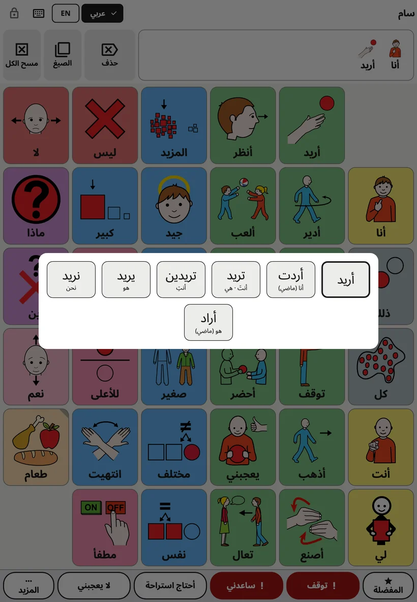
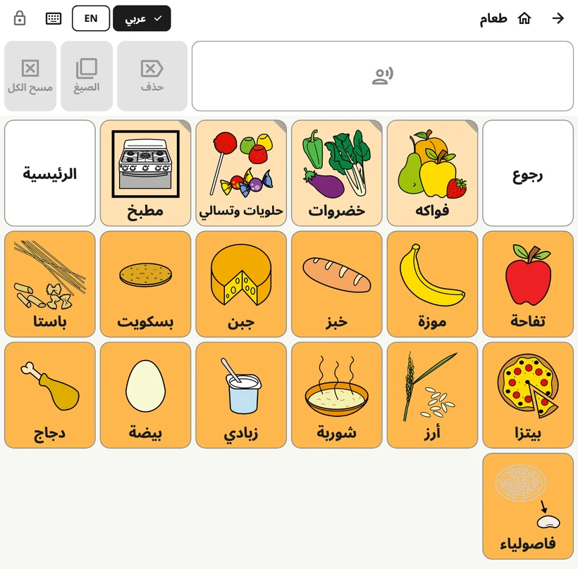

<!-- description: ما يراه الطفل في Amalino: اللوحة، والشريط العلوي، وشريط الرسالة، وصيغ الكلمات، ونطق الجملة، والتبديل بين اللغات. -->
# لوحة الطفل

اللوحة هي الشاشة التي يستخدمها الطفل طوال اليوم. أما إعدادات الكبار فمقفلة بعيدًا عنه، فيستطيع أن يستكشف اللوحة بحرية.

## أجزاء الشاشة

من الأعلى إلى الأسفل:

1. **الشريط العلوي**: اسم الطفل (أو اسم اللوحة داخل مجلد)، وأزرار اللغات، وزر لوحة المفاتيح، والقفل.
2. **شريط الرسالة**: الكلمات التي اختارها الطفل، وبجانبه الأزرار **{app:barDelete}** و**{app:barForms}** و**{app:barClear}**.
3. **اللوحة**: الأزرار التي عليها الصور والكلمات.
4. **صف العبارات**: المفضلة، و«توقف»، و«ساعدني»، وعبارتان للأسرة، و«{app:quickMore}». راجع [العبارات السريعة و«المزيد»](quick-phrases.md).

## نطق كلمة وجملة

حين يضغط الطفل زرًا، تُنطق كلمته وتُضاف إلى شريط الرسالة. وبضغط أزرار أخرى تُبنى جملة: «أنا»، «أريد»، «المزيد».

- **اضغط شريط الرسالة** لتُنطق الجملة كلها.
- يحذف الزر **{app:barDelete}** آخر كلمة.
- يُفرغ الزر **{app:barClear}** الرسالة.

يمكنك تغيير طريقة عمل ذلك في **{app:sectionSettings}** ← **{app:messageBar}**: مثلًا أن تُنطق الكلمات فقط عند ضغط الرسالة، أو أن تُمسح الرسالة بعد نطقها.

## صيغ الكلمات

الكلمات تتغير: «كلب» و«كلاب»، و«أذهب» و«ذهبت»، و«كبير» و«أكبر». تعرض قائمة صيغ الكلمات الصيغ الأخرى للكلمة أزرارًا كبيرة. وضغطة على إحدى الصيغ تضعها في الرسالة وتنطقها. والكلمة الأصلية تأتي أولًا دائمًا، فيستطيع الطفل أن يعود إليها في أي وقت.

هناك ثلاث طرق لفتح القائمة:

- **اضغط مطولًا على كلمة** في اللوحة لحظة.
- **اضغط مطولًا على شريط الرسالة** لتغيير آخر كلمة.
- اضغط الزر **{app:barForms}** بجانب شريط الرسالة. يغيّر هذا الزر آخر كلمة، ويظهر باهتًا حين لا تكون لتلك الكلمة صيغ أخرى.

إن كان الطفل يستخدم **{app:holdTime}** (في إعدادات الكبار ← **{app:sectionSettings}** ← **{app:touchAccess}**)، فالضغط المطوّل على الكلمة ينطقها فقط. ولفتح صيغ الكلمات، اضغط الزر **{app:barForms}** بدلًا من ذلك.

القائمة مفعّلة في كل اللغات. ولإيقافها، افتح **{app:sectionSettings}** ← **{app:messageBar}** ← **{app:grammarHelper}**.

## المجلدات

بعض الأزرار تفتح مجلدًا فيه كلمات مترابطة، مثل الطعام أو الأماكن أو المشاعر. ولزر المجلد زاوية مطوية.

داخل المجلد، يعرض الشريط العلوي سهم **الرجوع** وزر **الرئيسية**. وزر الرئيسية يعيدك دائمًا إلى اللوحة الرئيسية.

## التبديل بين اللغات

إن كان الطفل يستخدم أكثر من لغة، يعرض الشريط العلوي زرًا لكل لغة (EN، DA، ES، РУС، УКР، عربي، LT). ولمسة واحدة تبدّل اللوحة كلها. وتبقى كل كلمة في مكانها نفسه في كل اللغات.

وعلى الشاشات الأصغر يظهر زر لغة واحد بدلًا من ذلك، يفتح قائمة قصيرة.

## لماذا لا تتحرك الأزرار أبدًا

لكل كلمة مكانها على اللوحة، وتبقى فيه. فيتعلم الطفل أين الكلمات، كما تعرف أنت أين الحروف على لوحة المفاتيح، وسرعان ما يجدها دون أن يبحث عنها.

لهذا:

- تبقى اللوحة على ترتيبها نفسه حين يُدار الجهاز اللوحي؛
- وعلى الهاتف تبقى اللوحة عمودية افتراضيًا (يمكنك تغيير ذلك في **{app:sectionSettings}** ← **{app:boardLayout}** ← **{app:boardOrientation}**)؛
- وتظهر الكلمات الجديدة مع الوقت في أماكنها الخاصة، بدلًا من أن تزيح غيرها. راجع [الكلمات والمجلدات](words-and-folders.md).

## القفل

القفل في أعلى الشاشة يفتح إعدادات الكبار. اضغط عليه مطولًا 3 ثوانٍ، ثم أجب عن عملية جمع بسيطة بأزرار الأرقام (أو أدخل رقمك السري إن كنت قد عيّنته). والضغطة السريعة لا تفعل شيئًا، فلا يستطيع الطفل فتحه بالخطأ.

ولإبقاء الطفل داخل التطبيق، راجع **{app:lockAndKeep}** في [الإعدادات](settings.md).

## التنبيهات على اللوحة

إن كانت البطارية منخفضة جدًا، أو كان الصوت مكتومًا أو خافتًا، يظهر سطر قصير تحت الشريط العلوي يقول ذلك، مثل «{app:warn.muted}».

التالي: [الكلمات والمجلدات](words-and-folders.md).
