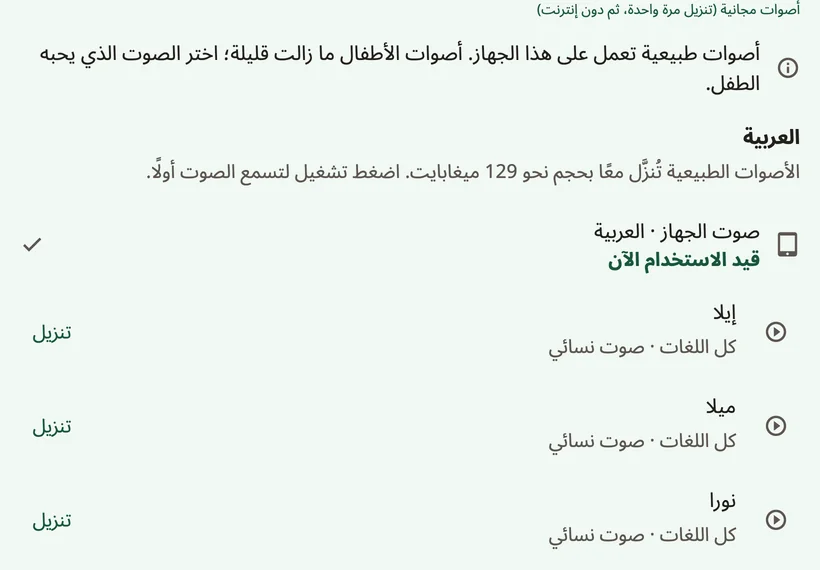

<!-- description: اختر الصوت الذي يتكلم به الطفل في Amalino: الأصوات الطبيعية، وصوت الجهاز، والتسجيلات، وعمر الصوت، والسرعة، وطريقة نطق اسم الطفل. -->
# الأصوات

الصوت هو صوت الطفل. فدعه يسمع بضعة أصوات ويختار ما يعجبه منها. ويمكنك تغييره في أي وقت من **{app:sectionSettings}** ← **{app:speechVoice}**.

## أنواع الأصوات

- **{app:naturalVoicesHeading}**: عشرة أصوات ({app:voiceName.F1} و{app:voiceName.F2} و{app:voiceName.F3} و{app:voiceName.F4} و{app:voiceName.F5} و{app:voiceName.M1} و{app:voiceName.M2} و{app:voiceName.M3} و{app:voiceName.M4} و{app:voiceName.M5})، وهي أقرب الأصوات إلى صوت الإنسان. وكل منها ينطق لغات Amalino السبع كلها. ويجمعها تنزيل واحد، ثم تعمل دون إنترنت.
- **{app:systemVoice}**: الأصوات التي تأتي مع الهاتف أو الجهاز اللوحي، ولا تحتاج إلى تنزيل. وقد يحتاج بعضها إلى الإنترنت، ويذكر Amalino ذلك تحت الصوت.
- **{app:personalVoice}** (على iPhone وiPad، بنظام iOS 17 أو أحدث): صوت أنشأته في إعدادات الجهاز، في **تسهيلات الاستخدام ← الصوت الشخصي**. ويستأذنك Amalino قبل استخدامه. ولا يوجد صوت شخصي في Android: فإن أردت الاحتفاظ بصوت أحد أفراد الأسرة، فسجّل الكلمات بصوته.
- **تسجيلاتك**: سجّل أي كلمة بصوتك في محرّر الزر. وتُشغَّل التسجيلات بدلًا من صوت التطبيق. راجع [تعديل الأزرار ونقلها](editing.md).

اضغط صوتًا لتسمعه، ثم اضغط **{app:useVoice}**.

## صوت واحد أم صوت لكل لغة

لكل لغة إعداد صوتها الخاص. ولأن كل صوت طبيعي ينطق كل لغات الطفل، يمكنك أن تضغط **{app:useForAll|voice=…}** لتُبقي صوتًا واحدًا لكل شيء. وإلا، فإن الجمل التي تخلط بين لغتين يتغير فيها الصوت.

## التنزيلات

الأصوات الطبيعية تنزيل واحد بنحو 129 ميغابايت. ويخبرك Amalino بالحجم أولًا. وعلى بيانات الجوال يستأذنك قبل التنزيل؛ فاختر **{app:waitForWifi}** لتنزّلها لاحقًا. وإلى أن يكتمل التنزيل، يتكلم صوت الجهاز.

ولتوفير المساحة، احذف الأصوات الطبيعية من الجهاز؛ فتُنطق الكلمات بصوت الجهاز إلى أن تنزّلها من جديد.

## كيف يبدو الصوت

- **{app:speechRate}**: أبطأ أو أسرع.
- **{app:voiceAge}**: **{app:voiceAgeAdult}** أو **{app:voiceAgeOlder}** أو **{app:voiceAgeYoung}**، مع شريط تمرير **{app:voiceAgeStrength}**. يرفع هذا الإعداد طبقة الصوت ويغيّر طابعه. وسيبدو الصوت أقرب إلى شخص كبير صغير الحجم منه إلى طفل حقيقي، فجرّب وانظر ما يعجب الطفل.
- **{app:pitch}**: لأصوات الجهاز فقط، لذلك لا يظهر إلا حين يتكلم أحدها. أما الأصوات الطبيعية فتستخدم **{app:voiceAge}** بدلًا منه.
- **{app:volume}**.
- **{app:lowerOthers.anon}**: تنخفض الموسيقى وأصوات التطبيقات الأخرى **{app:lowerOthersSpeaking}** أو **{app:lowerOthersOpen}**، لتُسمع الكلمات بوضوح أكبر.

## الكلام المحفوظ

تجد هذا تحت **{app:advanced}** في آخر شاشة **{app:speechVoice}**. فلكي يتكلم Amalino فورًا، يُعِدّ كلمات اللوحة بالأصوات المختارة ويحفظها على الجهاز. ويجري ذلك في الخلفية حين لا تكون اللوحة قيد الاستخدام. ويعرض **{app:savedSpeech}** مدى التقدم والمساحة المستخدمة. وإن بدت الكلمات خاطئة يومًا، فالزر **{app:savedSpeechRebuild}** يُعِدّها من جديد.

## اسم الطفل

في إعدادات الكبار، اختر اسم الطفل (مثلًا **{app:settingsChildName|name=سام}**):

- اكتب الاسم كما يُكتب في كل لغة، أو اكتب صيغة مختصرة منه؛
- استمع إلى طريقة نطق كل صوت له؛
- وإن بدا النطق خاطئًا، فاكتب في **{app:spokenAs}** كيف يُلفظ، مثلًا بالتشكيل: «عُمَر» بدلًا من «عمر».

وإن ظل النطق خاطئًا، فسجّل الاسم بصوتك بدلًا من ذلك.

## لا صوت للغة ما

إن لم يكن للغة صوت بعد، فنزّل الأصوات الطبيعية. أو ثبّت صوتًا من إعدادات تحويل النص إلى كلام في الجهاز، أو سجّل الكلمات بنفسك.

> **نصيحة:** اسأل الطفل أي صوت يعجبه. فالصوت الذي يناسبه يجعله يرغب في استخدامه.

التالي: [المشاركة والطباعة](sharing-and-printing.md).
