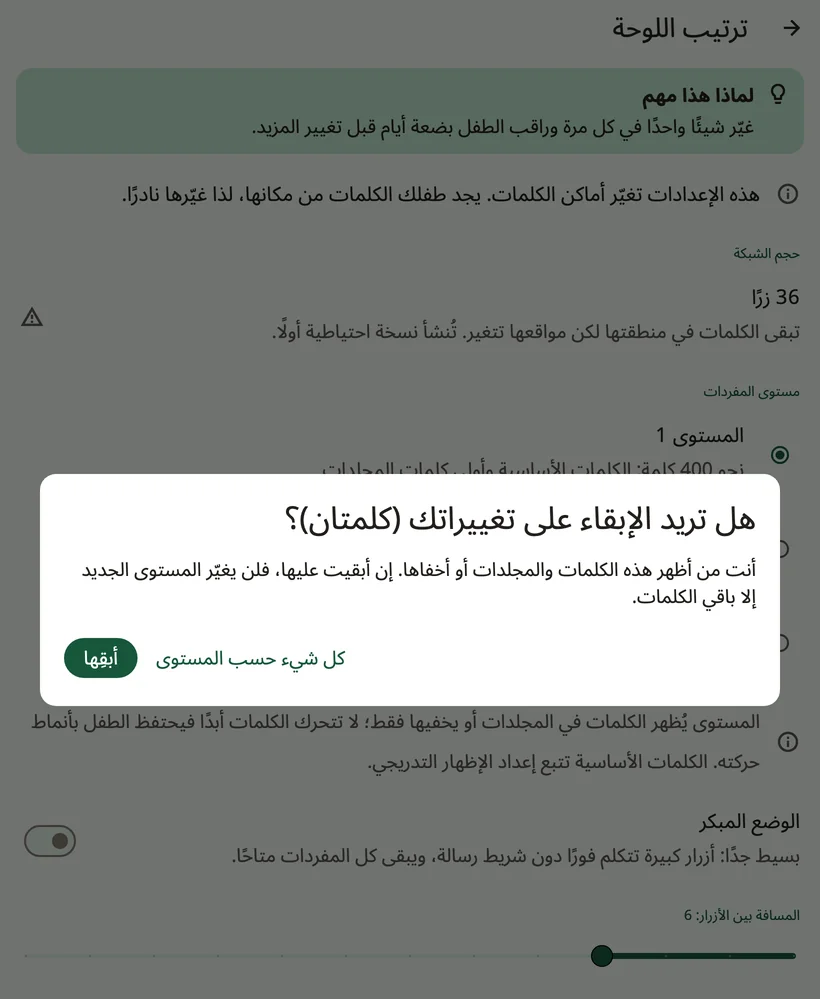
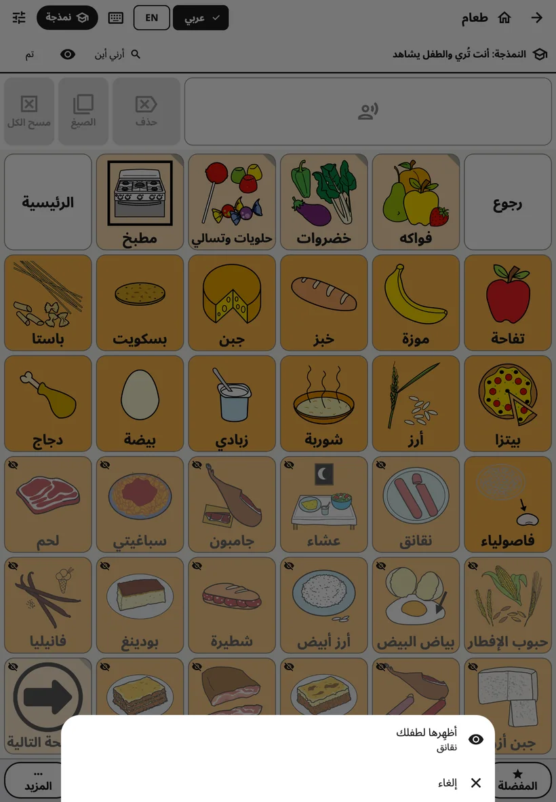

<!-- description: كيف ينظّم Amalino الكلمات: كلمات أساسية في أماكن ثابتة، ومجلدات، وأحجام اللوحة، ومستويات المفردات، وإظهار الكلمات المخفية مع الوقت. -->
# الكلمات والمجلدات

في Amalino نحو 2500 كلمة في كل لغة من لغاته السبع. ولا تُظهرها كلها دفعة واحدة. تشرح هذه الصفحة كيف تُنظَّم الكلمات، وكيف تُظهر المزيد منها كلما كبر الطفل.

## الكلمات الأساسية والمجلدات

**اللوحة الرئيسية** فيها الكلمات الأساسية: كلمات صغيرة يومية مثل «أنا» و«أريد» و«المزيد» و«أذهب» و«ليس» و«ساعدني» و«يعجبني». فنحو 200 كلمة أساسية تشكّل معظم ما يقوله الناس كل يوم، لذلك يستطيع الطفل أن يقول بها الكثير.

**المجلدات** فيها بقية الكلمات: الطعام، والأماكن، والأشخاص، والمشاعر، والألعاب، وغيرها. ولزر المجلد زاوية مطوية، وهو يفتح صفحة فيها كلمات مترابطة.

بعد أن يضغط الطفل كلمة داخل مجلد، يعود Amalino إلى حيث كان، جاهزًا للكلمة التالية: «أنا أريد»، ثم **طعام**، ثم «تفاحة»، فتعود الكلمات الرئيسية لتقول «من فضلك». وفي المجلدات التي يختار فيها الطفل عدة كلمات متتالية، مثل الألوان، أوقف خيار **{app:folderGoBack}** لذلك المجلد (راجع [تعديل الأزرار ونقلها](editing.md)). ويبدأ مجلد **{app:favourites}** وهذا الخيار متوقف.

## حجم اللوحة

حجم اللوحة (**{app:gridSize}**) هو عدد الأزرار التي تتسع لها الصفحة الواحدة:

- **20**: أزرار كبيرة، يسهل إصابتها
- **36**: حجم متوسط، بداية جيدة لمعظم الأطفال الصغار
- **60**: أزرار أصغر، وكلمات أكثر في الصفحة الواحدة
- **84**: أزرار صغيرة، لمن يستخدم الجهاز بثقة

يقترح الإعداد حجمًا بحسب عمر الطفل وطريقة لمسه. ولا يعرض كل جهاز إلا الأحجام التي يبقى فيها عرض كل زر 44 نقطة على الأقل (نحو 7 ملم، وهو حجم مريح للإصبع).

حاول أن تبقى على الحجم نفسه. فتغييره ينقل الكلمات إلى أماكن جديدة، ويضطر الطفل إلى تعلّمها من جديد. ولذلك يطلب Amalino منك التأكيد، ويُنشئ نسخة احتياطية أولًا. ودع اللوحة تكبر بإظهار مزيد من الكلمات بدلًا من ذلك.

## الكلمات لا تتحرك أبدًا

لكل كلمة مكانها، وتحتفظ به. وحين تُخفى كلمة، يبقى مكانها فارغًا؛ وحين تُظهرها لاحقًا، تظهر فيه. ولا يتزحزح شيء ليفسح لها مكانًا.

## مستوى المفردات

يحدد **{app:vocabLevel}** (في **{app:sectionSettings}** ← **{app:boardLayout}**) عدد الكلمات التي تظهر في المجلدات:

- **{app:levelDesc1|label}**: نحو 400 كلمة، الكلمات الأساسية والكلمات الأولى في المجلدات
- **{app:levelDesc2|label}**: نحو 1300 كلمة، ومجلدات أكثر
- **{app:levelDesc3|label}**: كل الكلمات (نحو 2500)

لا يُظهر المستوى الكلمات أو يخفيها إلا في المجلدات. أما كلمات اللوحة الرئيسية فتُظهرها واحدة واحدة (انظر أدناه).

وإن كنت قد أظهرت كلمات في المجلدات أو أخفيتها بنفسك، يسألك Amalino أولًا: **{app:keepOwnChanges.zero}** يغيّر الزر **{app:keepOwnChangesKeep}** الكلمات الأخرى فقط، أما الزر **{app:keepOwnChangesReset}** فيجعل كل كلمة تتبع المستوى الجديد.

## إظهار الكلمات وإخفاؤها

كل كلمة إما **ظاهرة** للطفل وإما **مخفية**. ومكان الكلمة المخفية يبدو للطفل فارغًا، ولا يتحرك شيء آخر.

لرؤية الكلمات وتغييرها، افتح إعدادات الكبار واختر **{app:editBoard}**. تظهر الكلمات المخفية في أماكنها، مظللة بلون داكن وعليها عين مشطوبة. اضغط واحدة منها، وفي محرّرها شغّل **{app:visibility}**، ثم اضغط **{app:done}**. ويجري ذلك بالطريقة نفسها داخل المجلدات.

وفي وضع النمذجة، تعمل صفحة المجلد بالطريقة نفسها: تظهر الكلمات المخفية باهتة، والعين في سطر النمذجة تُظهر كل كلمات ذلك المجلد دفعة واحدة.

> **نصيحة:** لا تُظهر كلمة جديدة إلا بعد أن تستخدمها أمام طفلك مرات كثيرة. في وضع النمذجة تظهر الكلمات المخفية باهتة في أماكنها: اضغطها وأنت تتكلم، وحين يصبح طفلك مستعدًا، اضغط مطولًا على إحداها واختر **{app:showToChild}**. راجع [الإعدادات: وضع النمذجة](settings.md).

## البحث عن كلمة

لا تتذكر أين كلمة ما؟ في **{app:modellingMode}**، اضغط **{app:showMeWhere}** واكتب الكلمة. فيُريك Amalino الطريق إليها، زرًا بعد زر، لتضغطها بنفسك وأنت تتكلم.

## كلماتك الخاصة

يمكنك أن تضيف كلمات، وتغيّر الصور، وتسجّل كلمة بصوتك، وتنشئ مجلدات جديدة أو تضيف المجلدات الجاهزة. راجع [تعديل الأزرار ونقلها](editing.md).

التالي: [العبارات السريعة و«المزيد»](quick-phrases.md).
