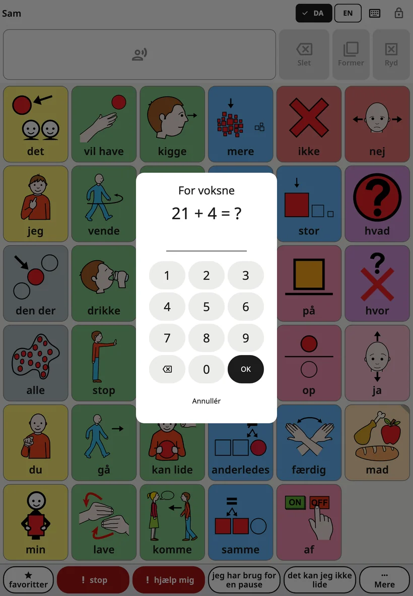
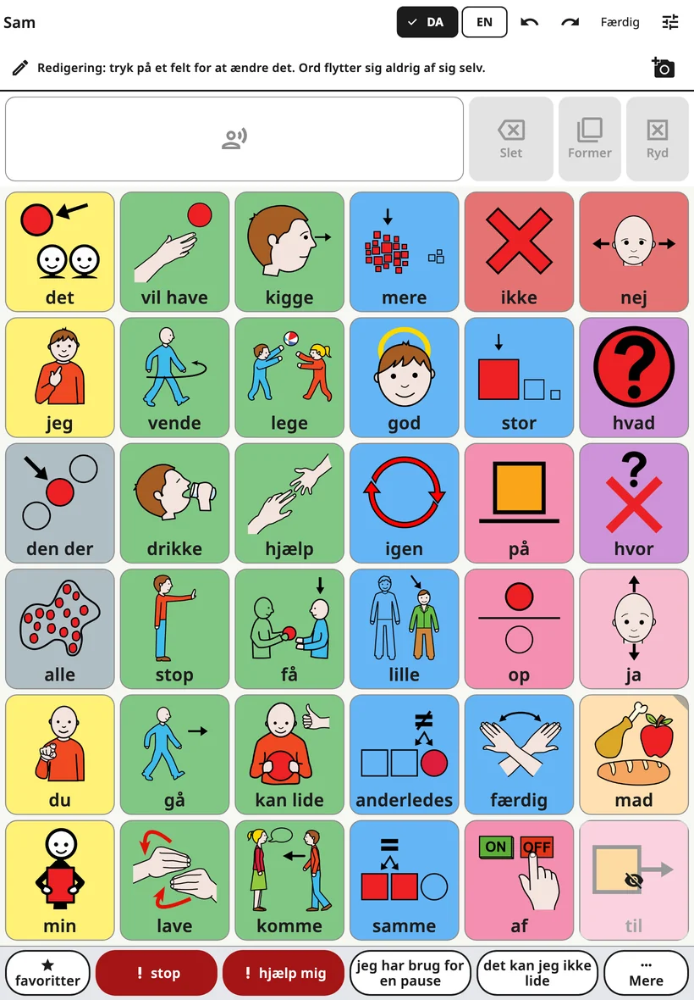
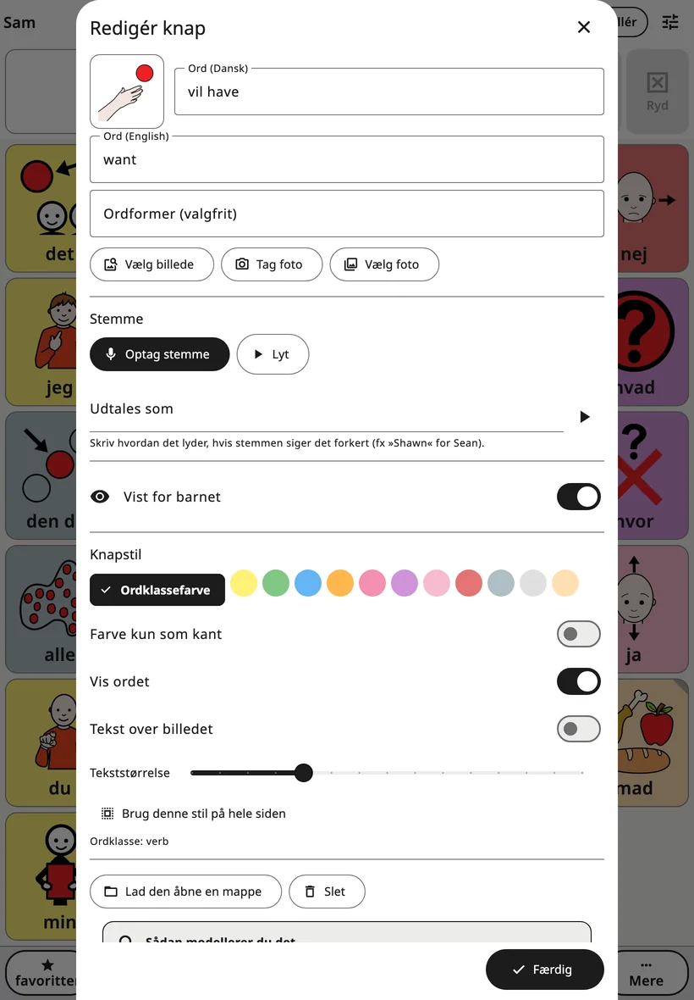
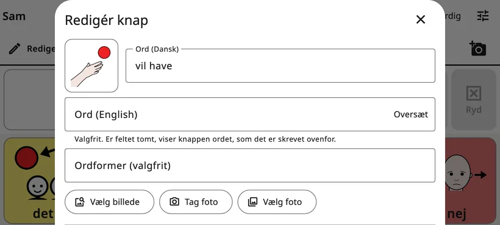
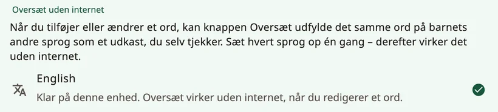

<!-- description: Ret Amalinos tavle: Åbn voksenindstillingerne, ret en knaps ord, billede og stemme, oversæt, tilføj mapper, flyt knapper, og fortryd. -->
# Redigér og flyt knapper

Alle familier har deres egne ord. Du kan ændre alle ord, billeder og stemmer, tilføje jeres egne ord og mapper og flytte knapper, du selv har tilføjet. Barnet kan hverken se eller ændre noget af det, der står her.

## Åbn voksenindstillingerne

Øverst til højre på tavlen skal du **holde fingeren på låsen i 3 sekunder** og derefter løse det lille regnestykke (eller indtaste din pinkode) med de taltaster, der dukker op. Så åbner voksenindstillingerne. De låser sig selv igen efter 5 minutter – eller med det samme, når du trykker på **{app:lockNow}**.

Du kan ændre, hvor længe man skal holde, pinkoden og den automatiske lås under **{app:lockAndKeep}**. Læs mere under [Indstillinger](settings.md).

## Redigér tavlen

Vælg **{app:editBoard}**. Øverst på tavlen står der nu: »{app:editingHint}« I den øverste bjælke er der nu **{app:undo}**, **{app:redo}** og **{app:done}**.

- Tryk på en knap for at redigere den.
- Tryk på et tomt felt, og vælg **{app:addWord}** eller **{app:addFolder}**.
- Åbn mapper, og redigér deres knapper på samme måde.
- Tryk på **{app:done}** til sidst.

Skjulte ord står på deres pladser, mørkt skraverede og med et overstreget øje, så du altid kan se hele tavlen, mens du redigerer.

## Redigering af en knap

- **Ordet**: ordet på knappen på tavlens nuværende sprog.
- **Barnets andre sprog**: Under ordet er der et felt til hvert af barnets andre sprog, for eksempel **{app:wordLabel|language=engelsk}**. De er valgfrie: Er et felt tomt, viser knappen ordet, som det er skrevet ovenfor.
- **{app:translateWord}**: vises ud for et tomt felt, når enheden kan oversætte det sprog offline. Knappen udfylder ordet som et udkast, mærket »{app:translatedCheck}« Tjek ordet, før barnet bruger det. Se »Oversæt ord« nedenfor.
- **{app:wordFormsManual}**: ordets andre former adskilt af kommaer, for eksempel »musen, musene«.
- **Billedet**: **{app:chooseSymbol}** søger i de indbyggede billeder, og **{app:moreSymbolSets}** søger i andre gratis symbolsæt på internettet. Kun de ord, du søger efter, bliver sendt. Med **{app:takePhoto}** og **{app:choosePhoto}** bruger du dine egne. Fotos fungerer bedst til mennesker, kæledyr og barnets egne ting.
- **{app:voice}**: **{app:recordVoice}** optager ordet med din egen stemme, **{app:listen}** afspiller det, og **{app:removeRecording}** skifter tilbage til appens stemme.
- **{app:spokenAs}**: Siger stemmen et ord forkert, så skriv det, som det udtales – for eksempel »Sjån« for Sean.
- **{app:recInSentences}**: Normalt afspilles din optagelse kun, når barnet trykker på netop den knap. Inde i en sætning siger appens stemme ordet. Slå funktionen til ved lyde, sange eller ord, som stemmen ikke kan sige.
- **{app:visibility}**: Når den er slået til, kan barnet se og bruge ordet. Når den er slået fra, ser pladsen tom ud for barnet, og intet flytter sig. Læs mere under [Ord og mapper](words-and-folders.md).
- **{app:buttonStyle}**: **{app:wordTypeColour}**, **{app:borderOnly}**, **{app:showLabel}**, **{app:labelOnTop}** og **{app:textSize}**. **{app:styleWholePage}** giver alle knapper på siden den samme stil.
- **{app:wordType}**: bestemmer knappens farve (handlinger er for eksempel grønne og beskrivende ord blå).

Er det et **nyt** ord eller en ny mappe, så tryk på **{app:add}** nederst for at sætte den på tavlen. **{app:add}** er grå, indtil knappen har et ord eller et billede. **✕** annullerer: Der bliver ikke tilføjet noget, og et foto eller en optagelse, du har lavet til knappen, bliver kasseret.

Når du redigerer en knap, der **allerede findes**, gælder dine ændringer med det samme. Tryk på **{app:done}** (eller **✕**) for at lukke.

## Oversæt ord

**{app:translateWord}** virker på enheden uden internet, når sproget først er sat op. Det gør du én gang for hvert sprog: Åbn **{app:languages}** (under **{app:sectionBoards}**) i voksenindstillingerne, og derefter **{app:offlineTranslationHeader}**:

- **Android**: Tryk på sproget, og sig ja til at hente Googles oversættelsesmodel – omkring 30 MB pr. sprog. Der sendes ingen ord fra appen.
- **iPhone og iPad**: Det kræver iOS 26 eller nyere. Sprogene kommer fra Apple: Åbn enhedens **Indstillinger** → **Apps** → **Oversæt** → **Hentede sprog**, hent sprogene, og vend så tilbage til Amalino.

Ud for hvert sprog står der, om det er klar. Kan enheden ikke oversætte, står der **{app:offlineTranslationUnsupported}**

## Mapper

Du tilføjer en mappe ved at trykke på et tomt felt i redigeringstilstand og vælge **{app:addFolder}**. Under **{app:pickFolderTitle}** står barnets mapper med deres billeder, også de indbyggede (mad, følelser, steder …), og øverst **{app:newFolder}**. Vælg en mappe, tjek navnet og billedet, og tryk på **{app:add}**.

Når du redigerer en mappeknap, er der også:

- **{app:makeFolder}**: laver en ordknap om til en mappeknap. Vælg en mappe eller **{app:newFolder}**.
- **{app:changeFolder}**: lader mappeknappen åbne en anden mappe.
- **{app:openThisFolder}**: lukker redigeringen og åbner mappen, så du kan redigere det, der er i den.
- **{app:folderGoBack}**: Når den er slået til, kommer barnet tilbage til det sted, det kom fra, efter at have trykket på et ord i mappen – klar til næste ord. Slå den fra for mapper, hvor barnet vælger flere ord i træk. Indstillingen gælder mappen, uanset hvorfra den bliver åbnet. **{app:favourites}** starter med den slået fra.

## Flyt en knap

Kerneordene på hovedtavlen beholder deres pladser, så barnets hånd altid finder dem. Knapper, der åbner en mappe eller en scene, kan flyttes:

1. Redigér knappen, og vælg **{app:sceneMove}**.
2. **{app:pickCellTitle}** viser tavlen, hvor de ledige felter er fremhævet. Tryk på et af dem og derefter på **{app:pickCellPutHere}**.
3. Du kan også vælge **{app:pickCellChooseAnother}** for at flytte knappen til en anden mappe, eller **{app:pickCellFavouritesInstead}**.

Knappen beholder sit ord, sit billede, sin stemme og sin stil. Intet andet flytter sig på nogen af tavlerne. Ét tryk på **{app:undo}** sætter den tilbage.

## Slet en knap

Redigér knappen, og vælg **{app:delete}**. Er det et kerneord, foreslår Amalino **{app:hideInstead}**: Skjuler du ordet, beholder det sin plads til senere, mens en sletning efterlader et tomt felt. Det er næsten altid bedst at skjule.

## Fortryd og historik

- Med **{app:undo}** og **{app:redo}** i den øverste bjælke går du frem og tilbage i dine ændringer, mens du redigerer.
- **{app:historyBackups}** i voksenindstillingerne viser alle ændringer. **{app:restoreHere}** sætter tavlerne tilbage til, som de var på det tidspunkt.

Det gør ikke noget at lave fejl. Alt, hvad du ændrer, kan fortrydes.

> **Tip:** Når du tilføjer et ord, så brug det selv på enheden mindst tre gange samme dag.

Næste side: [Indstillinger, skærm for skærm](settings.md).
