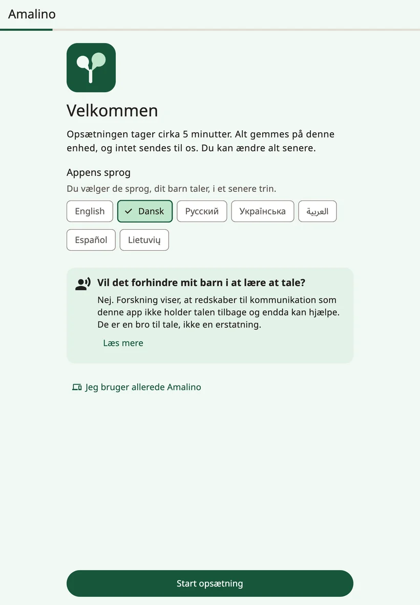
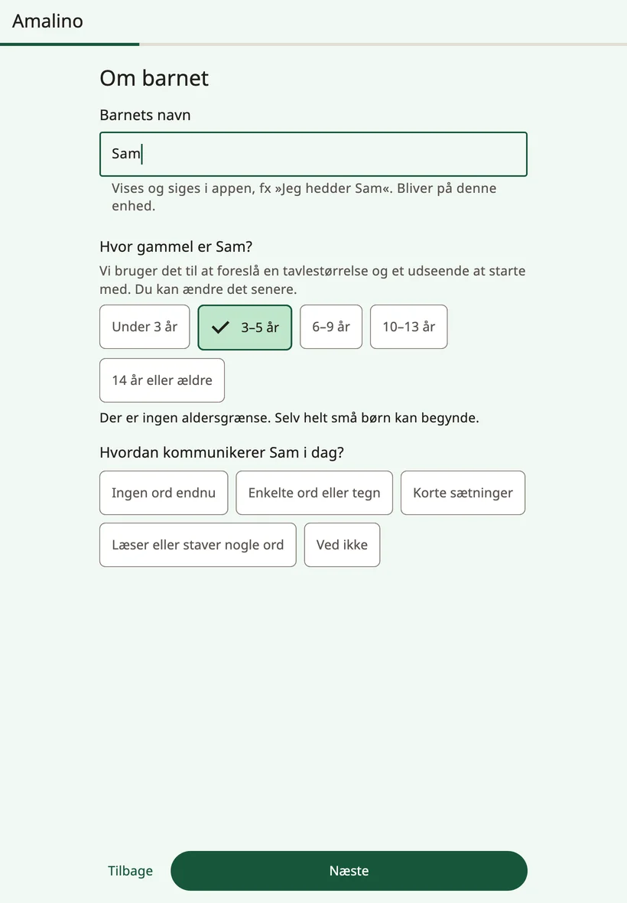
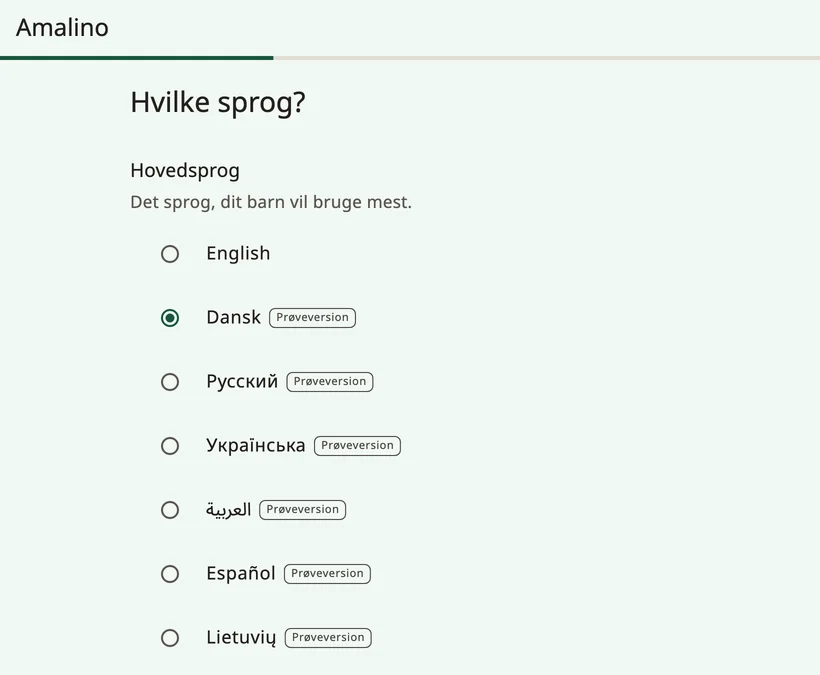
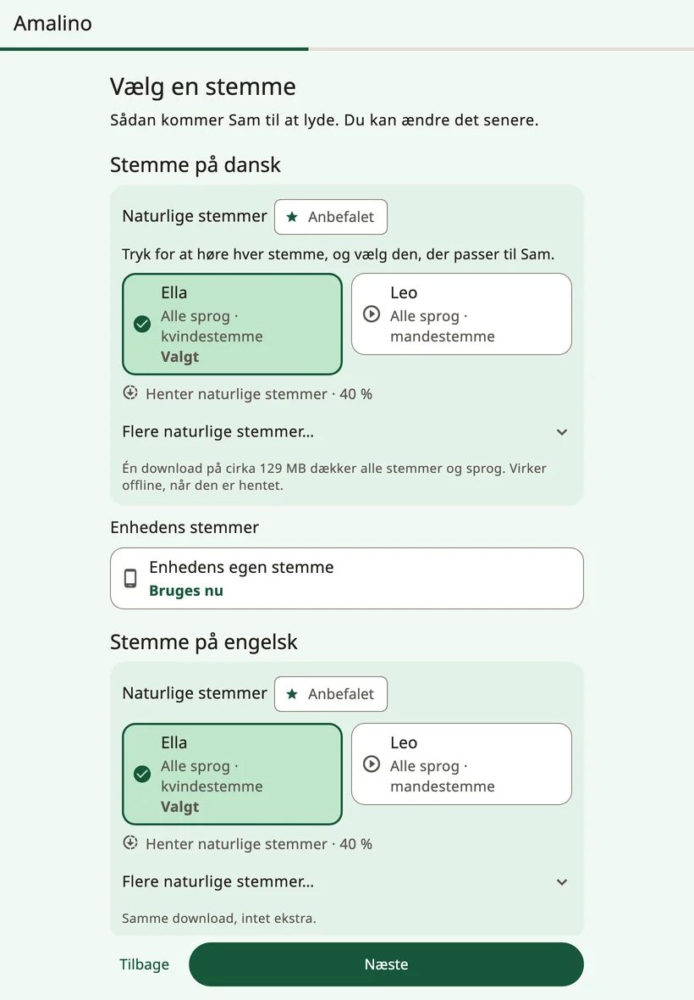
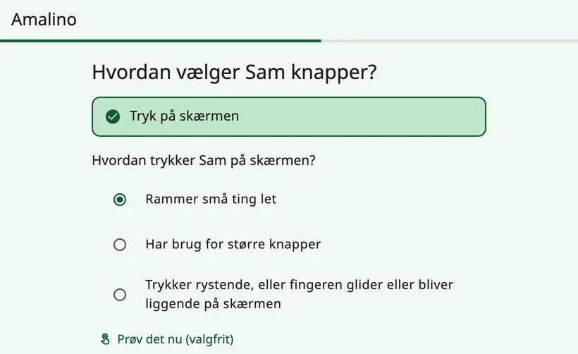
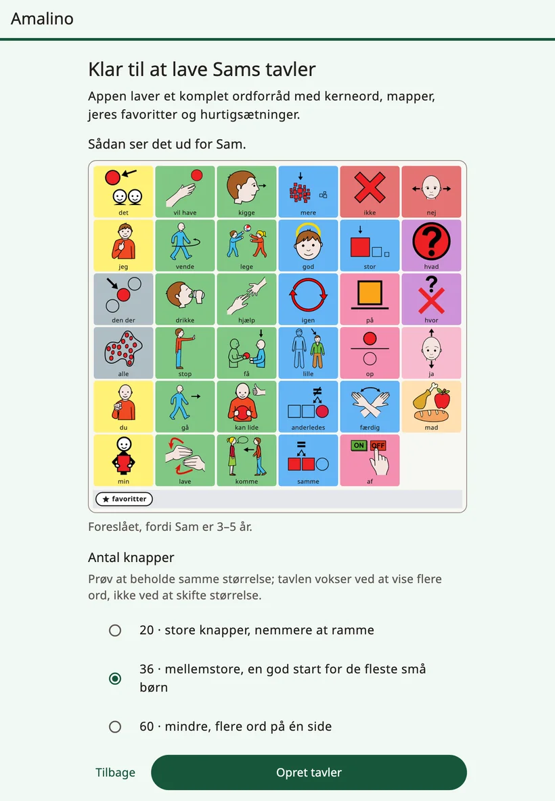

<!-- description: Sæt Amalino op første gang: barnet, sprogene, stemmen, berøring, barnets yndlingsting og voksenlåsen. -->
# Kom godt i gang

Amalino virker på iPhone, iPad og Android-telefoner og -tablets. Appen er gratis, og når den først er sat op, virker den uden internet.

Opsætningen tager omkring fem minutter. Alt, hvad du skriver, bliver på enheden, og du kan ændre alle svar senere.

## Før du begynder

- Oplad enheden, og skru op for lyden.
- Har du mulighed for det, så hav barnet i nærheden til trinnet om berøring. Det er en hjælp at se, hvordan barnet trykker.
- Brug gerne Wi-Fi: De naturlige stemmer er én samlet download på omkring 129 MB.

## Trinnene i opsætningen

### {app:welcomeTitle}

Vælg **{app:appLanguage}**: det sprog, de voksnes skærme vises på. Barnets sprog vælger du i et senere trin.

Bruger barnet allerede Amalino på en anden enhed, så tryk på **{app:alreadyUse}** og derefter **{app:restoreBackup}**. Så kan du hente barnets tavler over fra en sikkerhedskopi, som du har eksporteret med en adgangskode. Læs mere under [Deling og udskrift](sharing-and-printing.md).

### {app:aboutChild}

- **{app:ageBandTitle.anon}** Ud fra aldersgruppen foreslår appen, hvor store knapperne skal være, et ordforrådsniveau og et udseende. Der er ingen aldersgrænse – selv helt små børn kan begynde.
- **{app:commTitle.anon}** Svaret hjælper med at vælge de første ord.
- **{app:childName}** (valgfrit). Navnet vises og siges i appen, for eksempel i »Jeg hedder …«. Det bliver på enheden.

### Sprog

Vælg **{app:primaryLanguage}** – det sprog, barnet kommer til at bruge mest – og sæt flueben ved de andre sprog, barnet hører hver dag. Amalino har syv sprog: engelsk, dansk, russisk, ukrainsk, arabisk, spansk og litauisk.

På alle sprog står den samme knap på samme plads. Barnet kan skifte sprog med ét tryk og skal ikke lære tavlen forfra.

Indtil videre er alle sprog undtagen engelsk mærket **{app:languagePreview}**: Ikke alle ordene er tjekket af en, der har sproget som modersmål. Under listen står der: »{app:languagePreviewNote}« Du kan også selv rette alle ord.

På russisk, ukrainsk, arabisk, spansk og litauisk spørger opsætningen også: **{app:wordFormsTitle.anon}** Vælg **{app:forms.boy}** eller **{app:forms.girl}**, så ordene får de rigtige endelser, når barnet taler om sig selv (på russisk for eksempel »устал / устала«, »træt«). På dansk ændrer ordene sig ikke på den måde.

Står dit sprog ikke på listen, så tryk på **{app:notListed}**. Du kan stadig lave tavler: Indtal hvert ord med din egen stemme, så afspiller tavlen dine optagelser.

### Stemme

Vælg, hvordan barnet skal lyde på hvert sprog. Tryk på en stemme for at høre den.

- **{app:naturalVoicesHeading}** lyder mest menneskelige. Ti stemmer taler alle syv sprog, og de hentes i én samlet download på omkring 129 MB. Derefter virker de offline. Den anbefalede stemme er allerede valgt for dig.
- **{app:systemVoice}** skal ikke hentes og er klar med det samme. Den taler, indtil den naturlige stemme er hentet.

På Wi-Fi begynder downloaden af sig selv. På mobildata spørger Amalino først eller venter på Wi-Fi.

Du kan altid skifte stemme. Læs mere under [Stemmer](voices.md).

### Sådan vælger barnet

Indtil videre bruger barnet Amalino ved at trykke på skærmen. Andre måder at vælge på er mærket »**{app:comingLater}**«.

Svar derefter på **{app:touchTitle.anon}**

- **{app:touch.easy}**
- **{app:touch.bigger}**
- **{app:touch.shaky}**

Svaret indstiller berøringen og tavlens størrelse. Med **{app:tryItNow}** kan barnet prøve at trykke et par gange, og **{app:makeEasier}** justerer indstillingerne, hvis mange tryk rammer ved siden af. Flere indstillinger for berøring finder du under **{app:sectionSettings}** → **{app:touchAccess}**.

### 5 yndlingsting

Tilføj op til fem ting, barnet holder af: sæbebobler, en tegnefilm, mormor. Tag et foto, eller vælg et, og skriv, hvad barnet kalder tingen. De havner i mappen **{app:favourites}**, som altid er ét tryk væk, uanset hvilken tavle barnet er på. Fotos fungerer bedst til mennesker og barnets eget legetøj.

### Voksenindstillinger

Indstillingerne er beskyttet, så barnet ikke kommer til at ændre tavlen ved et uheld. Du åbner dem ved at **holde låsen øverst på tavlen nede i 3 sekunder og derefter løse et lille regnestykke**. Prøv det én gang her. Du kan også vælge **{app:longerHold}**.

Du kan vælge **{app:lockPin}** i stedet for regnestykket. Ældre børn kan godt løse regnestykket, så til dem er en pinkode mere sikker.

### Navnet på hvert sprog

Har du skrevet et navn, kan du angive, hvordan det staves på hvert sprog, og høre, hvordan stemmen siger det. Lyder det forkert, så skriv det, som det udtales – for eksempel »Sjån« for Sean.

### Oversigt

Det sidste trin viser alle dine svar. Tryk på **{app:change}** ud for det svar, du vil ændre.

Her vælger du også:

- **{app:gridSize}**: hvor mange knapper der er plads til på tavlen. **{app:moreSizes}** viser de andre størrelser. Prøv at holde fast i én størrelse: Tavlen vokser ved, at der bliver vist flere ord, ikke ved at størrelsen ændres.
- **{app:vocabLevel}**: omkring 400, 1.300 eller 2.500 ord. Læs mere under [Ord og mapper](words-and-folders.md).

Til ældre børn kan du slå **{app:teenPack}** til: sociale vendinger, jokes og slang og et mere voksent udseende uden tegneseriestil.

Til helt små begyndere tilbyder opsætningen måske **{app:earlyOffer|label}**: fire store billeder, der taler med det samme. Hele ordforrådet ligger klar nedenunder, og du kan skifte til hele tavlen senere.

Tryk så på **{app:createBoards}**.

## Efter opsætningen

Siden **{app:allSet}** viser endnu en gang, hvordan du åbner voksenindstillingerne, og giver dig et første tip, du kan prøve i dag. Her finder du også **{app:lockDeviceToApp}** (den samme vejledning som **{app:guidedAccess}** i voksenindstillingerne) og en kontakt til **{app:dailyTip}**.

Tryk på **{app:startTalking}**. Tavlen åbner og er klar til barnet.

Et par ting kan du gøre senere under **{app:finishSetup}** i voksenindstillingerne:

- vælge de to sætninger, barnet har mest brug for,
- høre, hvordan barnets navn lyder,
- prøve berøringsindstillingerne sammen med barnet.

Næste side: [Barnets tavle](the-board.md).
