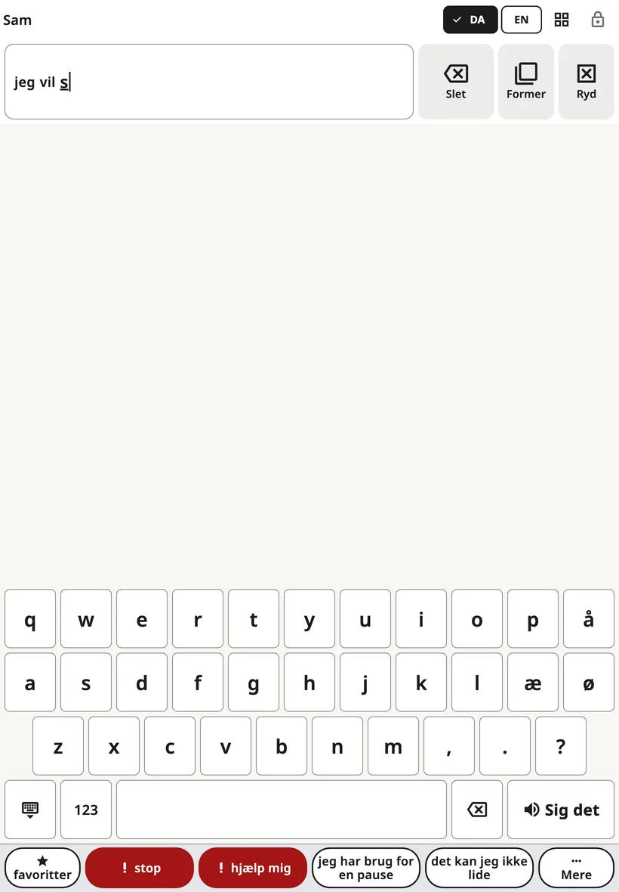

<!-- description: Skriv i Amalino: Åbn tastaturet, brug ordforslag, vælg bogstavernes rækkefølge, tal og tegn og tasternes størrelse på telefoner. -->
# Tastaturet

Børn, der kender nogle bogstaver, kan skrive ord, som ikke står på tavlen. Tastaturet ligger samme sted som tavlen, så der er kun ét tryk mellem dem.

## Åbn og luk tastaturet

Tryk på **tastaturknappen** i den øverste bjælke. Vil du tilbage til billederne, så tryk på den samme knap igen (nu viser den et gitter) eller på **lukketasten** nederst til venstre på tastaturet.

## Sådan skriver barnet

- Det ord, barnet er ved at skrive, står i **beskedlinjen**, så barnet kan se det vokse.
- Tasten **{app:space}** afslutter ordet.
- **Slettetasten** sletter et bogstav. Hold den nede for at blive ved med at slette.
- **{app:kbSpeak}** siger hele beskeden.
- **123** åbner tal og tegnsætning, også de tegn, der hører til hvert sprog (¿ ¡ på spansk, » « på dansk, « » på russisk og ukrainsk, „ “ på litauisk, ؟ ، på arabisk). På dansk står » først, fordi vi citerer »sådan her«, og det lige anførselstegn " findes på alle sprog. **ABC** går tilbage til bogstaverne.

Beskedlinjens **{app:barDelete}** og **{app:barClear}** virker som på tavlen.

Når barnet rører et bogstav på en telefon, vises bogstavet større over fingeren, så barnet kan se, hvilken tast det er på, før det løfter fingeren. Det sker ikke, når både **{app:activateOnRelease}** og **{app:holdTime}** er slået til, for så bliver tasten allerede mørkere, mens barnet holder den.

## Ordforslag

En række over tasterne foreslår ord, mens barnet skriver. Et tryk tilføjer ordet og et mellemrum. Forslagene kommer fra:

- ordene på barnets tavler,
- det, barnet har skrevet før, hvis **{app:kbLearn.anon}** er slået til,
- en ordliste for sproget.

Forslagene bliver lavet på enheden; der sendes intet nogen steder hen.

Nogle familier slår forslagene fra, mens barnet øver sig i at stave: **{app:sectionSettings}** → **{app:kbSettings}** → **{app:kbSuggestions}**.

Er **{app:aiPhrase}** slået til (under **{app:sectionSettings}** → **{app:kbSettings}**), kan forbogstaver som »jvpl« give »jeg vil på legepladsen« som et ekstra forslag. Barnet vælger det eller lader være.

## Bogstavernes rækkefølge

**{app:sectionSettings}** → **{app:kbSettings}** → **{app:kbLayout}**:

- **{app:kbLayoutStandard}**: sprogets almindelige tastatur.
- **{app:kbLayoutAbc}**: bogstaverne i alfabetisk rækkefølge i de samme rækker, så tastaturet har samme størrelse.

## Tasternes størrelse på telefoner

På en telefon giver et sprog med mange bogstaver smalle taster. **{app:sectionSettings}** → **{app:kbSettings}** → **{app:kbKeySize}**:

- **{app:kbKeySizeAuto}** (standard) følger berøringsindstillingerne: Har barnet brug for større knapper, eller trykker barnet rystende, bliver lange bogstavrækker delt i to – i samme rækkefølge – så hver tast er mindst 40 punkter (omkring 6 mm) bred.
- **{app:kbKeySizeStandard}** beholder altid de almindelige rækker.
- **{app:kbKeySizeLarger}** deler altid lange rækker.

Når en telefon vendes på tværs, er tasterne allerede brede, så rækkerne bliver ikke delt. Tablets bruger altid de almindelige rækker.

## Når telefonen vendes på tværs

Er tavlen sat til at stå på tværs på en telefon, har tastaturet brug for hele højden. »**stop**« og »**hjælp mig**« flytter så ud for enden af forslagsrækken – hver gang det samme sted. Hele sætningsrækken kommer tilbage, når du går tilbage til tavlen.

> **Tip:** Modellér også, når du skriver. Skriv et ord langsomt, mens du siger det, og tryk så på **{app:kbSpeak}**.

Næste side: [Scener](scenes.md).
