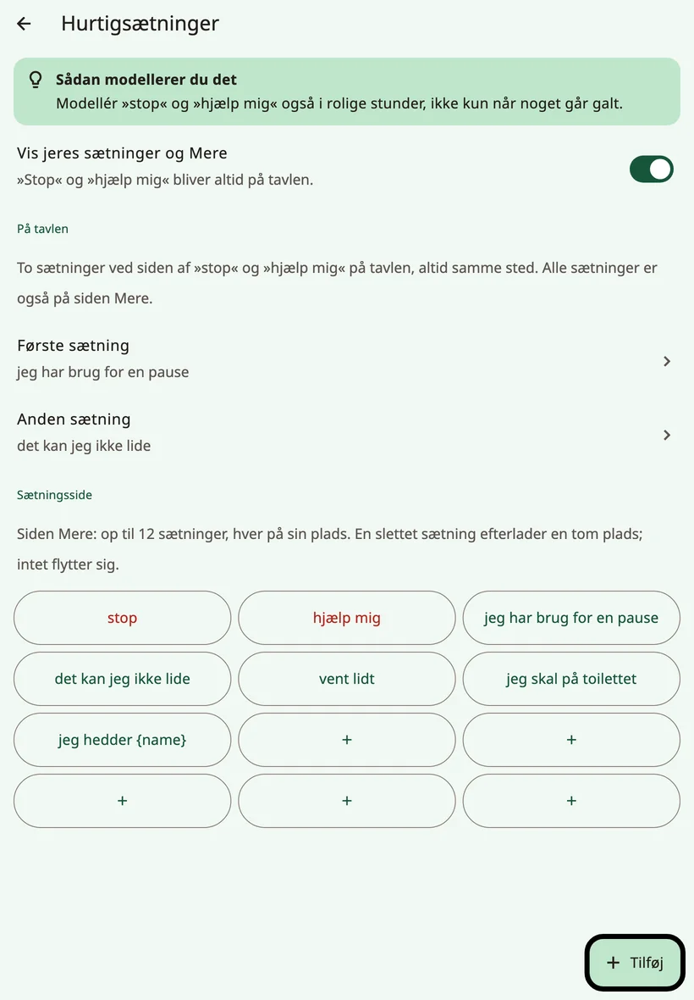
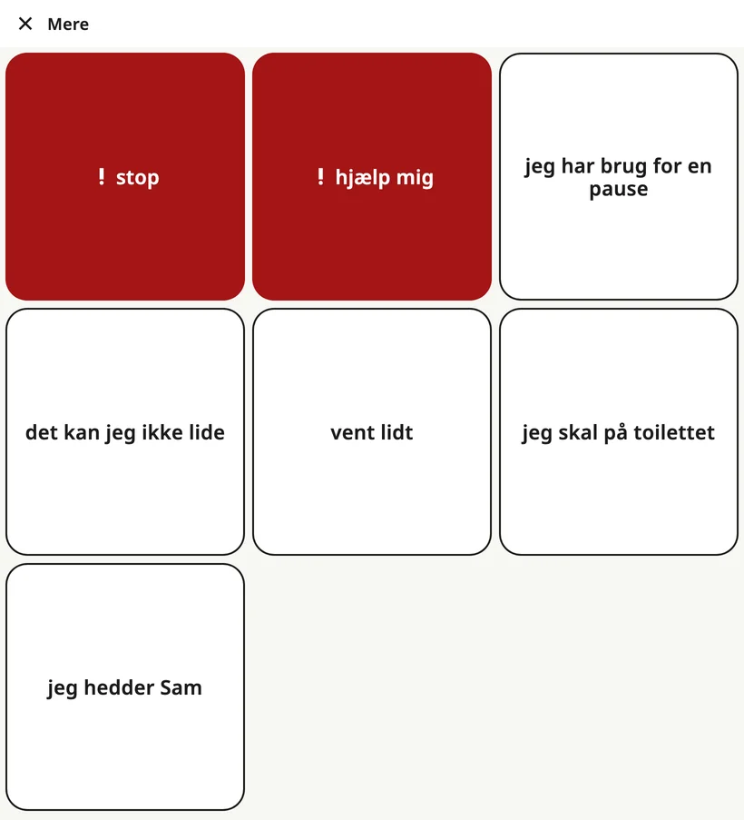

<!-- description: Sætningsrækken nederst på Amalinos tavle: stop, hjælp mig, to af familiens egne sætninger, favoritmappen og siden med alle sætningerne. -->
# Hurtigsætninger og Mere

Nogle ting skal siges hurtigt, uden at barnet først skal bygge en sætning. **Sætningsrækken** nederst på tavlen gør, at de altid er ét tryk væk – på alle sider.

## Sætningsrækken

Fra venstre mod højre:

1. **★ {app:favourites}**: åbner mappen {app:favourites}.
2. **! stop**
3. **! hjælp mig**
4. **Familiens første sætning**
5. **Familiens anden sætning**
6. **{app:quickMore}**: åbner siden med alle sætningerne.

Hver knap beholder sin plads – på alle sprog og på alle sider. »**stop**« og »**hjælp mig**« er der altid, og de er altid røde: Det er de sætninger, der haster. De fire sætningsknapper er lige brede, så en lang sætning aldrig skubber noget til side; den fortsætter i stedet på en ny linje.

Et tryk på en sætning siger den med det samme. Den bliver ikke lagt i beskedlinjen.

## Vælg familiens to sætninger

Åbn voksenindstillingerne, og vælg **{app:quickPhrases}**. Under **{app:qpOnBoard}** vælger du **{app:qpPick1}** og **{app:qpPick2}** til pladserne ved siden af »stop« og »hjælp mig«. Vælg de to, barnet har mest brug for, for eksempel »jeg har brug for en pause« og »det kan jeg ikke lide«.

## Siden {app:quickMore}

**{app:quickMore}** åbner en side med op til 12 sætninger, som hver har sin faste plads. Et tryk siger sætningen og lukker siden; **{app:close}** går tilbage uden at sige noget.

I **{app:quickPhrases}** kan du under **{app:qpPage}**:

- tilføje en sætning med **{app:add}** og vælge dens **{app:qpPlace}**,
- rette en sætning med **{app:edit}** eller markere den som **{app:qpUrgent}**, så den bliver vist med rødt,
- fjerne en sætning med **{app:delete}**. Dens plads bliver tom, og de andre flytter sig ikke.

Er siden fuld, så fjern en sætning, eller tryk på **{app:makePhraseBoard}** for at lave sætningerne om til en mappe med plads til flere.

Sætninger med barnets navn, som »Jeg hedder …«, dukker op, når du har tilføjet navnet.

## {app:favourites}

Mappen **{app:favourites}** rummer de ting, barnet holder allermest af: de fem yndlingsting fra opsætningen og alt, hvad du tilføjer senere. Den er altid ét tryk væk med **★ {app:favourites}**.

Hovedtavlen holder også én plads fri til {app:favourites}. Når du vælger, hvor en ny knap skal stå, er pladsen mærket »{app:pickCellFavouritesNote}«.

På små telefoner viser knappen ★ måske kun stjernen uden ordet. Den gør det samme.

## Skjul familiens sætninger

Bliver barnet distraheret af rækken, så slå **{app:showQuickPhrases}** fra i **{app:quickPhrases}**. Jeres to sætninger og **{app:quickMore}** forsvinder, men »**stop**« og »**hjælp mig**« bliver altid på tavlen på de samme pladser: De er tit de vigtigste ord, et barn har. **★ {app:favourites}** bliver også.

> **Tip:** Modellér »stop« og »hjælp mig« også i rolige stunder – ikke kun når noget går galt.

Næste side: [Tastaturet](keyboard.md).
