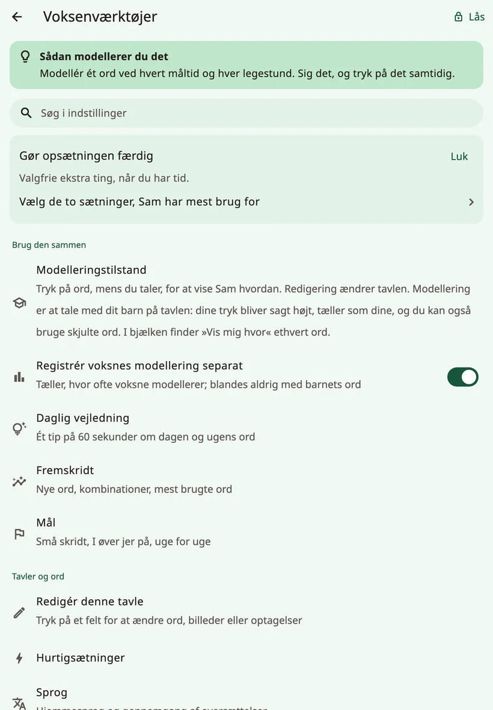
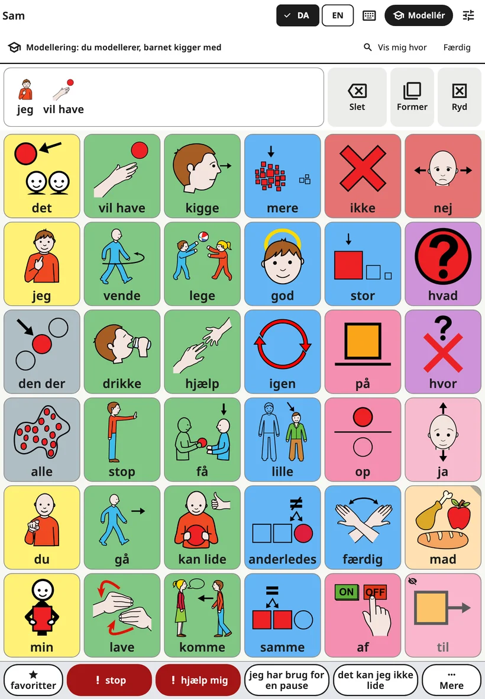
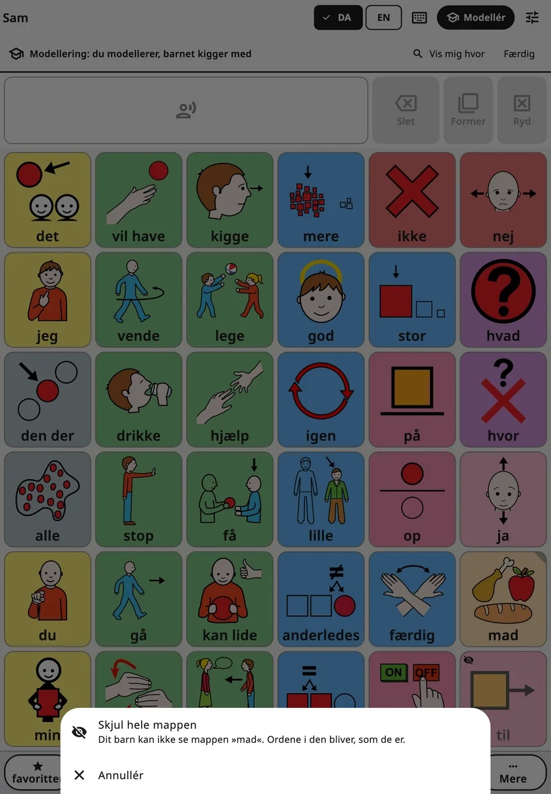
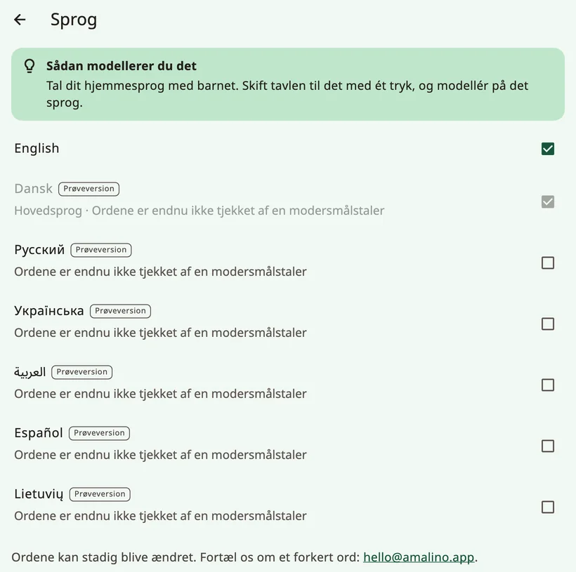
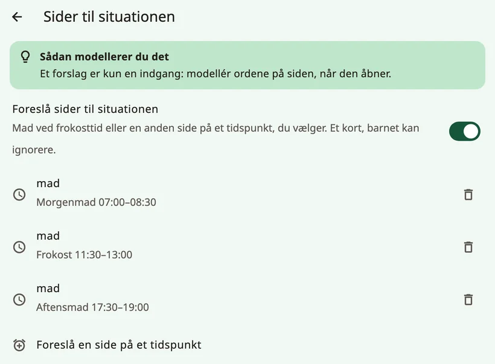

<!-- description: Alle skærme i Amalinos voksenindstillinger forklaret: modellering, ord, stemmer, berøring, visning, tavlens opbygning, tastatur, forslag, lås og data. -->
# Indstillinger, skærm for skærm

Hold fingeren på låsen øverst på tavlen i 3 sekunder, og løs regnestykket med taltasterne for at åbne voksenindstillingerne. De er delt i fire grupper: **{app:sectionTogether}**, **{app:sectionBoards}**, **{app:sectionSettings}** og **{app:sectionData}**. Denne side gennemgår dem i den rækkefølge, du ser dem. Når der i vejledningen står »{app:sectionSettings} → …«, menes gruppen **{app:sectionSettings}** i voksenindstillingerne – ikke enhedens egen app Indstillinger.

De fleste skærme har et kort tip: **{app:tipTitle}**.

## Find en indstilling

Kan du ikke huske, hvor noget er? Tryk på **{app:searchSettings}** øverst, og skriv et ord, for eksempel »stemme« eller »farve«. Ved hvert resultat står der, hvor det ligger (»{app:speechVoice} → {app:speechRate}«). Tryk på det, så åbner Amalino skærmen og markerer indstillingen.

## {app:sectionTogether}

### {app:modellingMode}

**{app:edit}** ændrer tavlen. **{app:modelShort}** er til at tale med dit barn ved hjælp af tavlen: Du trykker på ord, mens du taler, for at vise, hvordan man gør. Dine tryk bliver sagt højt og tæller som dine – aldrig som barnets ord.

Den hurtigste vej ind: Mens voksenindstillingerne er åbne, trykker du på **{app:modelShort}** i tavlens øverste bjælke (på en telefon er det ikonet med studenterhuen). Punktet **{app:modellingMode}** i menuen gør det samme. Øverst står der så »{app:modellingOn}«. I den linje finder **{app:showMeWhere}** et ord for dig: Skriv ordet, så viser Amalino vejen til det, knap for knap.

- **Skjulte ord** ses svagt med et lille overstreget øje på de pladser, hvor de senere dukker op for barnet. Tryk på dem som på alle andre ord, så dit barn hører og ser ordene, længe før de kommer frem på barnets egen tavle. Barnet ser stadig en tom plads.
- **{app:showToChild}**: Hold fingeren på et skjult ord et øjeblik, og vælg **{app:showToChild}**, når du synes, barnet er klar. **{app:undo}** sætter det tilbage.
- **Skjul et ord eller en hel mappe**: Hold fingeren på et ord, barnet kan se, og vælg **{app:hideFromChild}**. Hold fingeren på en mappeknap for at vise eller skjule hele mappen på én gang; et hurtigt tryk åbner stadig mappen.

- **Den slutter af sig selv** to minutter efter dit sidste tryk, og hver gang voksenlåsen lukker, så dit barn aldrig bliver efterladt i modelleringstilstand. Vil du selv afslutte, så tryk på **{app:done}** eller på **{app:modelShort}** igen.

Læs mere under [Tips til familier](tips-for-families.md).

Ved siden af ligger **{app:logModelTaps}**: Den tæller, hvor tit de voksne modellerer, og blander det aldrig sammen med barnets ord.

### {app:coaching}

Et tip om modellering på 60 sekunder hver dag og **{app:wordOfWeek}**: op til 3 ord, som de voksne modellerer i denne uge, fremhævet i modelleringstilstand. **{app:dailyReminder}** sender en notifikation på det tidspunkt, du vælger; appen beder først om lov, når du slår den til.

Her finder du også **{app:mythBuster}**: korte svar på typiske bekymringer (»{app:myth.speech.q}«) med forskningen bag.

### {app:progress} og {app:goals}

- **{app:progress}**: nye ord, ordkombinationer og de mest brugte ord. **{app:thisWeek}** opsummerer ugen i en kort tekst, du kan dele med alle, der taler med barnet – med ét ord, I kan modellere næste gang.
- **{app:goals}**: små skridt, I arbejder på uge for uge, for eksempel antal dage med brug, nye ord eller ord pr. sætning.

Brug tallene til at vælge, hvad I skal modellere næste gang – ikke til at teste barnet.

## {app:sectionBoards}

- **{app:editBoard}**: Læs mere under [Redigér og flyt knapper](editing.md). Det er også dér, du viser og skjuler ord.
- **{app:quickPhrases}**: Læs mere under [Hurtigsætninger og Mere](quick-phrases.md).
- **{app:languages}**: hovedsproget og de andre sprog. Sprog, hvor ordene stadig bliver tjekket, er mærket **{app:languagePreview}** og har en linje om, hvordan du melder et forkert ord. **{app:englishSpelling}** (britisk eller amerikansk) kan indstilles for sig på hver enhed. **{app:translationReview}** viser de ord, der stadig skal gennemgås på hvert sprog, så du kan tjekke eller rette dem. **{app:offlineTranslationHeader}** sætter offline-oversættelse op for hvert af barnets andre sprog; læs mere under [Redigér og flyt knapper](editing.md).
- **{app:boardBuilder}**: Skriv et emne, for eksempel »fødselsdag«, og få en færdig side til det. Det sker på enheden og virker med omkring 20 hverdagsemner (fødselsdag, lægen, parken, badetid, sengetid, zoo, stranden og flere). Du tjekker ordene, før siden bliver gemt.
- **{app:symbolSets}**: de medfølgende ARASAAC-billeder, de ældre Mulberry-billeder, som nogle tavler stadig bruger, dine egne fotos og en valgfri søgning i alle ARASAAC-billeder (omkring 13.000), som henter et billede, når du vælger det. »**{app:useNewPictures}**« skifter til de nyere billeder for de indbyggede ord, der stadig har deres oprindelige billede. Dine egne billeder og fotos bliver bevaret. ARASAAC er gratis til ikke-kommerciel brug.
- **{app:printBoards}**: Læs mere under [Deling og udskrift](sharing-and-printing.md).

## {app:sectionSettings}

### Barnets navn

Navnet, og hvordan det staves på hvert sprog. Du kan også indstille, hvordan det udtales. Læs mere under [Stemmer](voices.md).

### {app:speechVoice}

Stemmen til hvert sprog, **{app:useForAll|voice=…}**, **{app:personalVoice}**, **{app:speechRate}**, **{app:voiceAge}**, **{app:volume}** og **{app:soundCheck}**. **{app:pitch}** vises kun, mens en af enhedens egne stemmer taler. **{app:savedSpeech}** ligger nederst under **{app:advanced}**. Læs mere under [Stemmer](voices.md).

### {app:touchAccess}

Hvordan tavlen reagerer på berøring. Ændr én ting ad gangen, og hold øje med barnet i et par dage.

**{app:accessMethod}** viser tryk på skærmen; andre måder at vælge på står som **{app:comingLater}**. **{app:highlightSpeaking}** giver knappen et blødt farveskær, mens ordet bliver sagt.

**{app:touchTuning}** rummer resten:

- **{app:holdTime}**: Fingeren skal blive på en knap så længe, før den taler. Det hjælper, når hånden kommer til at strejfe skærmen, men så virker et hurtigt tryk ikke. Med holdetid åbner ordformerne kun med knappen **{app:barForms}**.
- **{app:repeatIgnore}**: Et nyt tryk på samme knap kort efter bliver ignoreret.
- **{app:activateOnRelease}**: Barnet kan glide hen til den rigtige knap, før trykket tæller.
- **{app:targetEnlargement}**: Hver knap reagerer også lidt uden for sin kant.
- **{app:tremorFilter}**: Til rystende hænder. Den knap, der tæller, er **{app:tremor.firstLanding}** eller **{app:tremor.longestDwell}**.
- **{app:palmRejection}**: En håndflade eller en hånd, der hviler på skærmen, trykker ikke på knapperne.
- **{app:practice}**: en øvetavle, der tæller tryk, ignorerede berøringer og tryk, der rammer mellem knapperne.

### {app:displaySensory}

Hvordan tavlen ser ud. Her kan du roligt prøve alt: Intet flytter sig.

- **{app:theme}**: **{app:theme.standard}**, **{app:theme.calm}**, **{app:theme.dark}**, **{app:theme.highContrast}** eller **{app:theme.teen}**.
- **{app:colourCoding}**: **{app:palette.fitzgerald}**, **{app:palette.calm}**, **{app:palette.colorBlindSafe}** eller **{app:palette.none}**. **{app:borderOnly}** giver et roligere udtryk.
- **{app:showLabels}**, **{app:labelOnTop}** og **{app:textSize}**.
- **{app:reduceMotion}**: følger enhedens indstilling eller er altid slået til eller fra.

### {app:boardLayout}

»{app:boardLayoutNote}«

- **{app:gridSize}**: Læs mere under [Ord og mapper](words-and-folders.md). På en tablet står der en bemærkning, når nogle lange ord ikke kan stå helt ved 84 knapper i højformat.
- **{app:boardOrientation}**: kun på telefoner. Tavlen, tastaturet og scenerne bliver stående lodret (eller på tværs); de voksnes skærme drejer stadig. Er der plads til færre knapper i den anden retning, spørger Amalino, før den skifter.
- **{app:vocabLevel}**: Læs mere under [Ord og mapper](words-and-folders.md).
- **{app:earlyMode}**: helt enkle, store knapper, der taler med det samme, uden beskedlinje. Hele ordforrådet ligger klar nedenunder.
- **{app:cellGap}**.

### {app:messageBar}

- **{app:showMessageBar}**.
- **{app:speakEachWord}** (slået til som standard). Når den er slået fra, bliver et ord kun lagt i beskeden, når barnet trykker på det, og intet bliver sagt, før der trykkes på beskedlinjen.
- **{app:clearAfterSpeak}**.
- **{app:grammarHelper}**: Hold fingeren på et ord for at vælge en anden form (hunde, gik, større …). Slået til på alle sprog. Læs mere under [Barnets tavle](the-board.md).

### {app:kbSettings}

**{app:kbSuggestions}**, **{app:kbLearn.anon}**, **{app:aiPhrase}**, **{app:kbLayout}** og **{app:kbKeySize}**. Læs mere under [Tastaturet](keyboard.md).

### {app:aiHelpers}

Hjælp, der foreslår ord. Den taler aldrig for dit barn, og det er altid barnet, der vælger. Hver hjælper har sin egen kontakt, og de er alle slået fra, indtil du slår dem til. De kører på enheden:

- **{app:aiNextWord}**: markerer forsigtigt 2–3 knapper med en kant. Knapperne flytter sig aldrig. Lærer kun på denne enhed.
- **{app:contextBoards}**: foreslår en side på et bestemt tidspunkt af dagen, for eksempel madsiden ved frokosttid. Funktionen bruger kun klokkeslættet, aldrig din placering eller din kalender. Et kort på tavlen tilbyder siden; ét tryk åbner den, og barnet kan lade være. Slå **{app:aiContext}** til på funktionens skærm, og tryk derefter på **{app:addMealRules}** eller **{app:addTimeRule}** for at vælge en side og et tidspunkt.
- **{app:aiListen}**: Når du slår mikrofonen til i den øverste bjælke, lytter enheden til det, du siger, og fremhæver ord, barnet kan bruge til at svare. Talen bliver genkendt på enheden; lyden bliver aldrig gemt eller sendt. Funktionen kræver, at talegenkendelsen bliver hentet én gang.

### {app:lockAndKeep}

- **{app:editLock}**: **{app:lockChallenge}** eller **{app:lockPin}** (4–8 cifre) – begge skrives med taltaster på skærmen. Pinkoden gælder enheden: Den samme pinkode åbner voksenindstillingerne for alle børn på enheden. Har enheden ingen skærmlås, viser Amalino først en **gendannelseskode**, som du skal skrive ned og gemme et andet sted end ved enheden. Glemmer du pinkoden, så tryk på **{app:forgotPin}**, og brug skærmlåsen eller gendannelseskoden til at vælge en ny.
- **{app:holdSeconds}**: hvor mange sekunder du skal holde låsen nede, før indstillingerne åbner.
- **{app:relockAfter}**: hvor hurtigt voksenindstillingerne låser sig selv.
- **{app:guidedAccess}**: en trin-for-trin-vejledning til **Guidet adgang** på iPad og iPhone og **Fastgørelse af app** på Android (på Samsung-tablets også Samsung Kids). Barnet kan stadig tale – det kan bare ikke forlade appen.

## {app:sectionData}

- **{app:historyBackups}**: Fortryd en hvilken som helst ændring, lav en sikkerhedskopi nu, eksportér en sikkerhedskopi med adgangskode, eller gendan en. Læs mere under [Deling og udskrift](sharing-and-printing.md).
- **{app:openBoardFormat}**: Flyt tavler til og fra andre ASK-apps. Læs mere under [Deling og udskrift](sharing-and-printing.md).
- **{app:profiles}**: Hvert barn har sine egne tavler og ord. Med **{app:addChild}** kan du tilføje en bror eller søster på samme enhed.
- **{app:about}**: privatliv, et link til **{app:privacyPolicy}**, licenserne for billederne og stemmerne, appens **{app:appVersion}** og **{app:reportProblem}**: Det åbner en e-mail til mig, hvor appens version, din enhed og nogle få indstillinger allerede er udfyldt – men intet om dit barn. Du læser og retter det hele, før du sender den. **{app:diagnostics}** nederst viser tekniske detaljer, for eksempel hvor hurtigt et tryk bliver til tale. Jeg beder dig måske om dem, hvis noget ikke virker.

## Kommer senere

Nogle funktioner kræver en onlinetjeneste: **{app:syncTitle}** mellem enheder, **{app:library}**, **{app:lessonPages}** og **{app:aiCloud}**. Denne version af appen har ingen sådan tjeneste, så funktionerne vises ikke i menuen.

Næste side: [Stemmer](voices.md).
