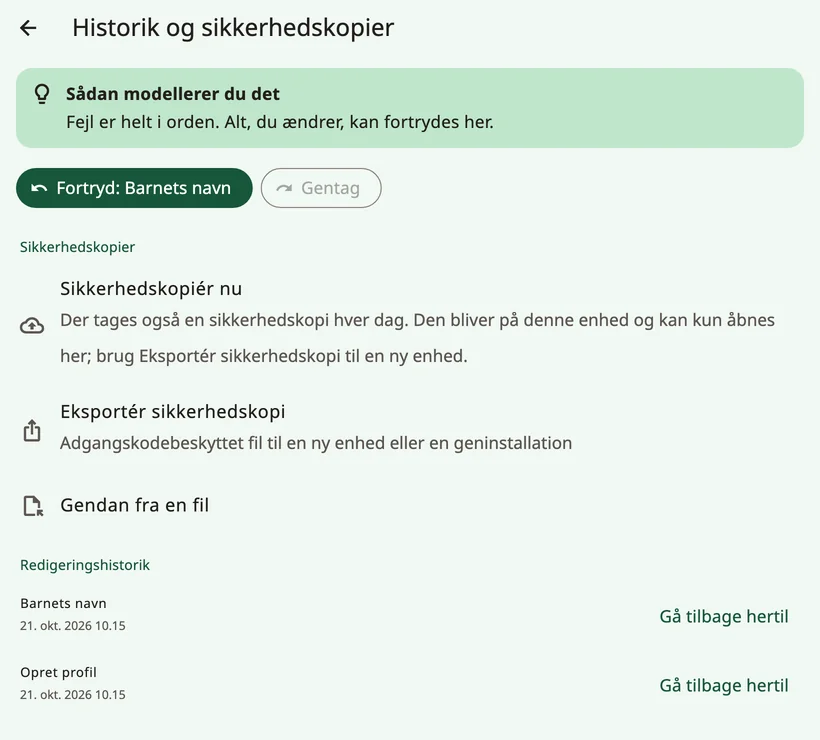
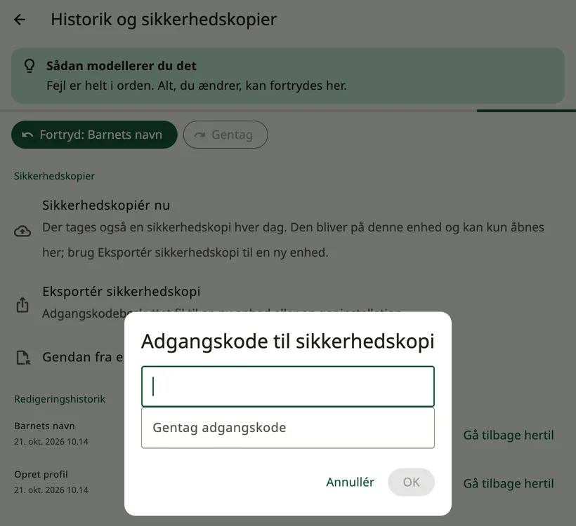
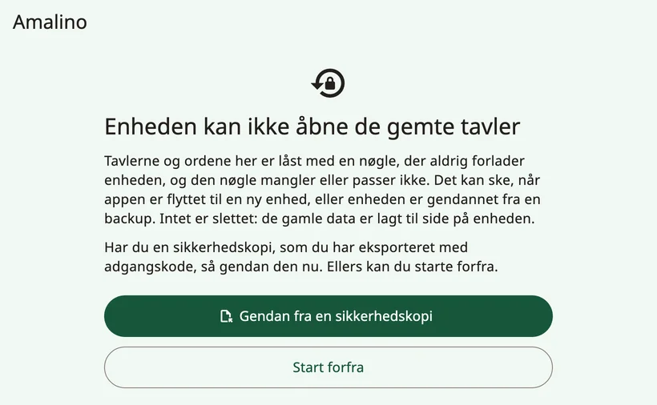
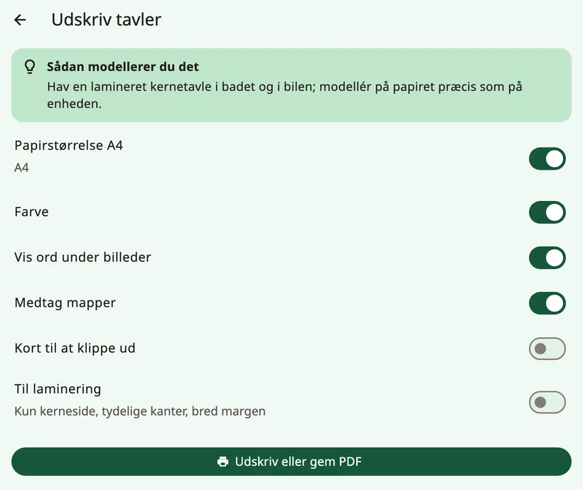

<!-- description: Lav en sikkerhedskopi af barnets tavler i Amalino, flyt dem til en ny enhed, del tavler med andre ASK-apps, og udskriv tavler på papir. -->
# Deling og udskrift

Barnets tavler er værdifulde: måneders arbejde med ord, fotos og optagelser. Her kan du læse, hvordan du passer på dem, flytter dem og får dem på papir.

## Sikkerhedskopier

Åbn voksenindstillingerne, og vælg **{app:historyBackups}**.

- Der bliver lavet en sikkerhedskopi **automatisk hver dag**. Den bliver på enheden og kan kun åbnes på den enhed, der lavede den. Den beskytter altså mod fejl, men ikke mod at miste enheden.
- **{app:backupNow}** laver en med det samme.
- **{app:exportBackup}** laver en fil, der er beskyttet med en adgangskode, til en ny enhed eller en geninstallation. Vælg en adgangskode, du kan huske, og gem filen et andet sted end på enheden: på en computer, i en skytjeneste eller i en mail til dig selv.

Er der ingen kopi uden for enheden, eller er den seneste mere end en måned gammel, viser voksenindstillingerne en venlig påmindelse med **{app:backupReminderMake}** (dog aldrig i de første to uger med en ny profil). **{app:notNow}** skjuler den i to uger.

### Enhedens egen sikkerhedskopi

- **iPhone og iPad**: Sikkerhedskopierer du enheden til iCloud eller en computer, kommer Amalinos data med i sikkerhedskopien.
- **Android**: Amalinos data kommer ikke med i din Google-sikkerhedskopi og bliver heller ikke kopieret over på en anden enhed. Brug **{app:exportBackup}**, når du skifter til en ny enhed.

## Skift til en ny enhed

1. På den gamle enhed: Åbn voksenindstillingerne, og vælg **{app:historyBackups}** (under **{app:sectionData}**) → **{app:exportBackup}**, og vælg en adgangskode.
2. Send filen til den nye enhed med AirDrop, Quick Share, mail, en skytjeneste eller et USB-kabel.
3. Installér Amalino på den nye enhed. På opsætningens første skærm trykker du på **{app:alreadyUse}**, derefter **{app:restoreBackup}** og **{app:chooseFile}**.
4. Skriv adgangskoden.

Vil du gendanne på en enhed, der allerede er sat op, så brug **{app:importBackup}** i **{app:historyBackups}**. Alle tavler, optagelser og logs på enheden bliver erstattet; Amalino laver først en sikkerhedskopi af det, der er på enheden nu.

En automatisk sikkerhedskopi fra en anden enhed kan ikke gendannes, for den kan kun åbnes på den enhed, der lavede den. Brug en sikkerhedskopi, der er eksporteret med en adgangskode.

## Hvis Amalino ikke kan åbne de gemte tavler

Tavlerne er låst med en nøgle, der aldrig forlader enheden. Mangler nøglen, eller passer den ikke – for eksempel efter at appen er flyttet til en ny enhed, eller efter en gendannelse af en systemsikkerhedskopi – viser Amalino **{app:dataRecoveryTitle}**, når appen starter. Intet er slettet: De gamle data er gemt til side på enheden.

- **{app:dataRecoveryRestore}**: Vælg en sikkerhedskopi, du har eksporteret med en adgangskode, og skriv adgangskoden.
- **{app:dataRecoveryFresh}**: Gå igennem opsætningen igen.

Ser du nogensinde **{app:startupFailedTitle}**, så luk appen helt, og åbn den igen. Sker det igen og igen, så genstart enheden. Dine tavler er ikke blevet slettet.

## Del tavler med andre ASK-apps

**{app:openBoardFormat}** i gruppen **{app:sectionData}** i voksenindstillingerne flytter tavler til og fra andre ASK-apps, der bruger det åbne tavleformat (Open Board Format):

- **{app:exportAllBoards}** eller **{app:exportThisBoard}**.
- **{app:importObz}**, for eksempel fra Cboard. Importerede tavler bliver tilføjet som mapper. Amalino fortæller dig, hvor mange knapper den har koblet til ord, den kender.

Når du importerer en tavle, så tjek, at ordene står på pladser, barnet allerede kender.

## Udskrift

**{app:printBoards}** laver en papirudgave til badet, svømmehallen, en tur eller en enhed, der er gået i stykker.

- **{app:paperA4}**: Siderne er i A4.
- **{app:colour}**: Slå den fra for at udskrive i sort-hvid.
- **{app:showLabels}**: Ordet bliver skrevet under hvert billede.
- **{app:includeFolders}**: Mappernes sider bliver også udskrevet, ikke kun hovedtavlen.
- **{app:cutOut}**: enkelte billeder, der kan klippes ud.
- **{app:waterproof}**: kun kernesiden, med kraftige kanter og en bred margen.

Tryk på **{app:printOrSave}** for at udskrive eller for at gemme en PDF og udskrive den senere.

> **Tip:** Hav en lamineret kernetavle i badet og i bilen, og modellér på papiret præcis som på enheden.

Næste side: [Tips til familier](tips-for-families.md).
