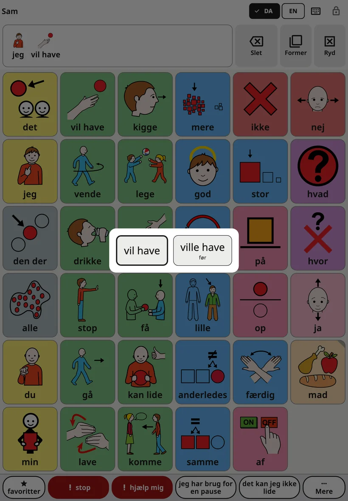
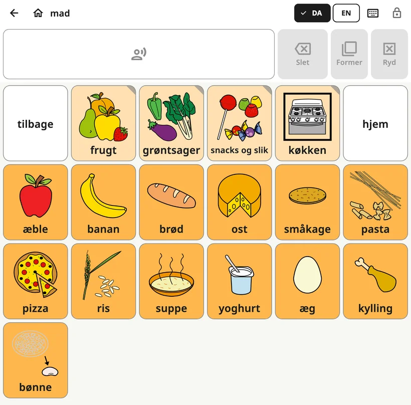

<!-- description: Det ser barnet i Amalino: tavlen, den øverste bjælke, beskedlinjen, ordformer, når en sætning siges højt, og skift mellem sprog. -->
# Barnets tavle

Tavlen er den skærm, barnet bruger hele dagen. Voksenindstillingerne er låst inde, så barnet frit kan gå på opdagelse.

## Skærmens dele

Oppefra og ned:

1. **Den øverste bjælke**: barnets navn (eller tavlens navn, når en mappe er åben), sprogknapperne, knappen til tastaturet og låsen.
2. **Beskedlinjen**: de ord, barnet har valgt, med **{app:barDelete}**, **{app:barForms}** og **{app:barClear}** ved siden af.
3. **Tavlen**: knapperne med billeder og ord.
4. **Sætningsrækken**: {app:favourites}, stop, hjælp mig, to af familiens egne sætninger og {app:quickMore}. Læs mere under [Hurtigsætninger og Mere](quick-phrases.md).

## Sådan siges et ord og en sætning

Når barnet trykker på en knap, bliver ordet sagt højt og lagt i beskedlinjen. Trykker barnet på flere knapper, bliver det til en sætning: »jeg«, »vil have«, »mere«.

- **Tryk på beskedlinjen** for at få hele sætningen sagt højt.
- **{app:barDelete}** fjerner det sidste ord.
- **{app:barClear}** tømmer beskeden.

Du kan ændre, hvordan det fungerer, under **{app:sectionSettings}** → **{app:messageBar}**. Du kan for eksempel vælge, at ordene først bliver sagt, når der trykkes på beskeden, eller at beskeden bliver ryddet, når den er sagt.

## Ordformer

Ord ændrer sig: »hund« og »hunde«, »gå« og »gik«, »stor« og »større«. Menuen med ordformer viser et ords andre former som store knapper. Et tryk på en form lægger den i beskeden og siger den. Grundformen står altid først, så barnet altid kan vende tilbage til den.

Du kan åbne menuen på tre måder:

- **Hold fingeren på et ord** på tavlen et øjeblik.
- **Hold fingeren på beskedlinjen** for at ændre det sidste ord.
- Tryk på **{app:barForms}** ved siden af beskedlinjen. Det ændrer det sidste ord, og knappen er grå, når ordet ikke har andre former.

Bruger barnet **{app:holdTime}** (i voksenindstillingerne under **{app:sectionSettings}** → **{app:touchAccess}**), bliver et ord bare sagt, når barnet holder fingeren på det. Så åbner du ordformerne med knappen **{app:barForms}** i stedet.

Menuen er slået til på alle sprog. Du slår den fra under **{app:sectionSettings}** → **{app:messageBar}** → **{app:grammarHelper}**.

## Mapper

Nogle knapper åbner en mappe med ord, der hører sammen, for eksempel mad, steder eller følelser. En mappeknap har et foldet hjørne.

Når en mappe er åben, viser den øverste bjælke en pil **tilbage** og en knap til **hjem**. Hjem fører altid tilbage til hovedtavlen.

## Skift sprog

Bruger barnet mere end ét sprog, viser den øverste bjælke en knap for hvert sprog (EN, DA, ES, РУС, УКР, عربي, LT). Ét tryk skifter hele tavlen. Hvert ord står samme sted på alle sprog.

På mindre skærme er der i stedet én sprogknap, som åbner en kort liste.

## Derfor flytter knapperne sig aldrig

Hvert ord har sin egen plads på tavlen, og der bliver det. Barnet lærer, hvor ordene står – ligesom du ved, hvor bogstaverne sidder på et tastatur – og finder dem snart uden at kigge.

Derfor:

- beholder tavlen den samme opstilling, når en tablet bliver vendt;
- står tavlen på en telefon som standard lodret (det kan du ændre under **{app:sectionSettings}** → **{app:boardLayout}** → **{app:boardOrientation}**);
- dukker nye ord efterhånden op på deres egen plads i stedet for at skubbe andre ord til side. Læs mere under [Ord og mapper](words-and-folders.md).

## Låsen

Låsen øverst til højre åbner voksenindstillingerne. Hold fingeren på den i 3 sekunder, og løs derefter et lille regnestykke med taltasterne (eller indtast din pinkode, hvis du har valgt en). Et hurtigt tryk gør ingenting, så barnet ikke kan komme til at åbne den ved et uheld.

Vil du holde barnet inde i appen, så læs om **{app:lockAndKeep}** under [Indstillinger](settings.md).

## Advarsler på tavlen

Er batteriet meget lavt, eller er lyden slået fra eller skruet langt ned, står det i en kort linje under den øverste bjælke, for eksempel »{app:warn.muted}«.

Næste side: [Ord og mapper](words-and-folders.md).
