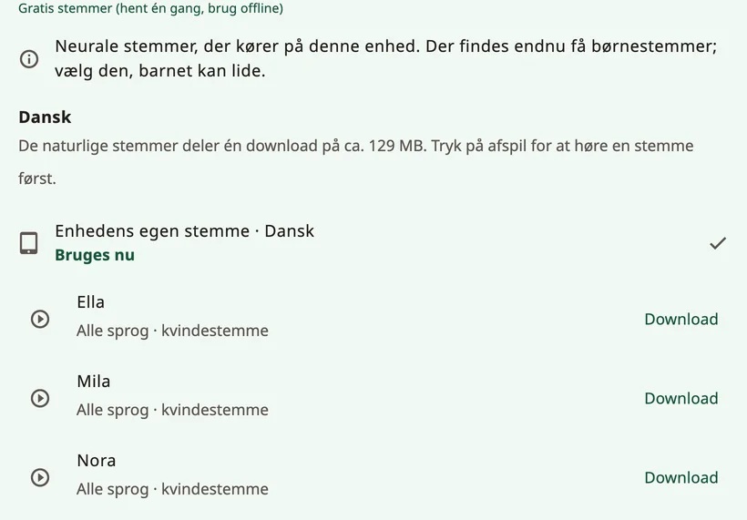

<!-- description: Vælg, hvordan barnet lyder i Amalino: naturlige stemmer, enhedens egen stemme, optagelser, stemmens alder, tempo og udtalen af barnets navn. -->
# Stemmer

Stemmen er barnets stemme. Lad barnet høre et par stykker, og lad det selv vælge den, det kan lide. Du kan altid skifte under **{app:sectionSettings}** → **{app:speechVoice}**.

## Slags stemmer

- **{app:naturalVoicesHeading}**: ti stemmer (Ella, Mila, Nora, Sofi, Ida, Leo, Theo, Adam, Omar og Ben), der lyder mest menneskelige. Hver af dem taler alle Amalinos syv sprog. Én download dækker dem alle, og derefter virker de offline.
- **{app:systemVoice}**: de stemmer, der følger med telefonen eller tabletten. De skal ikke hentes. Nogle af dem kræver måske internet; det skriver Amalino under stemmen.
- **{app:personalVoice}** (iPhone og iPad, iOS 17 eller nyere): en stemme, du har lavet i enhedens indstillinger under **Tilgængelighed** → **Personlig stemme**. Amalino beder om lov til at bruge den. Android har ikke {app:personalVoice}: Vil du bevare et familiemedlems stemme, så indtal ordene i stedet.
- **Jeres egne optagelser**: Indtal et hvilket som helst ord med din egen stemme, når du redigerer knappen. Optagelserne afspilles i stedet for appens stemme. Læs mere under [Redigér og flyt knapper](editing.md).

Tryk på en stemme for at høre den, og tryk derefter på **{app:useVoice}**.

## Én stemme eller én pr. sprog

Hvert sprog har sin egen indstilling for stemme. Da hver naturlig stemme taler alle barnets sprog, kan du trykke på knappen **{app:useForAll|voice=…}** og bruge den samme stemme til det hele. Ellers skifter sætninger, der blander sprog, stemme undervejs.

## Download

De naturlige stemmer er én samlet download på omkring 129 MB. Amalino fortæller dig først, hvor stor den er. På mobildata spørger appen, før den henter noget; vælg **{app:waitForWifi}**, hvis du vil hente stemmerne senere. Indtil downloaden er færdig, taler enhedens egen stemme.

Har du brug for plads, kan du fjerne de naturlige stemmer fra enheden. Så bruger ordene enhedens stemme, indtil du henter dem igen.

## Sådan lyder stemmen

- **{app:speechRate}**: langsommere eller hurtigere.
- **{app:voiceAge}**: **{app:voiceAgeAdult}**, **{app:voiceAgeOlder}** eller **{app:voiceAgeYoung}** med en skyder til **{app:voiceAgeStrength}**. Indstillingen gør stemmen lysere og ændrer dens karakter. Den kommer til at lyde mere som en lille voksen end som et rigtigt barn, så prøv dig frem og se, hvad barnet kan lide.
- **{app:pitch}**: kun for enhedens egne stemmer, så indstillingen vises kun, mens en af dem taler. De naturlige stemmer bruger i stedet indstillingen for stemmens alder.
- **{app:volume}**.
- **{app:lowerOthers.anon}**: Musik og andre apps bliver skruet ned **{app:lowerOthersSpeaking}** eller **{app:lowerOthersOpen}**, så det er lettere at høre ordene.

## {app:savedSpeech}

Du finder funktionen under **{app:advanced}** nederst i **{app:speechVoice}**. For at kunne tale med det samme forbereder Amalino tavlens ord med de valgte stemmer og gemmer dem på enheden. Det sker i baggrunden, mens tavlen ikke bliver brugt. **{app:savedSpeech}** viser, hvor langt appen er nået, og hvor meget plads det fylder. Lyder ordene på et tidspunkt forkert, så tryk på **{app:savedSpeechRebuild}**, så bliver de forberedt forfra.

## Barnets navn

Vælg barnets navn i voksenindstillingerne (for eksempel **{app:settingsChildName|name=Sam}**):

- skriv navnet, som det staves på hvert sprog, eller en kortere udgave af det;
- hør, hvordan hver stemme siger det;
- lyder det forkert, så skriv under **{app:spokenAs}**, hvordan det udtales – for eksempel »Sjån« for Sean.

Lyder det stadig forkert, så indtal navnet med din egen stemme i stedet.

## Ingen stemme til et sprog

Har et sprog endnu ingen stemme, så hent de naturlige stemmer. Du kan også installere en stemme i enhedens indstillinger for tekst-til-tale eller selv indtale ordene.

> **Tip:** Spørg barnet, hvilken stemme det kan lide. En stemme, der passer til barnet, giver lyst til at bruge den.

Næste side: [Deling og udskrift](sharing-and-printing.md).
