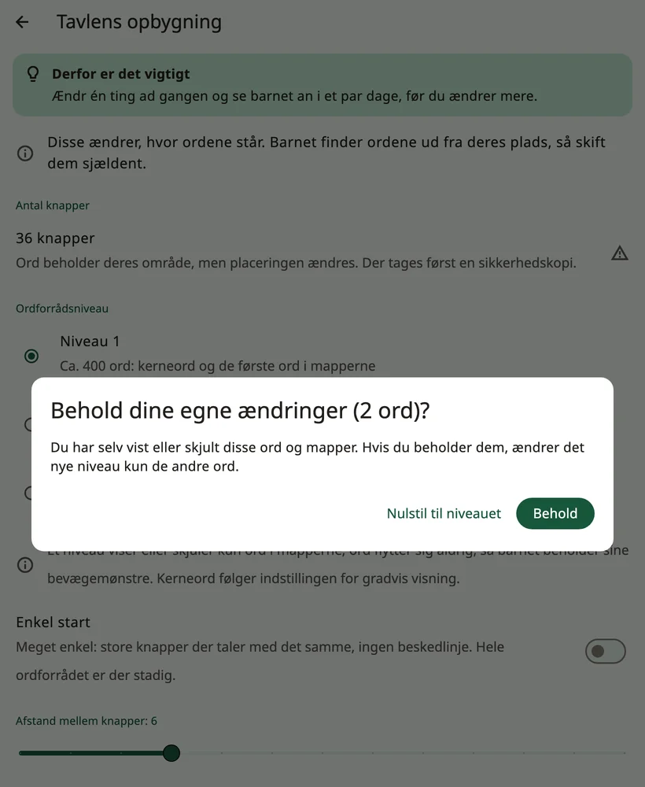

<!-- description: Sådan er ordene i Amalino ordnet: kerneord på faste pladser, mapper, tavlens størrelse, ordforrådsniveauer og skjulte ord, der vises lidt efter lidt. -->
# Ord og mapper

Amalino har omkring 2.500 ord på hvert af sine syv sprog. Du viser dem ikke alle på én gang. Her kan du læse, hvordan ordene er ordnet, og hvordan du viser flere, efterhånden som barnet udvikler sig.

## Kerneord og mapper

På **hovedtavlen** står kerneordene: små hverdagsord som »jeg«, »vil have«, »mere«, »gå«, »ikke«, »hjælp« og »kan lide«. Omkring 200 kerneord udgør det meste af det, vi siger hver dag, så barnet kan sige rigtig meget med dem.

**Mapperne** rummer resten: mad, steder, mennesker, følelser, legetøj og meget mere. En mappeknap har et foldet hjørne og åbner en side med ord, der hører sammen.

Når barnet har trykket på et ord i en mappe, går Amalino tilbage til det sted, barnet kom fra, klar til næste ord: »jeg vil have«, så **mad**, »æble« – og så er hovedordene der igen til »vær sød«. Til mapper, hvor barnet vælger flere ord i træk, for eksempel farver, kan du slå **{app:folderGoBack}** fra for den mappe (se [Redigér og flyt knapper](editing.md)). **{app:favourites}** starter med funktionen slået fra.

## Tavlens størrelse

Tavlens størrelse (**{app:gridSize}**) er, hvor mange knapper der er plads til på én side:

- **20**: {app:grid.20}
- **36**: {app:grid.36}
- **60**: {app:grid.60}
- **84**: {app:grid.84}

Opsætningen foreslår en størrelse ud fra barnets alder og måde at trykke på. Hver enhed tilbyder kun de størrelser, hvor hver knap er mindst 44 punkter bred (omkring 7 mm – en behagelig størrelse til en finger).

Prøv at holde fast i den samme størrelse. Ændrer du den, flytter ordene til nye pladser, og barnet skal lære dem forfra. Amalino beder dig bekræfte ændringen og laver en sikkerhedskopi først. Lad hellere tavlen vokse ved at vise flere ord.

## Ordene flytter sig aldrig

Hvert ord har sin egen plads, og den beholder det. Er et ord skjult, står pladsen tom, og når ordet bliver vist senere, dukker det op dér. Intet rykker sig for at gøre plads.

## {app:vocabLevel}

**{app:sectionSettings}** → **{app:boardLayout}** → **{app:vocabLevel}** bestemmer, hvor mange ord der vises i mapperne:

- **{app:levelDesc1|label}**: omkring 400 ord, kerneord og de første ord i mapperne
- **{app:levelDesc2|label}**: omkring 1.300 ord, med flere mapper
- **{app:levelDesc3|label}**: alle ord (omkring 2.500)

Et niveau viser eller skjuler kun ord i mapperne. Ordene på hovedtavlen bliver vist ét ad gangen (se nedenfor).

Har du selv vist eller skjult ord i mapperne, spørger Amalino først, om du vil beholde dine egne ændringer. **{app:keepOwnChangesKeep}** ændrer kun de andre ord; **{app:keepOwnChangesReset}** lader alle ord følge det nye niveau.

## Vis og skjul ord

Hvert ord er enten **vist** for barnet eller **skjult**. Et skjult ords plads ser tom ud for barnet, og intet andet flytter sig.

Du ser og ændrer dem ved at åbne voksenindstillingerne og vælge **{app:editBoard}**. De skjulte ord står på deres pladser, mørkt skraverede og med et overstreget øje. Tryk på et af dem, slå **{app:visibility}** til i redigeringen af ordet, og tryk på **{app:done}**. Det fungerer på samme måde inde i mapperne.

I modelleringstilstand fungerer en mappeside på samme måde: Skjulte ord ses svagt, og øjet i modelleringslinjen viser alle ordene i mappen på én gang.

> **Tip:** Vis først et nyt ord for barnet, når du har modelleret det mange gange. I modelleringstilstand ses skjulte ord svagt på deres pladser: Tryk på dem, mens du taler, og når dit barn er klar, så hold fingeren på et af dem, og vælg **{app:showToChild}**. Læs mere under [Indstillinger: {app:modellingMode}](settings.md).

## Find et ord

Kan du ikke huske, hvor et ord står? Tryk på **{app:showMeWhere}** i **{app:modellingMode}**, og skriv ordet. Amalino viser vejen til ordet, knap for knap, så du selv kan trykke på det, mens du taler.

## Jeres egne ord

Du kan tilføje ord, skifte billeder, indtale et ord med din egen stemme og lave nye mapper eller tilføje de indbyggede. Læs mere under [Redigér og flyt knapper](editing.md).

Næste side: [Hurtigsætninger og Mere](quick-phrases.md).
