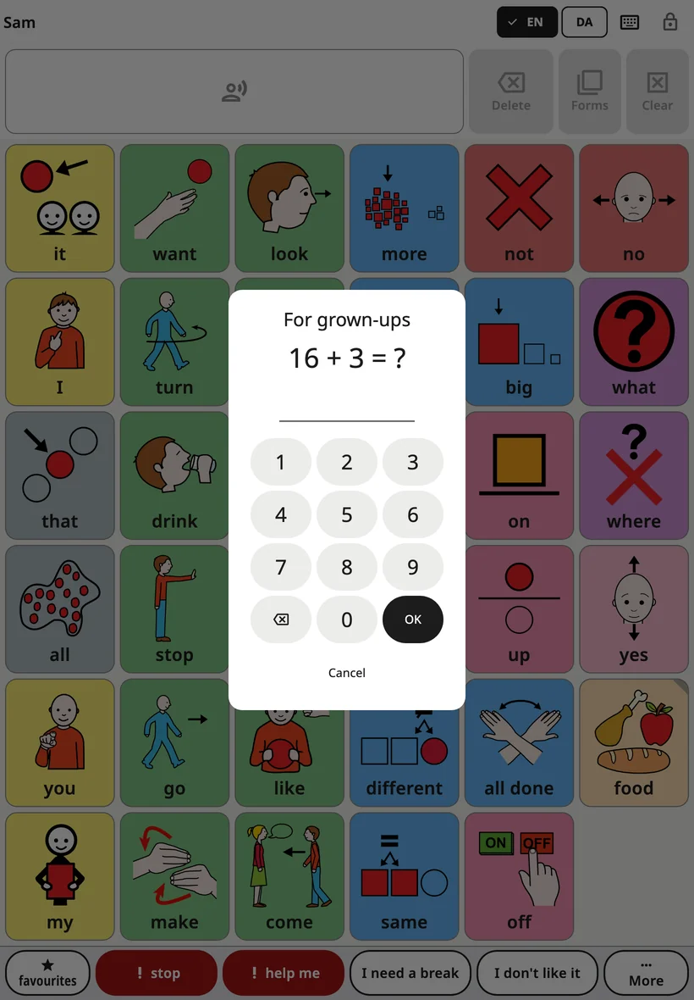
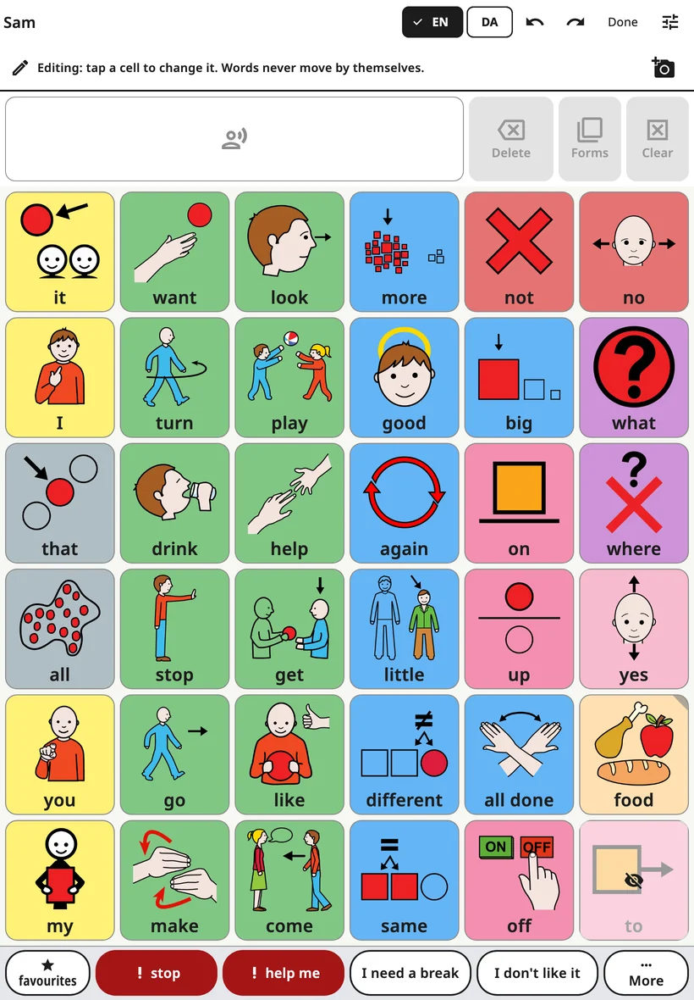
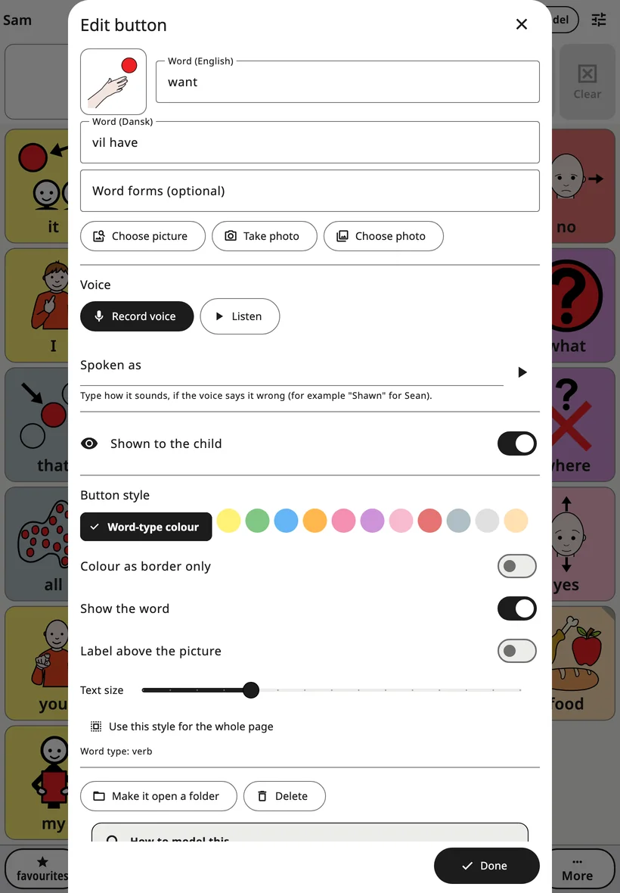
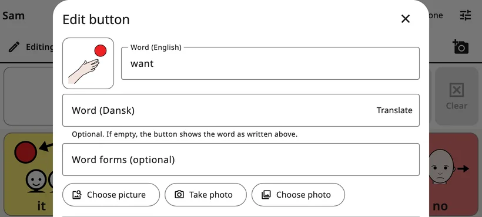
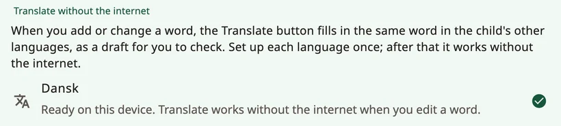

<!-- description: Change Amalino's board: open the grown-up settings, edit a button's words, picture and voice, translate, add folders, move buttons and undo. -->
# Editing and moving buttons

Every family's words are different. You can change any word, picture or voice, add your own words and folders, and move buttons you've added. Nothing here can be seen or changed by the child.

## Opening the grown-up settings

At the top right of the board, **hold the lock for 3 seconds**, then answer the short sum (or enter your PIN) on the number keys that appear. The grown-up settings open. They lock again by themselves after 5 minutes, or straight away when you tap **Lock**.

You can change the hold time, the PIN and the automatic lock under **Lock and keep in the app**. See [Settings](settings.md).

## Editing the board

Choose **Edit this board**. The board shows a line at the top: "Editing: tap a cell to change it. Words never move by themselves." The top bar now has **Undo**, **Redo** and **Done**.

- Tap a button to edit it.
- Tap an empty cell and choose **Add a word** or **Add a folder**.
- Open folders and edit their buttons the same way.
- Tap **Done** when you've finished.

Hidden words show in their places, shaded dark and with a crossed-out eye, so you always see the whole board while editing.

## The button editor

- **Word**: the word on the button, in the board's current language.
- **The child's other languages**: below it, one field for each of the child's other languages, for example **Word (Danish)**. They're optional: an empty field shows the word as written above.
- **Translate**: appears next to an empty field when the device can translate that language offline. It fills in the word as a draft, marked "Translated on this device. Please check it." Check it before the child uses it. See "Translating words" below.
- **Word forms (optional)**: other forms of the word, separated by commas, for example "mice, mouse's".
- **Picture**: **Choose picture** searches the built-in pictures, and **More symbol sets (online)** searches other free symbol sets on the internet; only your search words are sent. **Take photo** and **Choose photo** use your own. Photos work best for people, pets and the child's own things.
- **Voice**: **Record voice** records the word in your own voice; **Listen** plays it back; **Remove recording** goes back to the app's voice.
- **Spoken as**: if the voice says a word wrongly, type how it sounds, for example "Shawn" for Sean.
- **Use my recording in sentences too**: normally, your recording plays only when the child taps that one button. Inside a sentence, the app's voice says the word. Turn this on for sounds, songs or words the voice can't say.
- **Shown to the child**: on, the child sees and uses the word; off, its place looks empty to the child and nothing moves. See [Words and folders](words-and-folders.md).
- **Button style**: the **Word-type colour**, **Colour as border only**, **Show the word**, **Label above the picture** and **Text size**. **Use this style for the whole page** applies it to every button on the page.
- **Word type**: decides the button's colour (for example, actions are green and describing words blue).

For a **new** word or folder, tap **Add** at the bottom to put it on the board. **Add** stays greyed out until the button has a word or a picture. The **✕** cancels: nothing is added, and a photo or recording you made for it is thrown away.

When you edit an **existing** button, your changes apply as you make them; tap **Done** (or the **✕**) to close.

## Translating words

**Translate** works on the device, without the internet, once a language is set up. Set it up once for each language: in the grown-up settings, open **Languages** (under **Boards and words**), then **Translate without the internet**:

- **Android**: tap the language and agree to download Google's translation model, about 30 MB per language. No words from the app are sent.
- **iPhone and iPad**: this needs iOS 26 or later. The languages come from Apple: open the device's **Settings → Apps → Translate → Downloaded Languages**, download the languages, then come back to Amalino.

Each language shows whether it's ready. Where the device can't do it, it says **Not available on this device.**

## Folders

To add a folder, tap an empty cell in edit mode and choose **Add a folder**. **Which folder?** lists the child's folders with their pictures, including the built-in ones (Food, Feelings, Places…), and **New folder** at the top. Choose one, check the name and picture, and tap **Add**.

A folder button's editor also has:

- **Make it open a folder**: turns a word button into a folder button. Choose a folder or **New folder**.
- **Change folder**: points a folder button at a different folder.
- **Open this folder**: closes the editor and opens the folder, so you can edit what's inside.
- **Go back after a word**: on, the child returns to where they came from after tapping a word in this folder, ready for the next word. Turn it off for folders where the child picks several words in a row. It applies to the folder wherever it's opened from. **Favourites** starts with it off.

## Moving a button

Core words on the main board keep their places, so the child's hand always finds them. Buttons that open a folder or a scene can be moved:

1. Edit the button and choose **Move…**.
2. **Where should it go?** shows the board with the free cells highlighted. Tap one, then **Put it here**.
3. Or choose **Choose another board** to move it to another folder, or **Put it in Favourites instead**.

The button keeps its word, picture, voice and style. Nothing else on either board moves. One **Undo** puts it back.

## Deleting a button

Edit it and choose **Delete**. For a core word, Amalino suggests **Hide instead**: hiding keeps its place for later, while deleting leaves an empty cell. Hiding is almost always the better choice.

## Undo and history

- **Undo** and **Redo** in the top bar step back and forward through your changes while you edit.
- **History and backups** in the grown-up settings lists every change. **Go back to here** returns the boards to how they were at that point.

Mistakes are fine. Anything you change can be undone.

> **Tip:** When you add a word, use it on the device yourself at least three times that day.

Next: [Settings, screen by screen](settings.md).
