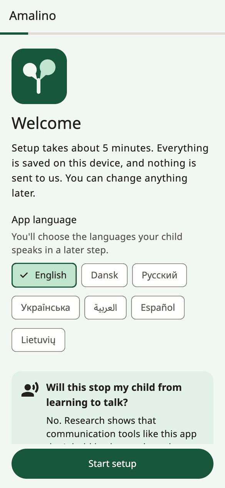
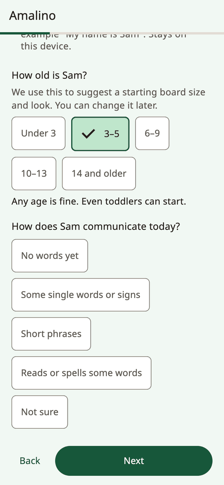
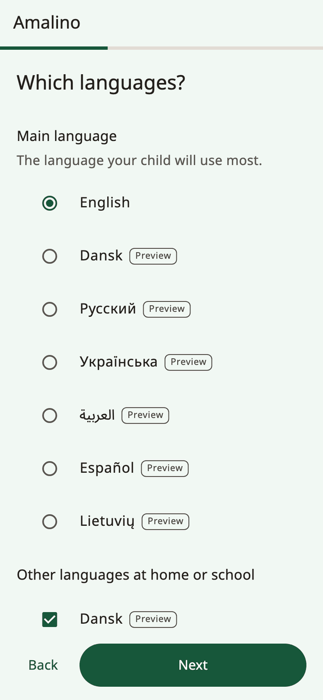
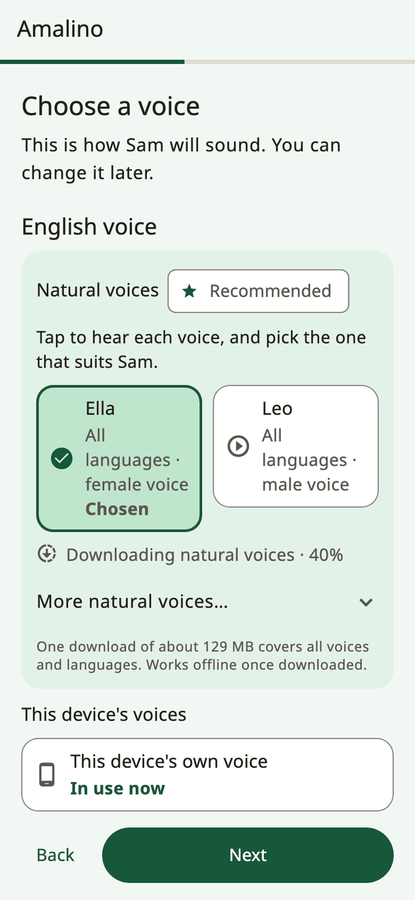
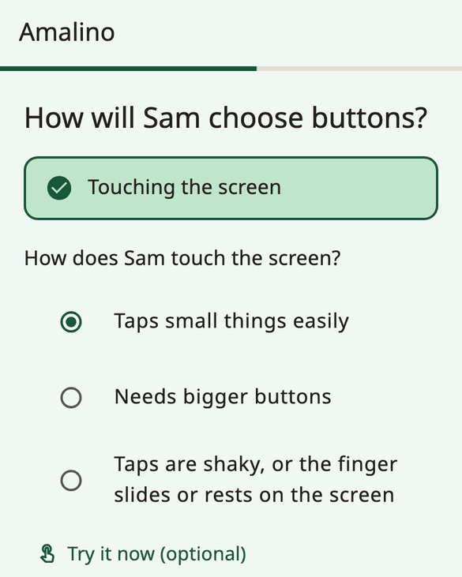
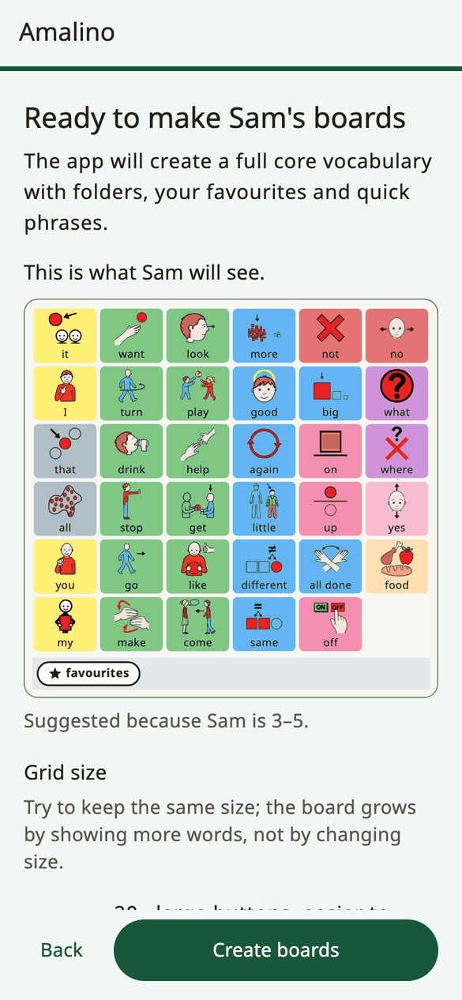

<!-- description: Install Amalino and go through the first setup: the child, languages, voice, touch, favourite things and the grown-up lock. -->
# Getting started

Amalino runs on iPhone, iPad and Android phones and tablets. It is free, and it works without the internet once it's set up.

Setup takes about five minutes. Everything you enter stays on the device, and you can change any answer later.

## Before you start

- Charge the device and turn the sound up.
- If you can, have the child nearby for the touch step. It helps to see how they tap.
- Be on Wi-Fi if you can: the natural voices are one download of about 129 MB.

## The setup steps

### Welcome

Choose the **App language**: the language of the grown-up screens. You'll choose the child's languages in a later step.

If the child already uses Amalino on another device, tap **I already use Amalino**, then **Restore a backup file**, to bring their boards over from a backup you exported with a password. See [Sharing and printing](sharing-and-printing.md).

### About the child

- **How old is your child?** The age range suggests a starting board size, vocabulary level and look. Any age is fine; even toddlers can start.
- **How does your child communicate today?** This helps choose the first words.
- **Child's name** (optional). It is shown and spoken in the app, for example "My name is…". It stays on the device.

### Languages

Choose the **Main language**, the one the child will use most, and tick any other languages the child hears every day. Amalino has seven: English, Danish, Russian, Ukrainian, Arabic, Spanish and Lithuanian.

Every language uses the same button in the same place. The child can switch languages with one tap and doesn't have to learn the board again.

For now, every language except English has a **Preview** tag: not all its words have been checked by a native speaker yet. The note under the list says "Words may still change. Tell us about a wrong word." You can also correct any word yourself.

In Russian, Ukrainian, Arabic, Spanish and Lithuanian, setup also asks **Which word forms should the app use for your child?** Choose **Boy forms** or **Girl forms**, so sentences about the child sound right (for example "устал / устала", "tired", in Russian).

If your language isn't listed, tap **My language isn't listed**. You can still make boards: record each word with your own voice, and the board plays your recordings.

### Voice

Choose how the child will sound in each language. Tap a voice to hear it.

- **Natural voices** sound the most human. Ten voices speak all seven languages, and they share one download of about 129 MB. They work offline afterwards. The recommended voice is already chosen for you.
- **This device's own voice** needs no download and is ready at once. It speaks until the natural voice has downloaded.

On Wi-Fi, the download starts by itself. On mobile data, Amalino asks first, or waits for Wi-Fi.

You can change the voice at any time. See [Voices](voices.md).

### How the child chooses

Amalino is used by touching the screen. Other ways of choosing are shown as **Coming in a later version**.

Then answer **How does your child touch the screen?**

- **Taps small things easily**
- **Needs bigger buttons**
- **Taps are shaky, or the finger slides or rests on the screen**

The answer sets up the touch settings and the board size. **Try it now (optional)** lets the child tap a few times; **Make it easier** adjusts things if many taps miss. More touch settings are in **Settings → Touch and access**.

### 5 favourite things

Add up to five things the child loves: bubbles, a cartoon, grandma. Take a photo or choose one, and type what the child calls it. They go into the **Favourites** folder, one tap away from every board. Photos work best for people and the child's own toys.

### Grown-up settings

The settings are protected so the child can't change the board by accident. To open them, **hold the lock at the top of the board for 3 seconds, then answer a short sum**. Try it here once. Choose **Longer hold (5 seconds)** if the child explores the screen a lot.

You can choose a **PIN** instead of the sum. Older children can solve the sum, so a PIN is safer for them.

### The name in each language

If you added a name, you can say how it's written in each language and hear how the voice says it. If it sounds wrong, type how it sounds, for example "Shawn" for Sean.

### Summary

The last step shows all your answers. Tap **Change** next to any of them.

Here you also choose:

- the **Grid size**: how many buttons fit on the board. **More sizes** shows the others. Try to keep one size: the board grows by showing more words, not by changing size.
- the **Vocabulary level**: about 400, 1,300 or 2,500 words. See [Words and folders](words-and-folders.md).

For older children, you can turn on **Teen words and look**: social phrases, jokes and slang, and a grown-up style without cartoon looks.

For very young beginners, setup may offer **Simple start**: four big pictures that speak at once. The full vocabulary stays underneath, and you can switch to the full board later.

Then tap **Create boards**.

## After setup

The **All set!** page shows once more how to open the grown-up settings, and gives you a first tip to try today. It also has **Lock this device to the app** and a **Daily tip** switch.

Tap **Start talking**. The board opens, ready for the child.

A few things you can do later, under **Finish setting up** in the grown-up settings:

- choose the two phrases the child needs most,
- hear how the child's name sounds,
- try the touch settings with the child.

Next: [The child's board](the-board.md).
