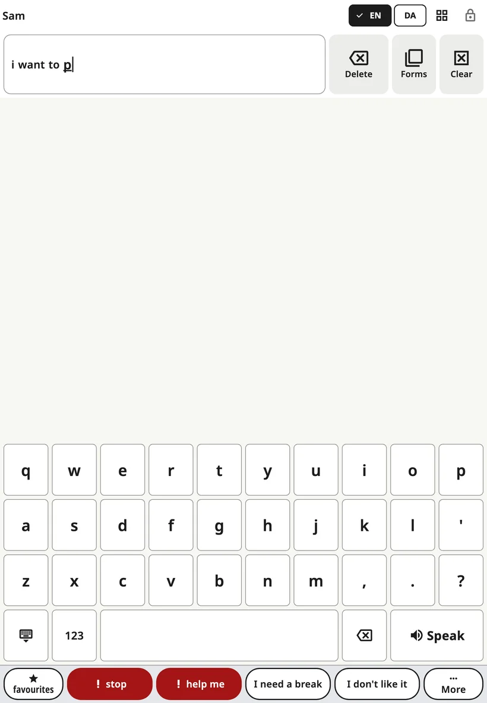

<!-- description: Typing in Amalino: opening the keyboard, word suggestions, letter order, numbers and marks, and key sizes on phones. -->
# The keyboard

Children who know some letters can type words that aren't on the board. The keyboard sits in the same place as the board, so switching between them is one tap.

## Opening and closing it

Tap the **keyboard** button in the top bar. To go back to the pictures, tap the same button again (it now shows a grid) or the **close** key at the bottom left of the keyboard.

## Typing

- The word being typed appears in the **message bar**, so the child sees it grow.
- **Space** finishes the word.
- **Backspace** deletes a letter. Hold it to keep deleting.
- **Speak** says the whole message.
- **123** opens numbers and punctuation, including each language's own marks (¿ ¡ in Spanish, « » in Danish, Russian and Ukrainian, „ “ in Lithuanian, ؟ ، in Arabic). **ABC** goes back to the letters.

The message bar's **Delete** and **Clear** work as on the board.

On a phone, touching a letter shows it larger above the finger, so the child can see which key they're on before lifting. This doesn't happen when **Activate when the finger lifts** and a **Hold time** are on, because then the key already darkens while it's held.

## Word suggestions

A row above the keys suggests words as the child types. A tap adds the word and a space. Suggestions come from:

- the words on the child's boards,
- what the child has typed before, if **Learn from what your child types** is on,
- a word list for the language.

They are made on the device; nothing is sent anywhere.

Some families turn suggestions off while a child practises spelling: **Settings → Keyboard → Word suggestions**.

If **Sentence from first letters** is on (in **Settings → Keyboard**), typing first letters like "iwgp" can offer "I want to go to the park" as an extra suggestion. The child picks it or ignores it.

## Letter order

**Settings → Keyboard → Layout**:

- **Standard**: the language's usual keyboard.
- **ABC order**: the letters in alphabetical order, in the same rows, so the keyboard is the same size.

## Key size on phones

On a phone, a language with many letters gives narrow keys. **Settings → Keyboard → Key size on this phone**:

- **Automatic** (the default) follows the touch settings: if the child needs bigger buttons or taps are shaky, long rows of letters are split in two, keeping the letter order, so every key is at least 40 points (about 6 mm) wide.
- **Standard** always keeps the usual rows.
- **Larger keys** always splits long rows.

When a phone is turned sideways, the keys are already wide, so rows aren't split. Tablets always use the usual rows.

## When the phone is turned sideways

If the board is set to landscape on a phone, the keyboard needs the whole height. "**Stop**" and "**help me**" then move to the end of the suggestion row, in the same place every time. The full phrase row returns when you go back to the board.

> **Tip:** Model typing too. Type a word slowly while you say it, then tap **Speak**.

Next: [Scenes](scenes.md).
