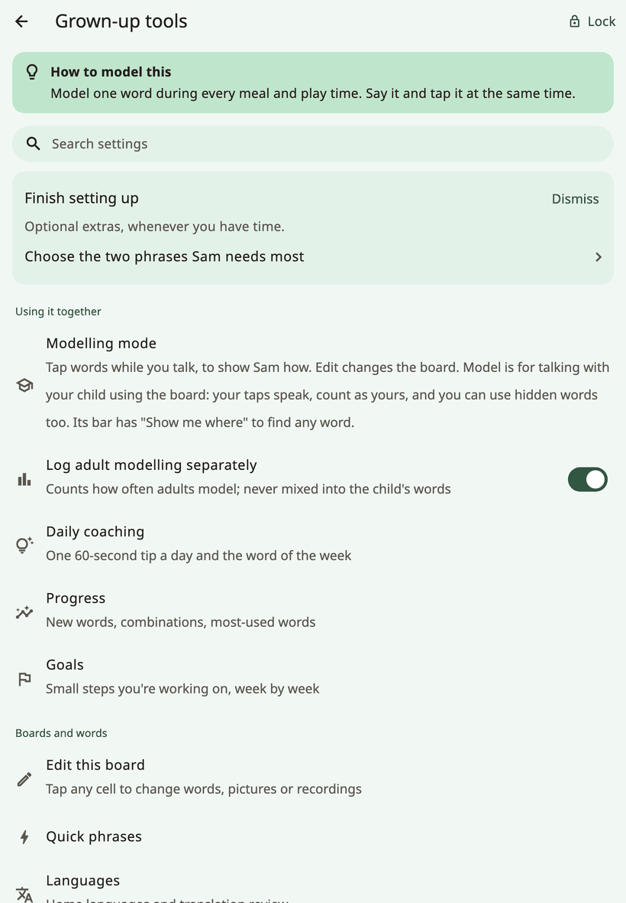
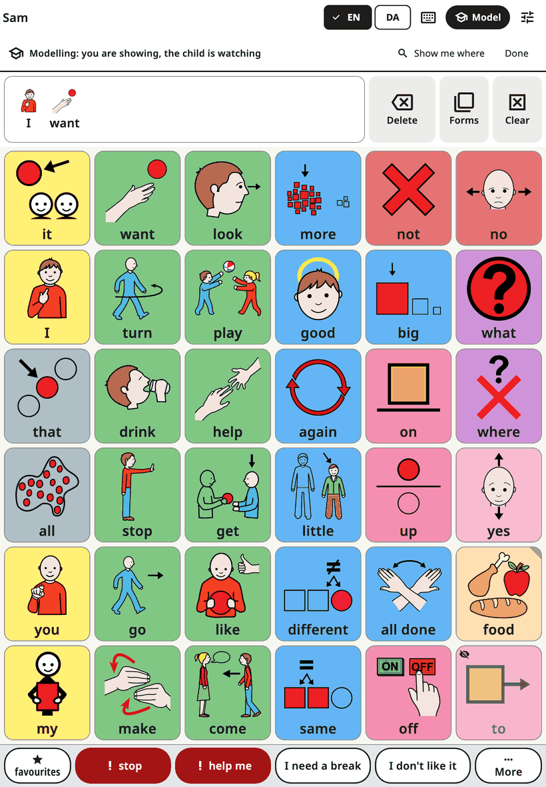
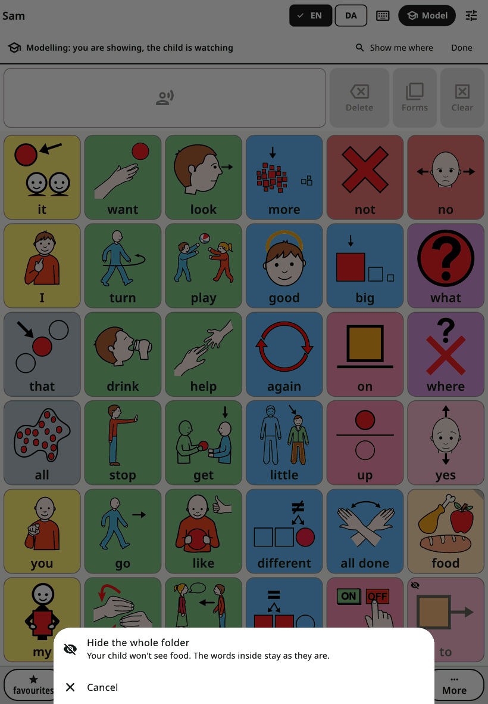

<!-- description: Every screen in Amalino's grown-up settings explained: modelling, words, voices, touch, display, board layout, keyboard, suggestions, lock and data. -->
# Settings, screen by screen

Hold the lock at the top of the board for 3 seconds and answer the sum on the number keys to open the grown-up settings. They're in four groups: **Using it together**, **Boards and words**, **Settings** and **Data**. This page goes through them in the order you see them.

Most screens have a short tip, **Why this matters**.

## Find a setting

Can't remember where something is? Tap **Search settings** at the top and type a word, like "voice" or "colour". Each result shows where it lives ("Speech and voices → Speaking speed"). Tap it, and Amalino opens that screen with the setting gently marked.

## Using it together

### Modelling mode

**Edit** changes the board. **Model** is for talking with your child using the board: you tap words while you talk, to show how. Your taps speak and count as yours, never as the child's words.

The quickest way in: while the grown-up settings are open, tap **Model** on the board's top bar (on a phone, the icon with the mortarboard). The **Modelling mode** entry in the menu does the same. A line at the top says "Modelling: you are showing, the child is watching". In that line, **Show me where** finds a word for you: type it, and Amalino shows the path to it, button by button.

- **Hidden words** appear faded, with a small crossed-out eye, in the places where they'll appear for the child. Tap them like any word, so your child hears and sees them long before they get them. The child still sees an empty space.
- **Show to your child**: hold a hidden word for a moment and choose **Show to your child** when you think they're ready. **Undo** puts it back.
- **Hide, or a whole folder**: hold a word your child sees to get **Hide from your child**. Hold a folder button to show or hide the whole folder at once; a quick tap still opens it.

- **It ends by itself** two minutes after your last tap, and whenever the grown-up lock closes, so your child is never left in modelling mode. To end it yourself, tap **Done** or **Model** again.

See [Tips for families](tips-for-families.md).

**Log adult modelling separately** sits next to it: it counts how often adults model, never mixed into the child's words.

### Daily coaching

One 60-second modelling tip a day, and the **Word of the week**: up to 3 words the grown-ups model this week, highlighted in modelling mode. **Daily reminder** sends a notification at the time you choose; it asks for permission only when you turn it on.

**Why this helps** is here too: short answers to common worries ("Will this stop my child from learning to talk?"), with the research.

### Progress and Goals

- **Progress**: new words, word combinations and the most-used words. **This week** sums up the week in a short text to share with everyone who talks with the child, with one word to model next.
- **Goals**: small steps you're working on, week by week, such as days used, new words or words per sentence.

Use the numbers to choose what to model next, not to test the child.

## Boards and words

- **Edit this board**: see [Editing and moving buttons](editing.md). Showing and hiding words is done there too.
- **Quick phrases**: see [Quick phrases and More](quick-phrases.md).
- **Languages**: the main language and the other languages. Languages whose words are still being checked show a **Preview** tag, with a line on how to tell us about a wrong word. **English spelling** (UK or US) is for this device. **Translation review** lists words that still need review in each language, so you can check or correct them. **Translate without the internet** sets up offline translation for each of the child's other languages; see [Editing and moving buttons](editing.md).
- **Make a topic page**: type a topic, like "birthday party", to get a ready page for it. It works on the device with about 20 everyday topics (birthday, doctor, park, bath time, bedtime, zoo, beach and more). You check the words before saving.
- **Symbol sets**: the included ARASAAC pictures, the older Mulberry pictures some boards still use, your own photos, and an optional search of all ARASAAC pictures (about 13,000), which downloads a picture when you choose it. **Use the new pictures on this child's boards** updates built-in words that still have their original picture; your own pictures and photos are kept. ARASAAC is free for non-commercial use.
- **Print boards**: see [Sharing and printing](sharing-and-printing.md).

## Settings

### The child's name

The name, and how it's written in each language. You can also set how it's spoken. See [Voices](voices.md).

### Speech and voices

The voice for each language, **Use … for all languages**, **Personal Voice**, **Speaking speed**, **Voice age**, **Volume** and **Sound check**. **Pitch** appears only while one of the device's own voices is speaking. **Saved speech** is at the end, under **Advanced**. See [Voices](voices.md).

### Touch and access

How the board reacts to touch. Change one thing at a time and watch the child for a few days.

**How the child chooses** shows touching the screen; other ways of choosing are listed as **Coming in a later version**. **Highlight while speaking** puts a soft tint on the button while its word plays.

**Touch tuning** holds the rest:

- **Hold time**: the finger must stay on a button this long before it speaks. Helps when the hand brushes the screen, but a quick tap won't work. With a hold time, word forms open only from the **Forms** button.
- **Ignore repeated taps within**: a second tap on the same button soon after is ignored.
- **Activate when the finger lifts**: the child can slide to the right button before it counts.
- **Bigger touch area**: each button reacts a little beyond its edge.
- **Tremor filter**: for shaky hands, the button that counts is **Where the finger first lands** or **Where the finger rests longest**.
- **Ignore a resting hand**: a palm or a hand resting on the screen doesn't press buttons.
- **Practise with the child**: a practice board that counts taps, ignored touches and misses between buttons.

### Display, hearing and sensory

How the board looks. Everything here is safe to try: nothing moves.

- **Look**: **Standard**, **Calm**, **Dark**, **High contrast**, or **Teen (no childish look)**.
- **Word-type colours**: **Standard (Fitzgerald key)**, **Calm colours**, **Colour-blind safe** or **No colours**. **Colour as border only** gives a calmer look.
- **Show words under pictures**, **Label above the picture** and **Text size**.
- **Reduce motion**: follows the device's setting, or always on or off.

### Board layout

"These change where words are. Your child finds words by their place, so change them rarely."

- **Grid size**: see [Words and folders](words-and-folders.md). On a tablet, a note says when some long words won't fit in full at 84 buttons upright.
- **Board orientation on this phone**: phones only. The board, the keyboard and scenes stay upright (or sideways); grown-up screens still turn. If the other orientation fits fewer buttons, Amalino asks before changing.
- **Vocabulary level**: see [Words and folders](words-and-folders.md).
- **Simple start**: very simple, big buttons that speak at once, with no message bar. The full vocabulary stays underneath.
- **Space between buttons**.

### Message bar

- **Show the message bar**.
- **Speak each word when tapped**: on by default. When off, words only go into the message until it's tapped.
- **Clear the message after speaking it**.
- **Word forms**: hold a word to choose another form (dogs, went, bigger…). On in every language. See [The child's board](the-board.md).

### Keyboard

**Word suggestions**, **Learn from what your child types**, **Sentence from first letters**, **Layout** and **Key size on this phone**. See [The keyboard](keyboard.md).

### Suggestions

Help that suggests words. It never speaks for your child, and the child always chooses. Each helper has its own switch, and all are off until you turn them on. They work on the device:

- **Highlight likely next words**: gently outlines 2–3 buttons. Buttons never move. Learns only on this device.
- **Pages for the moment**: suggests a page at a time of day, for example the Food page at lunchtime. It uses the time of day only, never your location or calendar. A card on the board offers the page; one tap opens it, and the child can ignore it. On its screen, turn on **Suggest pages for the moment**, then tap **Add meal-time suggestions (Food page)** or **Suggest a page at a time of day** to choose a page and a time.
- **Listen to what I say**: while you switch the microphone on in the top bar, the device listens to what you say and highlights words that could answer. Speech is recognised on the device; audio is never saved or sent. It needs a one-time download of the speech recogniser.

### Lock and keep in the app

- **Edit lock**: **Simple sum (default)** or **PIN** (4–8 digits), both typed on number keys on the screen. The PIN is for the device: the same PIN opens the grown-up settings for every child on it. If the device has no screen lock, Amalino first shows a **recovery code** to write down and keep away from the device. If you forget the PIN, tap **Forgot PIN?** and use the screen lock or the recovery code to set a new one.
- **Hold time to open**: how long the lock must be held.
- **Lock again after**: how soon the grown-up settings lock themselves.
- **Keep the child in the app**: step-by-step instructions for **Guided Access** on iPad and iPhone, and **app pinning** on Android (on Samsung tablets also Samsung Kids). The child can still talk; they just can't leave the app.

## Data

- **History and backups**: undo any change, make a backup now, export a backup with a password, or restore one. See [Sharing and printing](sharing-and-printing.md).
- **Share boards (Open Board Format)**: move boards to and from other AAC apps. See [Sharing and printing](sharing-and-printing.md).
- **Children**: each child has their own boards and words. **Add a child** for a brother or sister on the same device.
- **About and licences**: privacy, a link to the **Privacy policy**, the licences of the pictures and voices, and feedback. **Diagnostics** at the end shows technical details, such as how fast a tap turns into speech, if we ever ask you for them.

## Coming later

Some features need an online service: **Sync and sharing** between devices, the **Board library**, **Pages shared with you** and the **Cloud helpers for grown-ups**. This version of the app has no such service, so they don't appear in the menu.

Next: [Voices](voices.md).
