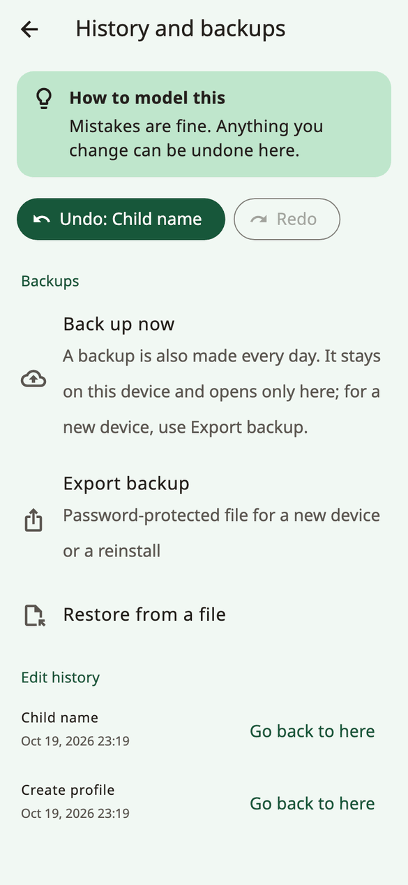

<!-- description: Back up a child's Amalino boards, move them to a new device, share boards with other AAC apps, and print paper boards. -->
# Sharing and printing

The child's boards are precious: months of words, photos and recordings. Here's how to keep them safe, move them, and take them onto paper.

## Backups

Open the grown-up settings and choose **History and backups**.

- A backup is made **automatically every day**. It stays on the device and only opens on the device that made it, so it protects against mistakes, not against losing the device.
- **Back up now** makes one straight away.
- **Export backup** makes a password-protected file for a new device or a reinstall. Choose a password you'll remember, and keep the file somewhere other than the device: a computer, a cloud drive or an email to yourself.

If there's no copy outside the device, or the last one is more than a month old, the grown-up settings show a gentle reminder with **Make a copy now** (never in the first two weeks of a new profile). **Not now** hides it for two weeks.

### The device's own backup

- **iPhone and iPad**: if you back up the device to iCloud or a computer, Amalino's data is part of that backup.
- **Android**: Amalino's data isn't copied to your Google backup or to another device. To move to a new device, use **Export backup**.

## Moving to a new device

1. On the old device: **Settings → History and backups → Export backup**, and choose a password.
2. Send the file to the new device with AirDrop, Quick Share, email, a cloud drive or a USB cable.
3. On the new device, install Amalino. On the first screen of setup, tap **I already use Amalino**, then **Restore a backup file**, and **Choose file**.
4. Type the password.

To restore on a device that's already set up, use **Restore from a file** in **History and backups**. All boards, recordings and logs on the device are replaced; Amalino backs up the current state first.

An automatic backup from another device can't be restored: it only opens on the device that made it. Use a backup exported with a password.

## If Amalino can't open the saved boards

The boards are locked with a key that never leaves the device. If that key is missing or doesn't match, for example after moving the app to a new device or restoring a system backup, Amalino shows **This device can't open the saved boards** when it starts. Nothing has been deleted: the old data is kept aside on the device.

- **Restore from a backup file**: choose a backup you exported with a password, and type the password.
- **Start fresh**: go through setup again.

If you ever see **Amalino couldn't start**, close the app completely and open it again. If it keeps happening, restart the device. Your boards have not been deleted.

## Sharing boards with other AAC apps

**Share boards (Open Board Format)**, in the **Data** group of the grown-up settings, moves boards to and from other AAC apps that use the open board format:

- **Export all boards (.obz)** or **Export this board**.
- **Import boards (.obz / .obf)**, for example from Cboard. Imported boards are added as folders. Amalino tells you how many buttons it linked to words it knows.

When you import a board, check that its words are in places the child already knows.

## Printing

**Print boards** makes a paper copy for bath time, the pool, a trip, or a broken device.

- **Paper size A4**
- **Colour**
- **Show words under pictures**
- **Include folders**
- **Cut-out cards**: single pictures to cut out.
- **Laminate-friendly**: the core page only, with strong borders and a wide margin.

Tap **Print or save PDF** to print, or to save a PDF and print it later.

> **Tip:** Keep a laminated core board in the bath and in the car, and model on paper exactly as on the device.

Next: [Tips for families](tips-for-families.md).
