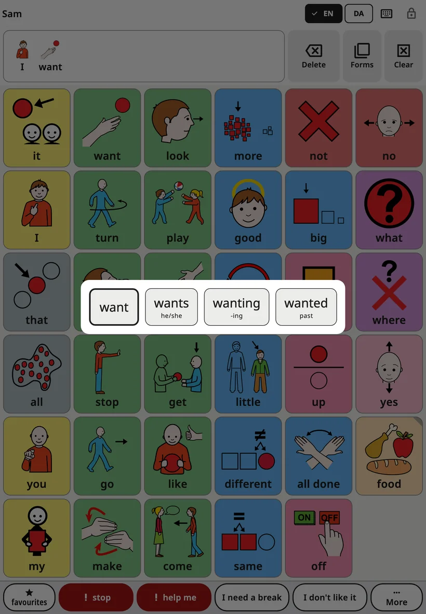
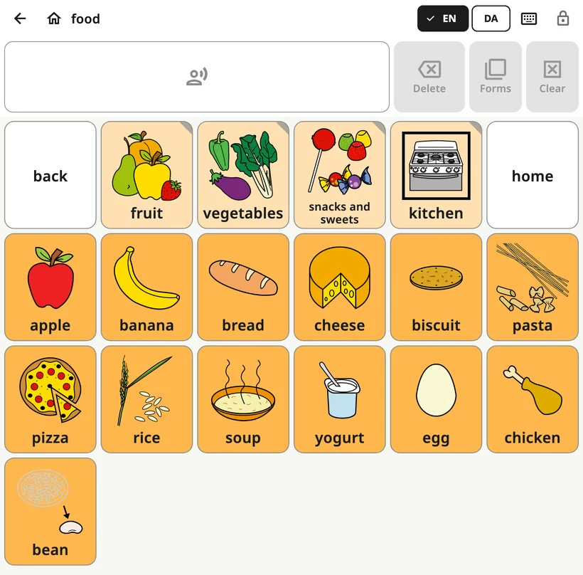

<!-- description: What the child sees in Amalino: the board, the top bar, the message bar, word forms, speaking a sentence and switching languages. -->
# The child's board

The board is the screen the child uses all day. Grown-up settings are locked away, so the child can explore it freely.

## The parts of the screen

From top to bottom:

1. **The top bar**: the child's name (or the board's name inside a folder), the language buttons, the keyboard button and the lock.
2. **The message bar**: the words the child has chosen, with **Delete**, **Forms** and **Clear** next to it.
3. **The board**: the buttons with pictures and words.
4. **The phrase row**: Favourites, stop, help me, two family phrases and More. See [Quick phrases and More](quick-phrases.md).

## Saying a word and a sentence

When the child taps a button, its word is spoken and added to the message bar. Tapping more buttons builds a sentence: "I", "want", "more".

- **Tap the message bar** to speak the whole sentence.
- **Delete** removes the last word.
- **Clear** empties the message.

You can change how this works in **Settings → Message bar**: for example, speak words only when the message is tapped, or clear the message after it is spoken.

## Word forms

Words change: "dog" and "dogs", "go" and "went", "big" and "bigger". The word-forms menu shows the other forms of a word as big buttons. A tap on a form puts it in the message and says it. The plain word is always first, so a form can be turned back.

There are three ways to open it:

- **Hold a word** on the board for a moment.
- **Hold the message bar** to change the last word.
- Tap **Forms** next to the message bar. It changes the last word, and is greyed out when that word has no other forms.

If the child uses a **Hold time** (in **Settings → Touch and access**), holding a word only says it. Then **Forms** is the way to the word forms.

The menu is on in every language. To turn it off, go to **Settings → Message bar → Word forms**.

## Folders

Some buttons open a folder of related words, such as Food, Places or Feelings. A folder button has a folded corner.

Inside a folder, the top bar shows a **back** arrow and a **home** button. Home always returns to the main board.

## Switching languages

If the child uses more than one language, the top bar shows a button for each one (EN, DA, ES, РУС, УКР, عربي, LT). One tap switches the whole board. Every word stays in the same place in every language.

On smaller screens there is one language button instead; it opens a short list.

## Why buttons never move

Every word has its own place on the board, and it stays there. The child learns where words are, the way you learn where the letters are on a keyboard, and soon finds them without looking.

That's why:

- the board keeps the same layout when a tablet is turned;
- on a phone, the board stays upright by default (you can change this in **Settings → Board layout → Board orientation on this phone**);
- new words appear in their own place over time, instead of pushing others aside. See [Words and folders](words-and-folders.md).

## The lock

The lock at the top right opens the grown-up settings. Hold it for 3 seconds, then answer a short sum on the number keys (or enter your PIN, if you set one). A quick tap does nothing, so the child can't open it by accident.

To keep the child inside the app, see **Lock and keep in the app** in [Settings](settings.md).

## Warnings on the board

If the battery is very low or the sound is off or quiet, a short line under the top bar says so, for example "Sound is off — the child cannot be heard".

Next: [Words and folders](words-and-folders.md).
