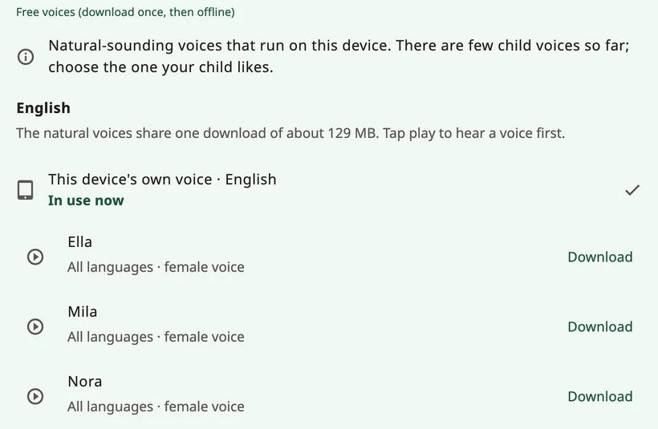

<!-- description: Choose how a child sounds in Amalino: natural voices, the device's own voice, recordings, voice age, speed and how the child's name is said. -->
# Voices

The voice is the child's voice. Let the child hear a few and choose the one they like. You can change it at any time in **Settings → Speech and voices**.

## Kinds of voices

- **Natural voices**: ten voices (Ella, Mila, Nora, Sofi, Ida, Leo, Theo, Adam, Omar and Ben) that sound the most human. Each of them speaks all seven of Amalino's languages. One download covers all of them, and they work offline afterwards.
- **This device's own voice**: the voices that come with the phone or tablet. No download. Some may need the internet; Amalino says so under the voice.
- **Personal Voice** (iPhone and iPad, iOS 17 or newer): a voice you made in the device's settings under **Accessibility → Personal Voice**. Amalino asks for permission to use it. Android has no Personal Voice: to keep a family member's voice, record words instead.
- **Your recordings**: record any word in your own voice in the button editor. Recordings play instead of the app's voice. See [Editing and moving buttons](editing.md).

Tap a voice to hear it, then tap **Use**.

## One voice or one per language

Each language has its own voice setting. Because every natural voice speaks all of the child's languages, you can tap **Use … for all languages** to keep one voice for everything. Otherwise, sentences that mix languages switch voice.

## Downloads

The natural voices are one download of about 129 MB. Amalino tells you the size first. On mobile data it asks before downloading; choose **Wait for Wi-Fi** to download later. Until the download has finished, the device's own voice speaks.

To free space, remove the natural voices from the device; the words use the device's voice until you download them again.

## How the voice sounds

- **Speaking speed**: slower or faster.
- **Voice age (natural voices)**: **Adult**, **Older child** or **Young child**, with a **Strength** slider. It raises the pitch and changes the voice's character. It will sound like a small adult more than a real child; try what the child likes.
- **Pitch**: only for the device's own voices, so it appears only while one of them is speaking. Natural voices use **Voice age** instead.
- **Volume**.
- **Lower other sound when your child speaks**: music and other apps get quieter **While speaking** or **While Amalino is open**, so the words are easier to hear.

## Saved speech

You'll find this under **Advanced** at the end of **Speech and voices**. To speak at once, Amalino prepares the board's words with the chosen voices and keeps them on the device. This happens in the background while the board isn't in use. **Saved speech** shows the progress and the space used. If words ever sound wrong, **Rebuild** prepares them again.

## The child's name

In the grown-up settings, choose the child's name (for example **Jev's name**):

- write the name the way it's written in each language, or a short form;
- hear how each voice says it;
- if it sounds wrong, type in **Spoken as** how it sounds, for example "Shawn" for Sean.

If a word is still wrong, record it in your own voice instead.

## No voice for a language

If a language has no voice yet, download the natural voices. Or install a voice in the device's text-to-speech settings, or record the words yourself.

> **Tip:** Ask the child which voice they like. A voice that fits them makes them want to use it.

Next: [Sharing and printing](sharing-and-printing.md).
