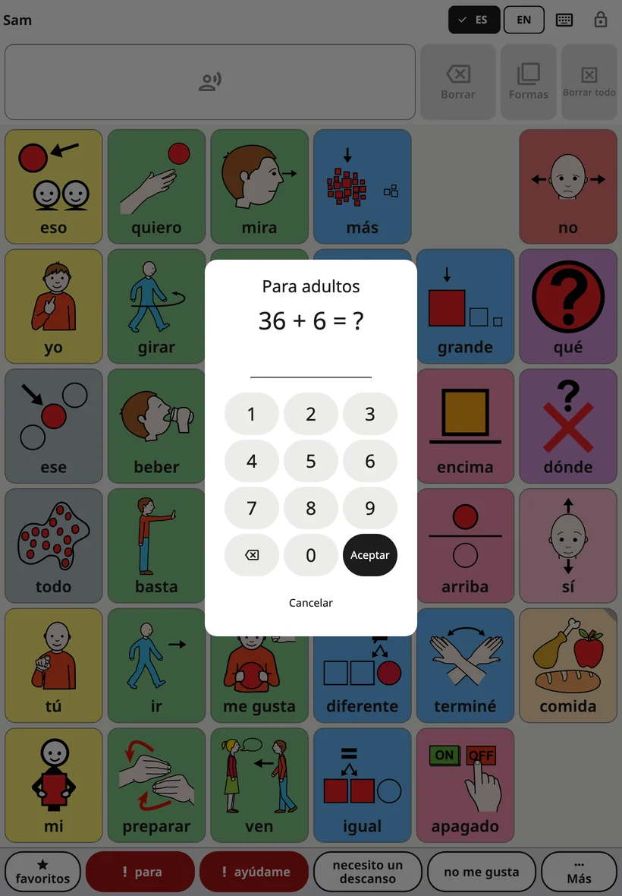
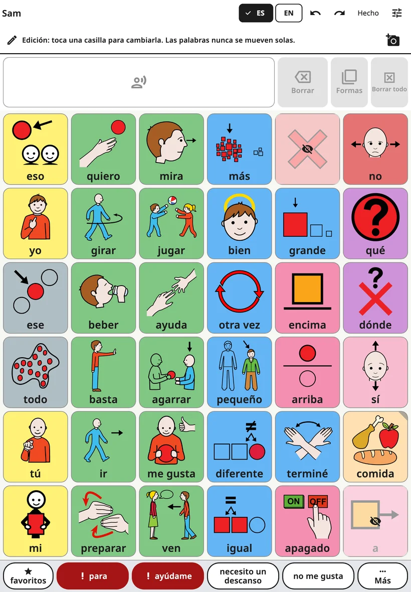
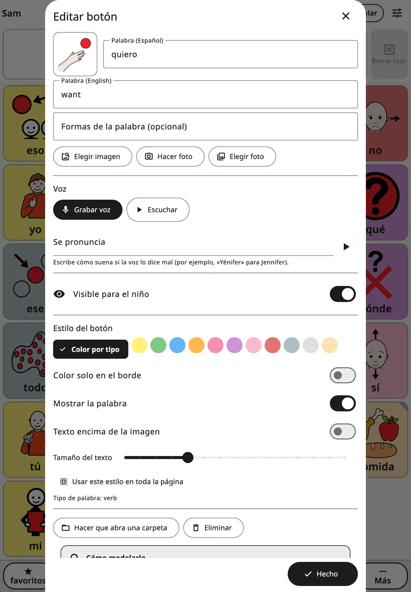
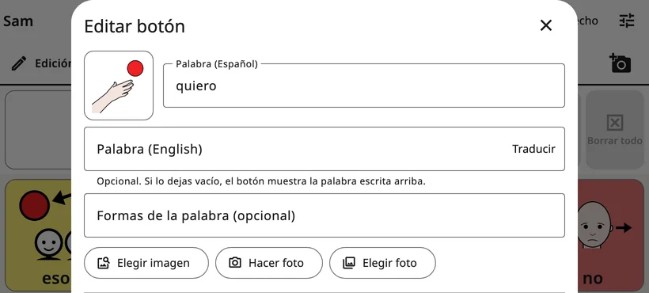
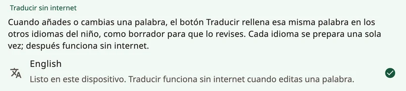

<!-- description: Cambia el tablero de Amalino: abre los controles para adultos, edita cada botón (palabra, imagen y voz), traduce, añade carpetas, mueve botones y deshaz. -->
# Editar y mover botones

Cada familia tiene sus propias palabras. Puedes cambiar cualquier palabra, imagen o voz, añadir tus propias palabras y carpetas, y mover los botones que hayas añadido. El niño no puede ver ni cambiar nada de esto.

## Abrir los controles para adultos

Arriba a la derecha del tablero, **mantén pulsado el candado durante 3 segundos** y luego resuelve la suma sencilla (o escribe tu PIN) con las teclas numéricas que aparecen. Se abren los controles para adultos. Se vuelven a bloquear solos al cabo de 5 minutos, o al momento si tocas **{app:lockNow}**.

El tiempo de pulsación, el PIN y el bloqueo automático se cambian en **{app:lockAndKeep}**. Lo explico en [Ajustes](settings.md).

## Editar el tablero

Elige **{app:editBoard}**. En la parte superior del tablero aparece una línea: *{app:editingHint}* La barra superior muestra ahora **{app:undo}**, **{app:redo}** y **{app:done}**.

- Toca un botón para editarlo.
- Toca una casilla vacía y elige **{app:addWord}** o **{app:addFolder}**.
- Abre las carpetas y edita sus botones de la misma manera.
- Cuando termines, toca **{app:done}**.

Las palabras ocultas se ven en su sitio, sombreadas en oscuro y con un ojo tachado, así que mientras editas siempre ves el tablero completo.

## El editor de botones

- **Palabra**: la palabra del botón, en el idioma que tiene el tablero en ese momento.
- **Los demás idiomas del niño**: debajo, un campo para cada uno de los otros idiomas del niño, por ejemplo **{app:wordLabel|language=danés}**. Son opcionales: si un campo se deja vacío, el botón muestra la palabra escrita arriba.
- **{app:translateWord}**: aparece junto a un campo vacío cuando el dispositivo puede traducir ese idioma sin conexión. Rellena la palabra como borrador, marcada con la nota *{app:translatedCheck}* Revísala antes de que el niño la use. Más abajo, en «Traducir palabras», te lo explico.
- **{app:wordFormsManual}**: otras formas de la palabra, separadas por comas, por ejemplo «perros, perra».
- **Imagen**: **{app:chooseSymbol}** busca entre los pictogramas que trae la app, y **{app:moreSymbolSets}** busca en otros conjuntos de símbolos gratuitos de internet; solo se envían las palabras que buscas. **{app:takePhoto}** y **{app:choosePhoto}** usan tus propias fotos. Las fotos funcionan mejor para personas, mascotas y las cosas del propio niño.
- **{app:voice}**: **{app:recordVoice}** graba la palabra con tu propia voz; **{app:listen}** la reproduce; **{app:removeRecording}** vuelve a la voz de la app.
- **{app:spokenAs}**: si la voz dice mal una palabra, escribe cómo suena, por ejemplo «Yénifer» para Jennifer.
- **{app:recInSentences}**: normalmente, tu grabación solo suena cuando el niño toca ese botón. Dentro de una frase, la palabra la dice la voz de la app. Activa esta opción para sonidos, canciones o palabras que la voz no sabe decir.
- **{app:visibility}**: activado, el niño ve y usa la palabra; desactivado, su sitio se ve vacío para el niño y nada se mueve. Lo explico en [Palabras y carpetas](words-and-folders.md).
- **{app:buttonStyle}**: **{app:wordTypeColour}**, **{app:borderOnly}**, **{app:showLabel}**, **{app:labelOnTop}** y **{app:textSize}**. **{app:styleWholePage}** aplica el estilo a todos los botones de la página.
- **{app:wordType}**: decide el color del botón (por ejemplo, las acciones son verdes y las palabras que describen, azules).

Si es una palabra o carpeta **nueva**, toca **{app:add}** abajo del todo para ponerla en el tablero. **{app:add}** sigue en gris hasta que el botón tiene una palabra o una imagen. La **✕** cancela: no se añade nada, y se descartan la foto o la grabación que hayas hecho para el botón.

Cuando editas un botón **que ya existe**, los cambios se aplican sobre la marcha; toca **{app:done}** (o la **✕**) para cerrar.

## Traducir palabras

**{app:translateWord}** funciona en el propio dispositivo, sin internet, una vez configurado el idioma. Se configura una sola vez para cada idioma: en los controles para adultos, abre **{app:languages}** (en **{app:sectionBoards}**) y luego **{app:offlineTranslationHeader}**:

- **{app:ga.androidTitle|label}**: toca el idioma y acepta descargar el modelo de traducción de Google, de unos 30 MB por idioma. No se envía ninguna palabra de la app.
- **iPhone y iPad**: hace falta iOS 26 o posterior. Los idiomas los proporciona Apple: abre en el dispositivo **Ajustes → Apps → Traducir → Idiomas descargados**, descarga los idiomas y vuelve a Amalino.

Cada idioma indica si ya está listo. Si el dispositivo no puede hacerlo, aparece **{app:offlineTranslationUnsupported}**

## Carpetas

Para añadir una carpeta, toca una casilla vacía en modo edición y elige **{app:addFolder}**. **{app:pickFolderTitle}** muestra las carpetas del niño con sus imágenes, también las que trae la app (Comida, Emociones, Lugares…), y **{app:newFolder}** arriba del todo. Elige una, revisa el nombre y la imagen, y toca **{app:add}**.

El editor de un botón de carpeta tiene además:

- **{app:makeFolder}**: convierte un botón de palabra en un botón de carpeta. Elige una carpeta o **{app:newFolder}**.
- **{app:changeFolder}**: hace que el botón de carpeta abra otra carpeta.
- **{app:openThisFolder}**: cierra el editor y abre la carpeta, para que puedas editar lo que hay dentro.
- **{app:folderGoBack}**: activado, el niño vuelve a donde estaba después de tocar una palabra de esta carpeta, listo para la siguiente. Desactívalo en las carpetas en las que el niño elige varias palabras seguidas. Se aplica a la carpeta desde dondequiera que se abra. En **{app:favourites}** viene desactivado de entrada.

## Mover un botón

Las palabras básicas del tablero principal no cambian de sitio, para que la mano del niño siempre las encuentre. Los botones que abren una carpeta o una escena sí se pueden mover:

1. Edita el botón y elige **{app:sceneMove}** en su editor.
2. **{app:pickCellTitle}** muestra el tablero con las casillas libres resaltadas. Toca una y luego **{app:pickCellPutHere}**.
3. También puedes tocar **{app:pickCellChooseAnother}** para moverlo a otra carpeta, o **{app:pickCellFavouritesInstead}**.

El botón conserva su palabra, su imagen, su voz y su estilo. Nada más se mueve en ninguno de los dos tableros. Un solo toque en **{app:undo}** lo devuelve a su sitio.

## Eliminar un botón

Edítalo y elige **{app:delete}**. Si es una palabra básica, Amalino te propone **{app:hideInstead}**: al ocultarla, su sitio se guarda para más adelante; al eliminarla, queda una casilla vacía. Casi siempre es mejor ocultarla.

## Deshacer e historial

- **{app:undo}** y **{app:redo}**, en la barra superior, recorren tus cambios hacia atrás y hacia delante mientras editas.
- **{app:historyBackups}**, en los controles para adultos, muestra todos los cambios. **{app:restoreHere}** deja los tableros como estaban en ese momento.

Equivocarse no pasa nada. Todo lo que cambies se puede deshacer.

> **Consejo:** Cuando añadas una palabra, úsala tú en el dispositivo al menos tres veces ese mismo día.

Siguiente: [Ajustes, pantalla por pantalla](settings.md).
