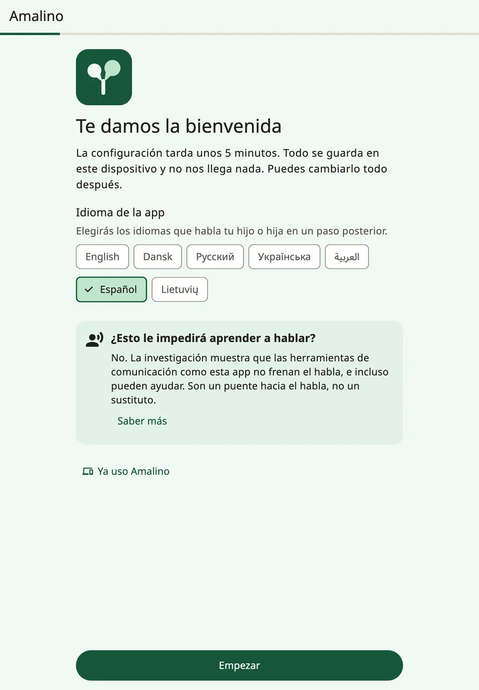
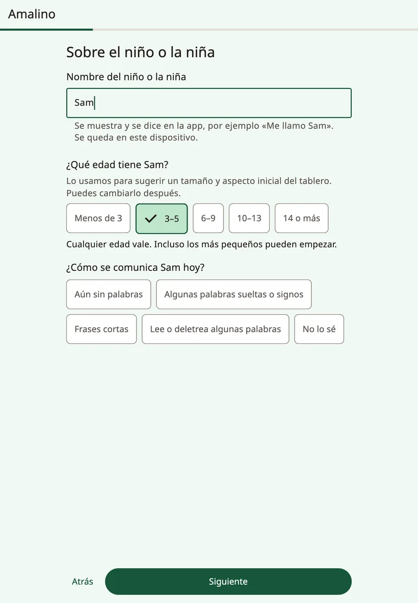
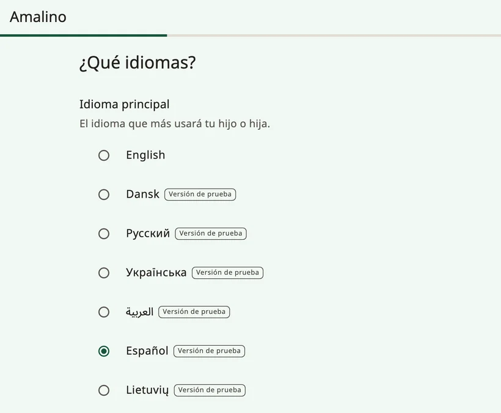
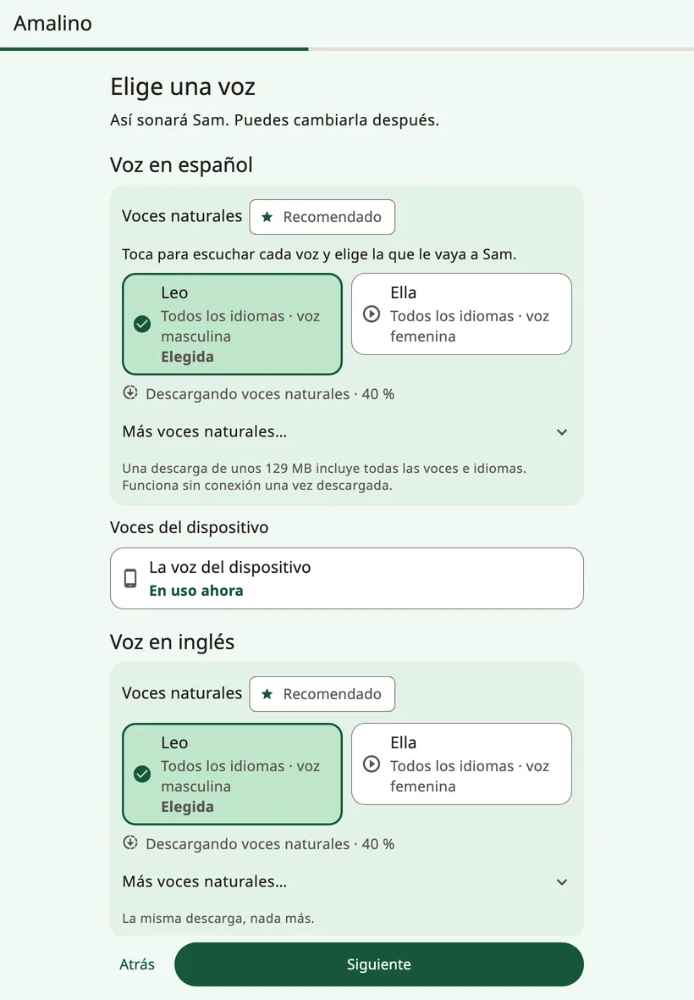
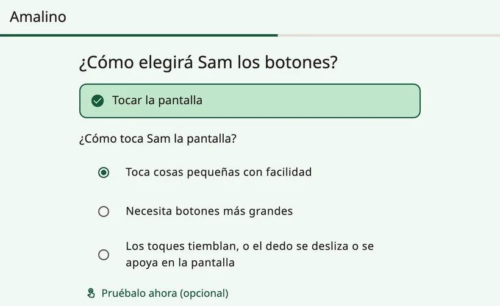
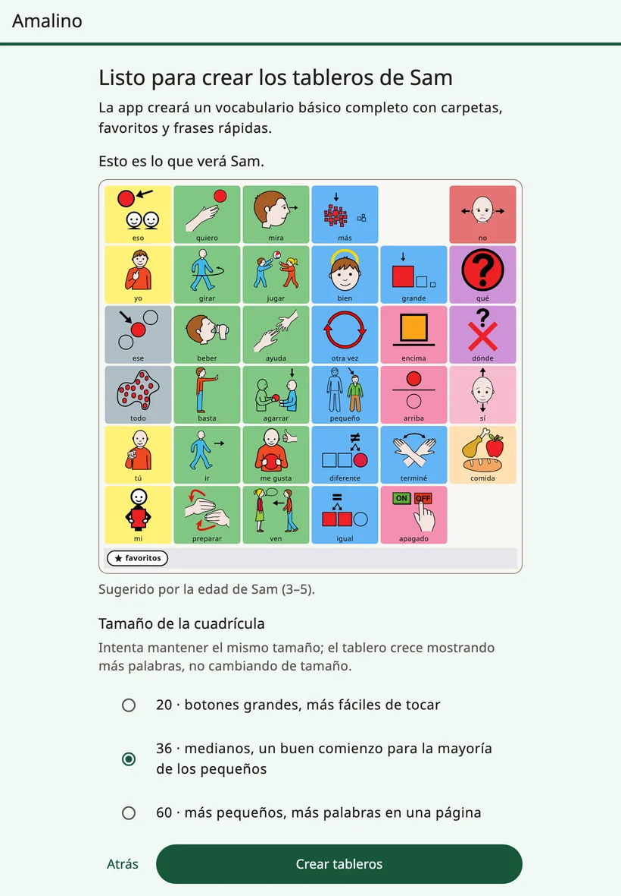

<!-- description: Configura Amalino por primera vez: el niño, los idiomas, la voz, el toque, sus cosas favoritas y el bloqueo para adultos. -->
# Primeros pasos

Amalino funciona en iPhone y iPad, y en teléfonos y tabletas Android. Es gratis y, una vez configurado, funciona sin internet.

La configuración lleva unos cinco minutos. Todo lo que escribes se queda en el dispositivo, y puedes cambiar cualquier respuesta más adelante.

## Antes de empezar

- Carga el dispositivo y sube el volumen.
- Si puedes, ten al niño cerca para el paso del toque: ayuda ver cómo toca la pantalla.
- Usa wifi si puedes: las voces naturales son una sola descarga de unos 129 MB.

## Los pasos de la configuración

### Bienvenida

Elige el **{app:appLanguage}**: el idioma de las pantallas para adultos. Los idiomas del niño los eliges en un paso posterior.

Si el niño ya usa Amalino en otro dispositivo, toca **{app:alreadyUse}** y después **{app:restoreBackup}** para traer sus tableros desde una copia que exportaste con contraseña. Lo explico en [Compartir e imprimir](sharing-and-printing.md).

### Sobre el niño

- **{app:ageBandTitle.anon}** La franja de edad propone un tamaño de tablero, un nivel de vocabulario y un aspecto para empezar. Cualquier edad vale; incluso los más pequeños pueden empezar.
- **{app:commTitle.anon}** Esto ayuda a elegir las primeras palabras.
- **{app:childName}** (opcional). Se muestra y se dice en la app, por ejemplo en «Me llamo…». Se queda en el dispositivo.

### Idiomas

Elige el **{app:primaryLanguage}**, el que más va a usar el niño, y marca los demás idiomas que oye cada día. Amalino tiene siete: inglés, danés, ruso, ucraniano, árabe, español y lituano.

En todos los idiomas, cada botón está en el mismo sitio. El niño puede cambiar de idioma con un toque sin tener que aprender el tablero otra vez.

Por ahora, todos los idiomas salvo el inglés llevan la etiqueta **{app:languagePreview}**: un hablante nativo aún no ha revisado todas sus palabras. Debajo de la lista hay una nota: *{app:languagePreviewNote}* También puedes corregir tú cualquier palabra.

En ruso, ucraniano, árabe, español y lituano, la configuración pregunta además **{app:wordFormsTitle.anon}** Elige **{app:forms.boy}** o **{app:forms.girl}**, para que las palabras tengan la terminación correcta cuando el niño hable de sí mismo (por ejemplo, «cansado» o «cansada»).

Si tu idioma no está, toca **{app:notListed}**. Aun así puedes crear tableros: graba cada palabra con tu propia voz, y el tablero reproducirá tus grabaciones.

### Voz

Elige cómo sonará el niño en cada idioma. Toca una voz para oírla.

- Las **{app:naturalVoicesHeading}** son las que suenan más humanas. Diez voces hablan los siete idiomas y comparten una sola descarga de unos 129 MB. Después funcionan sin conexión. La voz recomendada ya viene elegida.
- **{app:systemVoice}** no necesita descarga y está lista al momento. Es la que habla hasta que termina de descargarse la voz natural.

Con wifi, la descarga empieza sola. Con datos móviles, Amalino te pregunta antes o espera a que haya wifi.

Puedes cambiar la voz cuando quieras. Lo explico en [Voces](voices.md).

### Cómo elige el niño

Por ahora, el niño usa Amalino tocando la pantalla. Las demás formas de elegir aparecen marcadas como «**{app:comingLater}**».

Después responde a la pregunta **{app:touchTitle.anon}**

- **{app:touch.easy}**
- **{app:touch.bigger}**
- **{app:touch.shaky}**

La respuesta ajusta el toque y el tamaño del tablero. Con **{app:tryItNow}**, el niño toca unas cuantas veces; **{app:makeEasier}** cambia los ajustes si muchos toques fallan. Hay más ajustes del toque en **{app:sectionSettings}** → **{app:touchAccess}**.

### {app:fiveFavourites}

Añade hasta cinco cosas que le encanten al niño: las pompas, unos dibujos animados, la abuela. Haz una foto o elige una, y escribe cómo lo llama el niño. Van a la carpeta **{app:favourites}**, a un toque desde cualquier tablero. Las fotos funcionan mejor para las personas y para los juguetes del propio niño.

### {app:grownupTitle}

Los ajustes están protegidos para que el niño no cambie el tablero sin querer. Para abrirlos, **mantén pulsado el candado de la parte superior del tablero durante 3 segundos y luego resuelve una suma sencilla**. Pruébalo aquí una vez. También puedes elegir **{app:longerHold}**.

En lugar de la suma, puedes elegir un **{app:lockPin}**. Los niños mayores saben resolver la suma, así que para ellos un PIN es más seguro.

### El nombre en cada idioma

Si añadiste un nombre, puedes indicar cómo se escribe en cada idioma y oír cómo lo dice la voz. Si suena mal, escribe cómo suena, por ejemplo «Yénifer» para Jennifer.

### Resumen

El último paso muestra todas tus respuestas. Toca **{app:change}** junto a cualquiera de ellas.

Aquí también eliges:

- el **{app:gridSize}**: cuántos botones caben en el tablero. **{app:moreSizes}** muestra los demás. Intenta quedarte con un solo tamaño: el tablero crece mostrando más palabras, no cambiando de tamaño.
- el **{app:vocabLevel}**: unas 400, 1300 o 2500 palabras. Lo explico en [Palabras y carpetas](words-and-folders.md).

Para niños mayores, puedes activar **{app:teenPack}**: frases sociales, bromas y jerga, y un estilo más adulto, sin dibujos infantiles.

Para quienes empiezan muy pequeños, la configuración puede ofrecer **{app:earlyOffer|label}**: cuatro pictogramas grandes que hablan en cuanto se tocan. Todo el vocabulario sigue debajo, y más adelante puedes pasar al tablero completo.

Después toca **{app:createBoards}**.

## Después de la configuración

La página **{app:allSet}** te recuerda cómo abrir los controles para adultos y te da un primer consejo para probar hoy mismo. También tiene **{app:lockDeviceToApp}** (las mismas instrucciones que **{app:guidedAccess}** en los controles para adultos) y un interruptor de **{app:dailyTip}**.

Toca **{app:startTalking}**. Se abre el tablero, listo para el niño.

Algunas cosas puedes hacerlas más tarde, en **{app:finishSetup}**, dentro de los controles para adultos:

- elegir las dos frases que más necesita el niño,
- oír cómo suena su nombre,
- probar los ajustes táctiles con el niño.

Siguiente: [El tablero del niño](the-board.md).
