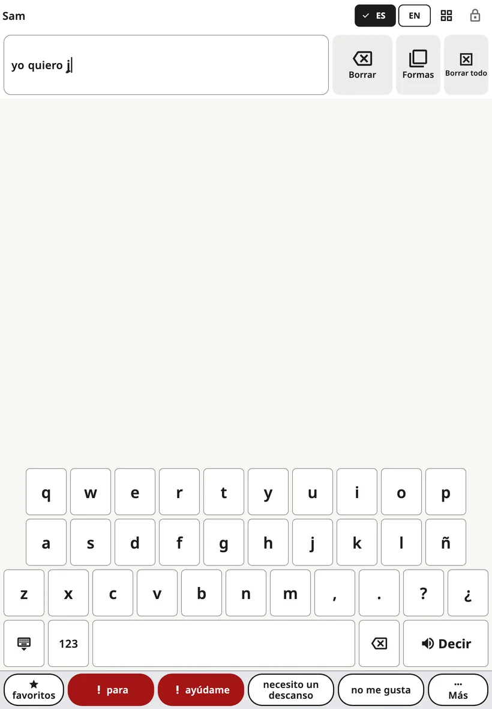

<!-- description: Escribir en Amalino: abrir el teclado, sugerencias de palabras, orden de las letras, números y signos, y tamaño de las teclas en los teléfonos. -->
# El teclado

Los niños que ya conocen algunas letras pueden escribir palabras que no están en el tablero. El teclado ocupa el mismo sitio que el tablero, así que se pasa de uno a otro con un solo toque.

## Abrirlo y cerrarlo

Toca el botón del **teclado** en la barra superior. Para volver a los pictogramas, toca otra vez ese mismo botón (que ahora muestra una cuadrícula) o la tecla de **cerrar**, abajo a la izquierda del teclado.

## Escribir

- La palabra que se está escribiendo aparece en la **barra de mensaje**, así que el niño ve cómo va creciendo.
- La tecla de **espacio** termina la palabra.
- La tecla de **retroceso** borra una letra. Si la mantienes pulsada, sigue borrando.
- **{app:kbSpeak}** pronuncia el mensaje entero.
- **123** abre los números y los signos de puntuación, también los propios de cada idioma (¿ ¡ en español, » « en danés, « » en ruso y ucraniano, „ “ en lituano, ؟ ، en árabe). **ABC** vuelve a las letras.
- La tecla **´**, después de la ñ, pone la tilde y funciona en los dos órdenes: escribe la letra y pulsa ´, o pulsa ´ y escribe después la letra. Justo después de una vocal, la tilde va sobre esa vocal: á é í ó ú. Si la pulsas otra vez, la quita; con la u da ú y luego ü (pingüino). En el teclado danés, la misma tecla está en la página **123** y da é (idé, café).
- Si se pulsa ´ antes de la letra (al empezar una palabra o después de una consonante), la tecla se queda oscura y en la barra de mensaje espera una ´ clara: la siguiente vocal lleva la tilde. Cualquier otra tecla, la propia ´ o la tecla de retroceso la anulan.

Los botones **{app:barDelete}** y **{app:barClear}** de la barra de mensaje funcionan igual que en el tablero.

En un teléfono, al tocar una letra, esta se ve más grande encima del dedo, para que el niño sepa qué tecla está tocando antes de levantarlo. Esto no ocurre cuando están activados **{app:activateOnRelease}** y un **{app:holdTime}**, porque entonces la tecla ya se oscurece mientras se mantiene pulsada.

## Sugerencias de palabras

Una fila encima de las teclas sugiere palabras a medida que el niño escribe. Al tocar una, se añade la palabra y un espacio. Las sugerencias salen de:

- las palabras de los tableros del niño,
- lo que el niño ha escrito antes, si está activado **{app:kbLearn.anon}**,
- una lista de palabras del idioma.

No hace falta escribir las tildes: con «cancion» aparece «canción» y con «tambien», «también». Si la frase empieza con ¿, al escribir «que», «como» o «donde» la primera sugerencia es «qué», «cómo» o «dónde». La barra espaciadora deja la palabra tal como está escrita.

Se generan en el dispositivo; no se envía nada a ningún sitio.

Algunas familias desactivan las sugerencias mientras el niño practica la ortografía: **{app:sectionSettings}** → **{app:kbSettings}** → **{app:kbSuggestions}**.

Si está activado **{app:aiPhrase}** (en **{app:sectionSettings}** → **{app:kbSettings}**), al escribir iniciales como «qiap» puede aparecer «quiero ir al parque» como sugerencia adicional. El niño la elige o no le hace caso.

## Orden de las letras

**{app:sectionSettings}** → **{app:kbSettings}** → **{app:kbLayout}**:

- **{app:kbLayoutStandard}**: el teclado habitual del idioma.
- **{app:kbLayoutAbc}**: las letras en orden alfabético, en las mismas filas, así que el teclado tiene el mismo tamaño.

## Tamaño de las teclas en los teléfonos

En un teléfono, un idioma con muchas letras tiene teclas estrechas. **{app:sectionSettings}** → **{app:kbSettings}** → **{app:kbKeySize}**:

- **{app:kbKeySizeAuto}** (la opción predeterminada) sigue los ajustes táctiles: si el niño necesita botones más grandes o sus toques tiemblan, las filas largas de letras se dividen en dos, sin cambiar el orden de las letras, para que cada tecla mida al menos 40 puntos (unos 6 mm) de ancho.
- **{app:kbKeySizeStandard}** mantiene siempre las filas habituales.
- **{app:kbKeySizeLarger}** divide siempre las filas largas.

Con el teléfono en horizontal, las teclas ya son anchas, así que las filas no se dividen. Las tabletas usan siempre las filas habituales.

## Con el teléfono en horizontal

Si en un teléfono el tablero está en horizontal, el teclado necesita toda la altura de la pantalla. Entonces «**para**» y «**ayúdame**» pasan al final de la fila de sugerencias, siempre en el mismo sitio. La fila de frases completa vuelve cuando regresas al tablero.

> **Consejo:** Modela también la escritura. Escribe una palabra despacio mientras la dices y luego toca **{app:kbSpeak}**.

Siguiente: [Escenas](scenes.md).
