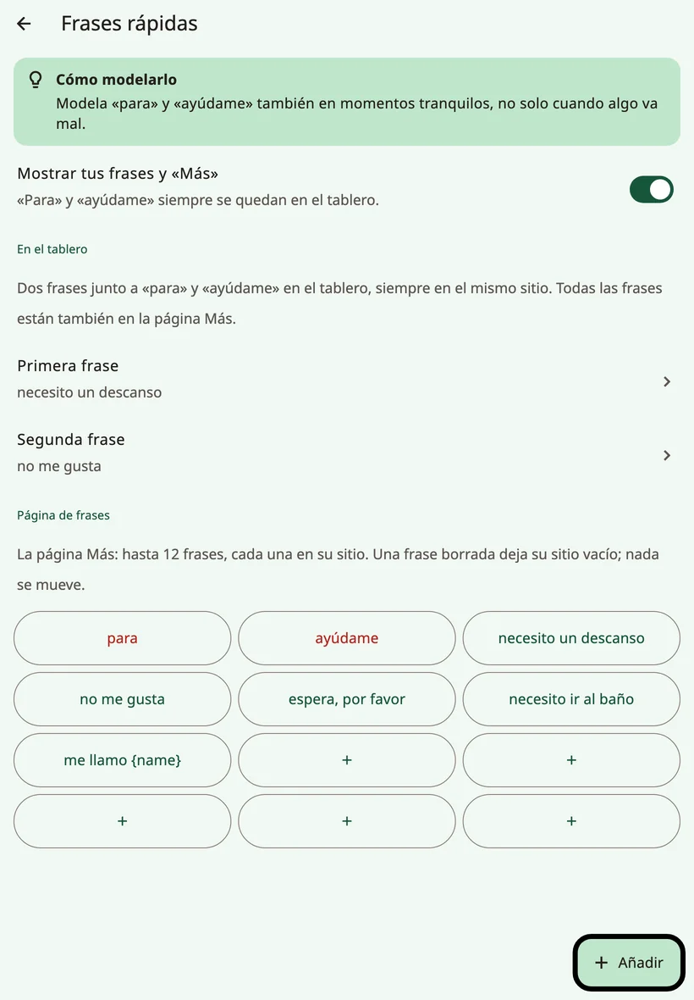
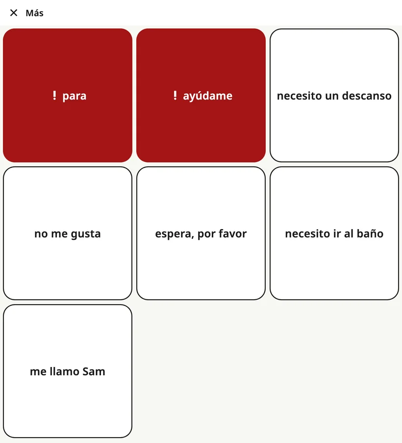

<!-- description: La fila de frases al pie del tablero de Amalino: para, ayúdame, dos frases de la familia, la carpeta Favoritos y la página «Más» con todas las frases. -->
# Frases rápidas y «Más»

Hay cosas que tienen que decirse rápido, sin formar una frase. La **fila de frases**, al pie del tablero, las tiene siempre a un toque, en todas las páginas.

## La fila de frases

De izquierda a derecha:

1. **★ {app:favourites}**: abre la carpeta {app:favourites}.
2. **! para**
3. **! ayúdame**
4. **Primera frase de la familia**
5. **Segunda frase de la familia**
6. **{app:quickMore}**: abre la página con todas las frases.

Cada botón conserva su sitio, en todos los idiomas y en todas las páginas. «**Para**» y «**ayúdame**» están siempre ahí y siempre en rojo: son las frases urgentes. Los cuatro botones de frases tienen el mismo ancho, así que una frase larga nunca desplaza nada; pasa a una segunda línea.

Al tocar una frase, se dice en el acto. No va a la barra de mensaje.

## Elegir las dos frases de la familia

Abre los controles para adultos y elige **{app:quickPhrases}**. En la sección **{app:qpOnBoard}**, elige la **{app:qpPick1}** y la **{app:qpPick2}** para los huecos que hay junto a «para» y «ayúdame». Elige las dos que más necesita el niño, por ejemplo «necesito un descanso» y «no me gusta».

## La página «Más»

**{app:quickMore}** abre una página con hasta 12 frases, cada una en su sitio fijo. Al tocar una, se dice la frase y la página se cierra; **{app:close}** vuelve atrás sin decir nada.

En **{app:quickPhrases}**, dentro de **{app:qpPage}**, puedes:

- **{app:add}** una frase y elegir su **{app:qpPlace}**,
- **{app:edit}** una frase, o marcarla como **{app:qpUrgent}** para que aparezca en rojo,
- **{app:delete}** una frase. Su sitio se queda vacío; las demás no se mueven.

Cuando la página está llena, quita una frase, o toca **{app:makePhraseBoard}** para convertir las frases en una carpeta con sitio para más.

Las frases que llevan el nombre del niño, como «me llamo…», aparecen en cuanto añades el nombre.

## Favoritos

La carpeta **{app:favourites}** guarda lo que más le gusta al niño: las cinco cosas favoritas de la configuración y todo lo que añadas después. Está a un toque desde cualquier página con **★ {app:favourites}**.

El tablero principal también reserva un sitio para {app:favourites}; cuando eliges dónde va un botón nuevo, aparece marcado con «{app:pickCellFavouritesNote}».

En los teléfonos pequeños, el botón ★ puede mostrar la estrella sin la palabra. Hace exactamente lo mismo.

## Ocultar las frases de la familia

Si la fila distrae al niño, desactiva **{app:showQuickPhrases}** en **{app:quickPhrases}**. Desaparecen tus dos frases y **{app:quickMore}**, pero «**para**» y «**ayúdame**» se quedan siempre en el tablero, en el mismo sitio: a menudo son las palabras más importantes que tiene un niño. **★ {app:favourites}** también se queda.

> **Consejo:** Modela «para» y «ayúdame» también en momentos de calma, no solo cuando algo va mal.

Siguiente: [El teclado](keyboard.md).
