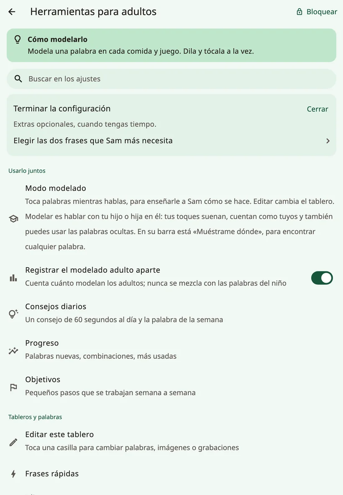
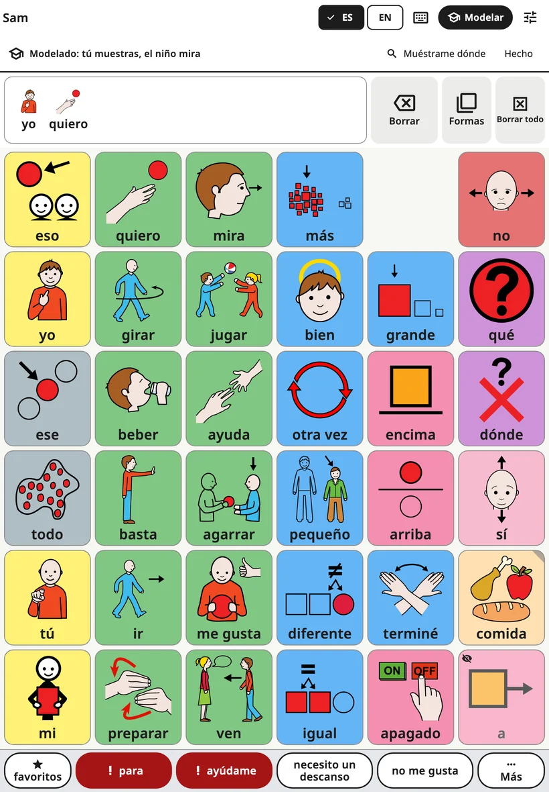
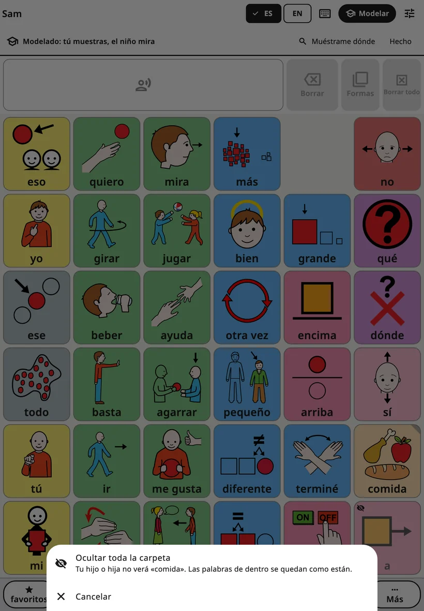
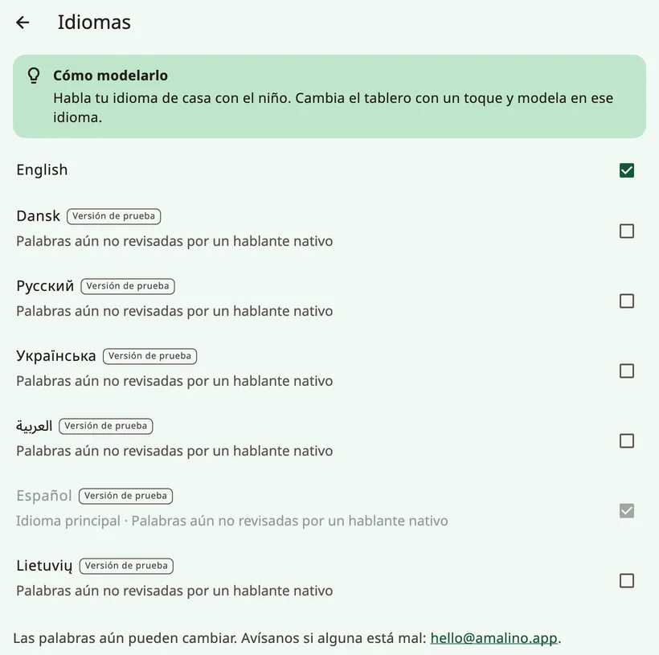
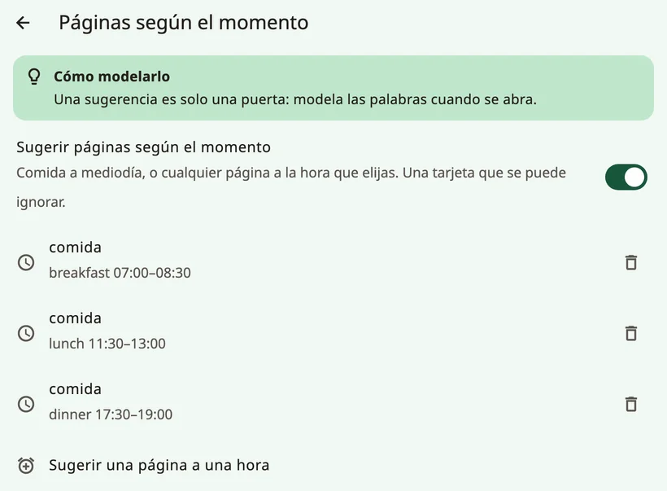

<!-- description: Cada pantalla de los controles para adultos de Amalino: modelado, palabras, voces, toque, pantalla, distribución, teclado, sugerencias, bloqueo y datos. -->
# Ajustes, pantalla por pantalla

Para abrir los controles para adultos, mantén pulsado el candado de la parte superior del tablero durante 3 segundos y resuelve la suma con las teclas numéricas. Están organizados en cuatro grupos: **{app:sectionTogether}**, **{app:sectionBoards}**, **{app:sectionSettings}** y **{app:sectionData}**. En esta página los recorro en el orden en que aparecen. En este manual, «{app:sectionSettings} → …» se refiere al grupo **{app:sectionSettings}** de los controles para adultos, no a la app de ajustes de tu dispositivo.

La mayoría de las pantallas tienen un consejo breve, **{app:tipTitle}**.

## Buscar un ajuste

¿No recuerdas dónde está algo? Toca **{app:searchSettings}** arriba del todo y escribe una palabra, como «voz» o «color». Cada resultado indica dónde está («{app:speechVoice} → {app:speechRate}»). Tócalo y Amalino abre esa pantalla con el ajuste suavemente resaltado.

## {app:sectionTogether}

### {app:modellingMode}

**{app:edit}** sirve para cambiar el tablero. **{app:modelShort}** sirve para hablar con el niño usando el tablero: tocas palabras mientras hablas, para enseñarle cómo se hace. Tus toques suenan y cuentan como tuyos, nunca como palabras del niño.

La forma más rápida de entrar: con los controles para adultos abiertos, toca **{app:modelShort}** en la barra superior del tablero (en un teléfono, el icono del birrete). La opción **{app:modellingMode}** del menú hace lo mismo. Una línea en la parte superior dice «{app:modellingOn}». En esa línea, **{app:showMeWhere}** te busca una palabra: escríbela y Amalino te enseña el camino hasta ella, botón a botón.

- **Palabras ocultas**: aparecen atenuadas, con un pequeño ojo tachado, en el sitio donde aparecerán para el niño. Tócalas como cualquier otra palabra, para que tu hijo o hija las oiga y las vea mucho antes de que aparezcan en su propio tablero. El niño sigue viendo un hueco vacío.
- **{app:showToChild}**: mantén pulsada un momento una palabra oculta y elige **{app:showToChild}** cuando creas que ha llegado el momento. **{app:undo}** la vuelve a ocultar.
- **Ocultar una palabra o una carpeta entera**: mantén pulsada una palabra que el niño ve y elige **{app:hideFromChild}**. Mantén pulsado un botón de carpeta para mostrar u ocultar toda la carpeta de una vez; un toque rápido la sigue abriendo.

- **Termina solo** dos minutos después de tu último toque, y siempre que se cierra el bloqueo para adultos, así que el niño nunca se queda en el modo modelado. Para terminarlo tú, toca **{app:done}** o vuelve a tocar **{app:modelShort}**.

Lo explico también en [Consejos para familias](tips-for-families.md).

Justo al lado está **{app:logModelTaps}**: cuenta cuántas veces modelan los adultos, sin mezclarlo nunca con las palabras del niño.

### {app:coaching}

Un consejo de modelado de 60 segundos al día y la **{app:wordOfWeek}**: hasta 3 palabras que los adultos modelan esa semana, resaltadas en el modo modelado. **{app:dailyReminder}** envía una notificación a la hora que elijas; solo pide permiso cuando lo activas.

Aquí está también **{app:mythBuster}**: respuestas breves a dudas frecuentes («{app:myth.speech.q}»), con los estudios que las respaldan.

### {app:progress} y {app:goals}

- **{app:progress}**: palabras nuevas, combinaciones de palabras y las palabras más usadas. **{app:thisWeek}** resume la semana en un texto breve para compartir con todas las personas que hablan con el niño, con una palabra para modelar a continuación.
- **{app:goals}**: pequeños pasos que se trabajan semana a semana, como los días de uso, las palabras nuevas o las palabras por frase.

Usa las cifras para decidir qué modelar a continuación, no para examinar al niño.

## {app:sectionBoards}

- **{app:editBoard}**: lo explico en [Editar y mover botones](editing.md). Allí también se muestran y se ocultan palabras.
- **{app:quickPhrases}**: lo explico en [Frases rápidas y «Más»](quick-phrases.md).
- **{app:languages}**: el idioma principal y los demás idiomas. Los idiomas cuyas palabras aún se están revisando llevan la etiqueta **{app:languagePreview}**, con una línea que explica cómo avisar de una palabra incorrecta. La **{app:englishSpelling}** (británica o estadounidense) se puede elegir por separado en cada dispositivo. **{app:translationReview}** muestra, para cada idioma, las palabras que aún hay que revisar, para que puedas comprobarlas o corregirlas. **{app:offlineTranslationHeader}** configura la traducción sin conexión para cada uno de los otros idiomas del niño; lo explico en [Editar y mover botones](editing.md).
- **{app:boardBuilder}**: escribe un tema, como «fiesta de cumpleaños», y obtendrás una página lista para ese tema. Funciona en el dispositivo con unos 20 temas cotidianos (cumpleaños, médico, parque, hora del baño, hora de dormir, zoo, playa y más). Tú revisas las palabras antes de guardarla.
- **{app:symbolSets}**: los pictogramas de ARASAAC incluidos, los pictogramas antiguos de Mulberry que aún usan algunos tableros, tus propias fotos y una búsqueda opcional en todos los pictogramas de ARASAAC (unos 13 000), que descarga cada pictograma cuando lo eliges. «**{app:useNewPictures}**» cambia a los pictogramas más nuevos las palabras incluidas que aún tienen su imagen original. Tus propias imágenes y fotos se conservan. ARASAAC es gratuito para uso no comercial.
- **{app:printBoards}**: lo explico en [Compartir e imprimir](sharing-and-printing.md).

## {app:sectionSettings}

### El nombre del niño

El nombre y cómo se escribe en cada idioma. También puedes indicar cómo se pronuncia. Lo explico en [Voces](voices.md).

### {app:speechVoice}

La voz de cada idioma, **{app:useForAll|voice=…}**, **{app:personalVoice}**, **{app:speechRate}**, **{app:voiceAge}**, **{app:volume}** y **{app:soundCheck}**. **{app:pitch}** solo aparece mientras habla una de las voces del dispositivo. **{app:savedSpeech}** está al final, en **{app:advanced}**. Lo explico en [Voces](voices.md).

### {app:touchAccess}

Cómo responde el tablero al toque. Cambia una sola cosa cada vez y observa al niño durante unos días.

**{app:accessMethod}** muestra el toque en la pantalla; las demás formas de elegir aparecen como **{app:comingLater}**. **{app:highlightSpeaking}** tiñe suavemente el botón mientras suena su palabra.

**{app:touchTuning}** reúne todo lo demás:

- **{app:holdTime}**: el dedo tiene que quedarse en el botón ese tiempo antes de que hable. Ayuda cuando la mano roza la pantalla, pero un toque rápido no funcionará. Con un tiempo de pulsación, las formas de las palabras solo se abren con el botón **{app:barForms}**.
- **{app:repeatIgnore}**: si se vuelve a tocar el mismo botón poco después, ese segundo toque no cuenta.
- **{app:activateOnRelease}**: el niño puede deslizar el dedo hasta el botón correcto antes de que cuente.
- **{app:targetEnlargement}**: cada botón responde también un poco más allá de su borde.
- **{app:tremorFilter}**: para manos temblorosas, eliges qué cuenta como toque: **{app:tremor.firstLanding}** o **{app:tremor.longestDwell}**.
- **{app:palmRejection}**: una palma o una mano apoyada en la pantalla no pulsa botones.
- **{app:practice}**: un tablero de práctica que cuenta los toques, los toques ignorados y los que caen entre botones.

### {app:displaySensory}

Cómo se ve el tablero. Aquí puedes probarlo todo sin miedo: nada cambia de sitio.

- **{app:theme}**: **{app:theme.standard}**, **{app:theme.calm}**, **{app:theme.dark}**, **{app:theme.highContrast}** o **{app:theme.teen}**.
- **{app:colourCoding}**: **{app:palette.fitzgerald}**, **{app:palette.calm}**, **{app:palette.colorBlindSafe}** o **{app:palette.none}**. **{app:borderOnly}** da un aspecto más tranquilo.
- **{app:showLabels}**, **{app:labelOnTop}** y **{app:textSize}**.
- **{app:reduceMotion}**: sigue el ajuste del dispositivo, o queda siempre activado o siempre desactivado.

### {app:boardLayout}

«{app:boardLayoutNote}»

- **{app:gridSize}**: lo explico en [Palabras y carpetas](words-and-folders.md). En una tableta, una nota avisa cuando algunas palabras largas no caben enteras con 84 botones en vertical.
- **{app:boardOrientation}**: solo en teléfonos. El tablero, el teclado y las escenas se quedan en vertical (o en horizontal); las pantallas para adultos siguen girando. Si en la otra orientación caben menos botones, Amalino pregunta antes de cambiarla.
- **{app:vocabLevel}**: lo explico en [Palabras y carpetas](words-and-folders.md).
- **{app:earlyMode}**: botones grandes y muy sencillos que hablan en cuanto se tocan, sin barra de mensaje. Todo el vocabulario sigue debajo.
- **{app:cellGap}**.

### {app:messageBar}

- **{app:showMessageBar}**.
- **{app:speakEachWord}** (activado de forma predeterminada). Si está desactivado, al tocar una palabra solo se añade al mensaje, y no suena nada hasta que se toca la barra de mensaje.
- **{app:clearAfterSpeak}**.
- **{app:grammarHelper}**: mantén pulsada una palabra para elegir otra forma (perros, fui, roja…). Activado en todos los idiomas. Lo explico en [El tablero del niño](the-board.md).

### {app:kbSettings}

**{app:kbSuggestions}**, **{app:kbLearn.anon}**, **{app:aiPhrase}**, **{app:kbLayout}** y **{app:kbKeySize}**. Lo explico en [El teclado](keyboard.md).

### {app:aiHelpers}

Ayudas que sugieren palabras. Nunca hablan por el niño, y es siempre el niño quien elige. Cada ayuda tiene su propio interruptor, y todas están desactivadas hasta que las activas. Funcionan en el dispositivo:

- **{app:aiNextWord}**: rodea suavemente 2 o 3 botones. Los botones nunca se mueven. Solo aprende en este dispositivo.
- **{app:contextBoards}**: sugiere una página a una hora del día, por ejemplo la página Comida a la hora de comer. Solo tiene en cuenta la hora del día, nunca tu ubicación ni tu calendario. Una tarjeta en el tablero ofrece la página; con un toque se abre, y el niño puede no hacerle caso. En su pantalla, activa **{app:aiContext}** y toca **{app:addMealRules}** o **{app:addTimeRule}** para elegir una página y una hora.
- **{app:aiListen}**: cuando activas el micrófono de la barra superior, el dispositivo escucha lo que dices y resalta palabras que el niño podría usar para responder. El habla se reconoce en el dispositivo; el audio nunca se guarda ni se envía. Necesita descargar una sola vez el reconocimiento de voz.

### {app:lockAndKeep}

- **{app:editLock}**: **{app:lockChallenge}** o **{app:lockPin}** (de 4 a 8 cifras); los dos se escriben con teclas numéricas en la pantalla. El PIN es del dispositivo: el mismo PIN abre los controles para adultos para todos los niños que lo usan. Si el dispositivo no tiene bloqueo de pantalla, Amalino muestra antes un **código de recuperación** que debes anotar y guardar lejos del dispositivo. Si olvidas el PIN, toca **{app:forgotPin}** y usa el bloqueo de pantalla o el código de recuperación para poner uno nuevo.
- **{app:holdSeconds}**: cuánto tiempo hay que mantener pulsado el candado.
- **{app:relockAfter}**: al cabo de cuánto tiempo se bloquean solos los controles para adultos.
- **{app:guidedAccess}**: instrucciones paso a paso para el **Acceso guiado** en iPad y iPhone, y para **Fijar aplicaciones** en Android (en las tabletas Samsung, también Samsung Kids). El niño puede seguir hablando; lo único que no puede hacer es salir de la app.

## {app:sectionData}

- **{app:historyBackups}**: deshacer cualquier cambio, hacer una copia ahora, exportar una copia con contraseña o restaurar una. Lo explico en [Compartir e imprimir](sharing-and-printing.md).
- **{app:openBoardFormat}**: pasar tableros a otras apps de CAA y traerlos desde ellas. Lo explico en [Compartir e imprimir](sharing-and-printing.md).
- **{app:profiles}**: cada niño tiene sus propios tableros y palabras. **{app:addChild}**, para un hermano o una hermana en el mismo dispositivo.
- **{app:about}**: la privacidad, un enlace a la **{app:privacyPolicy}**, las licencias de los pictogramas y de las voces, y los comentarios. **{app:diagnostics}**, al final, muestra datos técnicos, como el tiempo que tarda un toque en convertirse en habla. Puede que te los pida si algo no funciona.

## Más adelante

Algunas funciones necesitan un servicio en línea: **{app:syncTitle}** entre dispositivos, la **{app:library}**, **{app:lessonPages}** y las **{app:aiCloud}**. Esta versión de la app no tiene ese servicio, así que no aparecen en el menú.

Siguiente: [Voces](voices.md).
