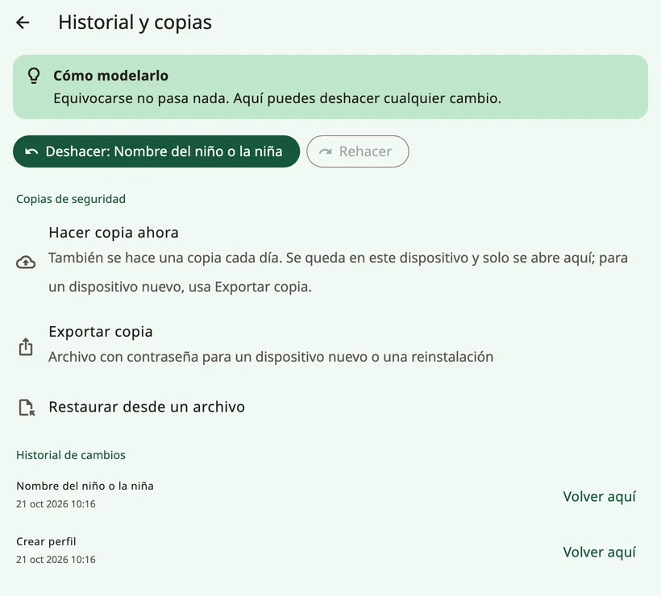
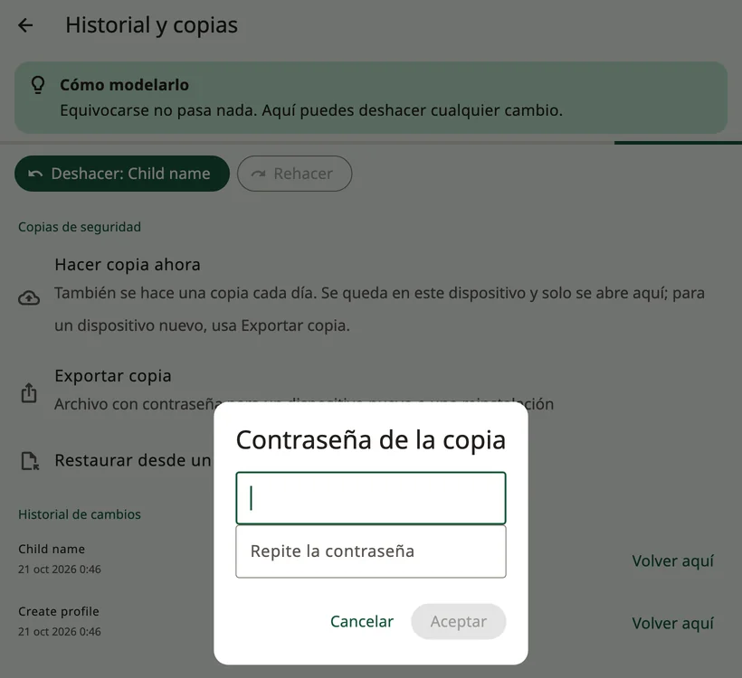
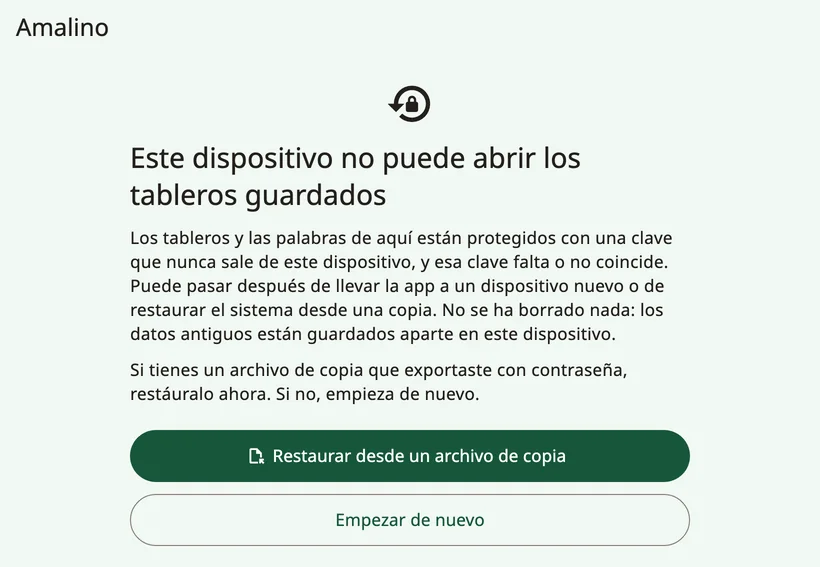
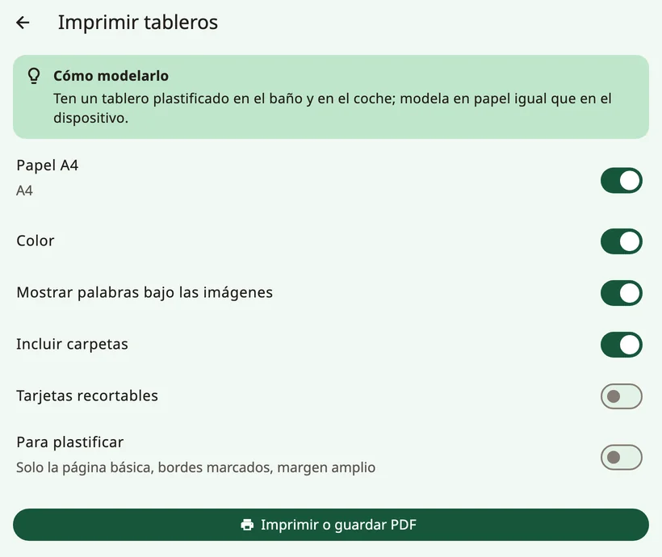

<!-- description: Haz copias de seguridad de los tableros de Amalino, pásalos a un dispositivo nuevo, compártelos con otras apps de CAA e imprime tableros en papel. -->
# Compartir e imprimir

Los tableros del niño valen mucho: son meses de palabras, fotos y grabaciones. Aquí te explico cómo protegerlos, cómo pasarlos a otro dispositivo y cómo llevarlos al papel.

## Copias de seguridad

Abre los controles para adultos y elige **{app:historyBackups}**.

- Cada día se hace una copia **de forma automática**. Se queda en el dispositivo y solo se abre en el dispositivo que la hizo, así que te protege de los errores, pero no de perder el dispositivo.
- **{app:backupNow}** hace una copia en el momento.
- **{app:exportBackup}** crea un archivo protegido con contraseña para un dispositivo nuevo o para reinstalar la app. Elige una contraseña que vayas a recordar, y guarda el archivo fuera del dispositivo: en un Mac o PC, en la nube o en un correo a tu propia dirección.

Si no hay ninguna copia fuera del dispositivo, o la última tiene más de un mes, los controles para adultos muestran un recordatorio discreto con **{app:backupReminderMake}** (nunca durante las dos primeras semanas de un perfil nuevo). **{app:notNow}** oculta el recordatorio durante dos semanas.

### La copia de seguridad del propio dispositivo

- **iPhone y iPad**: si haces una copia de seguridad del dispositivo en iCloud o en un Mac o PC, los datos de Amalino forman parte de esa copia.
- **{app:ga.androidTitle|label}**: los datos de Amalino no se copian en tu copia de seguridad de Google ni pasan a otro dispositivo. Para cambiar de dispositivo, usa **{app:exportBackup}**.

## Pasar a un dispositivo nuevo

1. En el dispositivo antiguo: abre los controles para adultos, después **{app:historyBackups}** (en **{app:sectionData}**) → **{app:exportBackup}**, y elige una contraseña.
2. Envía el archivo al dispositivo nuevo por AirDrop, Quick Share, correo electrónico, la nube o un cable USB.
3. En el dispositivo nuevo, instala Amalino. En la primera pantalla de la configuración, toca **{app:alreadyUse}**, después **{app:restoreBackup}** y luego **{app:chooseFile}**.
4. Escribe la contraseña.

Para restaurar una copia en un dispositivo que ya está configurado, usa **{app:importBackup}** en **{app:historyBackups}**. Se sustituyen todos los tableros, grabaciones y registros del dispositivo; antes, Amalino hace una copia de lo que hay en ese momento.

Una copia automática de otro dispositivo no se puede restaurar: solo se abre en el dispositivo que la hizo. Usa una copia exportada con contraseña.

## Si Amalino no puede abrir los tableros guardados

Los tableros están protegidos con una clave que nunca sale del dispositivo. Si esa clave falta o no coincide, por ejemplo después de pasar la app a un dispositivo nuevo o de restaurar una copia del sistema, Amalino muestra **{app:dataRecoveryTitle}** al iniciarse. No se ha borrado nada: los datos anteriores se guardan aparte en el dispositivo.

- **{app:dataRecoveryRestore}**: elige una copia que hayas exportado con contraseña y escribe la contraseña.
- **{app:dataRecoveryFresh}**: vuelve a hacer la configuración desde el principio.

Si alguna vez ves **{app:startupFailedTitle}**, cierra la app del todo y vuelve a abrirla. Si sigue pasando, reinicia el dispositivo. Tus tableros no se han borrado.

## Compartir tableros con otras apps de CAA

**{app:openBoardFormat}**, en el grupo **{app:sectionData}** de los controles para adultos, pasa tableros a otras apps de CAA que usan el formato Open Board, y también los trae desde ellas:

- **{app:exportAllBoards}** o **{app:exportThisBoard}**.
- **{app:importObz}**, por ejemplo desde Cboard. Los tableros importados se añaden como carpetas. Amalino te dice cuántos botones ha podido enlazar con palabras que ya conoce.

Cuando importes un tablero, comprueba que sus palabras están en sitios que el niño ya conoce.

## Imprimir

**{app:printBoards}** crea una copia en papel para el baño, la piscina, un viaje o por si se rompe el dispositivo.

- **{app:paperA4}**: las páginas son de tamaño A4.
- **{app:colour}**: desactívalo para imprimir en blanco y negro.
- **{app:showLabels}**: la palabra se imprime debajo de cada pictograma.
- **{app:includeFolders}**: también se imprimen las páginas de las carpetas, no solo el tablero principal.
- **{app:cutOut}**: pictogramas sueltos para recortar.
- **{app:waterproof}**: solo la página de palabras básicas, con bordes marcados y un margen ancho.

Toca **{app:printOrSave}** para imprimir, o para guardar un PDF e imprimirlo más tarde.

> **Consejo:** Ten un tablero de palabras básicas plastificado en el baño y en el coche, y modela en el papel igual que en el dispositivo.

Siguiente: [Consejos para familias](tips-for-families.md).
