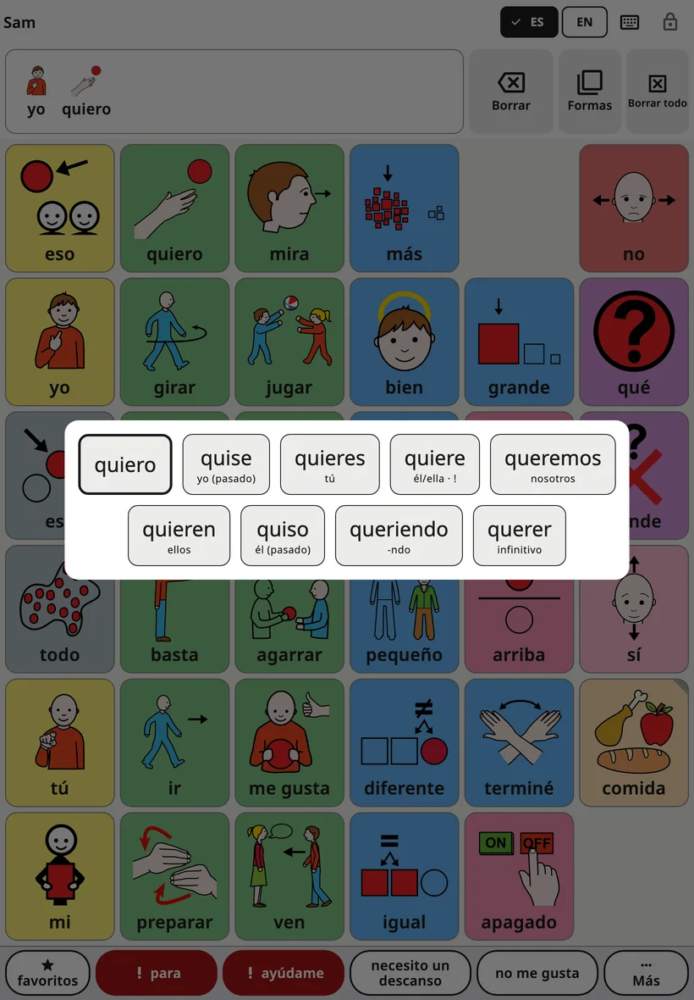
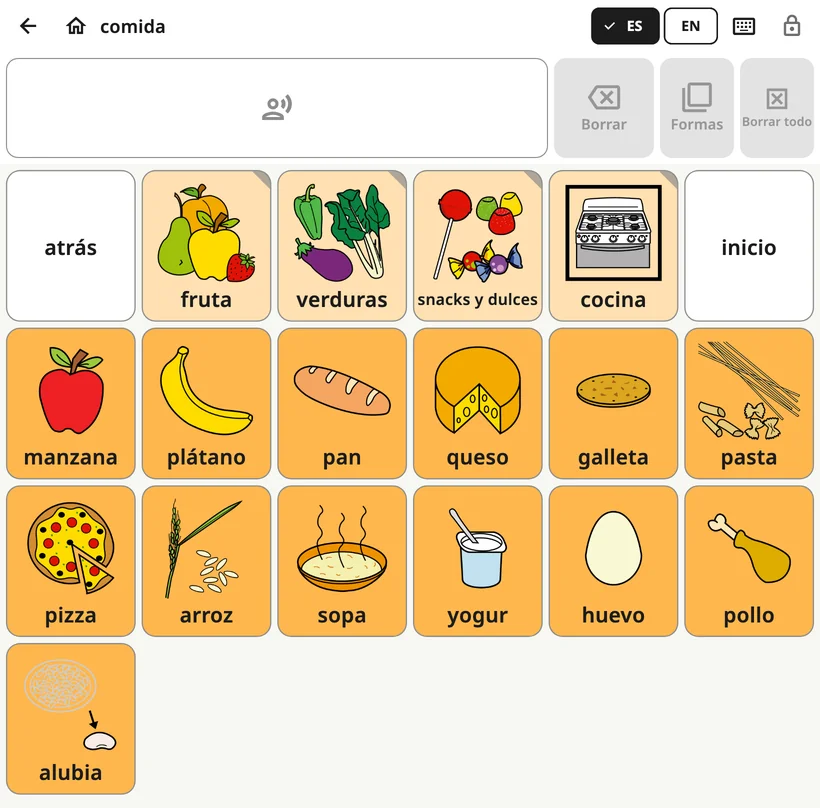

<!-- description: Lo que ve el niño en Amalino: el tablero, la barra superior, la barra de mensaje, las formas de las palabras, decir una frase y cambiar de idioma. -->
# El tablero del niño

El tablero es la pantalla que el niño usa todo el día. Los controles para adultos están bloqueados, así que puede explorarlo con total libertad.

## Las partes de la pantalla

De arriba abajo:

1. **La barra superior**: el nombre del niño (o el nombre del tablero, dentro de una carpeta), los botones de idioma, el botón del teclado y el candado.
2. **La barra de mensaje**: las palabras que ha elegido el niño, con **{app:barDelete}**, **{app:barForms}** y **{app:barClear}** al lado.
3. **El tablero**: los botones con pictogramas y palabras.
4. **La fila de frases**: {app:favourites}, «para», «ayúdame», dos frases de la familia y {app:quickMore}. Lo explico en [Frases rápidas y «Más»](quick-phrases.md).

## Decir una palabra y una frase

Cuando el niño toca un botón, se dice su palabra y se añade a la barra de mensaje. Si toca más botones, va formando una frase: «yo», «quiero», «más».

- **Toca la barra de mensaje** para decir la frase entera.
- **{app:barDelete}** quita la última palabra.
- **{app:barClear}** vacía el mensaje.

Puedes cambiar cómo funciona en **{app:sectionSettings}** → **{app:messageBar}**: por ejemplo, que las palabras solo se digan al tocar el mensaje, o que el mensaje se borre después de decirlo.

## Formas de las palabras

Las palabras cambian: «perro» y «perros», «ir» y «fui», «rojo» y «roja». El menú de formas muestra las otras formas de una palabra como botones grandes. Al tocar una forma, se añade al mensaje y se dice. La palabra tal cual siempre aparece la primera, para que el niño siempre pueda volver a ella.

Hay tres maneras de abrirlo:

- **Mantener pulsada una palabra** del tablero un momento.
- **Mantener pulsada la barra de mensaje** para cambiar la última palabra.
- Tocar **{app:barForms}**, junto a la barra de mensaje. Cambia la última palabra, y aparece en gris cuando esa palabra no tiene otras formas.

Si el niño usa un **{app:holdTime}** (en los controles para adultos → **{app:sectionSettings}** → **{app:touchAccess}**), mantener pulsada una palabra solo la dice. Para abrir las formas, toca **{app:barForms}**.

El menú está activado en todos los idiomas. Para desactivarlo, ve a **{app:sectionSettings}** → **{app:messageBar}** → **{app:grammarHelper}**.

## Carpetas

Algunos botones abren una carpeta de palabras relacionadas, como Comida, Lugares o Emociones. Un botón de carpeta tiene una esquina doblada.

Dentro de una carpeta, la barra superior muestra una flecha de **{app:back}** y un botón de **{app:home}**. El botón de inicio siempre vuelve al tablero principal.

## Cambiar de idioma

Si el niño usa más de un idioma, la barra superior muestra un botón para cada uno (EN, DA, ES, РУС, УКР, عربي, LT). Un toque cambia todo el tablero. Cada palabra se queda en el mismo sitio en todos los idiomas.

En las pantallas más pequeñas hay un solo botón de idioma, que abre una lista corta.

## Por qué los botones nunca se mueven

Cada palabra tiene su sitio en el tablero y no se mueve de ahí. El niño aprende dónde están las palabras, igual que tú aprendiste dónde están las letras en un teclado, y pronto las encuentra sin buscarlas.

Por eso:

- el tablero mantiene la misma distribución cuando se gira una tableta;
- en un teléfono, el tablero se queda en vertical de forma predeterminada (puedes cambiarlo en **{app:sectionSettings}** → **{app:boardLayout}** → **{app:boardOrientation}**);
- las palabras nuevas aparecen con el tiempo en su propio sitio, sin desplazar a las demás. Lo explico en [Palabras y carpetas](words-and-folders.md).

## El candado

El candado de arriba a la derecha abre los controles para adultos. Mantenlo pulsado 3 segundos y luego resuelve una suma sencilla con las teclas numéricas (o escribe tu PIN, si has puesto uno). Un toque rápido no hace nada, así que el niño no puede abrirlo sin querer.

Para que el niño no salga de la app, consulta **{app:lockAndKeep}** en [Ajustes](settings.md).

## Avisos en el tablero

Si la batería está muy baja o el sonido está apagado o muy bajo, una línea corta debajo de la barra superior lo avisa, por ejemplo «{app:warn.muted}».

Siguiente: [Palabras y carpetas](words-and-folders.md).
