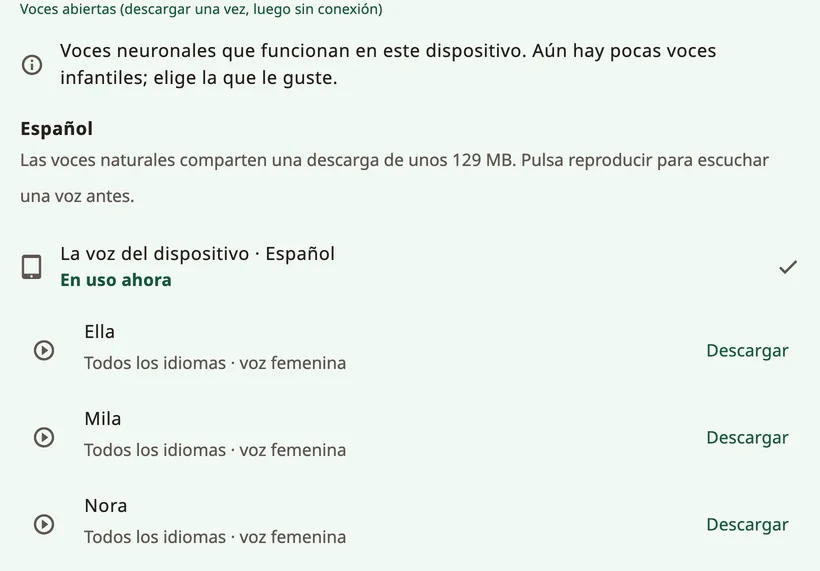

<!-- description: Elige cómo suena un niño en Amalino: voces naturales, la voz del dispositivo, grabaciones, edad de la voz, velocidad y cómo se dice su nombre. -->
# Voces

La voz es la voz del niño. Deja que escuche unas cuantas y que elija la que le guste. Puedes cambiarla cuando quieras en **{app:sectionSettings}** → **{app:speechVoice}**.

## Tipos de voces

- **{app:naturalVoicesHeading}**: diez voces (Ella, Mila, Nora, Sofi, Ida, Leo, Theo, Adam, Omar y Ben), las que suenan más humanas. Cada una habla los siete idiomas de Amalino. Una sola descarga sirve para todas, y después funcionan sin conexión.
- **{app:systemVoice}**: las voces que vienen con el teléfono o la tableta. No hay que descargar nada. Algunas pueden necesitar internet; en ese caso, Amalino lo indica debajo de la voz.
- **{app:personalVoice}** (iPhone y iPad, iOS 17 o posterior): una voz que has creado en los ajustes del dispositivo, en **Accesibilidad → Voz personal**. Amalino te pide permiso para usarla. Android no tiene Voz personal: si quieres conservar la voz de alguien de la familia, graba las palabras.
- **Tus grabaciones**: graba cualquier palabra con tu propia voz desde el editor de botones. Las grabaciones suenan en lugar de la voz de la app. Lo explico en [Editar y mover botones](editing.md).

Toca una voz para oírla y después toca **{app:useVoice}**.

## Una voz para todo o una por idioma

Cada idioma tiene su propio ajuste de voz. Como todas las voces naturales hablan todos los idiomas del niño, puedes tocar **{app:useForAll|voice=…}** para quedarte con una sola voz para todo. Si no, las frases que mezclan idiomas cambian de voz.

## Descargas

Las voces naturales son una sola descarga de unos 129 MB. Amalino te avisa primero de cuánto ocupa. Con datos móviles, te pregunta antes de descargar; elige **{app:waitForWifi}** para descargarlas más tarde. Hasta que termina la descarga, habla la voz del dispositivo.

Para liberar espacio, puedes quitar las voces naturales del dispositivo; las palabras usarán la voz del dispositivo hasta que vuelvas a descargarlas.

## Cómo suena la voz

- **{app:speechRate}**: más lenta o más rápida.
- **{app:voiceAge}**: **{app:voiceAgeAdult}**, **{app:voiceAgeOlder}** o **{app:voiceAgeYoung}**, con un control de **{app:voiceAgeStrength}**. Sube el tono y cambia el carácter de la voz. Sonará más a un adulto bajito que a un niño de verdad, así que mira qué le gusta al niño.
- **{app:pitch}**: solo para las voces del dispositivo, así que aparece únicamente mientras habla una de ellas. Las voces naturales usan la edad de la voz en su lugar.
- **{app:volume}**.
- **{app:lowerOthers.anon}**: la música y las demás apps bajan de volumen **{app:lowerOthersSpeaking}** o **{app:lowerOthersOpen}**, para que las palabras se oigan mejor.

## {app:savedSpeech}

Este ajuste está en **{app:advanced}**, al final de **{app:speechVoice}**. Para hablar al instante, Amalino prepara las palabras del tablero con las voces elegidas y las guarda en el dispositivo. Lo hace en segundo plano mientras nadie usa el tablero. **{app:savedSpeech}** muestra el progreso y el espacio que ocupa. Si alguna vez las palabras suenan mal, **{app:savedSpeechRebuild}** las vuelve a preparar.

## El nombre del niño

En los controles para adultos, elige el nombre del niño (por ejemplo, **{app:settingsChildName|name=Sam}**):

- escribe el nombre como se escribe en cada idioma, o una forma corta;
- escucha cómo lo dice cada voz;
- si suena mal, escribe en **{app:spokenAs}** cómo suena, por ejemplo «Yénifer» para Jennifer.

Si aun así suena mal, graba el nombre con tu propia voz.

## Un idioma sin voz

Si un idioma todavía no tiene voz, descarga las voces naturales. También puedes instalar una voz en los ajustes de texto a voz del dispositivo, o grabar tú las palabras.

> **Consejo:** Pregúntale al niño qué voz le gusta. Si la voz le encaja, tendrá más ganas de usarla.

Siguiente: [Compartir e imprimir](sharing-and-printing.md).
