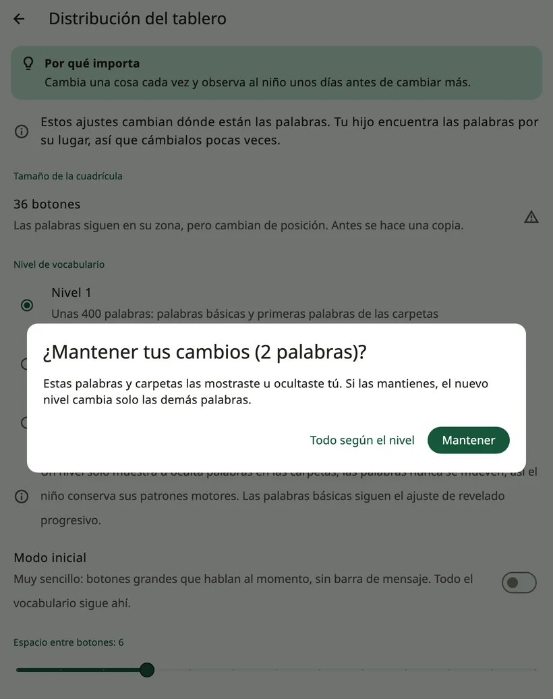

<!-- description: Cómo organiza Amalino las palabras: palabras básicas siempre en su sitio, carpetas, tamaños de tablero, niveles de vocabulario y palabras ocultas. -->
# Palabras y carpetas

Amalino trae unas 2500 palabras en cada uno de sus siete idiomas. No se muestran todas a la vez. En esta página te explico cómo están organizadas y cómo ir mostrando más a medida que el niño crece.

## Palabras básicas y carpetas

El **tablero principal** reúne las palabras básicas: palabras pequeñas y cotidianas como «yo», «quiero», «más», «ir», «no», «ayuda» y «me gusta». Unas 200 palabras básicas forman la mayor parte de lo que decimos cada día, así que con ellas el niño puede decir muchísimo.

Las **carpetas** guardan el resto: comida, lugares, personas, emociones, juguetes y mucho más. Un botón de carpeta tiene una esquina doblada y abre una página de palabras relacionadas.

Cuando el niño toca una palabra dentro de una carpeta, Amalino vuelve a donde estaba, listo para la siguiente palabra: «quiero», luego **Comida**, «manzana», y ya vuelven a estar ahí las palabras principales para decir «por favor». En las carpetas en las que el niño elige varias palabras seguidas, como los colores, desactiva **{app:folderGoBack}** para esa carpeta (lo explico en [Editar y mover botones](editing.md)). En **{app:favourites}** viene desactivado de entrada.

## Tamaño del tablero

El tamaño del tablero (**{app:gridSize}**) es el número de botones que caben en una página:

- **20**: botones grandes, más fáciles de acertar
- **36**: medianos, un buen comienzo para la mayoría de los niños pequeños
- **60**: más pequeños, con más palabras en una página
- **84**: pequeños, para quienes ya los manejan con soltura

La configuración propone un tamaño según la edad del niño y cómo toca la pantalla. Cada dispositivo ofrece solo los tamaños en los que todos los botones miden al menos 44 puntos de ancho (unos 7 mm, un tamaño cómodo para un dedo).

Intenta mantener siempre el mismo tamaño. Si lo cambias, las palabras se mueven a sitios nuevos y el niño tiene que aprenderlos otra vez. Amalino te pide que lo confirmes y antes hace una copia de seguridad. Para que el tablero crezca, es mejor mostrar más palabras.

## Las palabras nunca se mueven

Cada palabra tiene su sitio y lo conserva. Cuando una palabra está oculta, su sitio se queda vacío; cuando se muestra más adelante, aparece justo ahí. Nada se desplaza para hacerle hueco.

## Nivel de vocabulario

**{app:sectionSettings}** → **{app:boardLayout}** → **{app:vocabLevel}** decide cuántas palabras aparecen en las carpetas:

- **{app:levelDesc1|label}**: unas 400 palabras, las palabras básicas y las primeras palabras de las carpetas
- **{app:levelDesc2|label}**: unas 1300 palabras, con más carpetas
- **{app:levelDesc3|label}**: todas las palabras (unas 2500)

El nivel solo muestra u oculta palabras de las carpetas. Las palabras del tablero principal se muestran una a una (lo explico más abajo).

Si has sido tú quien ha mostrado u ocultado palabras en las carpetas, Amalino primero te pregunta si quieres mantener tus cambios. **{app:keepOwnChangesKeep}** cambia solo las demás palabras; **{app:keepOwnChangesReset}** hace que todas las palabras sigan el nuevo nivel.

## Mostrar y ocultar palabras

Cada palabra está **visible** para el niño u **oculta**. El sitio de una palabra oculta se ve vacío para el niño, y nada más se mueve.

Para verlas y cambiarlas, abre los controles para adultos y elige **{app:editBoard}**. Las palabras ocultas aparecen en su sitio, sombreadas en oscuro y con un ojo tachado. Toca una, activa **{app:visibility}** en su editor y toca **{app:done}**. Dentro de las carpetas funciona igual.

En el modo modelado, una página de carpeta funciona de la misma manera: las palabras ocultas se ven atenuadas, y el ojo de la línea de modelado muestra a la vez todas las palabras de esa carpeta.

> **Consejo:** Muestra una palabra nueva solo cuando ya la hayas modelado muchas veces. En el modo modelado, las palabras ocultas se ven atenuadas en su sitio: tócalas mientras hablas y, cuando llegue el momento, mantén una pulsada y elige **{app:showToChild}**. Lo explico en [Ajustes: {app:modellingMode}](settings.md).

## Encontrar una palabra

¿No recuerdas dónde está una palabra? En **{app:modellingMode}**, toca **{app:showMeWhere}** y escribe la palabra. Amalino te enseña el camino hasta ella, botón a botón, para que puedas tocarla tú mientras hablas.

## Tus propias palabras

Puedes añadir palabras, cambiar imágenes, grabar tu propia voz para una palabra y crear carpetas nuevas o añadir las que ya trae la app. Lo explico en [Editar y mover botones](editing.md).

Siguiente: [Frases rápidas y «Más»](quick-phrases.md).
