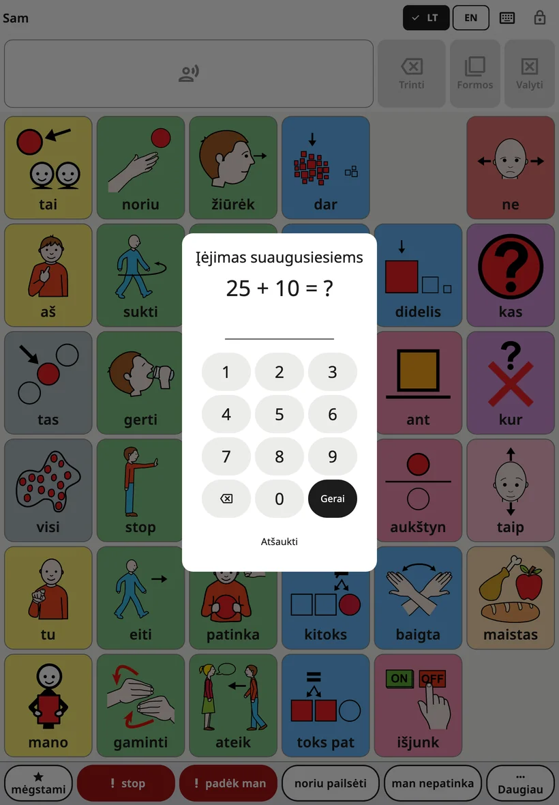
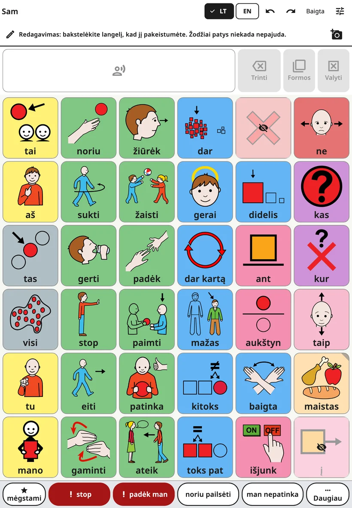
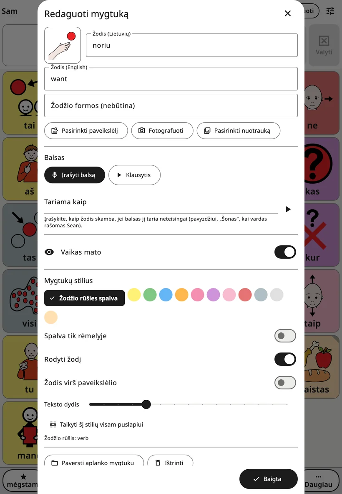
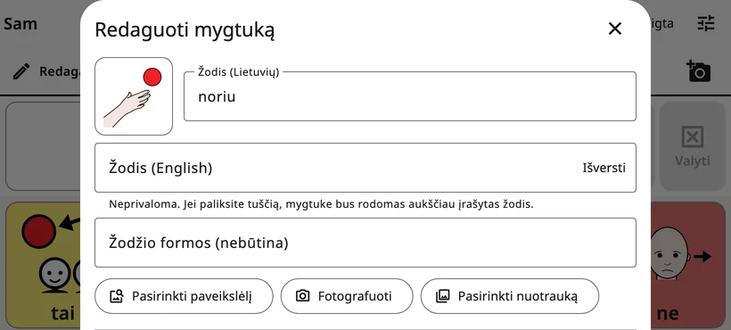
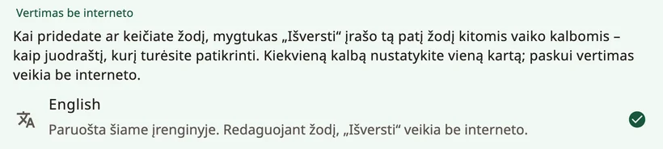

<!-- description: Kaip keisti Amalino lentą: suaugusiųjų nustatymai, mygtuko žodžiai, paveikslėlis ir balsas, vertimas, aplankai, mygtukų perkėlimas ir anuliavimas. -->
# Redagavimas ir mygtukų perkėlimas

Kiekvienos šeimos žodžiai skirtingi. Galite pakeisti bet kurį žodį, paveikslėlį ar balsą, pridėti savo žodžių ir aplankų bei perkelti savo pridėtus mygtukus. Vaikas nieko iš to nemato ir negali pakeisti.

## Kaip atidaryti suaugusiųjų nustatymus

Viršutiniame dešiniajame lentos kampe **3 sekundes palaikykite nuspaudę spynelę**, tada pasirodžiusiais skaičių klavišais išspręskite paprastą skaičiavimo užduotį (arba įveskite PIN kodą). Atsidarys suaugusiųjų nustatymai. Po 5 minučių jie vėl užsirakina patys, o bakstelėjus **{app:lockNow}** – iš karto.

Laikymo trukmę, PIN kodą ir automatinį užrakinimą galite pakeisti skiltyje **{app:lockAndKeep}**. Žr. [Nustatymai](settings.md).

## Lentos redagavimas

Pasirinkite **{app:editBoard}**. Lentos viršuje pasirodo eilutė: „{app:editingHint}“ Viršutinėje juostoje dabar yra mygtukai **{app:undo}**, **{app:redo}** ir **{app:done}**.

- Bakstelėkite mygtuką, kad jį redaguotumėte.
- Bakstelėkite tuščią langelį ir pasirinkite **{app:addWord}** arba **{app:addFolder}**.
- Aplankus atidarykite ir jų mygtukus redaguokite taip pat.
- Baigę bakstelėkite **{app:done}**.

Paslėpti žodžiai rodomi savo vietose, patamsinti ir su perbrauktos akies ženklu, todėl redaguodami visada matote visą lentą.

## Mygtuko redagavimo langas

- **Žodis**: mygtuko žodis ta kalba, kuria dabar rodoma lenta.
- **Kitos vaiko kalbos**: po juo – po laukelį kiekvienai kitai vaiko kalbai, pavyzdžiui, **{app:wordLabel|language=danų}**. Jie nebūtini: jei laukelis tuščias, rodomas aukščiau įrašytas žodis.
- **{app:translateWord}**: šis mygtukas atsiranda prie tuščio laukelio, kai įrenginys gali tą kalbą versti be interneto. Jis įrašo žodį kaip juodraštį su pastaba „{app:translatedCheck}“ Prieš vaikui juo naudojantis, patikrinkite. Žr. skyrių „Žodžių vertimas“ toliau.
- **{app:wordFormsManual}**: kitos žodžio formos, atskirtos kableliais, pavyzdžiui, „pelės, pelę, pelei“.
- **Paveikslėlis**: mygtukas **{app:chooseSymbol}** ieško tarp integruotų paveikslėlių, o **{app:moreSymbolSets}** – kituose nemokamuose simbolių rinkiniuose internete; siunčiami tik jūsų paieškos žodžiai. Mygtukais **{app:takePhoto}** ir **{app:choosePhoto}** pridėsite savo nuotrauką. Žmonėms, gyvūnams ir paties vaiko daiktams geriausiai tinka nuotraukos.
- **{app:voice}**: mygtukas **{app:recordVoice}** įrašo žodį jūsų balsu, **{app:listen}** jį atkuria, o **{app:removeRecording}** grąžina programėlės balsą.
- **{app:spokenAs}**: jei balsas žodį ištaria netaisyklingai, parašykite, kaip jis turėtų skambėti, pavyzdžiui, „Šon“ vardui Sean.
- **{app:recInSentences}**: paprastai jūsų įrašas skamba tik tada, kai vaikas bakstelėja būtent tą mygtuką, o sakinyje tą žodį ištaria programėlės balsas. Šį nustatymą įjunkite garsams, dainelėms ar žodžiams, kurių balsas ištarti nemoka.
- **{app:visibility}**: įjungus vaikas mato žodį ir gali juo naudotis; išjungus jo vieta vaikui atrodo tuščia, ir niekas nepasislenka. Žr. [Žodžiai ir aplankai](words-and-folders.md).
- **{app:buttonStyle}**: **{app:wordTypeColour}**, **{app:borderOnly}**, **{app:showLabel}**, **{app:labelOnTop}** ir **{app:textSize}**. Mygtukas **{app:styleWholePage}** pritaiko stilių visiems to puslapio mygtukams.
- **{app:wordType}**: nuo jos priklauso mygtuko spalva (pavyzdžiui, veiksmai žali, o savybės – mėlynos).

Kurdami **naują** žodį ar aplanką, apačioje bakstelėkite **{app:add}** – taip jis atsidurs lentoje. Mygtukas **{app:add}** lieka papilkėjęs, kol mygtukas neturi žodžio ar paveikslėlio. Mygtukas **✕** atšaukia: niekas nepridedama, o tam sukurta nuotrauka ar įrašas išmetami.

Kai redaguojate **esamą** mygtuką, pakeitimai pritaikomi iš karto; norėdami uždaryti langą, bakstelėkite **{app:done}** (arba **✕**).

## Žodžių vertimas

Kai kalba nustatyta, mygtukas **{app:translateWord}** veikia įrenginyje, be interneto. Kiekvieną kalbą reikia nustatyti vieną kartą: suaugusiųjų nustatymuose atidarykite **{app:languages}** (skiltyje **{app:sectionBoards}**), tada **{app:offlineTranslationHeader}**:

- **Android**: bakstelėkite kalbą ir sutikite atsisiųsti Google vertimo modelį – maždaug 30 MB kiekvienai kalbai. Jokie programėlės žodžiai nesiunčiami.
- **iPhone ir iPad**: reikia iOS 26 ar naujesnės versijos. Kalbas teikia Apple: įrenginio nustatymuose atidarykite **Settings → Apps → Translate → Downloaded Languages**, atsisiųskite kalbas ir grįžkite į Amalino.

Prie kiekvienos kalbos parodoma, ar ji paruošta. Jei įrenginys to padaryti negali, rodoma **{app:offlineTranslationUnsupported}**

## Aplankai

Norėdami pridėti aplanką, redagavimo režimu bakstelėkite tuščią langelį ir pasirinkite **{app:addFolder}**. Lange **{app:pickFolderTitle}** išvardyti vaiko aplankai su paveikslėliais, tarp jų ir integruotieji („Maistas“, „Jausmai“, „Vietos“…), o viršuje – **{app:newFolder}**. Pasirinkite aplanką, patikrinkite pavadinimą ir paveikslėlį ir bakstelėkite **{app:add}**.

Aplanko mygtuko redagavimo lange dar yra:

- **{app:makeFolder}**: žodžio mygtukas tampa aplanko mygtuku. Pasirinkite aplanką arba **{app:newFolder}**.
- **{app:changeFolder}**: aplanko mygtukas nukreipiamas į kitą aplanką.
- **{app:openThisFolder}**: redagavimo langas uždaromas ir atidaromas aplankas, kad galėtumėte redaguoti jo turinį.
- **{app:folderGoBack}**: įjungus, vaikui bakstelėjus žodį šiame aplanke, jis grąžinamas ten, iš kur atėjo, kad galėtų rinktis kitą žodį. Išjunkite aplankams, kuriuose vaikas renkasi kelis žodžius iš eilės. Nustatymas galioja aplankui, iš kur jis bebūtų atidarytas. Aplanke **{app:favourites}** jis iš pradžių išjungtas.

## Mygtuko perkėlimas

Pagrindiniai žodžiai pagrindinėje lentoje lieka savo vietose, kad vaiko ranka visada juos rastų. Perkelti galima mygtukus, kurie atidaro aplanką ar sceną:

1. Atidarykite mygtuko redagavimo langą ir pasirinkite **{app:sceneMove}**
2. Lange **{app:pickCellTitle}** parodoma lenta su paryškintais laisvais langeliais. Bakstelėkite vieną, tada **{app:pickCellPutHere}**.
3. Arba bakstelėkite **{app:pickCellChooseAnother}**, kad perkeltumėte mygtuką į kitą aplanką, arba **{app:pickCellFavouritesInstead}**.

Mygtukas išlaiko savo žodį, paveikslėlį, balsą ir stilių. Daugiau niekas nė vienoje lentoje nepasislenka. Vieną kartą bakstelėjus **{app:undo}**, viskas grąžinama atgal.

## Mygtuko ištrynimas

Atidarykite mygtuko redagavimo langą ir pasirinkite **{app:delete}**. Pagrindiniam žodžiui Amalino pasiūlo **{app:hideInstead}**: paslėpus jo vieta išsaugoma ateičiai, o ištrynus lieka tuščias langelis. Paslėpti beveik visada geriau.

## Anuliavimas ir istorija

- Redaguojant mygtukais **{app:undo}** ir **{app:redo}** viršutinėje juostoje galite grįžti atgal ar eiti pirmyn per savo pakeitimus.
- Suaugusiųjų nustatymų skiltyje **{app:historyBackups}** išvardytas kiekvienas pakeitimas. Mygtukas **{app:restoreHere}** grąžina lentas į tą būseną, kokia buvo tuo metu.

Klysti nebaisu. Bet kurį pakeitimą galima atšaukti.

> **Patarimas.** Pridėję žodį, tą pačią dieną bent tris kartus patys juo pasinaudokite įrenginyje.

Toliau: [Nustatymai, ekranas po ekrano](settings.md).
