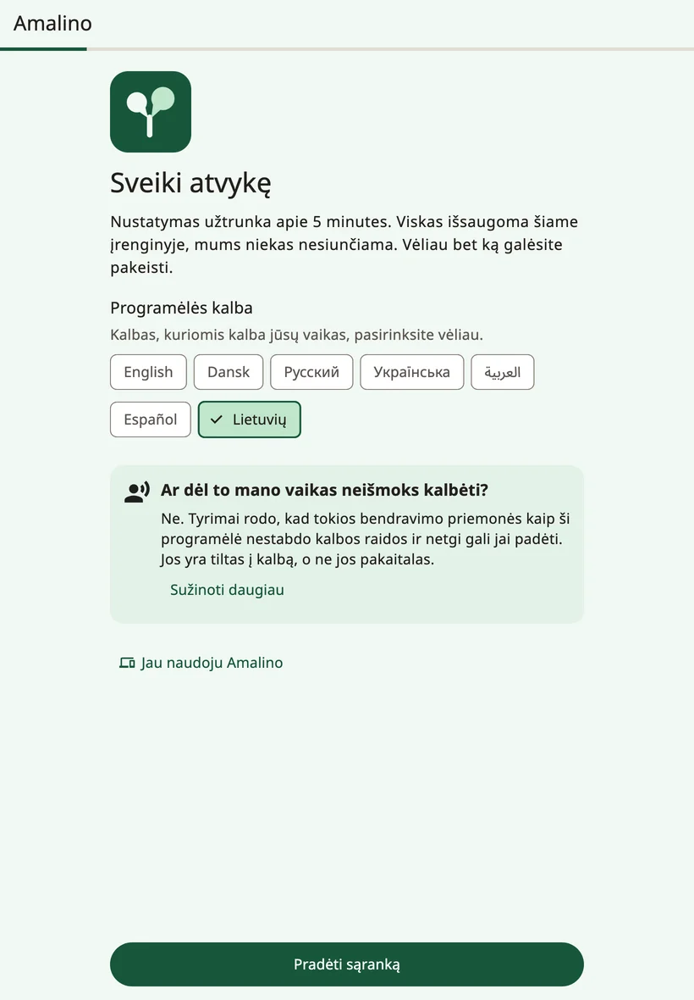
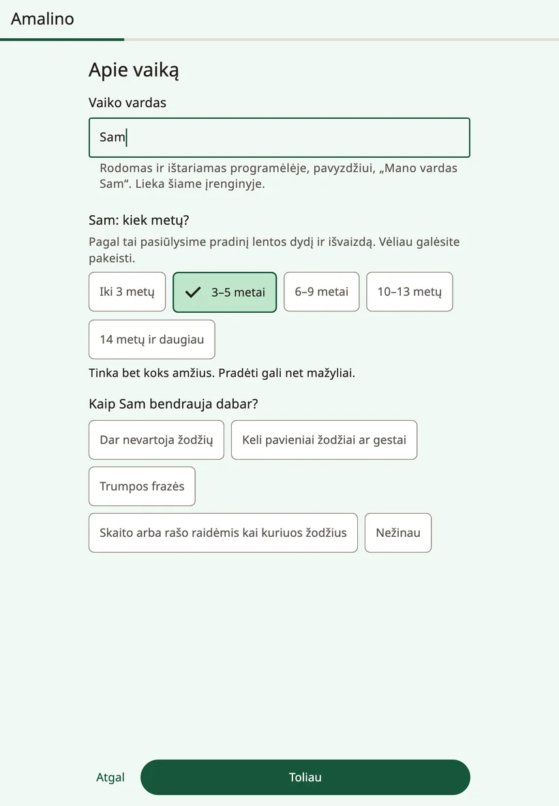
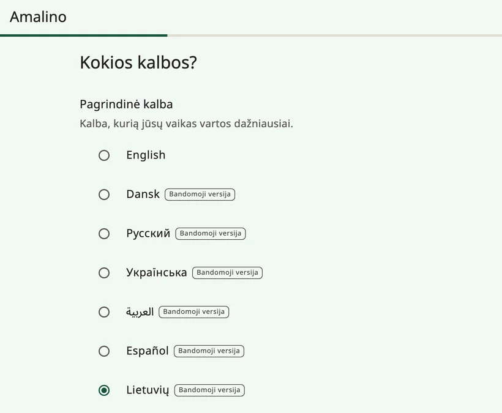
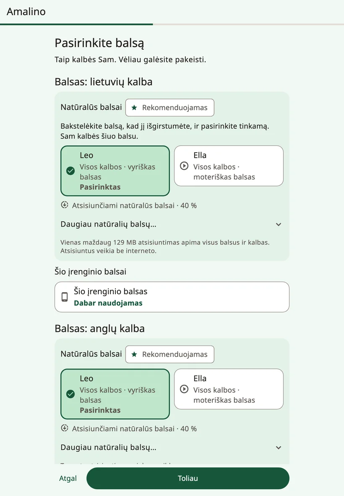
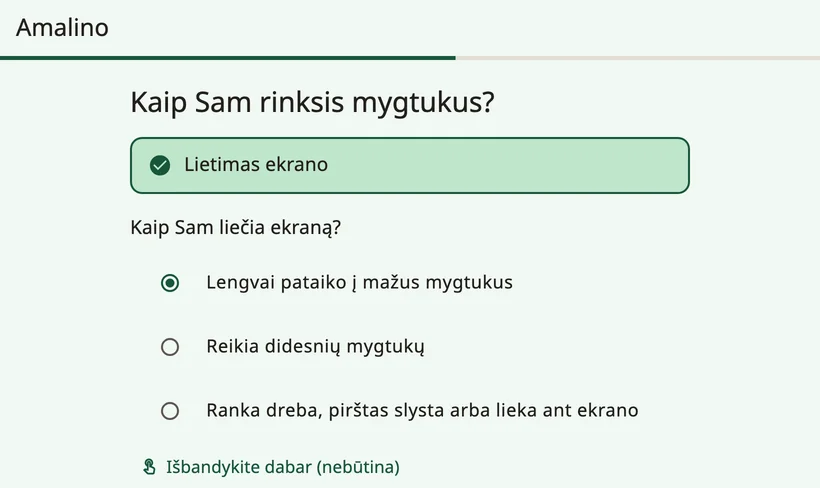
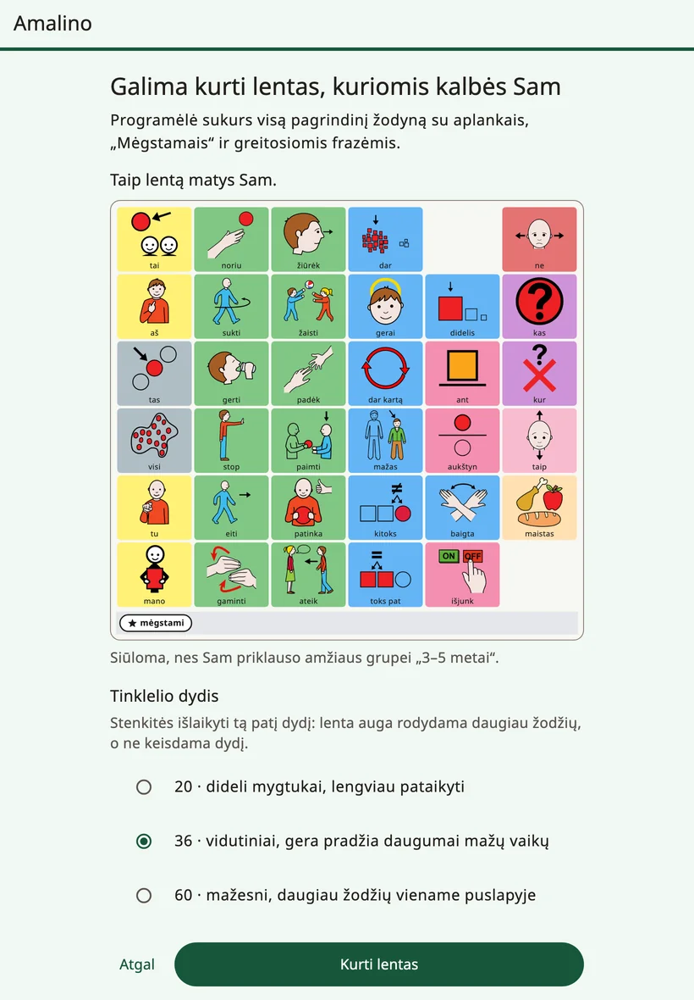

<!-- description: Pirmasis Amalino nustatymas: vaikas, kalbos, balsas, lietimas, mėgstamiausi dalykai ir užraktas, saugantis suaugusiųjų nustatymus. -->
# Pirmieji žingsniai

Amalino veikia iPhone ir iPad įrenginiuose, taip pat Android telefonuose ir planšetėse. Ji nemokama, o nustatyta veikia ir be interneto.

Sąranka užtrunka apie penkias minutes. Viskas, ką įvedate, lieka įrenginyje, o bet kurį atsakymą vėliau galėsite pakeisti.

## Prieš pradedant

- Įkraukite įrenginį ir padidinkite garsą.
- Jei galite, lietimo žingsniui pasikvieskite vaiką: naudinga pamatyti, kaip jis bakstelėja.
- Jei įmanoma, prisijunkite prie Wi-Fi: natūralūs balsai atsisiunčiami vienu maždaug 129 MB failu.

## Sąrankos žingsniai

### {app:welcomeTitle}

Skiltyje **{app:appLanguage}** pasirinkite, kokia kalba bus rodomi suaugusiesiems skirti ekranai. Vaiko kalbas pasirinksite vėlesniame žingsnyje.

Jei vaikas jau naudojasi Amalino kitame įrenginyje, bakstelėkite **{app:alreadyUse}**, tada **{app:restoreBackup}**: taip perkelsite jo lentas iš atsarginės kopijos, kurią eksportavote su slaptažodžiu. Žr. [Dalijimasis ir spausdinimas](sharing-and-printing.md).

### {app:aboutChild}

- **{app:ageBandTitle.anon}** Pagal amžiaus grupę pasiūlomas pradinis lentos dydis, žodyno lygis ir išvaizda. Tinka bet koks amžius – pradėti gali net mažyliai.
- **{app:commTitle.anon}** Atsakymas padeda parinkti pirmuosius žodžius.
- **{app:childName}** (nebūtina). Vardas rodomas ir ištariamas programėlėje, pavyzdžiui, frazėje „Mano vardas…“. Jis lieka įrenginyje.

### {app:whichLanguages}

Skiltyje **{app:primaryLanguage}** pasirinkite kalbą, kuria vaikas kalbės dažniausiai, ir pažymėkite kitas kalbas, kurias vaikas girdi kiekvieną dieną. Amalino turi septynias kalbas: anglų, danų, rusų, ukrainiečių, arabų, ispanų ir lietuvių.

Visomis kalbomis tas pats mygtukas yra toje pačioje vietoje. Vaikas gali perjungti kalbą vienu bakstelėjimu, ir lentos iš naujo mokytis jam nereikia.

Kol kas visos kalbos, išskyrus anglų, pažymėtos žyma **{app:languagePreview}**: ne visus jų žodžius jau patikrino gimtakalbis. Po sąrašu parašyta: „{app:languagePreviewNote}“ Bet kurį žodį galite pataisyti ir patys.

Pasirinkus rusų, ukrainiečių, arabų, ispanų ar lietuvių kalbą, sąranka dar paklausia: **{app:wordFormsTitle.anon}** Pasirinkite **{app:forms.boy}** arba **{app:forms.girl}** – tada vaikui kalbant apie save žodžiai turės teisingas galūnes.

Jei jūsų kalbos sąraše nėra, bakstelėkite **{app:notListed}**. Lentas vis tiek galėsite kurti: kiekvieną žodį įrašykite savo balsu, ir lenta gros jūsų įrašus.

### {app:chooseVoiceTitle}

Pasirinkite, kaip vaikas skambės kiekviena kalba. Bakstelėkite balsą, kad jį išgirstumėte.

- **{app:naturalVoicesHeading}** skamba labiausiai žmogiškai. Dešimt balsų kalba visomis septyniomis kalbomis, o atsisiunčiami jie vienu bendru maždaug 129 MB failu. Atsisiuntus jie veikia be interneto. Rekomenduojamas balsas jau pasirinktas.
- **{app:systemVoice}**: nieko atsisiųsti nereikia, jis paruoštas iš karto. Juo kalbama, kol atsisiunčiamas natūralus balsas.

Prisijungus prie Wi-Fi, atsisiuntimas prasideda savaime. Naudojantis mobiliuoju internetu, Amalino pirmiausia paklausia arba palaukia Wi-Fi ryšio.

Balsą galite pakeisti bet kada. Žr. [Balsai](voices.md).

### {app:accessMethod}

Kol kas Amalino valdoma liečiant ekraną. Kiti pasirinkimo būdai pažymėti užrašu „**{app:comingLater}**“.

Tada atsakykite į klausimą **{app:touchTitle.anon}**

- **{app:touch.easy}**
- **{app:touch.bigger}**
- **{app:touch.shaky}**

Pagal atsakymą nustatomi lietimo nustatymai ir lentos dydis. Mygtukas **{app:tryItNow}** leidžia vaikui kelis kartus pabandyti bakstelėti, o jei daug bakstelėjimų nepataiko, mygtukas **{app:makeEasier}** viską pakoreguoja. Daugiau lietimo nustatymų rasite skiltyje **{app:sectionSettings}** → **{app:touchAccess}**.

### {app:fiveFavourites}

Pridėkite iki penkių dalykų, kuriuos vaikas labai mėgsta: burbulus, filmuką, močiutę. Nufotografuokite arba pasirinkite nuotrauką ir įrašykite, kaip vaikas tą dalyką vadina. Jie atsidurs aplanke **{app:favourites}**, kurį vaikas pasiekia vienu bakstelėjimu iš bet kurios lentos. Žmonėms ir paties vaiko žaislams geriausiai tinka nuotraukos.

### Suaugusiųjų nustatymai

Nustatymai apsaugoti, kad vaikas netyčia nepakeistų lentos. Norėdami juos atidaryti, **3 sekundes palaikykite nuspaudę spynelę lentos viršuje, tada išspręskite paprastą skaičiavimo užduotį**. Čia galite tai vieną kartą išbandyti. Galite pasirinkti ir parinktį **{app:longerHold}**.

Vietoj skaičiavimo užduoties galite pasirinkti parinktį **{app:lockPin}**. Vyresni vaikai užduotį išspręsti gali, todėl jiems saugiau naudoti PIN kodą.

### Vardas kiekviena kalba

Jei įrašėte vardą, galite nurodyti, kaip jis rašomas kiekviena kalba, ir išgirsti, kaip jį ištaria balsas. Jei skamba netaisyklingai, parašykite, kaip vardas turėtų skambėti, pavyzdžiui, „Šon“ vardui Sean.

### Suvestinė

Paskutiniame žingsnyje matysite visus savo atsakymus. Norėdami kurį nors pakeisti, šalia jo bakstelėkite **{app:change}**.

Čia taip pat pasirenkate:

- **{app:gridSize}** – kiek mygtukų telpa lentoje. Mygtukas **{app:moreSizes}** parodo kitus dydžius. Stenkitės laikytis vieno dydžio: lenta auga rodant daugiau žodžių, o ne keičiant jos dydį.
- **{app:vocabLevel}** – maždaug 400, 1 300 arba 2 500 žodžių. Žr. [Žodžiai ir aplankai](words-and-folders.md).

Vyresniems vaikams galite įjungti parinktį **{app:teenPack}**: bendravimo frazės, juokeliai ir slengas, o išvaizda suaugusiškesnė, be animacinių piešinėlių.

Patiems mažiausiems pradedantiesiems sąranka gali pasiūlyti režimą **{app:earlyMode}**: keturi dideli paveikslėliai, kurie iš karto ištaria žodį. Visas žodynas lieka po apačia, o vėliau galėsite pereiti prie visos lentos.

Tada bakstelėkite **{app:createBoards}**.

## Po sąrankos

Puslapyje **{app:allSet}** dar kartą parodoma, kaip atidaryti suaugusiųjų nustatymus, ir pateikiamas pirmas patarimas, kurį galite išbandyti jau šiandien. Ten taip pat yra mygtukas **{app:lockDeviceToApp}** (tos pačios instrukcijos kaip suaugusiųjų nustatymų skiltyje **{app:guidedAccess}**) ir nustatymas **{app:dailyTip}**.

Bakstelėkite **{app:startTalking}**. Atsidarys lenta, paruošta vaikui.

Kai ką galėsite padaryti vėliau – suaugusiųjų nustatymų skiltyje **{app:finishSetup}**:

- pasirinkti dvi frazes, kurių vaikui reikia labiausiai,
- išgirsti, kaip skamba vaiko vardas,
- kartu su vaiku išbandyti lietimo nustatymus.

Toliau: [Vaiko lenta](the-board.md).
