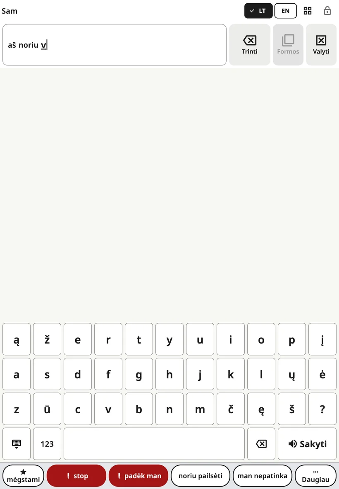

<!-- description: Rašymas Amalino programėlėje: kaip atidaryti klaviatūrą, žodžių pasiūlymai, raidžių tvarka, skaičiai ir ženklai, klavišų dydis telefone. -->
# Klaviatūra

Vaikai, kurie jau pažįsta kai kurias raides, gali parašyti žodžius, kurių lentoje nėra. Klaviatūra atsiranda toje pačioje vietoje kaip lenta, todėl tarp jų persijungiama vienu bakstelėjimu.

## Kaip ją atidaryti ir uždaryti

Viršutinėje juostoje bakstelėkite **klaviatūros** mygtuką. Norėdami grįžti prie paveikslėlių, dar kartą bakstelėkite tą patį mygtuką (dabar jame pavaizduotas tinklelis) arba **uždarymo** klavišą apatiniame kairiajame klaviatūros kampe.

## Rašymas

- Rašomas žodis rodomas **sakinio juostoje**, todėl vaikas mato, kaip jis auga.
- **Tarpas** užbaigia žodį.
- **Trynimo klavišas** ištrina raidę. Palaikius jį nuspaustą, trinama toliau.
- Mygtukas **{app:kbSpeak}** ištaria visą sakinį.
- **123** atidaro skaičius ir skyrybos ženklus, tarp jų ir kiekvienos kalbos savitus ženklus (ispanų ¿ ¡, danų » «, rusų ir ukrainiečių « », lietuvių „ “, arabų ؟ ،). **ABC** grąžina prie raidžių.
- Ispanų klaviatūroje klavišas **´** po ñ uždeda kirtį ką tik parašytai raidei: á é í ó ú. Paspaudus dar kartą, ženklas dingsta, o ant u pirma gaunama ú, paskui ü (pingüino).

Sakinio juostos mygtukai **{app:barDelete}** ir **{app:barClear}** veikia taip pat kaip lentoje.

Telefone palietus raidę, ji virš piršto parodoma padidinta, kad vaikas matytų, kurį klavišą liečia, dar prieš atitraukdamas pirštą. Taip nebūna, kai įjungti nustatymai **{app:activateOnRelease}** ir **{app:holdTime}**, nes tada klavišas patamsėja jau laikant jį nuspaustą.

## Žodžių pasiūlymai

Virš klavišų esančioje eilutėje vaikui rašant siūlomi žodžiai. Bakstelėjus pasiūlymą, žodis įrašomas kartu su tarpu. Pasiūlymai sudaromi iš:

- vaiko lentose esančių žodžių,
- to, ką vaikas jau rašė anksčiau, jei įjungtas nustatymas **{app:kbLearn.anon}**,
- tos kalbos žodžių sąrašo.

Jie sudaromi įrenginyje; niekas niekur nesiunčiama.

Kai kurios šeimos išjungia pasiūlymus, kol vaikas mokosi rašyti žodžius: **{app:sectionSettings}** → **{app:kbSettings}** → **{app:kbSuggestions}**.

Jei įjungtas nustatymas **{app:aiPhrase}** (skiltyje **{app:sectionSettings}** → **{app:kbSettings}**), įvedus pirmąsias raides, pavyzdžiui, „neįp“, kaip papildomas pasiūlymas gali būti pateiktas sakinys „Noriu eiti į parką“. Vaikas jį pasirenka arba nekreipia dėmesio.

## Raidžių tvarka

**{app:sectionSettings}** → **{app:kbSettings}** → **{app:kbLayout}**:

- **{app:kbLayoutStandard}**: įprasta tos kalbos klaviatūra.
- **{app:kbLayoutAbc}**: raidės išdėstytos abėcėlės tvarka tose pačiose eilėse, todėl klaviatūra lieka tokio pat dydžio.

## Klavišų dydis telefone

Telefone kalba, kurioje daug raidžių, turi siaurus klavišus. **{app:sectionSettings}** → **{app:kbSettings}** → **{app:kbKeySize}**:

- **{app:kbKeySizeAuto}** (numatytasis) – pagal lietimo nustatymus: jei vaikui reikia didesnių mygtukų arba jo bakstelėjimai netikslūs, ilgos raidžių eilės padalijamos į dvi, išlaikant raidžių tvarką, kad kiekvienas klavišas būtų bent 40 taškų (maždaug 6 mm) pločio.
- **{app:kbKeySizeStandard}** – visada lieka įprastos eilės.
- **{app:kbKeySizeLarger}** – ilgos eilės padalijamos visada.

Pasukus telefoną horizontaliai, klavišai ir taip platūs, todėl eilės nedalijamos. Planšetėse visada naudojamos įprastos eilės.

## Kai telefonas pasuktas horizontaliai

Jei telefone lenta nustatyta gulsčia, klaviatūrai reikia viso ekrano aukščio. Tada „**stop**“ ir „**padėk man**“ persikelia į pasiūlymų eilutės galą – kaskart į tą pačią vietą. Grįžus prie lentos, vėl rodoma visa frazių eilutė.

> **Patarimas.** Modeliuokite ir rašydami. Lėtai rašykite žodį jį tardami, tada bakstelėkite **{app:kbSpeak}**.

Toliau: [Scenos](scenes.md).
