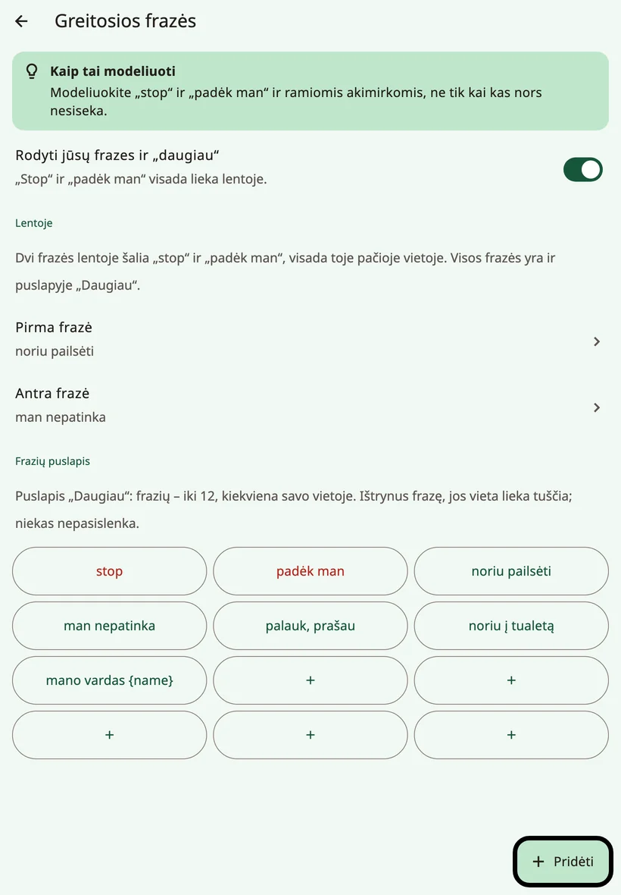
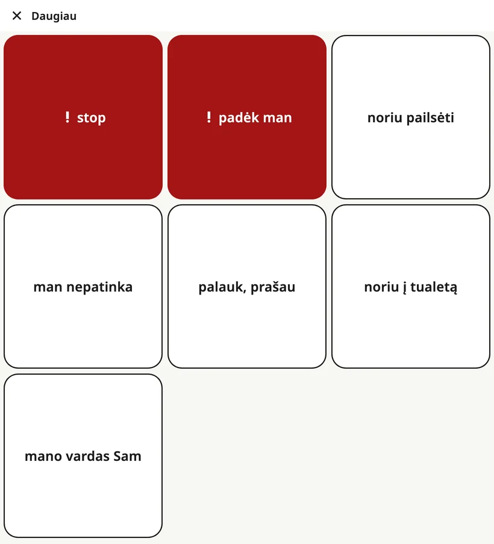

<!-- description: Frazių eilutė Amalino lentos apačioje: „stop“, „padėk man“, dvi šeimos frazės, aplankas „{app:favourites}“ ir frazių puslapis „{app:quickMore}“. -->
# Greitosios frazės ir „{app:quickMore}“

Kai ką reikia pasakyti greitai, nesudarant sakinio. **Frazių eilutė** lentos apačioje tokias frazes laiko vieno bakstelėjimo atstumu – kiekviename puslapyje.

## Frazių eilutė

Iš kairės į dešinę:

1. **★ {app:favourites}**: atidaro aplanką „{app:favourites}“.
2. **! stop**
3. **! padėk man**
4. **Pirmoji šeimos frazė**
5. **Antroji šeimos frazė**
6. **{app:quickMore}**: atidaro puslapį su visomis frazėmis.

Kiekvienas mygtukas visomis kalbomis ir kiekviename puslapyje lieka savo vietoje. „**stop**“ ir „**padėk man**“ yra visada ir visada raudoni: tai skubios frazės. Visi keturi frazių mygtukai vienodo pločio, todėl ilga frazė niekada nieko nenustumia – ji tiesiog persikelia į antrą eilutę.

Bakstelėta frazė ištariama iš karto. Į sakinio juostą ji nepatenka.

## Kaip pasirinkti dvi šeimos frazes

Atidarykite suaugusiųjų nustatymus ir pasirinkite **{app:quickPhrases}**. Skiltyje **{app:qpOnBoard}** pasirinkite **{app:qpPick1}** ir **{app:qpPick2}** – jos bus rodomos šalia „stop“ ir „padėk man“. Pasirinkite tas dvi, kurių vaikui reikia labiausiai, pavyzdžiui, „noriu pailsėti“ ir „man nepatinka“.

## Puslapis „{app:quickMore}“

Mygtukas **{app:quickMore}** atidaro puslapį, kuriame telpa iki 12 frazių, kiekviena savo pastovioje vietoje. Bakstelėjus frazę, ji ištariama ir puslapis užsidaro; mygtukas **{app:close}** grąžina atgal nieko neištaręs.

Nustatymų skiltyje **{app:quickPhrases}**, dalyje **{app:qpPage}**, galite:

- **{app:add}** frazę ir pasirinkti jos vietą (**{app:qpPlace}**),
- **{app:edit}** frazę arba pažymėti ją kaip **{app:qpUrgent}**, kad ji būtų rodoma raudonai,
- **{app:delete}** frazę. Jos vieta lieka tuščia, kitos nepasislenka.

Kai puslapis pilnas, pašalinkite kurią nors frazę arba bakstelėkite **{app:makePhraseBoard}** – frazės taps aplanku, kuriame vietos daugiau.

Frazės su vaiko vardu, pavyzdžiui, „Mano vardas…“, atsiranda, kai įrašote vardą.

## Aplankas „{app:favourites}“

Aplanke **{app:favourites}** laikoma tai, ką vaikas mėgsta labiausiai: penki mėgstamiausi dalykai iš sąrankos ir viskas, ką pridėsite vėliau. Iš bet kurio puslapio jį pasieksite vienu bakstelėjimu – mygtuku **★ {app:favourites}**.

Pagrindinėje lentoje viena vieta irgi paliekama šiam aplankui: kai renkatės, kur dėti naują mygtuką, ji pažymėta užrašu **{app:pickCellFavouritesNote}**.

Mažuose telefonuose ★ mygtuke gali būti rodoma tik žvaigždutė be žodžio. Mygtukas veikia taip pat.

## Kaip paslėpti šeimos frazes

Jei eilutė vaiką blaško, skiltyje **{app:quickPhrases}** išjunkite nustatymą **{app:showQuickPhrases}**. Jūsų dvi frazės ir mygtukas **{app:quickMore}** dings, bet „**stop**“ ir „**padėk man**“ visada lieka lentoje tose pačiose vietose: dažnai tai svarbiausi vaiko žodžiai. Lieka ir mygtukas **★ {app:favourites}**.

> **Patarimas.** Frazes „stop“ ir „padėk man“ modeliuokite ir ramiomis akimirkomis, ne tik tada, kai kas nors negerai.

Toliau: [Klaviatūra](keyboard.md).
