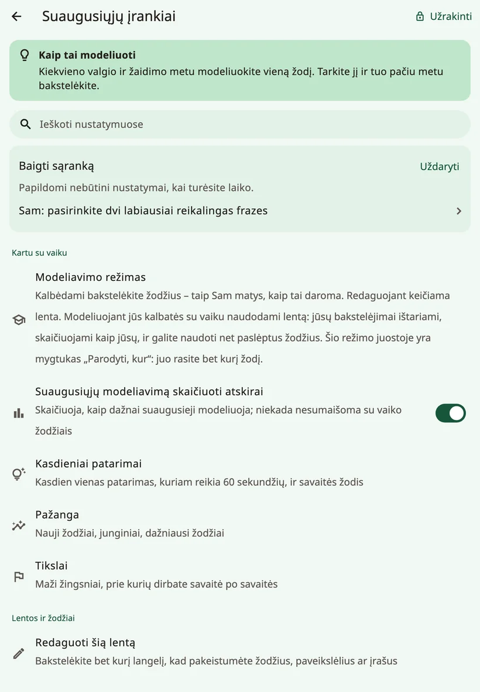
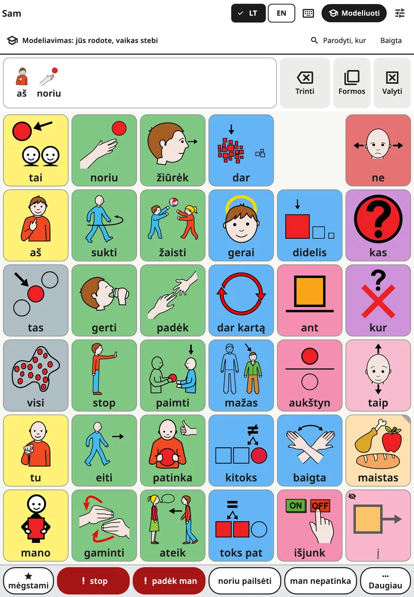
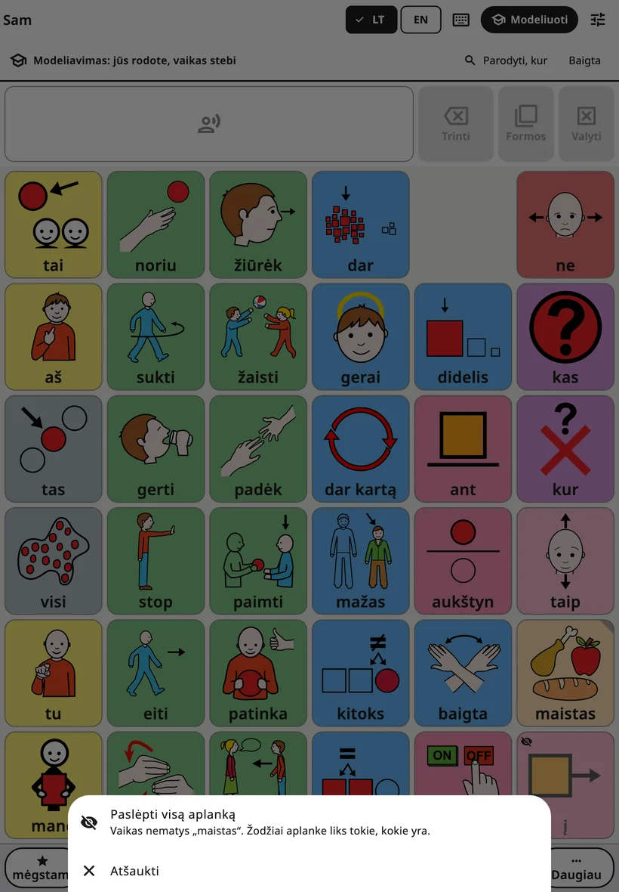
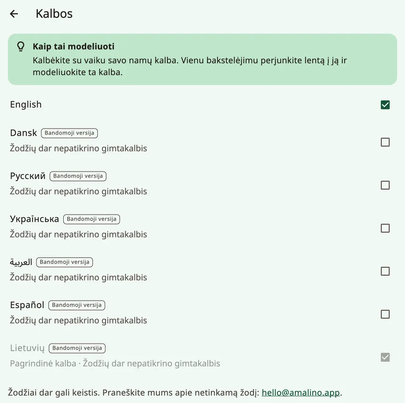
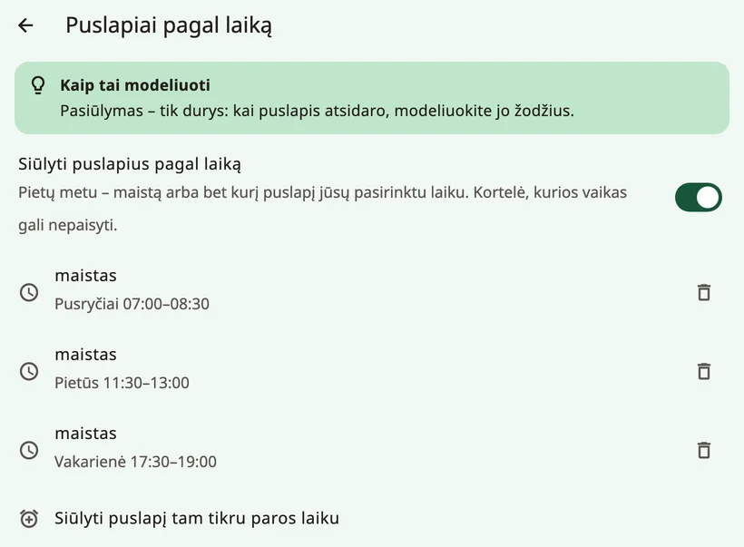

<!-- description: Visi Amalino suaugusiųjų nustatymų ekranai: modeliavimas, žodžiai, balsai, lietimas, ekranas, lentos išdėstymas, klaviatūra, užraktas ir duomenys. -->
# Nustatymai, ekranas po ekrano

Norėdami atidaryti suaugusiųjų nustatymus, 3 sekundes palaikykite nuspaudę spynelę lentos viršuje ir skaičių klavišais išspręskite skaičiavimo užduotį. Nustatymai suskirstyti į keturias grupes: **{app:sectionTogether}**, **{app:sectionBoards}**, **{app:sectionSettings}** ir **{app:sectionData}**. Šiame puslapyje jos aprašytos ta tvarka, kuria matote jas ekrane. Šiame vadove „{app:sectionSettings} → …“ reiškia grupę **{app:sectionSettings}** suaugusiųjų nustatymuose, o ne jūsų įrenginio nustatymų programėlę.

Daugelyje ekranų yra trumpas patarimas **{app:tipTitle}**.

## Kaip rasti nustatymą

Neprisimenate, kur kas yra? Viršuje bakstelėkite **{app:searchSettings}** ir įveskite žodį, pavyzdžiui, „balsas“ ar „spalva“. Prie kiekvieno rezultato parodoma, kur jis yra („{app:speechVoice} → {app:speechRate}“). Bakstelėkite jį, ir Amalino atidarys tą ekraną, o nustatymą švelniai pažymės.

## {app:sectionTogether}

### {app:modellingMode}

Režimas **{app:edit}** keičia lentą. Režimas **{app:modelShort}** skirtas kalbėtis su vaiku naudojantis lenta: kalbėdami bakstelite žodžius ir taip parodote, kaip tai daroma. Jūsų bakstelėjimai ištariami ir skaičiuojami kaip jūsų, niekada – kaip vaiko žodžiai.

Greičiausias būdas: kai suaugusiųjų nustatymai atidaryti, lentos viršutinėje juostoje bakstelėkite **{app:modelShort}** (telefone – absolvento kepurės piktogramą). Tą patį daro ir meniu punktas **{app:modellingMode}**. Viršuje pasirodo eilutė „{app:modellingOn}“. Joje esantis mygtukas **{app:showMeWhere}** padeda rasti žodį: įveskite jį, ir Amalino parodys kelią iki jo, mygtuką po mygtuko.

- **Paslėpti žodžiai** rodomi blankiai, su maža perbraukta akimi, tose vietose, kur jie vėliau atsiras vaikui. Bakstelėkite juos kaip bet kurį kitą žodį – taip vaikas išgirs ir pamatys šiuos žodžius gerokai anksčiau, nei jie atsiras jo lentoje. Vaikas vis tiek mato tuščią vietą.
- **{app:showToChild}**: kai manote, kad vaikas pasirengęs, akimirką palaikykite paslėptą žodį nuspaudę ir pasirinkite **{app:showToChild}**. Mygtukas **{app:undo}** viską grąžina atgal.
- **Kaip paslėpti žodį ar visą aplanką**: palaikykite nuspaudę žodį, kurį vaikas mato, ir pasirinkite **{app:hideFromChild}**. Palaikius aplanko mygtuką, galima iš karto parodyti ar paslėpti visą aplanką; trumpas bakstelėjimas jį vis tiek atidaro.

- **Režimas išsijungia pats** praėjus dviem minutėms po paskutinio bakstelėjimo ir kaskart, kai užsirakina suaugusiųjų užraktas, todėl vaikas niekada nelieka modeliavimo režime. Norėdami jį išjungti patys, bakstelėkite **{app:done}** arba dar kartą **{app:modelShort}**.

Žr. [Patarimai šeimoms](tips-for-families.md).

Šalia yra nustatymas **{app:logModelTaps}**: jis skaičiuoja, kaip dažnai modeliuoja suaugusieji, ir niekada nesumaišo to su vaiko žodžiais.

### {app:coaching}

Kasdien – vienas 60 sekundžių modeliavimo patarimas, taip pat **{app:wordOfWeek}**: iki 3 žodžių, kuriuos suaugusieji modeliuoja šią savaitę; modeliavimo režime jie paryškinami. **{app:dailyReminder}** atsiunčia pranešimą jūsų pasirinktu laiku; leidimo jis paprašo tik tada, kai jį įjungiate.

Čia yra ir skiltis **{app:mythBuster}**: trumpi atsakymai į dažnus nuogąstavimus („{app:myth.speech.q}“) kartu su tyrimais.

### {app:progress} ir {app:goals}

- **{app:progress}**: nauji žodžiai, žodžių junginiai ir dažniausiai vartojami žodžiai. Santrauka **{app:thisWeek}** trumpu tekstu apibendrina savaitę – juo galite pasidalyti su visais, kurie kalbasi su vaiku, – ir pasiūlo vieną žodį, kurį modeliuoti toliau.
- **{app:goals}**: maži žingsniai, kurių siekiate savaitė po savaitės, pavyzdžiui, naudojimo dienos, nauji žodžiai ar žodžių skaičius sakinyje.

Skaičiais remkitės rinkdamiesi, ką modeliuoti toliau, o ne tikrindami vaiką.

## {app:sectionBoards}

- **{app:editBoard}**: žr. [Redagavimas ir mygtukų perkėlimas](editing.md). Ten taip pat rodomi ir slepiami žodžiai.
- **{app:quickPhrases}**: žr. [Greitosios frazės ir „{app:quickMore}“](quick-phrases.md).
- **{app:languages}**: pagrindinė kalba ir kitos kalbos. Kalbos, kurių žodžiai dar tikrinami, pažymėtos žyma **{app:languagePreview}**, o šalia parašyta, kaip pranešti apie netinkamą žodį. **{app:englishSpelling}** (JK ar JAV) nustatoma atskirai kiekviename įrenginyje. **{app:translationReview}** išvardija kiekvienos kalbos žodžius, kuriuos dar reikia peržiūrėti, kad galėtumėte juos patikrinti ar pataisyti. Skiltyje **{app:offlineTranslationHeader}** vertimas nustatomas kiekvienai kitai vaiko kalbai; žr. [Redagavimas ir mygtukų perkėlimas](editing.md).
- **{app:boardBuilder}**: įrašykite temą, pavyzdžiui, „gimtadienis“, ir gausite tai temai paruoštą puslapį. Funkcija veikia įrenginyje ir apima apie 20 kasdienių temų (gimtadienis, gydytojas, parkas, maudynės, miegas, zoologijos sodas, paplūdimys ir kt.). Prieš išsaugodami žodžius patikrinate.
- **{app:symbolSets}**: įtraukti ARASAAC paveikslėliai, senesni Mulberry paveikslėliai, kuriuos dar naudoja kai kurios lentos, jūsų nuotraukos ir pasirenkama paieška visoje ARASAAC kolekcijoje (apie 13 000 paveikslėlių), kai paveikslėlis atsisiunčiamas jį pasirinkus. Funkcija „**{app:useNewPictures}**“ integruotiems žodžiams, kurie dar turi pradinį paveikslėlį, pritaiko naujesnius paveikslėlius. Jūsų paveikslėliai ir nuotraukos išsaugomi. ARASAAC nemokama naudoti nekomerciniais tikslais.
- **{app:printBoards}**: žr. [Dalijimasis ir spausdinimas](sharing-and-printing.md).

## {app:sectionSettings}

### {app:childName}

Vardas ir tai, kaip jis rašomas kiekviena kalba. Taip pat galite nustatyti, kaip jis tariamas. Žr. [Balsai](voices.md).

### {app:speechVoice}

Kiekvienos kalbos balsas, **{app:useForAll|voice=…}**, **{app:personalVoice}**, **{app:speechRate}**, **{app:voiceAge}**, **{app:volume}** ir **{app:soundCheck}**. **{app:pitch}** rodomas tik tada, kai kalba vienas iš įrenginio balsų. **{app:savedSpeech}** yra pabaigoje, skiltyje **{app:advanced}**. Žr. [Balsai](voices.md).

### {app:touchAccess}

Kaip lenta reaguoja į prisilietimą. Keiskite po vieną dalyką ir kelias dienas stebėkite vaiką.

Skiltyje **{app:accessMethod}** rodomas ekrano lietimas; kiti pasirinkimo būdai pažymėti užrašu **{app:comingLater}**. Nustatymas **{app:highlightSpeaking}** švelniai nuspalvina mygtuką, kol skamba jo žodis.

Visa kita yra skiltyje **{app:touchTuning}**:

- **{app:holdTime}**: tiek laiko pirštas turi išbūti ant mygtuko, kol šis prabyla. Padeda, kai ranka netyčia braukia per ekraną, bet trumpas bakstelėjimas tada neveiks. Kai nustatyta laikymo trukmė, žodžio formas galima atidaryti tik mygtuku **{app:barForms}**.
- **{app:repeatIgnore}**: antrasis to paties mygtuko bakstelėjimas netrukus po pirmojo nepaisomas.
- **{app:activateOnRelease}**: vaikas gali nuslinkti pirštu iki reikiamo mygtuko, kol bakstelėjimas užskaitomas.
- **{app:targetEnlargement}**: kiekvienas mygtukas reaguoja ir šiek tiek už savo krašto.
- **{app:tremorFilter}**: drebančioms rankoms; užskaitomas mygtukas **{app:tremor.firstLanding}** arba **{app:tremor.longestDwell}**.
- **{app:palmRejection}**: ant ekrano padėtas delnas ar ranka mygtukų nespaudžia.
- **{app:practice}**: pratybų lenta, kuri skaičiuoja bakstelėjimus, nepaisytus prisilietimus ir nepataikymus tarp mygtukų.

### {app:displaySensory}

Kaip atrodo lenta. Čia viską galima drąsiai išbandyti: niekas nepasislenka.

- **{app:theme}**: **{app:theme.standard}**, **{app:theme.calm}**, **{app:theme.dark}**, **{app:theme.highContrast}** arba **{app:theme.teen}**.
- **{app:colourCoding}**: **{app:palette.fitzgerald}**, **{app:palette.calm}**, **{app:palette.colorBlindSafe}** arba **{app:palette.none}**. Nustatymas **{app:borderOnly}** suteikia ramesnę išvaizdą.
- **{app:showLabels}**, **{app:labelOnTop}** ir **{app:textSize}**.
- **{app:reduceMotion}**: pagal įrenginio nustatymą arba visada įjungta ar išjungta.

### {app:boardLayout}

„{app:boardLayoutNote}“

- **{app:gridSize}**: žr. [Žodžiai ir aplankai](words-and-folders.md). Planšetėje parodoma pastaba, jei esant 84 mygtukams stačioje padėtyje kai kurie ilgi žodžiai netilps visi.
- **{app:boardOrientation}**: tik telefonams. Lenta, klaviatūra ir scenos lieka stačios (arba gulsčios), o suaugusiųjų ekranai vis tiek sukasi. Jei kitoje padėtyje telpa mažiau mygtukų, Amalino prieš keisdama paklausia.
- **{app:vocabLevel}**: žr. [Žodžiai ir aplankai](words-and-folders.md).
- **{app:earlyMode}**: labai paprasta – dideli mygtukai, kurie iš karto ištaria žodį, be sakinio juostos. Visas žodynas lieka po apačia.
- **{app:cellGap}**.

### {app:messageBar}

- **{app:showMessageBar}**.
- **{app:speakEachWord}** (pagal numatytuosius nustatymus įjungta). Kai išjungta, bakstelėtas žodis tik įdedamas į sakinį, ir niekas neištariama, kol nebakstelima sakinio juosta.
- **{app:clearAfterSpeak}**.
- **{app:grammarHelper}**: palaikius žodį nuspaustą, galima pasirinkti kitą jo formą (šunys, ėjo, didesnis…). Įjungta visomis kalbomis. Žr. [Vaiko lenta](the-board.md).

### {app:kbSettings}

**{app:kbSuggestions}**, **{app:kbLearn.anon}**, **{app:aiPhrase}**, **{app:kbLayout}** ir **{app:kbKeySize}**. Žr. [Klaviatūra](keyboard.md).

### {app:aiHelpers}

Pagalba, kuri siūlo žodžius. Ji niekada nekalba už vaiką, o rinktis visada vaikui. Kiekvienas pagalbininkas turi savo nustatymą, ir visi jie išjungti, kol patys jų neįjungsite. Visi veikia įrenginyje:

- **{app:aiNextWord}**: švelniai apibrėžia 2–3 mygtukus. Mygtukai niekada nepasislenka. Mokosi tik šiame įrenginyje.
- **{app:contextBoards}**: tam tikru paros laiku pasiūlo puslapį, pavyzdžiui, per pietus – puslapį „Maistas“. Remiasi tik paros laiku, niekada – jūsų buvimo vieta ar kalendoriumi. Lentoje pasirodo kortelė su siūlomu puslapiu; vienu bakstelėjimu jis atidaromas, o vaikas kortelės gali nepaisyti. To nustatymo ekrane įjunkite **{app:aiContext}**, tada bakstelėkite **{app:addMealRules}** arba **{app:addTimeRule}** ir pasirinkite puslapį bei laiką.
- **{app:aiListen}**: kai viršutinėje juostoje įjungiate mikrofoną, įrenginys klausosi, ką sakote, ir paryškina žodžius, kuriais vaikas galėtų atsakyti. Kalba atpažįstama įrenginyje; garsas niekada neįrašomas ir niekur nesiunčiamas. Reikia vieną kartą atsisiųsti kalbos atpažinimą.

### {app:lockAndKeep}

- **{app:editLock}**: **{app:lockChallenge}** arba **{app:lockPin}** (4–8 skaitmenys) – abu įvedami ekrane rodomais skaičių klavišais. PIN kodas skirtas įrenginiui: tas pats PIN kodas atidaro suaugusiųjų nustatymus visiems tame įrenginyje esantiems vaikams. Jei įrenginys neturi ekrano užrakto, Amalino pirmiausia parodo **atkūrimo kodą** – užsirašykite jį ir laikykite atokiau nuo įrenginio. Pamiršę PIN kodą, bakstelėkite **{app:forgotPin}** ir naują PIN kodą nustatykite naudodami ekrano užraktą arba atkūrimo kodą.
- **{app:holdSeconds}**: kiek laiko reikia laikyti nuspaustą spynelę.
- **{app:relockAfter}**: kaip greitai suaugusiųjų nustatymai užsirakina patys.
- **{app:guidedAccess}**: nuoseklios instrukcijos, kaip iPad ir iPhone įrenginiuose įjungti funkciją **Guided Access**, o Android įrenginiuose – **programų prisegimą** (Samsung planšetėse – ir Samsung Kids). Vaikas vis tiek gali kalbėti, tik negali išeiti iš programėlės.

## {app:sectionData}

- **{app:historyBackups}**: atšaukite bet kurį pakeitimą, sukurkite atsarginę kopiją dabar, eksportuokite ją su slaptažodžiu arba atkurkite. Žr. [Dalijimasis ir spausdinimas](sharing-and-printing.md).
- **{app:openBoardFormat}**: lentų perkėlimas į kitas AAK programėles ir iš jų. Žr. [Dalijimasis ir spausdinimas](sharing-and-printing.md).
- **{app:profiles}**: kiekvienas vaikas turi savo lentas ir žodžius. Mygtukas **{app:addChild}** skirtas broliui ar sesei tame pačiame įrenginyje.
- **{app:about}**: privatumas, nuoroda **{app:privacyPolicy}**, paveikslėlių ir balsų licencijos ir atsiliepimai. Pačioje pabaigoje esanti skiltis **{app:diagnostics}** rodo techninę informaciją, pavyzdžiui, kaip greitai bakstelėjimas virsta kalba. Jei kas nors neveiks, galiu jūsų jos paprašyti.

## Bus vėliau

Kai kurioms funkcijoms reikia internetinės paslaugos: **{app:syncTitle}** tarp įrenginių, **{app:library}**, **{app:lessonPages}** ir **{app:aiCloud}**. Šioje programėlės versijoje tokios paslaugos nėra, todėl meniu šių funkcijų nerodoma.

Toliau: [Balsai](voices.md).
