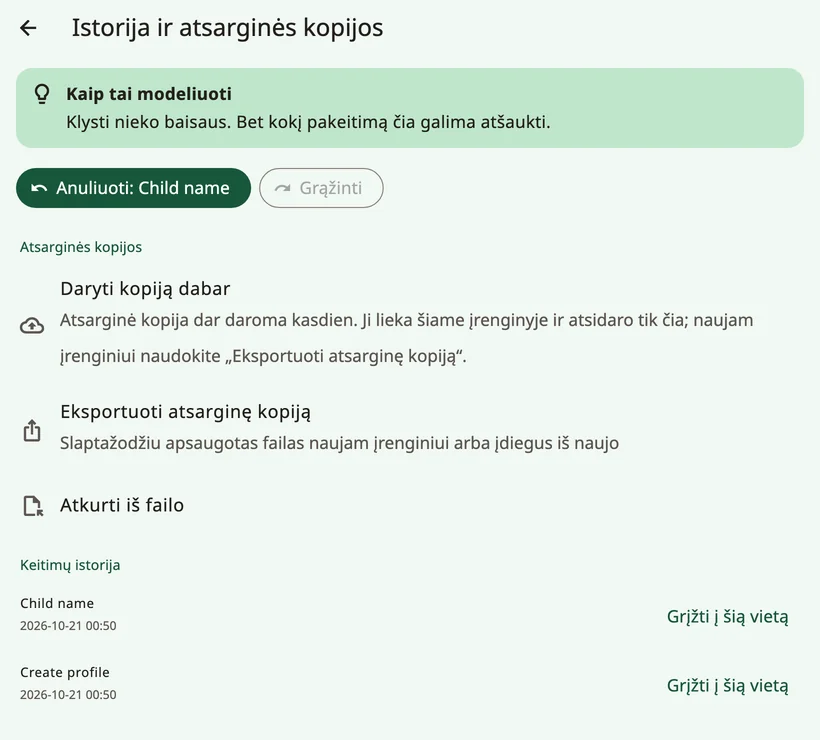
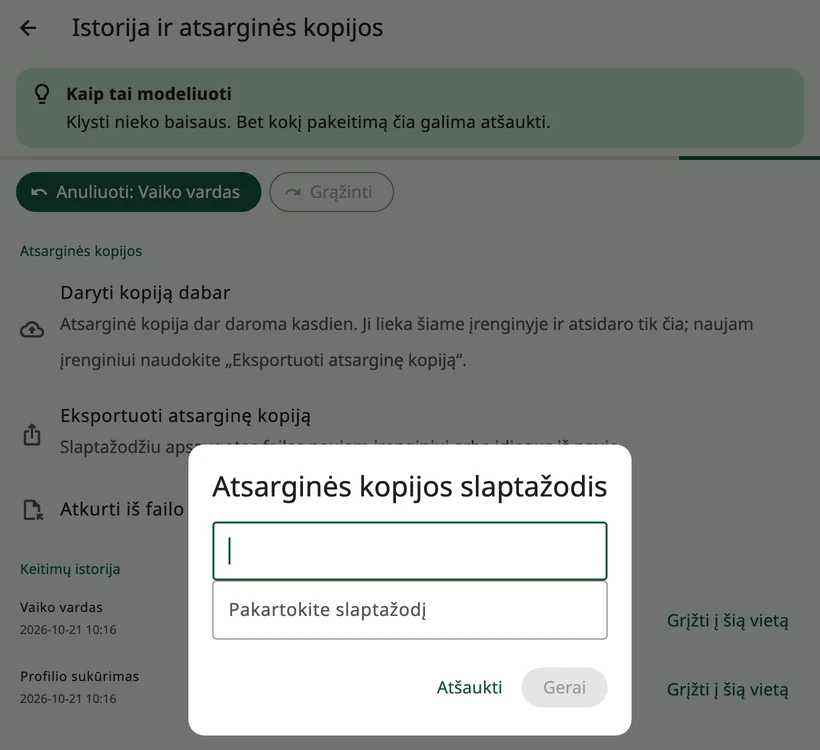
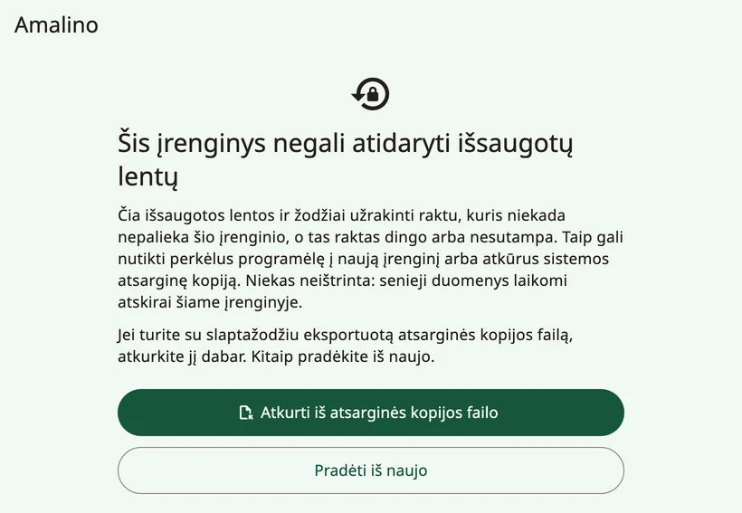
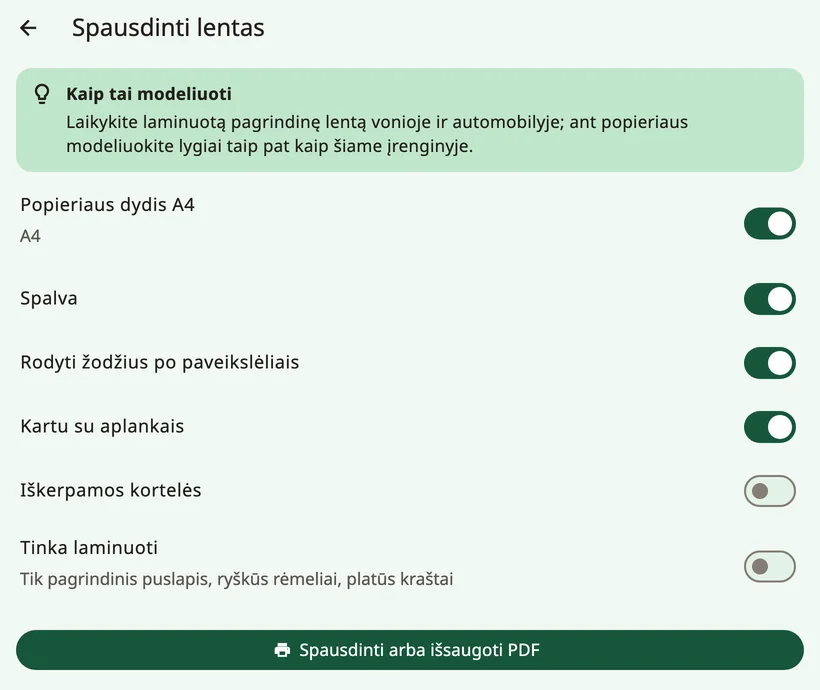

<!-- description: Kaip padaryti vaiko Amalino lentų atsarginę kopiją, perkelti jas į naują įrenginį, dalytis jomis su kitomis AAK programėlėmis ir jas atspausdinti. -->
# Dalijimasis ir spausdinimas

Vaiko lentos yra brangios: tai mėnesių mėnesiai žodžių, nuotraukų ir įrašų. Štai kaip jas apsaugoti, perkelti į kitą įrenginį ir atspausdinti.

## Atsarginės kopijos

Atidarykite suaugusiųjų nustatymus ir pasirinkite **{app:historyBackups}**.

- Atsarginė kopija sukuriama **automatiškai kiekvieną dieną**. Ji lieka įrenginyje ir atsidaro tik ją sukūrusiame įrenginyje, todėl apsaugo nuo klaidų, bet ne nuo įrenginio praradimo.
- Mygtukas **{app:backupNow}** sukuria kopiją iš karto.
- Funkcija **{app:exportBackup}** sukuria slaptažodžiu apsaugotą failą, kurio prireiks naujame įrenginyje ar iš naujo įdiegus programėlę. Pasirinkite slaptažodį, kurį prisiminsite, ir failą laikykite ne tame pačiame įrenginyje: kompiuteryje, debesijos saugykloje ar el. laiške sau.

Jei kopijos už įrenginio ribų nėra arba paskutinė senesnė nei mėnesio, suaugusiųjų nustatymuose pasirodo švelnus priminimas su mygtuku **{app:backupReminderMake}** (bet niekada per pirmąsias dvi naujo profilio savaites). Mygtukas **{app:notNow}** jį paslepia dviem savaitėms.

### Paties įrenginio atsarginė kopija

- **iPhone ir iPad**: jei darote įrenginio atsarginę kopiją iCloud saugykloje ar kompiuteryje, į ją patenka ir Amalino duomenys.
- **Android**: Amalino duomenys nekopijuojami nei į jūsų Google atsarginę kopiją, nei į kitą įrenginį. Norėdami pereiti į naują įrenginį, naudokite funkciją **{app:exportBackup}**.

## Perėjimas į naują įrenginį

1. Senajame įrenginyje atidarykite suaugusiųjų nustatymus, tada **{app:historyBackups}** (skiltyje **{app:sectionData}**) → **{app:exportBackup}** ir pasirinkite slaptažodį.
2. Nusiųskite failą į naująjį įrenginį per AirDrop, Quick Share, el. paštu, per debesijos saugyklą ar USB laidu.
3. Naujajame įrenginyje įdiekite Amalino. Pirmame sąrankos ekrane bakstelėkite **{app:alreadyUse}**, tada **{app:restoreBackup}** ir **{app:chooseFile}**.
4. Įveskite slaptažodį.

Jei įrenginys jau nustatytas, skiltyje **{app:historyBackups}** naudokite funkciją **{app:importBackup}**. Visos įrenginyje esančios lentos, įrašai ir žurnalai bus pakeisti; prieš tai Amalino padaro dabartinių duomenų atsarginę kopiją.

Automatinės kito įrenginio atsarginės kopijos atkurti negalima: ji atsidaro tik ją sukūrusiame įrenginyje. Naudokite atsarginę kopiją, eksportuotą su slaptažodžiu.

## Jei Amalino negali atidaryti išsaugotų lentų

Lentos užrakintos raktu, kuris niekada nepalieka įrenginio. Jei to rakto nėra arba jis netinka, pavyzdžiui, perkėlus programėlę į naują įrenginį ar atkūrus sistemos atsarginę kopiją, paleidus Amalino rodomas pranešimas **{app:dataRecoveryTitle}**. Niekas neištrinta: senieji duomenys laikomi atskirai tame pačiame įrenginyje.

- **{app:dataRecoveryRestore}**: pasirinkite atsarginę kopiją, kurią eksportavote su slaptažodžiu, ir įveskite slaptažodį.
- **{app:dataRecoveryFresh}**: sąranką atlikite iš naujo.

Jei kada nors pamatysite pranešimą **{app:startupFailedTitle}**, visiškai uždarykite programėlę ir vėl ją atidarykite. Jei tai kartojasi, iš naujo paleiskite įrenginį. Jūsų lentos neištrintos.

## Dalijimasis lentomis su kitomis AAK programėlėmis

Funkcija **{app:openBoardFormat}** suaugusiųjų nustatymų grupėje **{app:sectionData}** perkelia lentas į kitas alternatyviosios komunikacijos (AAK) programėles, naudojančias atvirąjį lentų formatą, ir iš jų:

- **{app:exportAllBoards}** arba **{app:exportThisBoard}**.
- **{app:importObz}**, pavyzdžiui, iš Cboard. Importuotos lentos pridedamos kaip aplankai. Amalino nurodo, kiek mygtukų pavyko susieti su jai žinomais žodžiais.

Importavę lentą, patikrinkite, ar jos žodžiai yra vaikui jau pažįstamose vietose.

## Spausdinimas

Funkcija **{app:printBoards}** sukuria popierinę lentos kopiją – maudynėms, baseinui, kelionei ar tam atvejui, jei įrenginys sugestų.

- **{app:paperA4}**: puslapiai yra A4 formato.
- **{app:colour}**: išjunkite, jei norite spausdinti nespalvotai.
- **{app:showLabels}**: po kiekvienu paveikslėliu atspausdinamas žodis.
- **{app:includeFolders}**: atspausdinami ir aplankų puslapiai, ne tik pagrindinė lenta.
- **{app:cutOut}**: atskiri paveikslėliai, kuriuos galima iškirpti.
- **{app:waterproof}**: tik pagrindinių žodžių puslapis, su ryškiais rėmeliais ir plačia parašte.

Bakstelėkite **{app:printOrSave}**, kad atspausdintumėte arba išsaugotumėte PDF failą ir atspausdintumėte vėliau.

> **Patarimas.** Laminuotą pagrindinių žodžių lentą laikykite vonioje ir automobilyje, o ant popieriaus modeliuokite lygiai taip pat, kaip įrenginyje.

Toliau: [Patarimai šeimoms](tips-for-families.md).
