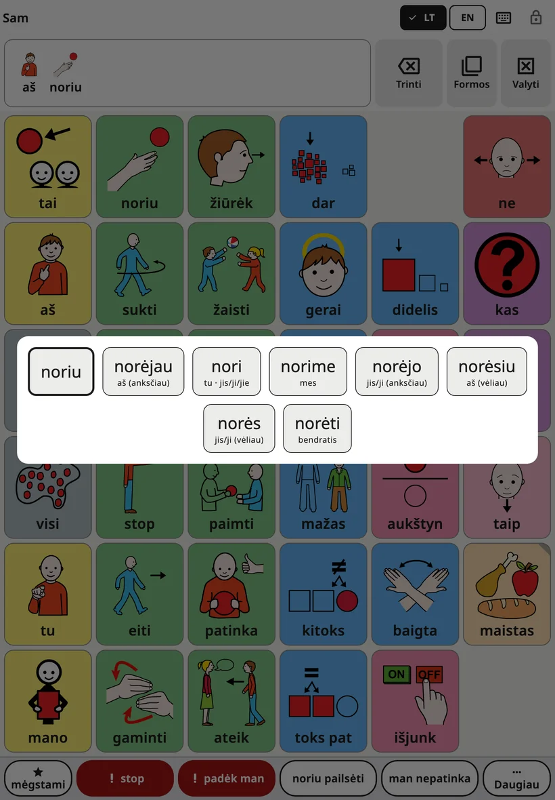
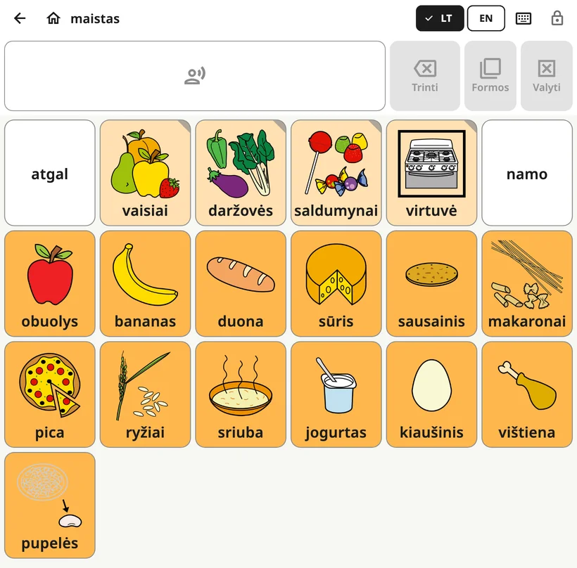

<!-- description: Ką vaikas mato Amalino ekrane: lenta, viršutinė juosta, sakinio juosta, žodžio formos, sakinio ištarimas ir kalbos perjungimas. -->
# Vaiko lenta

Lenta – tai ekranas, kuriuo vaikas naudojasi visą dieną. Suaugusiųjų nustatymai užrakinti, todėl vaikas gali drąsiai ją tyrinėti.

## Ekrano dalys

Iš viršaus į apačią:

1. **Viršutinė juosta**: vaiko vardas (aplanko viduje – lentos pavadinimas), kalbų mygtukai, klaviatūros mygtukas ir spynelė.
2. **Sakinio juosta**: vaiko pasirinkti žodžiai, o šalia – mygtukai **{app:barDelete}**, **{app:barForms}** ir **{app:barClear}**.
3. **Lenta**: mygtukai su paveikslėliais ir žodžiais.
4. **Frazių eilutė**: „{app:favourites}“, „stop“, „padėk man“, dvi šeimos frazės ir „{app:quickMore}“. Žr. [Greitosios frazės ir „{app:quickMore}“](quick-phrases.md).

## Žodžio ir sakinio ištarimas

Kai vaikas bakstelėja mygtuką, jo žodis ištariamas ir atsiranda sakinio juostoje. Bakstelėjus daugiau mygtukų, susidaro sakinys: „aš“, „noriu“, „dar“.

- **Bakstelėkite sakinio juostą**, kad būtų ištartas visas sakinys.
- Mygtukas **{app:barDelete}** pašalina paskutinį žodį.
- Mygtukas **{app:barClear}** išvalo visą sakinį.

Kaip tai veikia, galite pakeisti skiltyje **{app:sectionSettings}** → **{app:messageBar}**: pavyzdžiui, kad žodžiai būtų ištariami tik bakstelėjus sakinį arba kad sakinys būtų išvalomas jį ištarus.

## Žodžio formos

Žodžiai kaitomi: „šuo“ ir „šunys“, „eiti“ ir „ėjo“, „didelis“ ir „didesnis“. Žodžio formų meniu kitas žodžio formas parodo dideliais mygtukais. Bakstelėjus formą, ji įdedama į sakinį ir ištariama. Pirma visada rodoma pagrindinė žodžio forma, todėl vaikas visada gali prie jos grįžti.

Meniu atidaryti galima trimis būdais:

- **Palaikykite nuspaudę žodį** lentoje.
- **Palaikykite nuspaudę sakinio juostą**, kad pakeistumėte paskutinį žodį.
- Bakstelėkite mygtuką **{app:barForms}** šalia sakinio juostos. Jis pakeičia paskutinį žodį, o kai tas žodis kitų formų neturi, mygtukas būna papilkėjęs.

Jei vaikui nustatyta **{app:holdTime}** (suaugusiųjų nustatymuose → **{app:sectionSettings}** → **{app:touchAccess}**), palaikius žodį nuspaustą jis tiesiog ištariamas. Tokiu atveju žodžio formas atidarykite mygtuku **{app:barForms}**.

Meniu įjungtas visomis kalbomis. Norėdami jį išjungti, eikite į **{app:sectionSettings}** → **{app:messageBar}** → **{app:grammarHelper}**.

## Aplankai

Kai kurie mygtukai atidaro aplanką su susijusiais žodžiais, pavyzdžiui, „Maistas“, „Vietos“ ar „Jausmai“. Aplanko mygtukas turi užlenktą kampą.

Aplanko viduje viršutinėje juostoje rodoma rodyklė **{app:back}** ir mygtukas **{app:home}**. Mygtukas **{app:home}** visada grąžina į pagrindinę lentą.

## Kalbos perjungimas

Jei vaikas naudoja daugiau nei vieną kalbą, viršutinėje juostoje rodomas mygtukas kiekvienai iš jų (EN, DA, ES, РУС, УКР, عربي, LT). Vienas bakstelėjimas perjungia visą lentą. Visomis kalbomis kiekvienas žodis lieka toje pačioje vietoje.

Mažesniuose ekranuose rodomas vienas kalbos mygtukas, kuris atidaro trumpą sąrašą.

## Kodėl mygtukai niekada nesikilnoja

Kiekvienas žodis lentoje turi savo vietą ir joje lieka. Vaikas išmoksta, kur yra žodžiai, – kaip jūs žinote, kur klaviatūroje yra raidės, – ir greitai juos randa net nežiūrėdamas.

Todėl:

- pasukus planšetę, lentos išdėstymas nesikeičia;
- telefone lenta pagal numatytuosius nustatymus lieka stačia (tai galite pakeisti skiltyje **{app:sectionSettings}** → **{app:boardLayout}** → **{app:boardOrientation}**);
- nauji žodžiai laikui bėgant atsiranda savo vietose ir kitų nenustumia. Žr. [Žodžiai ir aplankai](words-and-folders.md).

## Spynelė

Spynelė viršutiniame dešiniajame kampe atidaro suaugusiųjų nustatymus. Palaikykite ją nuspaudę 3 sekundes, tada skaičių klavišais išspręskite paprastą skaičiavimo užduotį (arba įveskite PIN kodą, jei jį nustatėte). Trumpas bakstelėjimas nieko nedaro, todėl vaikas netyčia jos neatidarys.

Kaip neleisti vaikui išeiti iš programėlės, aprašyta skiltyje **{app:lockAndKeep}** puslapyje [Nustatymai](settings.md).

## Įspėjimai lentoje

Jei akumuliatorius beveik išsikrovęs arba garsas išjungtas ar labai tylus, po viršutine juosta pasirodo trumpas pranešimas, pavyzdžiui, „{app:warn.muted}“.

Toliau: [Žodžiai ir aplankai](words-and-folders.md).
