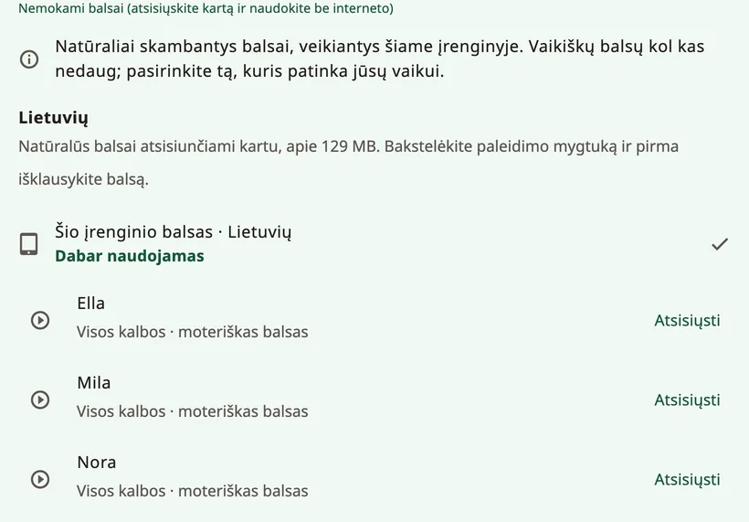

<!-- description: Kaip skambės vaikas Amalino programėlėje: natūralūs balsai, įrenginio balsas, įrašai, balso amžius, greitis ir kaip ištariamas vaiko vardas. -->
# Balsai

Balsas – tai vaiko balsas. Leiskite vaikui išgirsti kelis ir išsirinkti tą, kuris jam patinka. Balsą bet kada galite pakeisti skiltyje **{app:sectionSettings}** → **{app:speechVoice}**.

## Balsų rūšys

- **{app:naturalVoicesHeading}**: dešimt balsų (Ella, Mila, Nora, Sofi, Ida, Leo, Theo, Adam, Omar ir Ben), kurie skamba labiausiai žmogiškai. Kiekvienas jų kalba visomis septyniomis Amalino kalbomis. Visi atsisiunčiami vienu kartu, o paskui veikia be interneto.
- **{app:systemVoice}**: balsai, kurie jau yra telefone ar planšetėje. Nieko atsisiųsti nereikia. Kai kuriems gali prireikti interneto – tada Amalino tai nurodo po balsu.
- **{app:personalVoice}**: tik iPhone ir iPad (iOS 17 ar naujesnė versija) – balsas, kurį sukūrėte įrenginio nustatymuose, skiltyje **Accessibility → Personal Voice**. Amalino paprašo leidimo juo naudotis. Android įrenginiuose tokios funkcijos nėra: norėdami išsaugoti šeimos nario balsą, įrašykite žodžius.
- **Jūsų įrašai**: mygtuko redagavimo lange bet kurį žodį galite įrašyti savo balsu. Įrašai skamba vietoj programėlės balso. Žr. [Redagavimas ir mygtukų perkėlimas](editing.md).

Bakstelėkite balsą, kad jį išgirstumėte, tada bakstelėkite **{app:useVoice}**.

## Vienas balsas ar atskiras kiekvienai kalbai

Kiekviena kalba turi savo balso nustatymą. Kadangi kiekvienas natūralus balsas kalba visomis vaiko kalbomis, galite bakstelėti, pavyzdžiui, **{app:useForAll|voice=Ella}** ir visur naudoti vieną balsą. Kitaip sakiniuose, kuriuose maišomos kalbos, balsas keisis.

## Atsisiuntimas

Natūralūs balsai atsisiunčiami vienu maždaug 129 MB failu. Amalino pirmiausia nurodo dydį. Naudojantis mobiliuoju internetu, ji paklausia prieš pradėdama siųsti; pasirinkite **{app:waitForWifi}**, jei norite atsisiųsti vėliau. Kol atsisiuntimas nebaigtas, kalba įrenginio balsas.

Jei reikia atlaisvinti vietos, natūralius balsus iš įrenginio galite pašalinti; tada žodžius tars įrenginio balsas, kol balsus vėl atsisiųsite.

## Kaip skamba balsas

- **{app:speechRate}**: lėčiau ar greičiau.
- **{app:voiceAge}**: **{app:voiceAgeAdult}**, **{app:voiceAgeOlder}** arba **{app:voiceAgeYoung}**, su slankikliu **{app:voiceAgeStrength}**. Nustatymas pakelia balso aukštį ir pakeičia jo skambesį. Balsas vis tiek skambės labiau kaip mažas suaugęs žmogus nei kaip tikras vaikas, todėl pažiūrėkite, kas patinka vaikui.
- **{app:pitch}**: tik įrenginio balsams, todėl rodomas tik tada, kai kalba vienas iš jų. Natūraliems balsams vietoj to naudojamas nustatymas **{app:voiceAge}**.
- **{app:volume}**.
- **{app:lowerOthers.anon}**: muzika ir kitos programėlės nutyla **{app:lowerOthersSpeaking}** arba **{app:lowerOthersOpen}**, kad žodžius būtų lengviau išgirsti.

## {app:savedSpeech}

Šį nustatymą rasite skiltyje **{app:advanced}**, nustatymų **{app:speechVoice}** pabaigoje. Kad žodžiai skambėtų iš karto, Amalino lentos žodžius iš anksto įgarsina pasirinktais balsais ir laiko juos įrenginyje. Tai vyksta fone, kai lenta nenaudojama. Ekrane **{app:savedSpeech}** matyti, kiek jau paruošta ir kiek vietos užima. Jei kada nors žodžiai skambėtų netaisyklingai, mygtukas **{app:savedSpeechRebuild}** juos vėl paruoš.

## Vaiko vardas

Suaugusiųjų nustatymuose pasirinkite vaiko vardą (pavyzdžiui, **{app:settingsChildName|name=Sam}**):

- parašykite vardą taip, kaip jis rašomas kiekviena kalba, arba trumpąja forma;
- išgirskite, kaip jį ištaria kiekvienas balsas;
- jei skamba netaisyklingai, lauke **{app:spokenAs}** parašykite, kaip vardas turėtų skambėti, pavyzdžiui, „Šon“ vardui Sean.

Jei vis tiek skamba ne taip, įrašykite vardą savo balsu.

## Kai kalbai nėra balso

Jei kuriai nors kalbai balso dar nėra, atsisiųskite natūralius balsus. Arba įdiekite balsą įrenginio teksto įgarsinimo (TTS) nustatymuose, arba įrašykite žodžius patys.

> **Patarimas.** Paklauskite vaiko, kuris balsas jam patinka. Kai balsas tinka vaikui, jam labiau norisi juo kalbėti.

Toliau: [Dalijimasis ir spausdinimas](sharing-and-printing.md).
