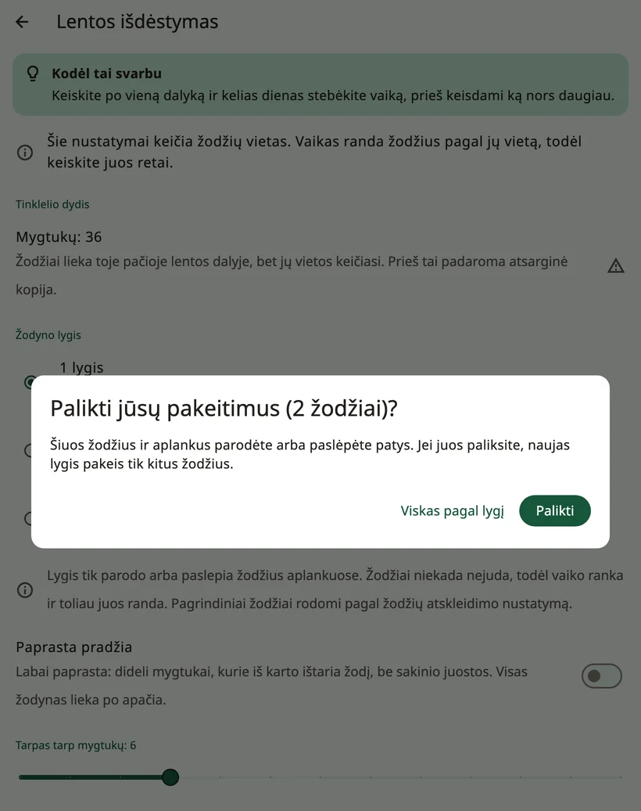

<!-- description: Kaip Amalino tvarko žodžius: pagrindiniai žodžiai savo vietose, aplankai, lentos dydis, žodyno lygiai ir paslėptų žodžių atvėrimas laikui bėgant. -->
# Žodžiai ir aplankai

Kiekviena iš septynių Amalino kalbų turi maždaug 2 500 žodžių. Visų iš karto rodyti nereikia. Šiame puslapyje paaiškinta, kaip žodžiai sutvarkyti ir kaip vaikui augant atverti jų vis daugiau.

## Pagrindiniai žodžiai ir aplankai

**Pagrindinėje lentoje** yra pagrindiniai žodžiai: trumpi kasdieniai žodžiai, tokie kaip „aš“, „noriu“, „dar“, „eiti“, „padėk“ ir „patinka“. Maždaug 200 pagrindinių žodžių sudaro didžiąją dalį to, ką žmonės pasako per dieną, todėl jais vaikas gali pasakyti labai daug.

Visa kita sudėta į **aplankus**: maistas, vietos, žmonės, jausmai, žaislai ir kt. Aplanko mygtukas turi užlenktą kampą ir atidaro puslapį su susijusiais žodžiais.

Kai vaikas aplanke bakstelėja žodį, Amalino grąžina jį ten, iš kur jis atėjo, kad galėtų rinktis kitą žodį: „aš noriu“, tada **Maistas**, „obuolys“ – ir pagrindiniai žodžiai vėl po ranka, kad vaikas galėtų pridėti „prašau“. Aplankams, kuriuose vaikas renkasi kelis žodžius iš eilės, pavyzdžiui, spalvoms, išjunkite to aplanko nustatymą **{app:folderGoBack}** (žr. [Redagavimas ir mygtukų perkėlimas](editing.md)). Aplanke **{app:favourites}** šis nustatymas iš pradžių išjungtas.

## Lentos dydis

Lentos dydis (**{app:gridSize}**) – tai kiek mygtukų telpa viename puslapyje:

- **20**: dideli mygtukai, į juos lengviau pataikyti
- **36**: vidutiniai, gera pradžia daugumai mažų vaikų
- **60**: mažesni, daugiau žodžių viename puslapyje
- **84**: maži, įgudusiems naudotojams

Sąranka pasiūlo dydį pagal vaiko amžių ir tai, kaip jis liečia ekraną. Kiekvienas įrenginys siūlo tik tokius dydžius, kuriuose kiekvienas mygtukas yra ne mažesnis kaip 44 taškų pločio (maždaug 7 mm – patogus dydis pirštui).

Stenkitės laikytis to paties dydžio. Pakeitus dydį, žodžiai persikelia į naujas vietas, ir vaikui tenka jas išmokti iš naujo. Amalino paprašo tai patvirtinti ir pirmiausia sukuria atsarginę kopiją. Geriau lentą auginkite rodydami daugiau žodžių.

## Žodžiai niekada nesikilnoja

Kiekvienas žodis turi savo vietą ir joje lieka. Kai žodis paslėptas, jo vieta lieka tuščia; kai vėliau jis parodomas, atsiranda būtent ten. Kad atsirastų vietos, niekas nepasislenka.

## Žodyno lygis

Skiltyje **{app:sectionSettings}** → **{app:boardLayout}** → **{app:vocabLevel}** nustatoma, kiek žodžių rodoma aplankuose:

- **{app:levelDesc1|label}**: maždaug 400 žodžių, pagrindiniai žodžiai ir pirmieji žodžiai aplankuose
- **{app:levelDesc2|label}**: maždaug 1 300 žodžių, daugiau aplankų
- **{app:levelDesc3|label}**: visi žodžiai (maždaug 2 500)

Lygis tik parodo arba paslepia žodžius aplankuose. Pagrindinės lentos žodžiai atveriami po vieną (žr. toliau).

Jei žodžius aplankuose rodėte ar slėpėte patys, Amalino pirmiausia paklausia, ar palikti jūsų pakeitimus. Pasirinkus **{app:keepOwnChangesKeep}**, keičiami tik kiti žodžiai; pasirinkus **{app:keepOwnChangesReset}**, visiems žodžiams taikomas naujasis lygis.

## Žodžių rodymas ir slėpimas

Kiekvienas žodis vaikui yra arba **rodomas**, arba **paslėptas**. Paslėpto žodžio vieta vaikui atrodo tuščia, ir niekas kitas nepasislenka.

Norėdami juos peržiūrėti ir pakeisti, atidarykite suaugusiųjų nustatymus ir pasirinkite **{app:editBoard}**. Paslėpti žodžiai rodomi savo vietose, patamsinti ir su perbrauktos akies ženklu. Bakstelėkite žodį, jo redagavimo lange įjunkite nustatymą **{app:visibility}**, tada bakstelėkite **{app:done}**. Aplankuose viskas veikia taip pat.

Modeliavimo režime aplanko puslapis veikia taip pat: paslėpti žodžiai rodomi blankiai, o akis modeliavimo eilutėje iš karto parodo visus to aplanko žodžius.

> **Patarimas.** Naują žodį vaikui rodykite tik tada, kai jau daug kartų jį sumodeliavote. Modeliavimo režime paslėpti žodžiai blankiai rodomi savo vietose: bakstelėkite juos kalbėdami, o kai vaikas bus pasirengęs, palaikykite žodį nuspaudę ir pasirinkite **{app:showToChild}**. Žr. [Nustatymai: {app:modellingMode}](settings.md).

## Kaip rasti žodį

Neprisimenate, kur yra žodis? Kai įjungtas **{app:modellingMode}**, bakstelėkite **{app:showMeWhere}** ir įrašykite žodį. Amalino parodys kelią iki jo, mygtuką po mygtuko, kad kalbėdami galėtumėte jį bakstelėti patys.

## Jūsų pačių žodžiai

Galite pridėti žodžių, pakeisti paveikslėlius, įrašyti žodį savo balsu, kurti naujus aplankus arba pridėti integruotuosius. Žr. [Redagavimas ir mygtukų perkėlimas](editing.md).

Toliau: [Greitosios frazės ir „{app:quickMore}“](quick-phrases.md).
