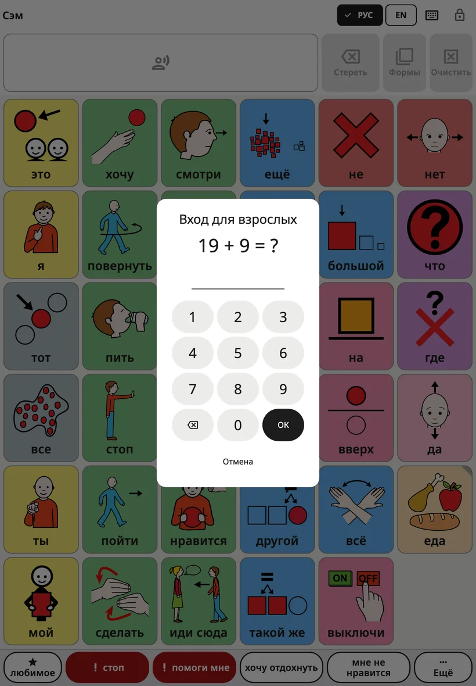
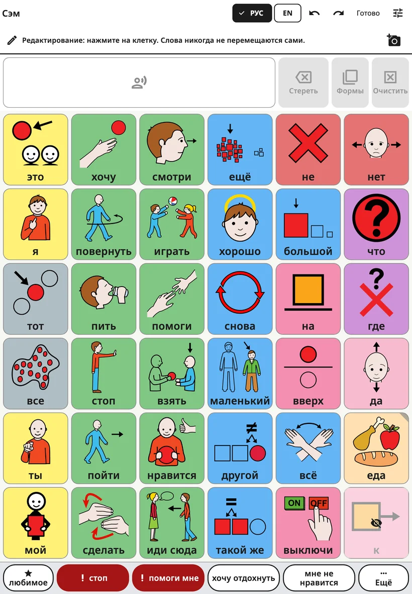
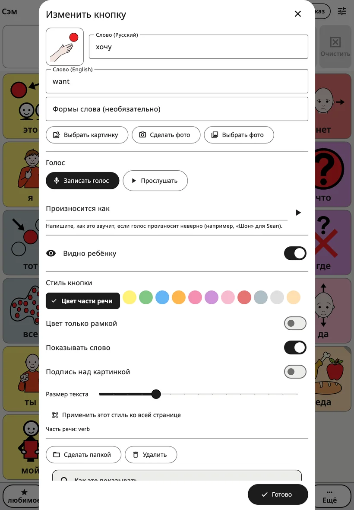
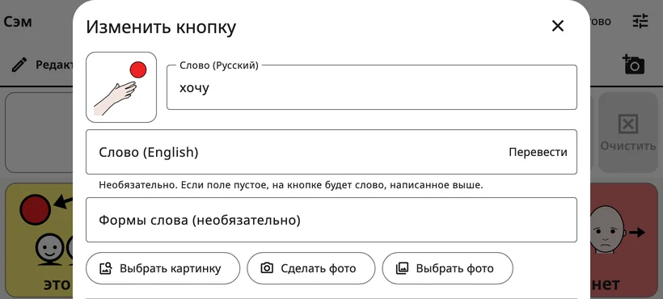
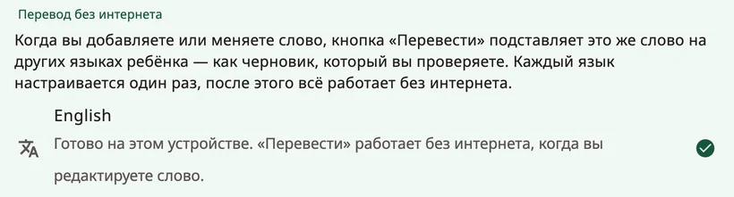

<!-- description: Как изменить доску Amalino: настройки для взрослых, слово, картинка и голос кнопки, перевод, новые папки, перемещение кнопок и отмена. -->
# Редактирование и перемещение кнопок

В каждой семье свои слова. Любое слово, картинку или голос можно изменить, можно добавить свои слова и папки и переместить кнопки, которые вы добавили сами. Ребёнок ничего из этого не видит и изменить не может.

## Как открыть настройки для взрослых

В правом верхнем углу доски **удерживайте замок 3 секунды**, а затем решите короткий пример (или введите PIN-код) на появившихся цифровых клавишах. Откроются настройки для взрослых. Через 5 минут они снова закроются сами, а если нажать **{app:lockNow}** — сразу.

Время удержания, PIN-код и автоматическую блокировку можно изменить в разделе **{app:lockAndKeep}**. Подробнее — на странице [Настройки](settings.md).

## Редактирование доски

Выберите **{app:editBoard}**. Вверху доски появится строка: «{app:editingHint}» На верхней панели теперь есть кнопки **{app:undo}**, **{app:redo}** и **{app:done}**.

- Нажмите на кнопку, чтобы её изменить.
- Нажмите на пустую клетку и выберите **{app:addWord}** или **{app:addFolder}**.
- Папки открываются, и их кнопки редактируются точно так же.
- Когда закончите, нажмите **{app:done}**.

Скрытые слова видны на своих местах — затемнённые и с перечёркнутым глазом, — так что во время редактирования вы всегда видите всю доску.

## Редактор кнопки

- **Слово** — слово на кнопке на текущем языке доски.
- **Другие языки ребёнка** — под ним по одному полю для каждого из остальных языков ребёнка, например **{app:wordLabel|language=датский}**. Заполнять их не обязательно: если поле пустое, на кнопке будет слово, написанное выше.
- **{app:translateWord}** — кнопка появляется рядом с пустым полем, если устройство умеет переводить на этот язык без интернета. Она подставляет слово как черновик с пометкой «{app:translatedCheck}» Проверьте его, прежде чем ребёнок начнёт им пользоваться. Подробнее — ниже, в разделе «Перевод слов».
- **{app:wordFormsManual}** — другие формы слова через запятую, например «мыши, мышку, мышке».
- **Картинка**: кнопка **{app:chooseSymbol}** ищет среди встроенных картинок, а **{app:moreSymbolSets}** — в других бесплатных наборах символов в интернете; отправляются только слова, которые вы ищете. Кнопки **{app:takePhoto}** и **{app:choosePhoto}** позволяют взять своё фото. Для людей, домашних животных и собственных вещей ребёнка лучше всего подходят фотографии.
- **{app:voice}**: кнопка **{app:recordVoice}** записывает слово вашим голосом, **{app:listen}** проигрывает запись, а **{app:removeRecording}** возвращает голос приложения.
- **{app:spokenAs}**: если голос произносит слово неправильно, напишите его так, как оно слышится, например «Шон» вместо «Sean».
- **{app:recInSentences}**: обычно ваша запись звучит, только когда ребёнок нажимает именно эту кнопку, а внутри фразы слово произносит голос приложения. Включите эту настройку для звуков, песенок или слов, которые голос не может произнести.
- **{app:visibility}**: если включено, ребёнок видит слово и может им пользоваться; если выключено, место слова ребёнку кажется пустым, и ничего не сдвигается. Подробнее — на странице [Слова и папки](words-and-folders.md).
- **{app:buttonStyle}**: **{app:wordTypeColour}**, **{app:borderOnly}**, **{app:showLabel}**, **{app:labelOnTop}** и **{app:textSize}**. Кнопка **{app:styleWholePage}** применяет стиль ко всем кнопкам на странице.
- **{app:wordType}** определяет цвет кнопки (например, действия зелёные, а слова-признаки синие).

Чтобы поставить на доску **новое** слово или папку, нажмите **{app:add}** внизу. Кнопка **{app:add}** остаётся серой, пока у кнопки нет слова или картинки. **✕** отменяет: ничего не добавляется, а сделанные для этой кнопки фото или запись удаляются.

Когда вы редактируете **уже существующую** кнопку, изменения применяются сразу; чтобы закрыть редактор, нажмите **{app:done}** (или **✕**).

## Перевод слов

Кнопка **{app:translateWord}** работает на устройстве, без интернета, когда язык настроен. Каждый язык нужно настроить один раз: в настройках для взрослых откройте **{app:languages}** (в группе **{app:sectionBoards}**), а затем **{app:offlineTranslationHeader}**:

- **{app:ga.androidTitle|label}**: нажмите на язык и согласитесь скачать модель перевода Google — около 30 МБ на каждый язык. Слова из приложения никуда не отправляются.
- **iPhone и iPad**: нужна iOS 26 или новее. Языки даёт Apple: откройте на устройстве **Настройки → Приложения → Перевод → Загруженные языки**, скачайте нужные языки и вернитесь в Amalino.

У каждого языка написано, готов ли он. Если устройство этого не умеет, появится надпись **{app:offlineTranslationUnsupported}**

## Папки

Чтобы добавить папку, в режиме редактирования нажмите на пустую клетку и выберите **{app:addFolder}**. На экране **{app:pickFolderTitle}** перечислены папки ребёнка с картинками, включая встроенные («еда», «чувства», «места»…), а вверху — пункт **{app:newFolder}**. Выберите папку, проверьте название и картинку и нажмите **{app:add}**.

В редакторе кнопки папки есть ещё:

- Кнопка **{app:makeFolder}** превращает кнопку со словом в кнопку папки. Выберите папку или пункт **{app:newFolder}**.
- Кнопка **{app:changeFolder}** привязывает кнопку папки к другой папке.
- Кнопка **{app:openThisFolder}** закрывает редактор и открывает папку, чтобы изменить её содержимое.
- **{app:folderGoBack}**: если включено, после нажатия слова в этой папке ребёнок возвращается туда, откуда пришёл, — к следующему слову. Выключите для папок, где ребёнок выбирает несколько слов подряд. Настройка действует на папку, откуда бы её ни открыли. В папке **{app:favourites}** она с самого начала выключена.

## Как переместить кнопку

Основные слова на основной доске не меняют своих мест, чтобы рука ребёнка всегда их находила. А кнопки, которые открывают папку или сцену, можно перемещать:

1. Откройте редактор кнопки и выберите **{app:sceneMove}**
2. На экране **{app:pickCellTitle}** видна доска, свободные клетки подсвечены. Нажмите на одну из них, а затем **{app:pickCellPutHere}**.
3. Или выберите **{app:pickCellChooseAnother}**, чтобы переместить кнопку в другую папку, либо **{app:pickCellFavouritesInstead}**.

У кнопки сохраняются слово, картинка, голос и стиль. Больше ничего ни на одной из досок не сдвигается. Одно нажатие на **{app:undo}** возвращает всё как было.

## Как удалить кнопку

Откройте редактор кнопки и выберите **{app:delete}**. Для основного слова Amalino предложит **{app:hideInstead}**: скрытое слово сохраняет своё место на будущее, а после удаления остаётся пустая клетка. Скрыть почти всегда лучше.

## Отмена и история изменений

- Кнопки **{app:undo}** и **{app:redo}** на верхней панели шаг за шагом отменяют и возвращают ваши изменения, пока вы редактируете.
- В разделе **{app:historyBackups}** в настройках для взрослых есть список всех изменений. Кнопка **{app:restoreHere}** возвращает доски в то состояние, в котором они были в тот момент.

Ошибаться не страшно. Любое изменение можно отменить.

> **Совет.** Добавив слово, в тот же день сами воспользуйтесь им на устройстве хотя бы три раза.

Далее: [Настройки: экран за экраном](settings.md).
