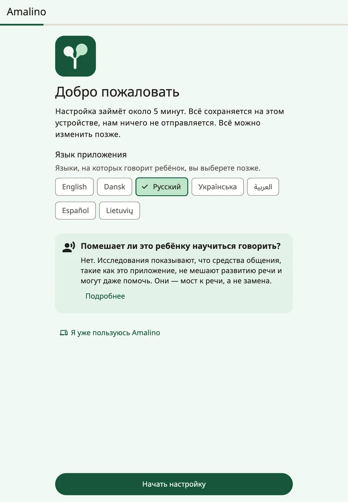
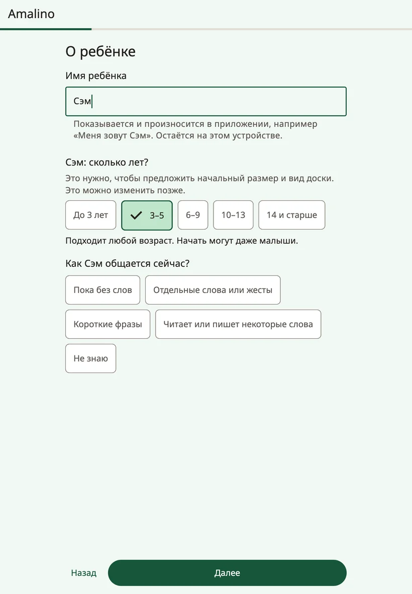
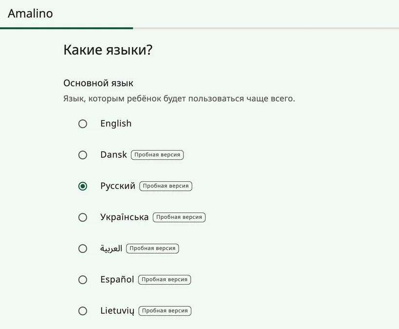
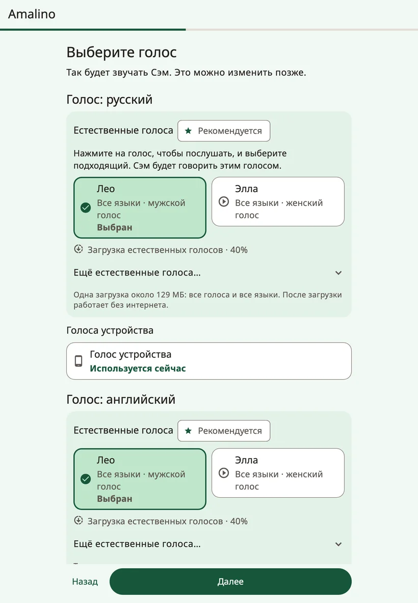
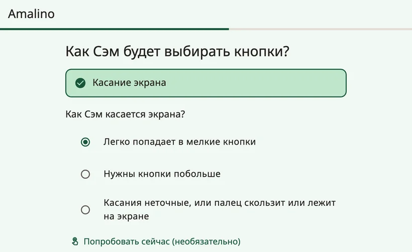
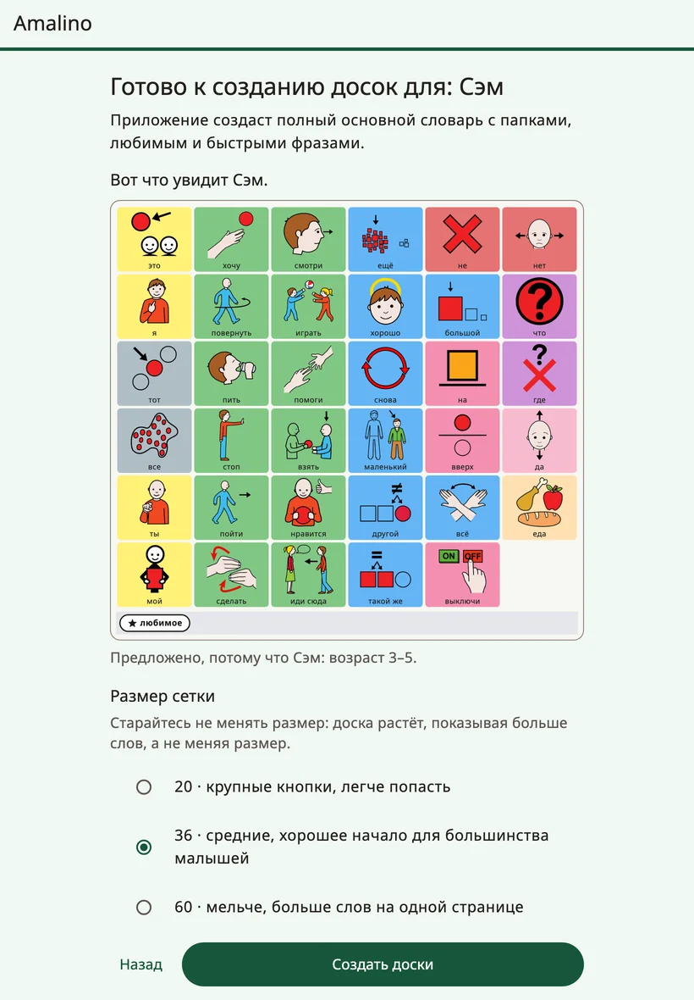

<!-- description: Первая настройка Amalino: ребёнок, языки, голос, касание экрана, любимые вещи и замок для взрослых. -->
# Начало работы

Amalino работает на iPhone, iPad, а также на телефонах и планшетах с Android. Приложение бесплатное, и после настройки ему не нужен интернет.

Настройка занимает около пяти минут. Всё, что вы вводите, остаётся на устройстве, и любой ответ потом можно изменить.

## Перед началом

- Зарядите устройство и сделайте звук погромче.
- Если получится, пусть ребёнок будет рядом, когда дойдёт до шага с касанием экрана: полезно увидеть, как он нажимает.
- По возможности подключитесь к Wi-Fi: естественные голоса скачиваются одним файлом примерно на 129 МБ.

## Шаги настройки

### {app:welcomeTitle}

Выберите **{app:appLanguage}** — язык экранов для взрослых. Языки ребёнка вы выберете на одном из следующих шагов.

Если ребёнок уже пользуется Amalino на другом устройстве, нажмите **{app:alreadyUse}**, а затем **{app:restoreBackup}**, чтобы перенести его доски из резервной копии, которую вы экспортировали с паролем. Подробнее — на странице [Резервные копии, обмен и печать](sharing-and-printing.md).

### {app:aboutChild}

- **{app:ageBandTitle.anon}** По возрасту приложение подбирает начальный размер доски, уровень словаря и оформление. Подходит любой возраст: начинать могут даже малыши.
- **{app:commTitle.anon}** Это помогает выбрать первые слова.
- **{app:childName}** (необязательно). Имя показывается и произносится в приложении, например «Меня зовут…». Оно остаётся на устройстве.

### Языки

Выберите **{app:setPrimary}** — тот, на котором ребёнок будет говорить чаще всего, — и отметьте другие языки, которые он слышит каждый день. В Amalino их семь: английский, датский, русский, украинский, арабский, испанский и литовский.

Во всех языках одна и та же кнопка стоит на одном и том же месте. Ребёнок переключает язык одним касанием, и ему не приходится заново учить доску.

Пока у всех языков, кроме английского, есть пометка **{app:languagePreview}**: носитель языка проверил ещё не все слова. Под списком написано: «{app:languagePreviewNote}» Любое слово можно исправить и самостоятельно.

Для русского, украинского, арабского, испанского и литовского настройка спрашивает ещё: **{app:wordFormsTitle.anon}** Выберите **{app:forms.boy}** или **{app:forms.girl}**, чтобы, когда ребёнок говорит о себе, у слов были правильные окончания.

Если вашего языка нет в списке, нажмите **{app:notListed}**. Доски всё равно можно сделать: запишите каждое слово своим голосом, и доска будет проигрывать ваши записи.

### Голос

Выберите, как ребёнок будет звучать на каждом языке. Нажмите на голос, чтобы его послушать.

- **{app:naturalVoicesHeading}** звучат наиболее по-человечески. Десять голосов говорят на всех семи языках и скачиваются одним общим файлом примерно на 129 МБ. После этого они работают без интернета. Рекомендуемый голос уже выбран.
- **{app:systemVoice}** не нужно скачивать: он готов сразу. Он звучит, пока не скачается естественный голос.

По Wi-Fi загрузка начинается сама. При мобильном интернете Amalino сначала спросит или подождёт Wi-Fi.

Голос можно поменять в любой момент. Подробнее — на странице [Голоса](voices.md).

### Как ребёнок выбирает

Пока ребёнок пользуется Amalino, касаясь экрана. Другие способы выбора помечены: «**{app:comingLater}**».

Затем ответьте на вопрос **{app:touchTitle.anon}**

- **{app:touch.easy}**
- **{app:touch.bigger}**
- **{app:touch.shaky}**

По ответу приложение настраивает касания и размер доски. Кнопка **{app:tryItNow}** позволяет ребёнку несколько раз нажать на экран, а **{app:makeEasier}** подстраивает настройки, если много нажатий мимо. Остальные настройки касания — в разделе **{app:sectionSettings}** → **{app:touchAccess}**.

### {app:fiveFavourites}

Добавьте до пяти вещей, которые ребёнок очень любит: мыльные пузыри, мультик, бабушку. Сфотографируйте или выберите фото и напишите, как ребёнок это называет. Всё это попадёт в папку **{app:favourites}**, до которой с любой доски одно касание. Для людей и собственных игрушек ребёнка лучше всего подходят фотографии.

### Настройки для взрослых

Настройки защищены, чтобы ребёнок случайно не изменил доску. Чтобы открыть их, **удерживайте замок вверху доски 3 секунды, а затем решите короткий пример**. Попробуйте здесь один раз. Есть и вариант **{app:longerHold}**.

Вместо примера можно выбрать **{app:lockPin}**. Дети постарше умеют решать примеры, поэтому для них PIN-код надёжнее.

### Имя на каждом языке

Если вы добавили имя, можно указать, как оно пишется на каждом языке, и послушать, как его произносит голос. Если звучит неправильно, напишите имя так, как оно слышится, например «Шон» вместо «Sean».

### Итог

На последнем шаге собраны все ваши ответы. Чтобы поменять любой из них, нажмите **{app:change}** рядом с ним.

Здесь же выбирается:

- **{app:gridSize}** — сколько кнопок помещается на доске. Кнопка **{app:moreSizes}** показывает остальные варианты. Старайтесь не менять размер: доска растёт за счёт того, что на ней открываются новые слова, а не за счёт смены размера.
- **{app:vocabLevel}** — около 400, 1300 или 2500 слов. Подробнее — на странице [Слова и папки](words-and-folders.md).

Для детей постарше можно включить **{app:teenPack}**: фразы для общения, шутки и сленг, а также взрослый стиль без мультяшных картинок.

Совсем маленьким новичкам настройка может предложить **{app:earlyOffer|label}**: четыре большие картинки, которые сразу произносят слово. Полный словарь при этом остаётся в запасе, и позже можно перейти на полную доску.

Затем нажмите **{app:createBoards}**.

## После настройки

На странице **{app:allSet}** ещё раз показано, как открыть настройки для взрослых, и есть первый совет, который можно попробовать уже сегодня. Там же есть пункт **{app:lockDeviceToApp}** (те же инструкции, что и в пункте **{app:guidedAccess}** в настройках для взрослых) и настройка **{app:dailyTip}**.

Нажмите **{app:startTalking}**. Откроется доска, готовая для ребёнка.

Кое-что можно сделать позже, в пункте **{app:finishSetup}** в настройках для взрослых:

- выбрать две фразы, которые нужны ребёнку чаще всего,
- послушать, как звучит имя ребёнка,
- попробовать настройки касания вместе с ребёнком.

Далее: [Доска ребёнка](the-board.md).
