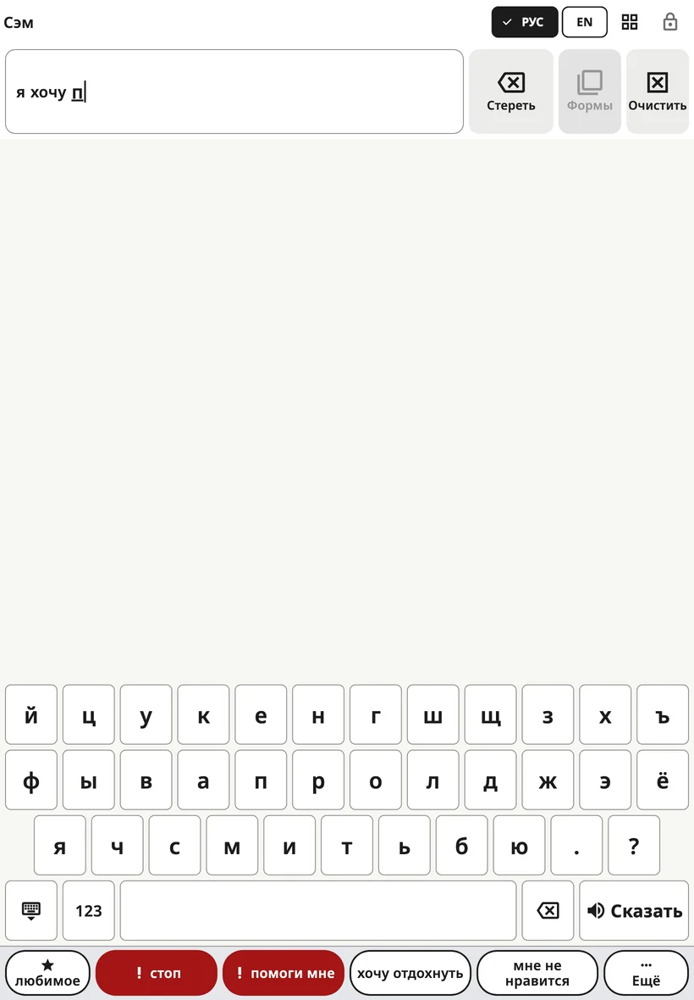

<!-- description: Как печатать в Amalino: открыть клавиатуру, подсказки слов, порядок букв, цифры и знаки, размер клавиш на телефоне. -->
# Клавиатура

Дети, которые знают хотя бы несколько букв, могут напечатать слова, которых нет на доске. Клавиатура открывается на месте доски, так что переключиться между ними можно одним касанием.

## Как открыть и закрыть клавиатуру

Нажмите **кнопку клавиатуры** на верхней панели. Чтобы вернуться к картинкам, нажмите ту же кнопку ещё раз (теперь на ней сетка) или **клавишу закрытия** в левом нижнем углу клавиатуры.

## Как печатать

- Слово, которое печатает ребёнок, появляется в **строке сообщения**, и ребёнок видит, как оно растёт.
- **Пробел** заканчивает слово.
- **Клавиша ⌫** стирает букву. Если её удерживать, буквы стираются дальше.
- Клавиша **{app:kbSpeak}** произносит всё сообщение.
- Клавиша **123** открывает цифры и знаки препинания, в том числе знаки, особые для каждого языка (¿ ¡ в испанском, » « в датском, « » в русском и украинском, „ “ в литовском, ؟ ، в арабском). Клавиша **ABC** возвращает к буквам.
- Клавиша **´** ставит знак ударения в любом порядке: можно набрать букву и нажать ´, а можно сначала нажать ´, а потом букву. На испанской клавиатуре она стоит после ñ и даёт á é í ó ú; повторное нажатие убирает знак, а на u даёт сначала ú, потом ü (pingüino). На датской клавиатуре она на странице **123** и даёт é, как в idé, café и én.
- Если нажать ´ до буквы (в начале слова или после согласной), клавиша темнеет, а в строке сообщения появляется светлый знак ´: его получит следующая гласная. Любая другая клавиша, повторное нажатие ´ или **клавиша ⌫** его отменяют. На датской клавиатуре буквы возвращаются сами.

Кнопки **{app:barDelete}** и **{app:barClear}** у строки сообщения работают так же, как на доске.

На телефоне при касании буква показывается крупнее над пальцем, чтобы ребёнок видел, на какой он клавише, прежде чем отпустить палец. Этого не происходит, если включена настройка **{app:activateOnRelease}** и задано **{app:holdTime}**: тогда клавиша и так темнеет, пока её удерживают.

## {app:kbSuggestions}

Над клавишами есть строка, где по мере печати появляются подсказки слов. Нажатие добавляет слово и пробел. Подсказки берутся:

- из слов на досках ребёнка,
- из того, что ребёнок печатал раньше, если включена настройка **{app:kbLearn.anon}**,
- из списка слов для этого языка.

В испанском и датском слово можно набирать без этих знаков: на cancion появится подсказка canción, на ide — idé.

Подсказки создаются на устройстве; ничего никуда не отправляется.

Некоторые семьи выключают подсказки, пока ребёнок учится писать слова: **{app:sectionSettings}** → **{app:kbSettings}** → **{app:kbSuggestions}**.

Если включена функция **{app:aiPhrase}** (в разделе **{app:sectionSettings}** → **{app:kbSettings}**), то по первым буквам, например «яхнпг», может появиться дополнительная подсказка «я хочу на площадку гулять». Ребёнок может выбрать её или не обращать на неё внимания.

## Порядок букв

**{app:sectionSettings}** → **{app:kbSettings}** → **{app:kbLayout}**:

- **{app:kbLayoutStandard}**: обычная клавиатура этого языка.
- **{app:kbLayoutAbc}**: буквы в алфавитном порядке, в тех же рядах, так что клавиатура не меняет размер.

## Размер клавиш на телефоне

На телефоне в языке, где много букв, клавиши получаются узкими. **{app:sectionSettings}** → **{app:kbSettings}** → **{app:kbKeySize}**:

- **{app:kbKeySizeAuto}** (по умолчанию) — по настройкам касания: если ребёнку нужны кнопки побольше или касания неточные, длинные ряды букв делятся надвое с сохранением порядка букв, так что каждая клавиша получается не меньше 40 пунктов (около 6 мм) в ширину.
- **{app:kbKeySizeStandard}** — ряды всегда обычные.
- **{app:kbKeySizeLarger}** — длинные ряды делятся всегда.

Если телефон повернуть горизонтально, клавиши и так широкие, поэтому ряды не делятся. На планшетах ряды всегда обычные.

## Если телефон повёрнут горизонтально

Если на телефоне для доски выбрана альбомная ориентация, клавиатуре нужна вся высота экрана. Тогда «**стоп**» и «**помоги мне**» переезжают в конец строки подсказок — каждый раз на одно и то же место. Вся строка фраз возвращается, когда вы снова переходите к доске.

> **Совет.** Показывайте и то, как печатать. Медленно напечатайте слово, проговаривая его, а затем нажмите **{app:kbSpeak}**.

Далее: [Сцены](scenes.md).
