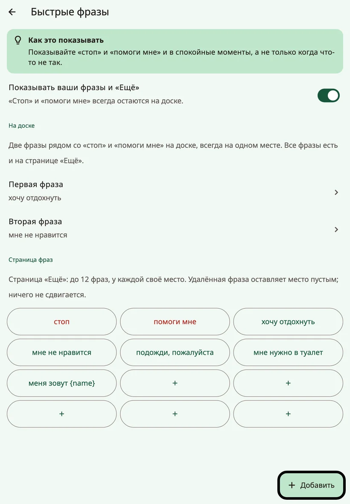
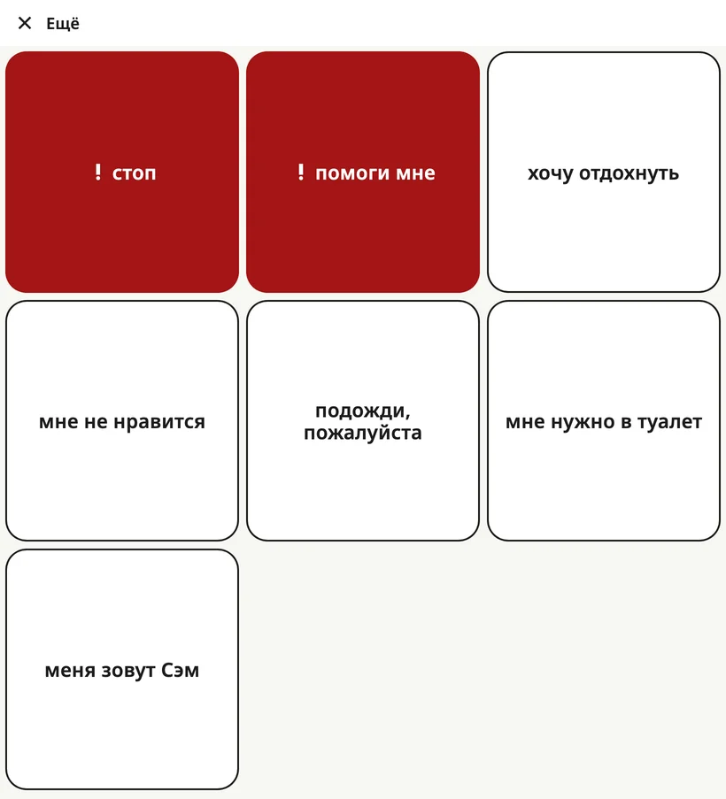

<!-- description: Строка фраз внизу доски Amalino: «стоп», «помоги мне», две фразы семьи, папка «{app:favourites}» и страница «{app:quickMore}» со всеми фразами. -->
# Быстрые фразы и «{app:quickMore}»

Кое-что нужно сказать быстро, не составляя фразу. **Строка фраз** внизу доски держит такие слова на расстоянии одного касания — на любой странице.

## Строка фраз

Слева направо:

1. **★ {app:favourites}** — открывает папку «{app:favourites}».
2. **! стоп**
3. **! помоги мне**
4. **Первая фраза семьи**
5. **Вторая фраза семьи**
6. **{app:quickMore}** — открывает страницу со всеми фразами.

Каждая кнопка стоит на своём месте — во всех языках и на всех страницах. «**Стоп**» и «**помоги мне**» есть всегда, и они всегда красные: это срочные фразы. Все четыре кнопки фраз одной ширины, поэтому длинная фраза никогда ничего не отодвигает, а просто переносится на вторую строку.

Нажатие на фразу сразу её произносит. В строку сообщения она не попадает.

## Как выбрать две фразы семьи

Откройте настройки для взрослых и выберите **{app:quickPhrases}**. В разделе **{app:qpOnBoard}** заполните поля **{app:qpPick1}** и **{app:qpPick2}** для мест рядом со «стоп» и «помоги мне». Возьмите те две, которые нужны ребёнку чаще всего, например «хочу отдохнуть» и «мне не нравится».

## Страница «{app:quickMore}»

Кнопка **{app:quickMore}** открывает страницу, на которой до 12 фраз, у каждой своё постоянное место. Нажатие на фразу произносит её и закрывает страницу; **{app:close}** возвращает назад, ничего не произнося.

На экране **{app:quickPhrases}**, в разделе **{app:qpPage}**, можно:

- **{app:add}** фразу и выбрать для неё **{app:qpPlace}**,
- **{app:edit}** фразу или отметить её как **{app:qpUrgent}**, чтобы она стала красной,
- **{app:delete}** фразу. Её место останется пустым, остальные не сдвинутся.

Когда страница заполнена, удалите какую-нибудь фразу или нажмите **{app:makePhraseBoard}**, чтобы превратить фразы в папку, где хватит места для новых.

Фразы с именем ребёнка, например «Меня зовут…», появляются, когда вы добавите имя.

## {app:favourites}

В папке **{app:favourites}** — то, что ребёнок любит больше всего: пять любимых вещей из настройки и всё, что вы добавите позже. С любой страницы до неё одно касание — через кнопку **★ {app:favourites}**.

На основной доске для папки «{app:favourites}» тоже оставлено одно место. Когда вы выбираете, куда поставить новую кнопку, оно отмечено надписью **{app:pickCellFavouritesNote}**.

На маленьких телефонах на кнопке ★ может быть только звёздочка без слова. Работает она так же.

## Как скрыть фразы семьи

Если строка фраз отвлекает ребёнка, выключите **{app:showQuickPhrases}** на экране **{app:quickPhrases}**. Ваши две фразы и кнопка **{app:quickMore}** исчезнут, но «**стоп**» и «**помоги мне**» всегда остаются на доске, на тех же местах: часто это самые важные слова, которые есть у ребёнка. Кнопка **★ {app:favourites}** тоже остаётся.

> **Совет.** Показывайте «стоп» и «помоги мне» и в спокойные минуты, а не только когда что-то идёт не так.

Далее: [Клавиатура](keyboard.md).
