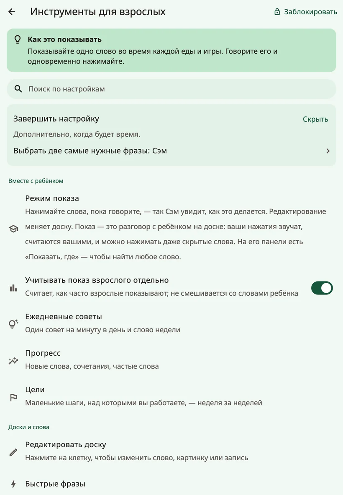
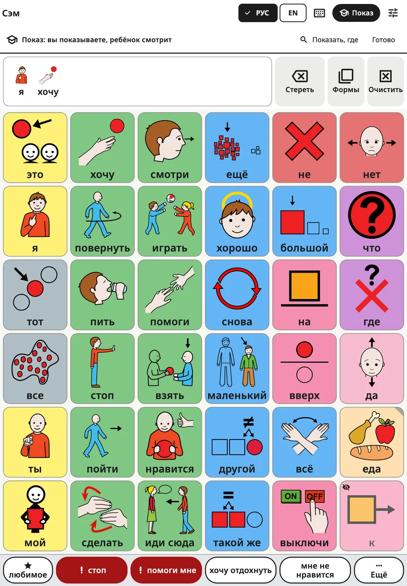
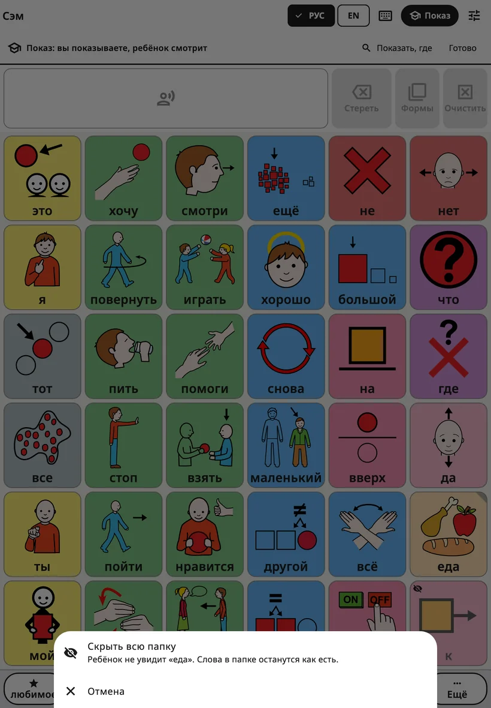
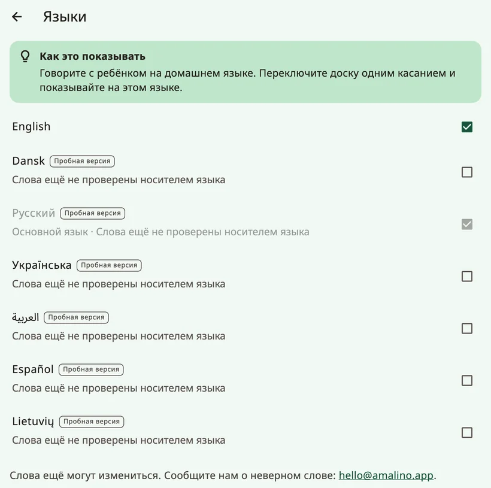
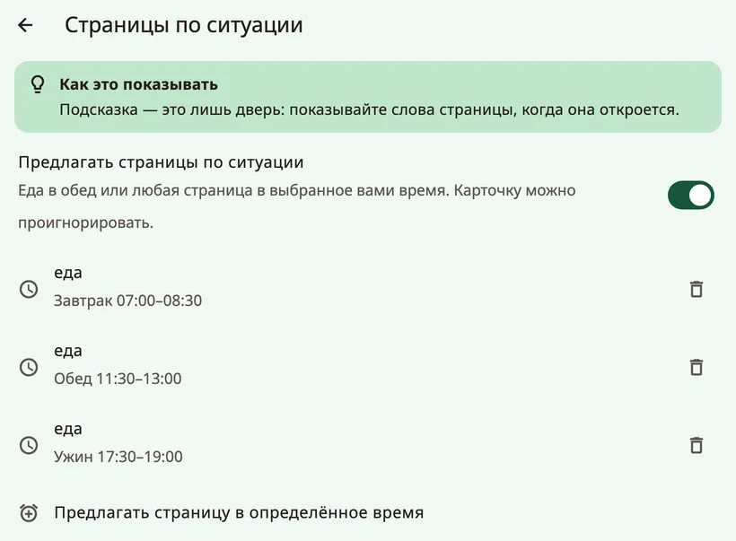

<!-- description: Все экраны настроек для взрослых в Amalino: показ, слова, голоса, касание, экран, расположение слов, клавиатура, подсказки, замок и данные. -->
# Настройки: экран за экраном

Чтобы открыть настройки для взрослых, удерживайте замок вверху доски 3 секунды и решите пример на цифровых клавишах. Настройки разделены на четыре группы: **{app:sectionTogether}**, **{app:sectionBoards}**, **{app:sectionSettings}** и **{app:sectionData}**. На этой странице они описаны в том порядке, в каком вы их видите. В этом руководстве «{app:sectionSettings} → …» означает группу **{app:sectionSettings}** внутри настроек для взрослых, а не приложение «Настройки» на вашем устройстве.

На большинстве экранов есть короткий совет — **{app:tipTitle}**.

## Как найти настройку

Не помните, где что-то находится? Нажмите **{app:searchSettings}** вверху и введите слово, например «голос» или «цвет». У каждого результата указано, где он находится («{app:speechVoice} → {app:speechRate}»). Нажмите на него, и Amalino откроет этот экран, ненавязчиво выделив нужную настройку.

## {app:sectionTogether}

### {app:modellingMode}

Кнопка **{app:edit}** меняет доску. А **{app:modelShort}** — для разговора с ребёнком с помощью доски: вы нажимаете слова, пока говорите, чтобы показать, как это делается. Ваши нажатия звучат и засчитываются как ваши, а не как слова ребёнка.

Быстрее всего так: пока настройки для взрослых открыты, нажмите **{app:modelShort}** на верхней панели доски (на телефоне — значок с академической шапочкой). Пункт **{app:modellingMode}** в меню делает то же самое. Вверху появляется строка «{app:modellingOn}». В этой строке кнопка **{app:showMeWhere}** найдёт для вас слово: введите его, и Amalino покажет путь к нему, кнопку за кнопкой.

- **Скрытые слова** видны бледными, с маленьким перечёркнутым глазом, — на тех местах, где они потом появятся у ребёнка. Нажимайте их, как любые другие слова: так ребёнок услышит и увидит эти слова задолго до того, как они появятся на его собственной доске. Ребёнок при этом по-прежнему видит пустое место.
- **{app:showToChild}**: когда вам покажется, что ребёнок готов, удерживайте скрытое слово и выберите **{app:showToChild}**. Кнопка **{app:undo}** вернёт всё как было.
- **Скрыть слово или целую папку**: удерживайте слово, которое ребёнок видит, и выберите **{app:hideFromChild}**. Если удерживать кнопку папки, можно сразу показать или скрыть всю папку; быстрое нажатие по-прежнему её открывает.

- **Режим заканчивается сам** через две минуты после вашего последнего нажатия, а также всякий раз, когда закрывается замок для взрослых, так что ребёнок никогда не останется в режиме показа. Чтобы закончить самим, нажмите **{app:done}** или ещё раз **{app:modelShort}**.

Подробнее — на странице [Советы для семьи](tips-for-families.md).

Рядом есть настройка **{app:logModelTaps}**: она считает, как часто показывают взрослые, и никогда не смешивает это со словами ребёнка.

### {app:coaching}

Каждый день — один совет о показе на 60 секунд, а также **{app:wordOfWeek}**: до 3 слов, которые взрослые показывают на этой неделе; в режиме показа они подсвечиваются. **{app:dailyReminder}** присылает уведомление в выбранное вами время; разрешение на уведомления приложение спросит только тогда, когда вы включите напоминание.

Здесь же есть раздел **{app:mythBuster}**: короткие ответы на частые опасения («{app:myth.speech.q}») со ссылками на исследования.

### {app:progress} и {app:goals}

- **{app:progress}**: новые слова, сочетания слов и самые частые слова. Сводка **{app:thisWeek}** в нескольких строках подводит итог недели: ею можно поделиться со всеми, кто общается с ребёнком, и в ней есть одно слово, которое стоит показывать дальше.
- **{app:goals}**: маленькие шаги, над которыми вы работаете неделя за неделей, например сколько дней ребёнок пользовался приложением, новые слова или число слов во фразе.

Используйте эти цифры, чтобы решить, что показывать дальше, а не чтобы проверять ребёнка.

## {app:sectionBoards}

- **{app:editBoard}**: см. [Редактирование и перемещение кнопок](editing.md). Там же слова показываются и скрываются.
- **{app:quickPhrases}**: см. [Быстрые фразы и «{app:quickMore}»](quick-phrases.md).
- **{app:languages}**: основной язык и остальные языки. У языков, слова которых ещё проверяются, есть пометка **{app:languagePreview}** и строка о том, как сообщить о неверном слове. **{app:englishSpelling}** (британское или американское) можно выбрать отдельно на каждом устройстве. **{app:translationReview}** показывает для каждого языка слова, которые ещё нужно проверить, чтобы вы могли проверить или исправить их. В пункте **{app:offlineTranslationHeader}** такой перевод настраивается для каждого из остальных языков ребёнка; см. [Редактирование и перемещение кнопок](editing.md).
- **{app:boardBuilder}**: введите тему, например «день рождения», и получите готовую страницу для неё. Это работает на устройстве и знает около 20 повседневных тем (день рождения, врач, парк, купание, перед сном, зоопарк, пляж и другие). Перед сохранением вы проверяете слова.
- **{app:symbolSets}**: встроенные картинки ARASAAC, старые картинки Mulberry, которые ещё есть на некоторых досках, ваши собственные фото и необязательный поиск по всем картинкам ARASAAC (около 13 000) — картинка скачивается, когда вы её выбираете. Кнопка «**{app:useNewPictures}**» ставит новые картинки вместо старых у тех встроенных слов, где картинка ещё не менялась. Ваши собственные картинки и фото сохраняются. ARASAAC бесплатен для некоммерческого использования.
- **{app:printBoards}**: см. [Резервные копии, обмен и печать](sharing-and-printing.md).

## {app:sectionSettings}

### {app:settingsChildName.anon}

Имя и то, как оно пишется на каждом языке. Здесь же можно задать, как имя произносится. Подробнее — на странице [Голоса](voices.md).

### {app:speechVoice}

Голос для каждого языка, **{app:useForAll|voice=…}**, **{app:personalVoice}**, **{app:speechRate}**, **{app:voiceAge}**, **{app:volume}** и **{app:soundCheck}**. **{app:pitch}** видна, только пока звучит один из собственных голосов устройства. **{app:savedSpeech}** — в самом конце, в разделе **{app:advanced}**. Подробнее — на странице [Голоса](voices.md).

### {app:touchAccess}

Как доска реагирует на касания. Меняйте что-то одно за раз и несколько дней наблюдайте за ребёнком.

Пункт **{app:accessMethod}** показывает касание экрана; другие способы выбора помечены: **{app:comingLater}**. **{app:highlightSpeaking}** мягко подкрашивает кнопку, пока звучит её слово.

Всё остальное — в разделе **{app:touchTuning}**:

- **{app:holdTime}**: палец должен пробыть на кнопке столько времени, прежде чем она заговорит. Помогает, когда рука случайно задевает экран, но быстрое нажатие тогда не сработает. Если задано время удержания, формы слова открываются только кнопкой **{app:barForms}**.
- **{app:repeatIgnore}**: второе нажатие на ту же кнопку вскоре после первого не учитывается.
- **{app:activateOnRelease}**: ребёнок может довести палец до нужной кнопки, прежде чем нажатие засчитается.
- **{app:targetEnlargement}**: каждая кнопка реагирует и чуть за своим краем.
- **{app:tremorFilter}**: при дрожащих руках засчитывается кнопка, на которую пришлось одно из двух: **{app:tremor.firstLanding}** или **{app:tremor.longestDwell}**.
- **{app:palmRejection}**: ладонь или рука, лежащая на экране, не нажимает кнопки.
- **{app:practice}**: тренировочная доска, которая считает нажатия, отброшенные касания и промахи между кнопками.

### {app:displaySensory}

Как выглядит доска. Здесь всё можно смело пробовать: ничего не сдвигается.

- **{app:theme}**: **{app:theme.standard}**, **{app:theme.calm}**, **{app:theme.dark}**, **{app:theme.highContrast}** или **{app:theme.teen}**.
- **{app:colourCoding}**: **{app:palette.fitzgerald}**, **{app:palette.calm}**, **{app:palette.colorBlindSafe}** или **{app:palette.none}**. **{app:borderOnly}** делает вид спокойнее.
- **{app:showLabels}**, **{app:labelOnTop}** и **{app:textSize}**.
- **{app:reduceMotion}**: как в настройках устройства, или всегда включено, или всегда выключено.

### {app:boardLayout}

«{app:boardLayoutNote}»

- **{app:gridSize}**: см. [Слова и папки](words-and-folders.md). На планшете появляется пометка, если при 84 кнопках в вертикальном положении некоторые длинные слова не поместятся целиком.
- **{app:boardOrientation}**: только для телефонов. Доска, клавиатура и сцены остаются вертикальными (или горизонтальными), а экраны для взрослых по-прежнему поворачиваются. Если в другой ориентации помещается меньше кнопок, Amalino спросит, прежде чем что-то менять.
- **{app:vocabLevel}**: см. [Слова и папки](words-and-folders.md).
- **{app:earlyMode}**: совсем простые большие кнопки, которые сразу произносят слово, без строки сообщения. Полный словарь при этом остаётся в запасе.
- **{app:cellGap}**.

### {app:messageBar}

- **{app:showMessageBar}**.
- **{app:speakEachWord}** (по умолчанию включено). Если выключить, нажатие на слово только добавляет его в сообщение, и ничего не звучит, пока не нажмут на строку сообщения.
- **{app:clearAfterSpeak}**.
- **{app:grammarHelper}**: удерживайте слово, чтобы выбрать другую форму («собаки», «пошёл», «больше»…). Включено во всех языках. Подробнее — на странице [Доска ребёнка](the-board.md).

### {app:kbSettings}

**{app:kbSuggestions}**, **{app:kbLearn.anon}**, **{app:aiPhrase}**, **{app:kbLayout}** и **{app:kbKeySize}**. Подробнее — на странице [Клавиатура](keyboard.md).

### {app:aiHelpers}

Помощники, которые подсказывают слова. Они никогда не говорят за ребёнка, и выбирает всегда сам ребёнок. Каждый помощник включается отдельно, и все они выключены, пока вы их не включите. Работают они на устройстве:

- **{app:aiNextWord}**: мягко обводит 2–3 кнопки. Кнопки никогда не сдвигаются. Учится только на этом устройстве.
- **{app:contextBoards}**: предлагает страницу в определённое время суток, например страницу с едой в обед. Учитывается только время суток, но никогда не ваше местоположение или календарь. Страницу предлагает карточка на доске: одно нажатие её открывает, а ребёнок может не обращать на неё внимания. На этом экране включите **{app:aiContext}**, затем нажмите **{app:addMealRules}** или **{app:addTimeRule}**, чтобы выбрать страницу и время.
- **{app:aiListen}**: когда вы включаете микрофон на верхней панели, устройство слушает, что вы говорите, и подсвечивает слова, которыми ребёнок мог бы ответить. Речь распознаётся на устройстве; звук никогда не сохраняется и не отправляется. Для этого один раз нужно скачать модуль распознавания речи.

### {app:lockAndKeep}

- **{app:editLock}**: **{app:lockChallenge}** или **{app:lockPin}** (4–8 цифр); и то и другое вводится на цифровых клавишах на экране. PIN-код задаётся для устройства: один и тот же PIN открывает настройки для взрослых для всех детей на нём. Если на устройстве нет блокировки экрана, Amalino сначала покажет **код восстановления**: запишите его и храните отдельно от устройства. Если вы забудете PIN-код, нажмите **{app:forgotPin}** и задайте новый с помощью блокировки экрана или кода восстановления.
- **{app:holdSeconds}**: сколько нужно удерживать замок.
- **{app:relockAfter}**: через сколько времени настройки для взрослых закрываются сами.
- **{app:guidedAccess}**: пошаговые инструкции для функции «Гид-доступ» на iPad и iPhone и для закрепления приложения на Android (на планшетах Samsung — также Samsung Kids). Ребёнок по-прежнему может говорить, он просто не может выйти из приложения.

## {app:sectionData}

- **{app:historyBackups}**: отменить любое изменение, сделать резервную копию сейчас, экспортировать её с паролем или восстановить. Подробнее — на странице [Резервные копии, обмен и печать](sharing-and-printing.md).
- **{app:openBoardFormat}**: перенос досок в другие приложения АДК и из них. Подробнее — на странице [Резервные копии, обмен и печать](sharing-and-printing.md).
- **{app:profiles}**: у каждого ребёнка свои доски и слова. **{app:addChild}** — для брата или сестры на том же устройстве.
- **{app:about}**: конфиденциальность, ссылка на страницу **{app:privacyPolicy}**, лицензии картинок и голосов, а также обратная связь. **{app:diagnostics}** в самом конце показывает технические подробности, например, как быстро нажатие превращается в речь. Если что-то не работает, я могу попросить вас прислать эти данные.

## Что появится позже

Некоторым функциям нужен онлайн-сервис: это **{app:syncTitle}** между устройствами, **{app:library}**, **{app:lessonPages}** и **{app:aiCloud}**. В этой версии приложения такого сервиса нет, поэтому в меню этих пунктов нет.

Далее: [Голоса](voices.md).
