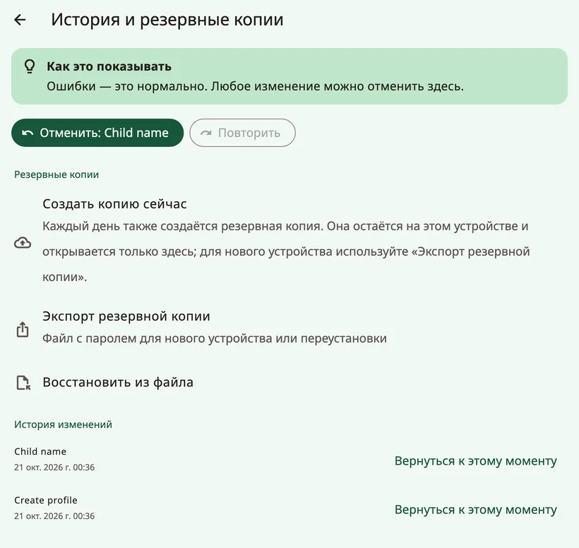
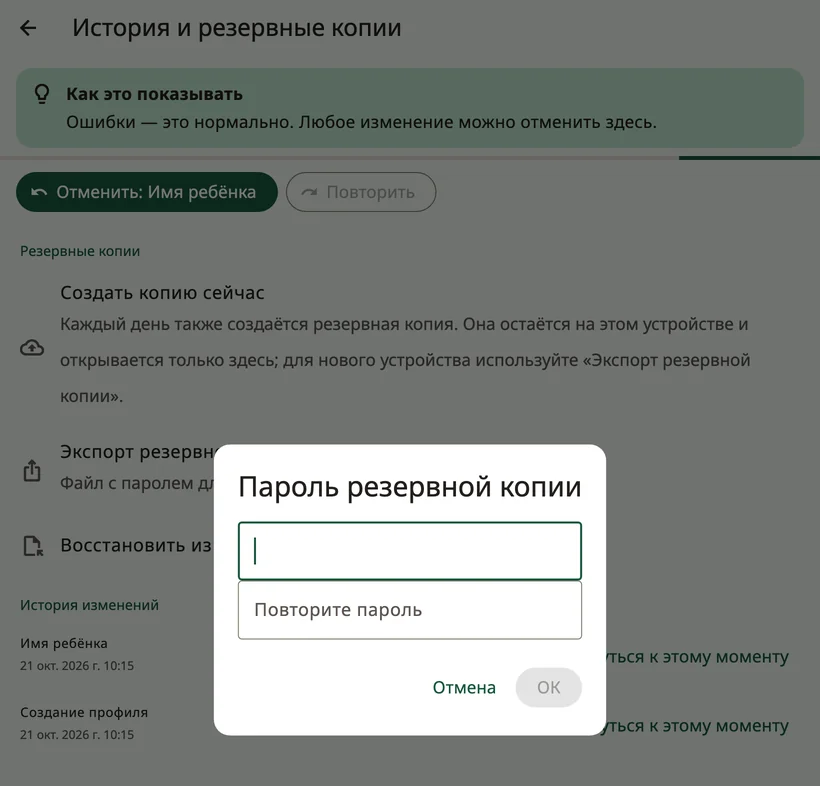
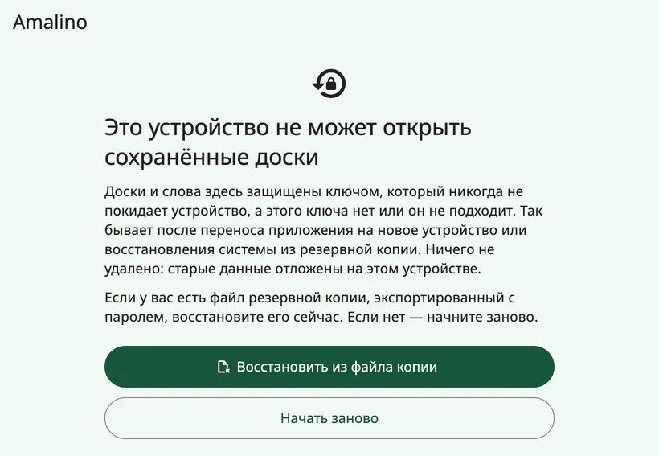
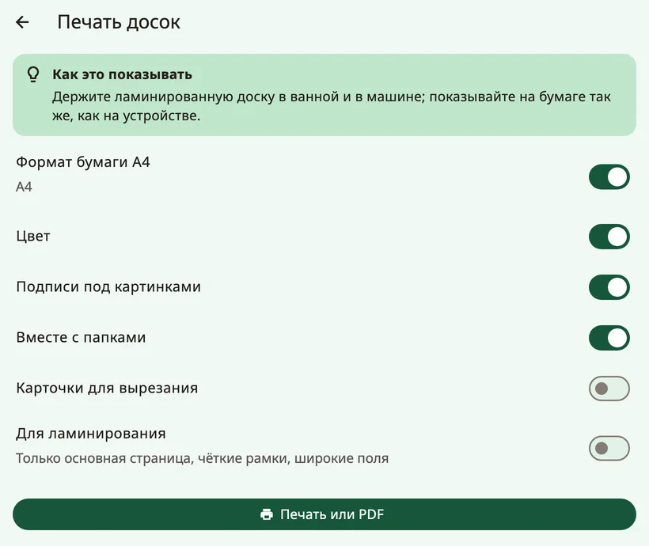

<!-- description: Как сделать резервную копию досок ребёнка в Amalino, перенести их на новое устройство, обменяться досками с другими приложениями АДК и распечатать их. -->
# Резервные копии, обмен и печать

Доски ребёнка — это ценность: месяцы слов, фотографий и записей. Здесь рассказано, как их сберечь, перенести на другое устройство и распечатать.

## Резервные копии

Откройте настройки для взрослых и выберите **{app:historyBackups}**.

- Резервная копия создаётся **автоматически каждый день**. Она остаётся на устройстве и открывается только на том устройстве, где была сделана. Поэтому она защищает от ошибок, но не от потери устройства.
- Кнопка **{app:backupNow}** делает копию сразу.
- **{app:exportBackup}** создаёт файл, защищённый паролем, — для нового устройства или переустановки. Выберите пароль, который вы запомните, и храните файл не на этом устройстве: на компьютере, в облаке или в письме самому себе.

Если копии вне устройства нет или последней больше месяца, в настройках для взрослых появляется ненавязчивое напоминание с кнопкой **{app:backupReminderMake}** (в первые две недели нового профиля — никогда). Кнопка **{app:notNow}** скрывает его на две недели.

### Резервная копия самого устройства

- **iPhone и iPad**: если вы делаете резервную копию устройства в iCloud или на компьютер, данные Amalino попадают в неё.
- **{app:ga.androidTitle|label}**: данные Amalino не копируются ни в резервную копию Google, ни на другое устройство. Чтобы перейти на новое устройство, используйте **{app:exportBackup}**.

## Переход на новое устройство

1. На старом устройстве откройте настройки для взрослых, затем **{app:historyBackups}** (в группе **{app:sectionData}**) → **{app:exportBackup}** и задайте пароль.
2. Отправьте файл на новое устройство через AirDrop, Quick Share, электронную почту, облако или USB-кабель.
3. Установите Amalino на новое устройство. На первом экране настройки нажмите **{app:alreadyUse}**, затем **{app:restoreBackup}** и **{app:chooseFile}**.
4. Введите пароль.

Чтобы восстановить данные на устройстве, которое уже настроено, нажмите **{app:importBackup}** в разделе **{app:historyBackups}**. Все доски, записи и журналы на устройстве будут заменены; перед этим Amalino сделает резервную копию того, что есть на устройстве сейчас.

Автоматическую копию с другого устройства восстановить нельзя: она открывается только на том устройстве, где была сделана. Используйте резервную копию, экспортированную с паролем.

## Если Amalino не может открыть сохранённые доски

Доски защищены ключом, который никогда не покидает устройство. Если ключа нет или он не подходит — например, после переноса приложения на новое устройство или восстановления системной резервной копии, — при запуске Amalino показывает сообщение **{app:dataRecoveryTitle}**. Ничего не удалено: старые данные хранятся на устройстве отдельно.

- **{app:dataRecoveryRestore}**: выберите резервную копию, которую вы экспортировали с паролем, и введите пароль.
- **{app:dataRecoveryFresh}**: пройти настройку с самого начала.

Если вы вдруг увидите сообщение **{app:startupFailedTitle}**, полностью закройте приложение и откройте его снова. Если это повторяется, перезагрузите устройство. Ваши доски не удалены.

## Обмен досками с другими приложениями АДК

Пункт **{app:openBoardFormat}** в группе **{app:sectionData}** настроек для взрослых переносит доски в другие приложения АДК и из них, если они поддерживают этот открытый формат:

- **{app:exportAllBoards}** или **{app:exportThisBoard}**.
- **{app:importObz}**, например из Cboard. Импортированные доски добавляются как папки. Amalino сообщит, сколько кнопок он связал со знакомыми ему словами.

Импортировав доску, проверьте, что её слова стоят на местах, которые ребёнок уже знает.

## Печать

**{app:printBoards}** делает бумажную копию — для купания, бассейна, поездки или на случай, если устройство сломалось.

- **{app:paperA4}**: страницы формата A4.
- **{app:colour}**: выключите, чтобы печатать в чёрно-белом виде.
- **{app:showLabels}**: под каждой картинкой печатается слово.
- **{app:includeFolders}**: печатаются и страницы папок, а не только основная доска.
- **{app:cutOut}**: отдельные картинки, чтобы вырезать.
- **{app:waterproof}**: только страница основных слов, с чёткими рамками и широкими полями.

Нажмите **{app:printOrSave}**, чтобы распечатать сразу или сохранить PDF и распечатать позже.

> **Совет.** Держите заламинированную доску с основными словами в ванной и в машине и показывайте на бумаге точно так же, как на устройстве.

Далее: [Советы для семьи](tips-for-families.md).
