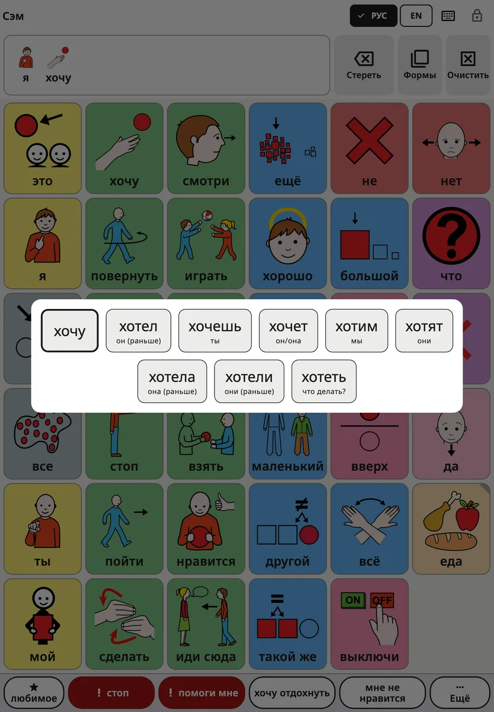
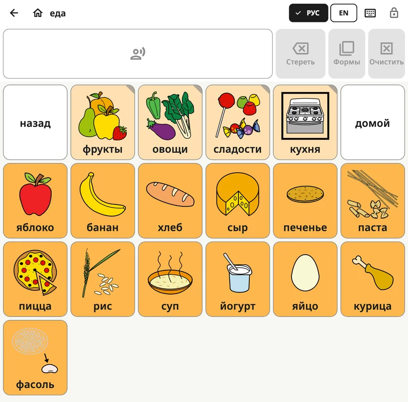

<!-- description: Что видит ребёнок в Amalino: доска, верхняя панель, строка сообщения, формы слов, как произнести фразу и как переключить язык. -->
# Доска ребёнка

Доска — это экран, которым ребёнок пользуется весь день. Настройки для взрослых закрыты замком, поэтому ребёнок может спокойно всё на ней исследовать.

## Из чего состоит экран

Сверху вниз:

1. **Верхняя панель**: имя ребёнка (а внутри папки — название доски), кнопки языков, кнопка клавиатуры и замок.
2. **Строка сообщения**: слова, которые выбрал ребёнок, а рядом кнопки **{app:barDelete}**, **{app:barForms}** и **{app:barClear}**.
3. **Доска**: кнопки с картинками и словами.
4. **Строка фраз**: «{app:favourites}», «стоп», «помоги мне», две фразы семьи и «{app:quickMore}». Подробнее — на странице [Быстрые фразы и «{app:quickMore}»](quick-phrases.md).

## Как сказать слово и фразу

Когда ребёнок нажимает на кнопку, её слово звучит и добавляется в строку сообщения. Нажимая на другие кнопки, ребёнок составляет фразу: «я», «хочу», «ещё».

- **Нажмите на строку сообщения**, чтобы произнести всю фразу целиком.
- Кнопка **{app:barDelete}** убирает последнее слово.
- Кнопка **{app:barClear}** удаляет всё сообщение.

Как это работает, можно изменить в разделе **{app:sectionSettings}** → **{app:messageBar}**: например, чтобы слова звучали, только когда нажимают на сообщение, или чтобы сообщение очищалось после того, как прозвучало.

## Формы слов

Слова меняются: «собака» и «собаки», «пойти» и «пошёл», «большой» и «больше». Меню форм слова показывает другие формы слова большими кнопками. Нажатие на форму ставит её в сообщение и произносит. Исходное слово всегда стоит первым, так что ребёнок всегда может к нему вернуться.

Открыть меню можно тремя способами:

- **Удерживать слово** на доске чуть дольше обычного.
- **Удерживать строку сообщения**, чтобы изменить последнее слово.
- Нажать **{app:barForms}** рядом со строкой сообщения. Эта кнопка меняет последнее слово и становится серой, если у этого слова нет других форм.

Если для ребёнка задано **{app:holdTime}** (в настройках для взрослых → **{app:sectionSettings}** → **{app:touchAccess}**), удержание слова просто произносит его. Чтобы открыть формы слова, нажмите **{app:barForms}**.

Меню включено во всех языках. Чтобы его выключить, откройте **{app:sectionSettings}** → **{app:messageBar}** → **{app:grammarHelper}**.

## Папки

Некоторые кнопки открывают папку со связанными словами, например «еда», «места» или «чувства». У кнопки папки загнут уголок.

Внутри папки на верхней панели появляются стрелка **{app:back}** и кнопка **{app:home}**. Кнопка **{app:home}** всегда возвращает на основную доску.

## Переключение языков

Если ребёнок пользуется несколькими языками, на верхней панели есть кнопка для каждого из них (EN, DA, ES, РУС, УКР, عربي, LT). Одно касание переключает всю доску. Каждое слово во всех языках остаётся на своём месте.

На небольших экранах вместо них одна кнопка языка: она открывает короткий список.

## Почему кнопки никогда не сдвигаются

У каждого слова на доске своё место, и оно там остаётся. Ребёнок запоминает, где какое слово, — так же, как вы запоминаете, где буквы на клавиатуре, — и вскоре находит их не глядя.

Поэтому:

- если повернуть планшет, раскладка доски не меняется;
- на телефоне доска по умолчанию остаётся вертикальной (это можно изменить: **{app:sectionSettings}** → **{app:boardLayout}** → **{app:boardOrientation}**);
- новые слова со временем появляются на своих местах и не отодвигают другие. Подробнее — на странице [Слова и папки](words-and-folders.md).

## Замок

Замок в правом верхнем углу открывает настройки для взрослых. Удерживайте его 3 секунды, а затем решите короткий пример на цифровых клавишах (или введите PIN-код, если вы его задали). Быстрое нажатие ничего не делает, так что случайно ребёнок настройки не откроет.

Как сделать так, чтобы ребёнок не мог выйти из приложения, описано в разделе **{app:lockAndKeep}** на странице [Настройки](settings.md).

## Предупреждения на доске

Если батарея почти разряжена или звук выключен либо слишком тихий, под верхней панелью появляется короткая строка, например «{app:warn.muted}».

Далее: [Слова и папки](words-and-folders.md).
